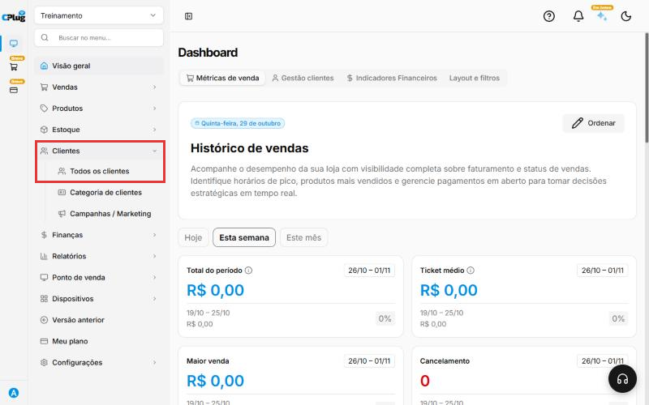
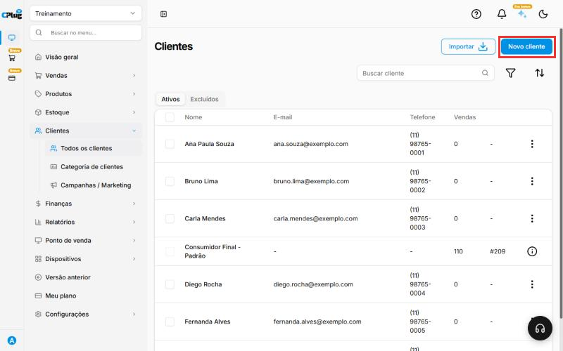
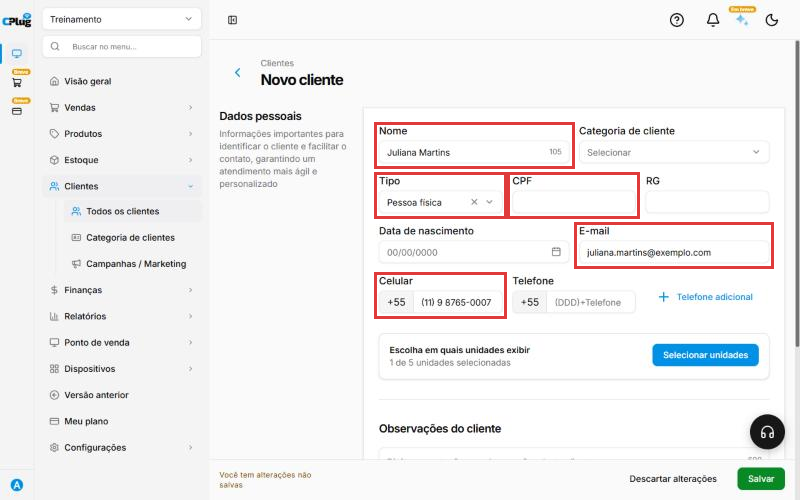
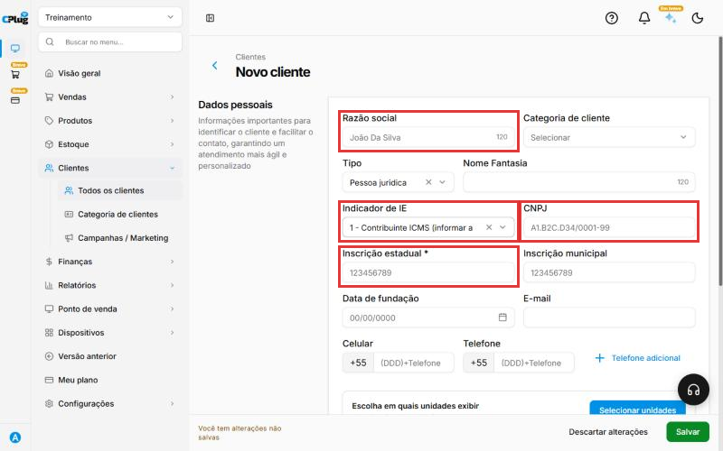
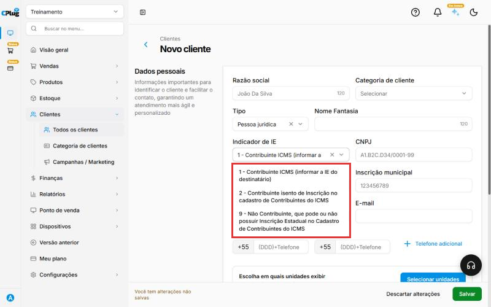
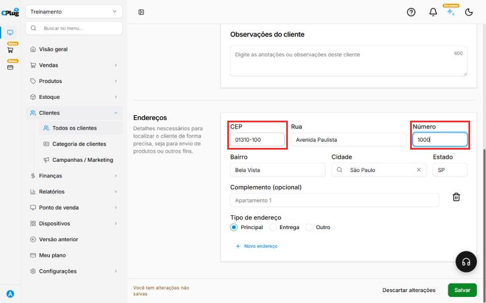
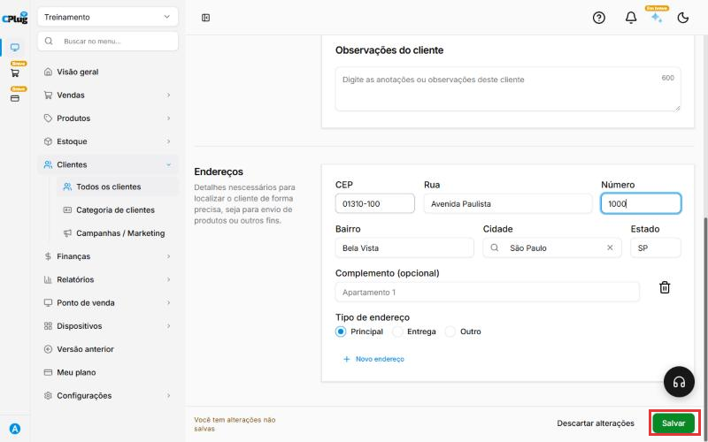
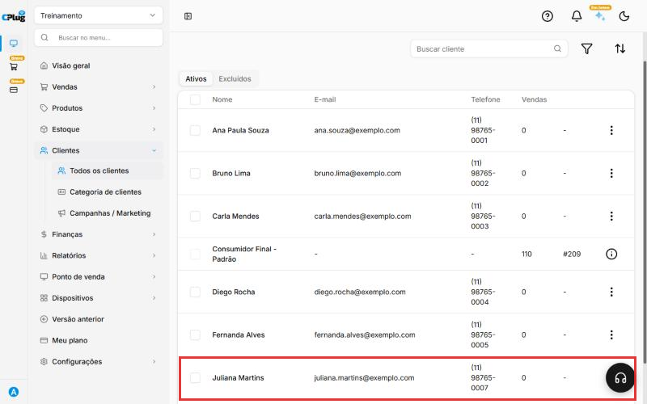

# Como cadastrar um cliente

:material-clock-outline: 3 minutos · :material-format-list-numbered: 7 passos · :material-calendar-check: Atualizado em 29/10/2026

Para salvar um cliente, basta o **nome**. Mas, se você vai **emitir nota fiscal** para ele, o cadastro precisa estar completo. Sem CPF ou CNPJ e sem endereço completo, a nota é recusada pela Sefaz.

!!! warning "Vai emitir nota fiscal (NF-e) para este cliente?"
    Preencha **todos** estes dados, senão a nota não é autorizada:

    | Pessoa física | Pessoa jurídica (empresa) |
    | --- | --- |
    | Nome completo | Razão social |
    | CPF | CNPJ |
    | Endereço completo: CEP, rua, número, bairro, cidade e estado | Indicador de IE e, se for contribuinte, a Inscrição estadual |
    | | Endereço completo: CEP, rua, número, bairro, cidade e estado |

    No **cupom fiscal do caixa (NFC-e)** é diferente: o cliente pode nem ter cadastro. O CPF só vai no cupom se o cliente pedir. Em vendas de valor alto, a identificação do consumidor pode ser obrigatória. Confirme com seu contador.

!!! info "Antes de começar, tenha em mãos"
    - **Pessoa física:** nome completo, CPF, celular, e-mail e endereço com CEP.
    - **Empresa:** cartão CNPJ (ele mostra razão social, CNPJ e endereço) e a Inscrição estadual, se a empresa tiver.

Nos prints, o **quadrado vermelho** mostra onde você deve clicar ou digitar.

## Abra a tela de clientes

No menu do lado esquerdo, clique em **Clientes**. Depois clique em **Todos os clientes**.

{ loading=lazy }

## Clique em "Novo cliente"

Você vai ver a lista dos clientes que já existem. No canto de cima, à direita, clique no botão azul **Novo cliente**.

{ loading=lazy }

## Escolha o tipo: pessoa física ou empresa

O campo **Tipo** já vem como **Pessoa física**. Se o cliente for uma empresa, clique nele e escolha **Pessoa jurídica**. Os campos da tela mudam de acordo com o tipo.

## Pessoa física: preencha os dados

- **Nome:** o nome completo, igual ao documento. Abreviações podem dar problema na nota.
- **CPF:** só os números. O sistema coloca os pontos e o traço sozinho. **Obrigatório para emitir NF-e.**
- **E-mail:** é para onde a nota fiscal e os recibos podem ser enviados.
- **Celular:** só os números, com DDD. Exemplo: 11987650007.

**RG** e **Data de nascimento** são opcionais.

{ loading=lazy }

## Empresa: preencha os dados fiscais

Com o **Tipo** em **Pessoa jurídica**, preencha:

- **Razão social:** o nome oficial da empresa, igual ao cartão CNPJ.
- **Nome fantasia:** o nome conhecido da loja (opcional).
- **CNPJ:** só os números e letras, sem pontos. **Obrigatório para emitir NF-e.**
- **Indicador de IE:** diz se a empresa paga ICMS. Veja a tabela abaixo.
- **Inscrição estadual:** obrigatória quando o indicador for **1 - Contribuinte ICMS**.

{ loading=lazy }

Clique em **Indicador de IE** e escolha a opção certa:

| Opção | Quando usar |
| --- | --- |
| **1 - Contribuinte ICMS** | A empresa tem Inscrição estadual. Ex.: comércio, indústria, restaurante. Digite o número da IE. |
| **2 - Contribuinte isento** | A empresa está no cadastro do ICMS, mas é isenta de inscrição. |
| **9 - Não contribuinte** | A empresa não tem Inscrição estadual. Ex.: muitas prestadoras de serviço, escritórios e condomínios. |

{ loading=lazy }

!!! tip "Não sabe se a empresa tem Inscrição estadual?"
    Pergunte ao cliente ou consulte o Sintegra do estado dele. Indicador errado é uma das causas mais comuns de nota recusada.

## Coloque o endereço

Role a tela até **Endereços** e clique em **+ Novo endereço**.

Digite o **CEP** e espere um segundo. Rua, bairro, cidade e estado aparecem sozinhos. Depois digite o **Número**. Se tiver, preencha o **Complemento** (apartamento, sala, bloco).

Para emitir **NF-e**, o endereço é **obrigatório**. Confira se a cidade e o estado vieram certos.

{ loading=lazy }

## Clique em "Salvar"

No canto de baixo, à direita, clique no botão verde **Salvar**.

{ loading=lazy }

!!! success "Como saber que deu certo"
    O sistema volta para a lista de clientes, e o cliente novo aparece com o nome, o e-mail e o telefone.

    { loading=lazy }

## Deu algum problema?

??? question "A nota fiscal foi recusada por causa do cliente"
    Abra o cadastro do cliente e confira:

    - **CPF ou CNPJ** preenchido e correto.
    - **Endereço completo**, com número e com a cidade certa.
    - Para empresa: **Indicador de IE** certo e, se for contribuinte, a **Inscrição estadual** preenchida.

    Depois de corrigir, salve o cliente e emita a nota de novo.

??? question "O sistema não deixa salvar a empresa"
    Se o **Indicador de IE** estiver em "1 - Contribuinte ICMS", a **Inscrição estadual** é obrigatória. Preencha a IE ou troque o indicador para a opção certa.

??? question "O endereço não apareceu sozinho"
    Confira se o CEP tem 8 números. Se mesmo assim não aparecer, digite rua, bairro, cidade e estado você mesmo.

??? question "Não acho o botão Salvar"
    Ele só aparece depois que você digita alguma coisa. Olhe no canto de baixo da tela, à direita.

??? question "Errei tudo e quero desistir"
    Clique em **Descartar alterações**, ao lado do Salvar. Nada é gravado.

??? question "Tenho mais de uma loja"
    O cliente aparece só na loja em que você está. Para usar em outras, clique em **Selecionar unidades** e marque as lojas antes de salvar.

consumidor comprador cadastro de cliente cpf cnpj inscrição estadual ie indicador de ie nota fiscal nf-e nfc-e rejeição recusada sefaz endereço cep empresa pessoa jurídica pessoa física
