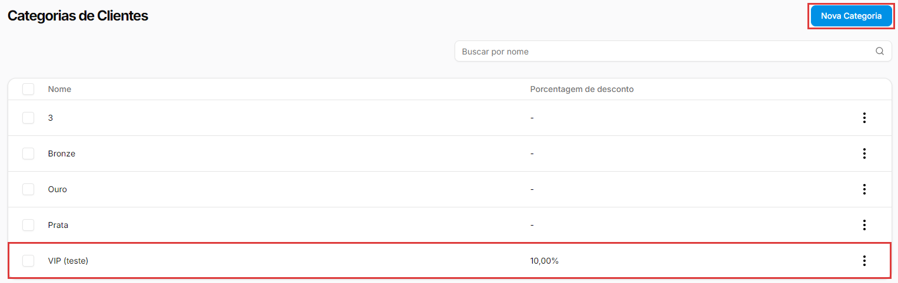
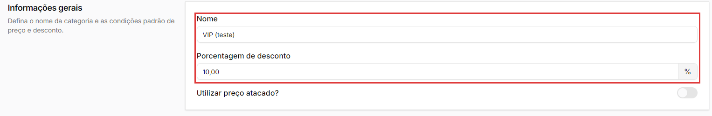
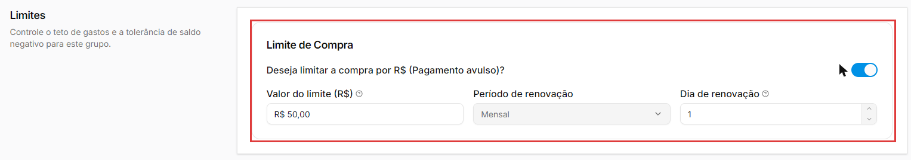
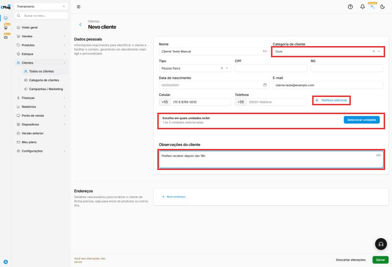
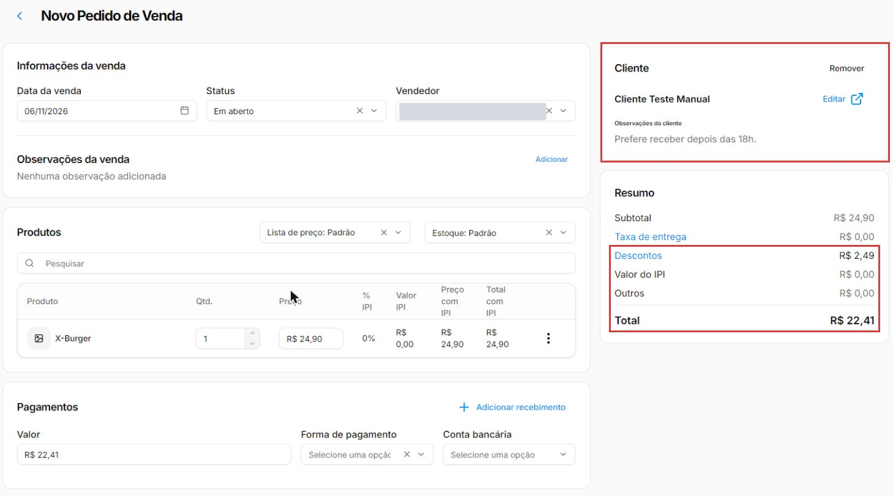
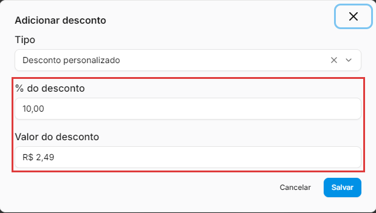
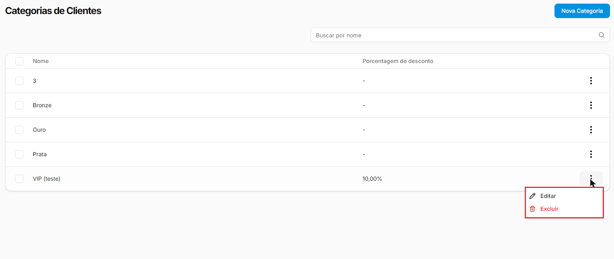
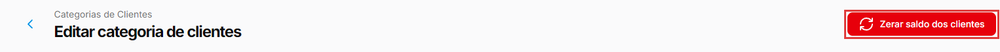
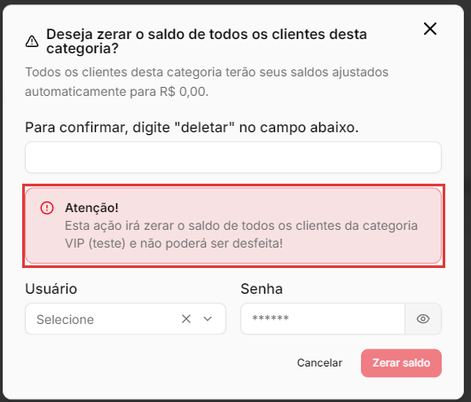

# Como criar categorias de clientes

:material-clock-outline: 7 minutos · :material-format-list-numbered: 6 passos · :material-calendar-check: Atualizado em 06/11/2026

A **categoria de cliente** é um grupo de clientes com as mesmas condições: por exemplo, os clientes **VIP** ganham 10% de desconto. Você define a regra uma vez na categoria e ela vale para todos os clientes do grupo.

## Entenda o conceito

A categoria guarda **condições comerciais** que acompanham o cliente:

| Condição | O que faz | Na prática |
| --- | --- | --- |
| **Porcentagem de desconto** | Desconto automático para os clientes da categoria. | No pedido de venda, o desconto entra sozinho ao escolher o cliente. |
| **Utilizar preço atacado?** | Pelo nome, faz a categoria usar o preço de atacado. | Fale com o suporte antes de usar. |
| **Limite de Compra** | Um teto de consumo por mês, com dia de renovação. | Gravado na categoria; não bloqueia o pedido de venda (veja o passo 3). |

**Por que usar categoria e não dar desconto à mão?** Porque a regra fica no sistema, e não na memória de quem atende. O desconto fica **na categoria**, e não no cliente: todos os clientes da categoria usam a mesma porcentagem, sem ninguém precisar lembrar nem calcular.

**Preço especial por categoria:** além da porcentagem, uma [lista de preços](../produtos/lista-de-precos.md) pode valer só para uma categoria (campo **Categorias de clientes** da lista). Use a porcentagem para um desconto igual em tudo e a lista para preços diferentes por produto.

**Quando usar:** grupos fixos de clientes com a mesma condição (fidelidade, funcionários, revendedores). **Quando não usar:** um desconto de um dia só ou para todos os clientes; para isso existem as listas de preço.

!!! info "Antes de começar"
    O cliente entra na categoria pelo próprio cadastro, no campo **Categoria de cliente** (veja [Como cadastrar um cliente](cadastrar-cliente.md)). No caixa, o desconto da categoria segue as configurações do terminal: **Habilitar descontos no Ponto de Venda** e a regra **Desconto aberto para alteração** ou **Desconto fixo** (veja [Como configurar o terminal de vendas](../ponto-de-venda/configurar-terminal.md)).

Nos prints, o **quadrado vermelho** mostra onde você deve clicar ou digitar.

## Abra as categorias de clientes

No menu do lado esquerdo, clique em **Clientes** e depois em **Categoria de clientes**. A lista mostra o **Nome** e a **Porcentagem de desconto** de cada categoria (um traço quando não há desconto). O campo **Buscar por nome** ajuda quando a lista cresce.

Clique em **Nova Categoria**.

{ loading=lazy }

## Dê o nome e o desconto

Em **Informações gerais**:

- **Nome:** o nome do grupo. Exemplo: "VIP".
- **Porcentagem de desconto:** o campo já tem a vírgula. Para 10%, digite **1000** e ele mostra **10,00**. Deixe 0,00 se a categoria não dá desconto.
- **Utilizar preço atacado?:** pelo nome, faz os clientes da categoria usarem o preço de atacado. Ligar a chave não abre nenhum campo. Fale com o suporte antes de usar.

{ loading=lazy }

## Configure o limite de compra (opcional) e salve

Em **Limites**, a chave **Deseja limitar a compra por R$ (Pagamento avulso)?** abre três campos:

- **Valor do limite (R$):** pela dica da tela, o "valor máximo que o cliente pode consumir no período de renovação". Para R$ 50,00, digite **5000**.
- **Período de renovação:** vem travado em **Mensal**.
- **Dia de renovação:** o "dia do mês em que o limite de compra é renovado (1 a 31)".

{ loading=lazy }

O limite **não bloqueia** o pedido de venda no ERP. Exemplo: um pedido de venda de R$ 67,23, pago em dinheiro, é salvo normalmente para um cliente com limite de R$ 50,00. Na tela, o limite é "por R$ (Pagamento avulso)"; antes de contar com ele, confirme com o suporte.

Clique em **Salvar**, no canto de baixo, à direita. A categoria aparece na lista com a porcentagem: no print, a categoria de exemplo com **10,00%**.

## Coloque os clientes na categoria

Abra o cadastro do cliente (**Clientes → Todos os clientes**, três pontinhos, **Editar**), escolha a categoria no campo **Categoria de cliente** e salve. O campo aceita uma categoria por cliente.

{ loading=lazy }

## Veja o desconto no pedido de venda

Em **Vendas → Pedidos de venda**, clique em **Novo Pedido**. O pedido abre com o **Consumidor Final**: no quadro **Cliente**, clique em **Remover**, busque o cliente pelo nome e escolha. Depois adicione os produtos.

O desconto da categoria entra sozinho. Exemplo: com um cliente de uma categoria de 10% e um X-Burger de R$ 24,90, o **Resumo** já mostra **Descontos R$ 2,49** (10% de R$ 24,90) e **Total R$ 22,41**, sem digitar nada. Com 3 X-Burgers, o desconto acompanha: R$ 7,47.

{ loading=lazy }

Clicando em **Descontos**, abre a janela **Adicionar desconto**, já preenchida com o desconto da categoria: **% do desconto** 10,00 e **Valor do desconto** R$ 2,49. O **Tipo** tem as opções **Desconto personalizado** e **Sem desconto**.

{ loading=lazy }

## Edite ou exclua uma categoria

Nos **três pontinhos** da categoria ficam **Editar** e **Excluir**.

{ loading=lazy }

!!! warning "Zerar saldo dos clientes não tem volta"
    Na edição da categoria (e só nela) aparece o botão vermelho **Zerar saldo dos clientes**. A tela avisa que todos os clientes da categoria terão o saldo ajustado para R$ 0,00 e que a ação não poderá ser desfeita. Para confirmar, pede para digitar "deletar" e pede **Usuário** e **Senha**. Se a sua loja usa crédito de clientes (veja [Como configurar o terminal de vendas](../ponto-de-venda/configurar-terminal.md)), fale com o suporte antes de usar. Se abriu a janela por engano, clique em cancelar: nada é alterado.

    { loading=lazy }

    { loading=lazy }

!!! tip "Boas práticas"
    - **Poucas categorias, com nomes claros** ("VIP", "Funcionários", "Revenda"). Muitas categorias parecidas confundem quem atende.
    - **Combine a regra com a equipe:** quem pode entrar em cada categoria e quem decide.
    - **Revise as categorias de tempos em tempos** e confira quem está em cada uma.
    - **Teste antes de divulgar:** faça um pedido de venda com um cliente da categoria e confira o desconto no Resumo.
    - **Cuidado com o Zerar saldo:** ele não tem volta.

## Deu algum problema?

??? question "O desconto não apareceu no pedido"
    Confira se o cliente está na categoria (campo **Categoria de cliente** no cadastro dele) e se a categoria tem **Porcentagem de desconto**. Se o pedido ainda está com o **Consumidor Final**, troque o cliente no quadro **Cliente** (**Remover** e buscar).

??? question "Digitei 10 e apareceu 0,10"
    O campo de porcentagem já tem a vírgula: os dois últimos números são os centavos. Para 10%, digite **1000**.

??? question "O cliente passou do limite e o pedido foi salvo"
    O limite de compra não bloqueia o pedido de venda no ERP. Na tela, o limite é "por R$ (Pagamento avulso)"; para saber onde ele vale na sua operação, fale com o suporte.

??? question "Não acho o botão Zerar saldo dos clientes"
    Ele só aparece ao **editar** uma categoria já salva, no canto de cima, à direita.

??? question "Para que serve o Zerar saldo dos clientes?"
    A tela avisa que ele ajusta para R$ 0,00 o saldo de todos os clientes da categoria e que a ação não pode ser desfeita; ele pede usuário e senha. Se a sua loja usa crédito de clientes, fale com o suporte antes.

**Relacionados:** [Como cadastrar um cliente](cadastrar-cliente.md) · [Como criar uma lista de preços](../produtos/lista-de-precos.md) · [Como configurar o terminal de vendas](../ponto-de-venda/configurar-terminal.md)

categoria de cliente categorias de clientes grupo de clientes bronze prata ouro vip desconto automático porcentagem de desconto preço atacado limite de compra pagamento avulso período de renovação dia de renovação zerar saldo dos clientes pedido de venda desconto do cliente fidelidade funcionários revenda 0,10
