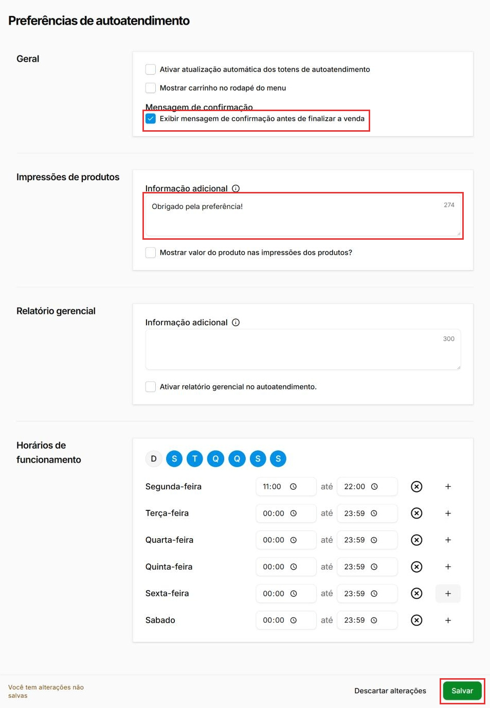

# Como configurar o autoatendimento

:material-clock-outline: 6 minutos · :material-format-list-numbered: 4 passos · :material-calendar-check: Atualizado em 24/11/2026

A tela **Preferências de autoatendimento** reúne ajustes gerais do autoatendimento da loja, em **Configurações**. Exemplo: a lanchonete quer uma mensagem de confirmação antes de finalizar a venda e um texto nas impressões dos produtos. Ela marca a opção, escreve o texto e salva.

## Entenda o conceito

**Preferências × cadastro do totem.** Cada totem tem o seu cadastro, com nome, impressora, mensagens da tela e cardápio (veja [Como configurar o totem de autoatendimento](../dispositivos/totem.md)). Esta tela fica em **Configurações** e reúne as preferências gerais do autoatendimento. Na dúvida sobre o alcance de alguma opção na sua loja, fale com o suporte.

**Não confunda as mensagens.** A **mensagem de confirmação** desta tela aparece *antes* de finalizar a venda ("Exibir mensagem de confirmação antes de finalizar a venda"). A **Mensagem exibida após a finalização** é outra: fica no cadastro de cada totem.

A tela tem quatro blocos:

| Bloco | O que tem |
| --- | --- |
| **Geral** | **Ativar atualização automática dos totens de autoatendimento**, **Mostrar carrinho no rodapé do menu** e **Exibir mensagem de confirmação antes de finalizar a venda**. |
| **Impressões de produtos** | **Informação adicional**: como diz a dica da tela, um "Texto de informações adicionais para as impressões dos produtos". E **Mostrar valor do produto nas impressões dos produtos?** |
| **Relatório gerencial** | **Informação adicional**, um texto para as impressões do relatório gerencial, e **Ativar relatório gerencial no autoatendimento.** |
| **Horários de funcionamento** | Os dias e horários de funcionamento (veja [Como configurar o horário de funcionamento](horario-de-funcionamento.md)). |

**Quando usar:** ao começar a usar o autoatendimento ou ao mudar o jeito como ele funciona. **Quando não usar:** para mudar um totem específico (nome, impressora, cardápio), use o cadastro dele.

!!! info "Antes de começar"
    - As mudanças só valem depois de clicar em **Salvar**, no rodapé.
    - Antes de ligar uma opção com a loja aberta, confirme com o suporte o efeito dela no seu autoatendimento.

Nos prints, o **quadrado vermelho** mostra onde você deve clicar ou digitar.

## Abra as preferências de autoatendimento

No menu do lado esquerdo, clique em **Configurações** → **Preferências do sistema** → **Autoatendimento**. Abre a tela **Preferências de autoatendimento**.

## Ajuste o bloco Geral

As três opções vêm desmarcadas. Pelos nomes:

- **Ativar atualização automática dos totens de autoatendimento:** sobre a atualização dos totens.
- **Mostrar carrinho no rodapé do menu:** sobre mostrar o carrinho do cliente no rodapé do menu.
- **Exibir mensagem de confirmação antes de finalizar a venda:** mostra uma mensagem de confirmação antes de finalizar (no exemplo, marcada).

Antes de marcar as duas primeiras, confirme com o suporte o efeito delas na sua loja.

{ loading=lazy }

## Escreva os textos das impressões e do relatório gerencial

- **Impressões de produtos → Informação adicional:** um texto de até 300 caracteres para as impressões dos produtos (no exemplo, "Obrigado pela preferência!"). O número no canto do campo mostra quantos caracteres ainda cabem. Abaixo fica **Mostrar valor do produto nas impressões dos produtos?**; pelo nome, inclui o valor do produto nessas impressões.
- **Relatório gerencial → Informação adicional:** um texto de até 300 caracteres para as impressões do relatório gerencial, e a opção **Ativar relatório gerencial no autoatendimento.** No exemplo, esse bloco ficou como veio.

Para saber em quais impressões cada texto sai na sua loja, fale com o suporte.

## Salve

Clique em **Salvar**, no rodapé. Aparece **Preferências de autoatendimento atualizadas com sucesso**. Enquanto não salvar, o rodapé avisa **Você tem alterações não salvas**; **Descartar alterações** desfaz o que foi mudado.

!!! tip "Boas práticas"
    - **Textos curtos:** nas impressões, poucas palavras bastam.
    - **Mude fora do movimento:** mude com a loja vazia e confira no autoatendimento antes de abrir.
    - **Uma mudança por vez:** fica mais fácil ver o efeito de cada opção.

## Deu algum problema?

??? question "Mudei a preferência e o totem não mudou"
    Confira se clicou em **Salvar** e se apareceu **Preferências de autoatendimento atualizadas com sucesso**. Se continuar, fale com o suporte. No cadastro do totem, nos **três pontinhos** (⋮), existe a opção **Sincronizar aplicativo**; use com orientação do suporte.

??? question "Qual a diferença entre esta tela e o cadastro do totem?"
    Esta tela reúne preferências gerais do autoatendimento. O cadastro de cada totem (nome, impressora, mensagens da tela, cores e cardápio) fica em **Dispositivos** → **Terminais & Dispositivos** (veja [Como configurar o totem de autoatendimento](../dispositivos/totem.md)).

??? question "O texto não cabe no campo"
    Cada campo aceita até 300 caracteres. O número no canto mostra quantos ainda cabem.

**Relacionados:** [Como configurar o totem de autoatendimento](../dispositivos/totem.md) · [Como configurar o horário de funcionamento](horario-de-funcionamento.md) · [Como ajustar as preferências do sistema](preferencias-do-sistema.md)

autoatendimento preferências de autoatendimento totem atualização automática dos totens carrinho no rodapé mensagem de confirmação finalizar a venda impressões de produtos informação adicional mostrar valor do produto relatório gerencial horários de funcionamento
