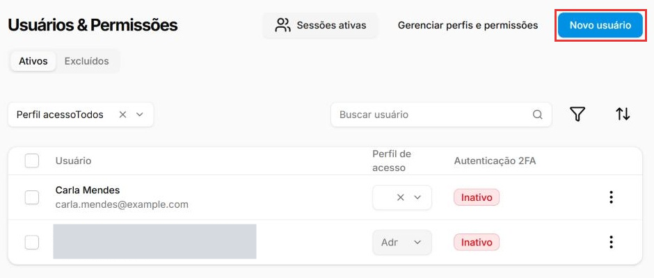
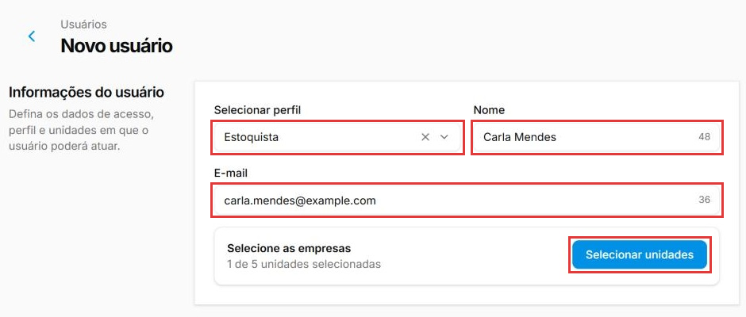
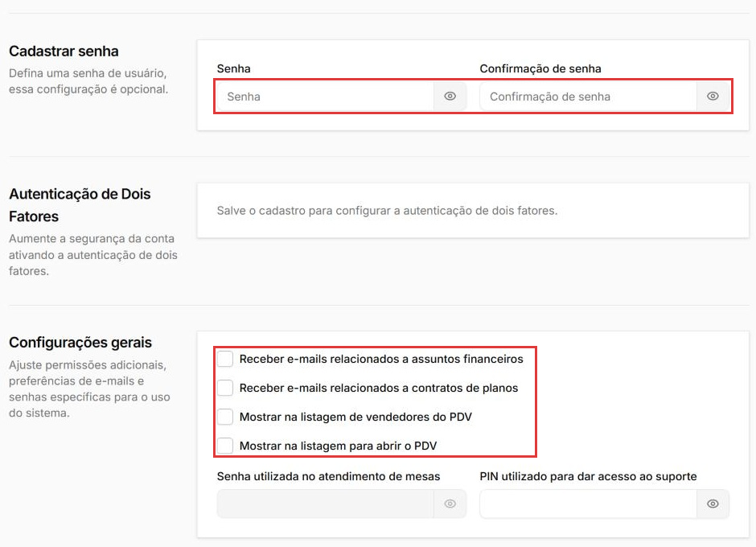
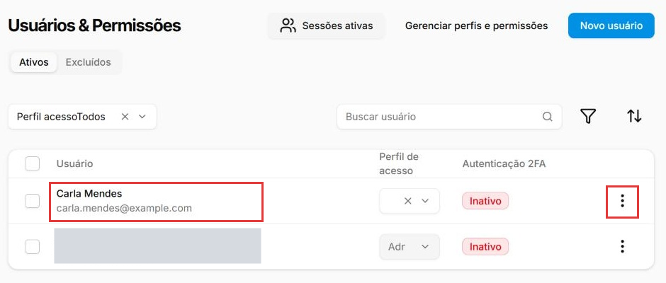

# Como cadastrar um usuário

:material-clock-outline: 6 minutos · :material-format-list-numbered: 4 passos · :material-calendar-check: Atualizado em 21/11/2026

Cada pessoa que usa o sistema deve ter o seu próprio **usuário**: um acesso com nome, e-mail e senha. Assim, cada um vê e faz só o que o perfil dele permite. Exemplo: a loja contrata a estoquista Carla Mendes. O gerente cadastra a Carla como usuária, com o perfil **Estoquista**, só na unidade em que ela trabalha.

## Entenda o conceito

| Termo | O que é |
| --- | --- |
| **Usuário** | A pessoa, com nome, e-mail e senha. |
| **Perfil de acesso** | O conjunto de permissões da função dela (o que pode ver e fazer). No cadastro do usuário você só escolhe o perfil; as permissões ficam nele (veja [Como criar perfis de acesso](perfis-de-acesso.md)). |
| **Unidade** | Cada loja ou filial da conta. Na tela aparece como "empresas", "unidades" ou "lojas". |
| **Autenticação de dois fatores (2FA)** | Um segundo passo de segurança além da senha, como um código. |
| **Sessão ativa** | Cada acesso aberto ao sistema, por exemplo o sistema logado num computador. |

**Um usuário por pessoa.** Não compartilhe o mesmo usuário entre várias pessoas. Quando alguém sai, você tira o acesso só dessa pessoa, sem trocar a senha de todo mundo.

**Quando usar:** sempre que alguém novo for usar o ERP ou o PDV. **Quando não usar:** para criar um acesso "geral" da loja, dividido por várias pessoas.

!!! info "Antes de começar"
    - Tenha o perfil da função pronto. Se nenhum servir, crie antes (veja [Como criar perfis de acesso](perfis-de-acesso.md)).
    - Tenha o nome e o e-mail da pessoa, e combine a senha inicial com ela.

Nos prints, o **quadrado vermelho** mostra onde você deve clicar ou digitar.

## Abra o cadastro de usuário

No menu do lado esquerdo, clique em **Configurações** e depois em **Usuários & Permissões**. A tela lista os usuários na aba **Ativos** (há também a aba **Excluídos**), com o **Perfil de acesso** e a **Autenticação 2FA** de cada um. Para achar alguém, use o filtro **Perfil acesso**, a busca **Buscar usuário** ou o funil. No alto ficam **Sessões ativas**, **Gerenciar perfis e permissões** e **Novo usuário**.

Clique em **Novo usuário**.

{ loading=lazy }

## Preencha as informações do usuário

Em **Informações do usuário**:

- **Selecionar perfil:** o perfil de acesso da função (no exemplo, **Estoquista**).
- **Nome:** o nome da pessoa (até 60 caracteres; no exemplo, "Carla Mendes").
- **E-mail:** o e-mail da pessoa (até 60 caracteres). Use um e-mail que ela acesse.
- **Selecione as empresas:** as lojas em que a pessoa pode atuar. Vem marcada só a unidade em que você está (por exemplo, **1 de 5 unidades selecionadas**). Se a pessoa trabalha em mais lojas, clique em **Selecionar unidades**, marque as lojas (ou **Selecionar todas as lojas**) e clique em **Salvar**, na janela. Com muitas lojas, use **Buscar** ou **UF** para achar.

{ loading=lazy }

## Defina a senha e as opções

Em **Cadastrar senha**, digite a senha inicial em **Senha** e repita em **Confirmação de senha** (o ícone de olho mostra o que foi digitado). A tela diz que essa configuração é opcional, mas, ao salvar um usuário novo sem senha, aparece **O preenchimento é obrigatório** no campo **Senha**. Preencha os dois campos.

Em **Autenticação de Dois Fatores**, o cadastro novo avisa **Salve o cadastro para configurar a autenticação de dois fatores**.

Em **Configurações gerais**:

- **Receber e-mails relacionados a assuntos financeiros** e **Receber e-mails relacionados a contratos de planos:** marque só para quem deve receber esses avisos (em geral, o responsável pela empresa). Na dúvida, fale com o suporte.
- **Mostrar na listagem de vendedores do PDV** e **Mostrar na listagem para abrir o PDV:** vêm marcadas. Pelos nomes, controlam se a pessoa aparece na lista de vendedores do PDV e na lista de quem pode abrir o PDV. Se a pessoa vai vender ou operar o caixa, deixe marcadas; no exemplo, a estoquista não trabalha no caixa, e as duas foram desmarcadas.
- **Senha utilizada no atendimento de mesas:** no cadastro novo, esse campo aparece desativado (cinza). Para dúvidas sobre o uso, fale com o suporte.
- **PIN utilizado para dar acesso ao suporte:** um código para essa situação, como diz o nome. Boa prática: só informe esse PIN ao atendente da CPlug quando ele pedir.

{ loading=lazy }

## Salve e confira

Clique em **Salvar**, no rodapé. A tela volta para **Usuários & Permissões**, e o novo usuário aparece na aba **Ativos**, com o nome e o e-mail. A coluna **Perfil de acesso** é estreita e pode não mostrar o nome inteiro do perfil; para conferir, use **Editar**.

Nos **três pontinhos** (⋮) do usuário ficam **Editar** e **Excluir**. **Editar** abre o mesmo formulário, com o título **Editar usuário**, onde ficam o perfil, as unidades, a senha e as opções. Ali aparece também o status da autenticação de dois fatores: na lista, a coluna **Autenticação 2FA** mostra **Inativo**; em **Editar**, aparece **Status atual: Desativado**. As duas indicam que ela não está ligada.

{ loading=lazy }

!!! tip "Boas práticas"
    - **Senha pessoal:** combine uma senha inicial e peça para a pessoa não compartilhar com ninguém.
    - **Só as unidades necessárias:** marque apenas as unidades em que a pessoa trabalha.
    - **Perfil da função, não da pessoa:** escolha o perfil pela função (Caixa, Estoquista, Gerente).
    - **Quando alguém sair da loja:** não deixe o acesso dessa pessoa ativo. Para tirar o acesso, fale com o suporte, que orienta a melhor forma.

## Deu algum problema?

??? question "Cliquei em Salvar e aparece O preenchimento é obrigatório na Senha"
    Mesmo com o texto "essa configuração é opcional", o cadastro novo pede a senha. Preencha **Senha** e **Confirmação de senha** e clique em **Salvar** de novo.

??? question "A coluna Perfil de acesso aparece vazia"
    A coluna é estreita e pode não mostrar o nome do perfil. Abra os **três pontinhos** do usuário e clique em **Editar**: o perfil aparece em **Selecionar perfil**.

??? question "O perfil que eu quero não aparece na lista"
    Crie o perfil antes em **Gerenciar perfis e permissões** (veja [Como criar perfis de acesso](perfis-de-acesso.md)) e volte ao cadastro do usuário.

??? question "O que é Sessões ativas?"
    Sessão é cada acesso aberto ao sistema, por exemplo o sistema logado num computador. A janela **Sessões ativas** lista as sessões, com **Nome do usuário**, **Expira em** e **Criado em**, e tem os botões **Revogar todas as sessões** e **Deslogar**. Use com cuidado; na dúvida, fale com o suporte.

??? question "Como ativo a autenticação de dois fatores?"
    Depois de salvar o usuário, a tela de edição mostra o **Status atual** da autenticação. Para ativar, fale com o suporte.

**Relacionados:** [Como criar perfis de acesso](perfis-de-acesso.md) · [Como ajustar as preferências do sistema](preferencias-do-sistema.md) · [Como configurar o terminal de vendas](../ponto-de-venda/configurar-terminal.md)

usuário usuários cadastrar usuário novo usuário funcionário equipe acesso login senha e-mail perfil de acesso selecionar perfil unidades selecionar unidades autenticação de dois fatores 2fa listagem de vendedores do pdv abrir o pdv senha de mesas pin do suporte sessões ativas revogar sessões deslogar editar usuário excluir usuário colaborador filial loja unidade trocar senha esqueci a senha 2fa inativo desativado
