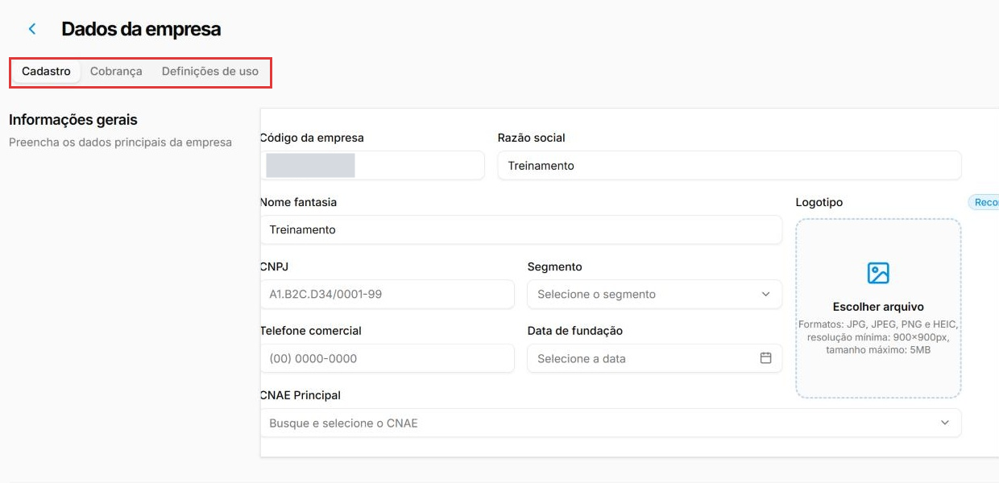
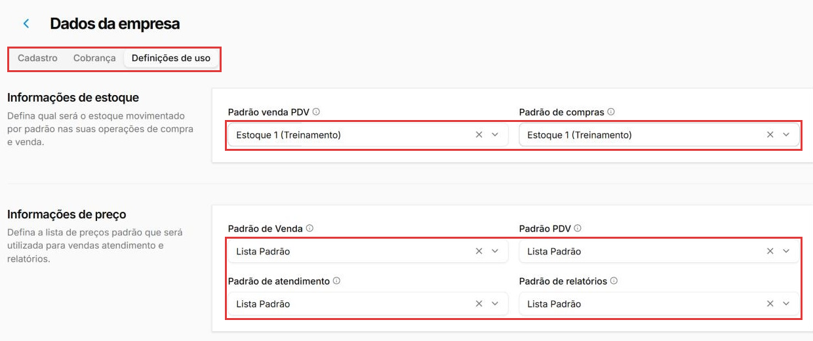
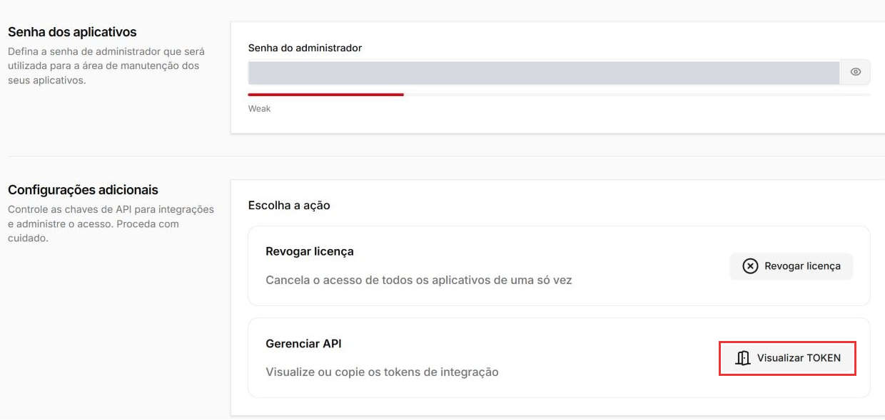

# Como configurar os dados do negócio

:material-clock-outline: 7 minutos · :material-format-list-numbered: 5 passos · :material-calendar-check: Atualizado em 21/11/2026

A tela **Dados da empresa** é a "ficha" da sua empresa no sistema: razão social, CNPJ, endereço, contatos, os padrões de estoque e de preço e, para quem tem a API contratada, o token de integração. Exemplo: a loja muda de endereço. O responsável atualiza o endereço da sede nesta tela, e o cadastro fica em dia.

## Entenda o conceito

A tela tem três abas:

| Aba | O que guarda |
| --- | --- |
| **Cadastro** | Os dados da empresa: nome, CNPJ, segmento, logotipo, CNAE, endereço da sede e os contatos financeiro e do proprietário. |
| **Cobrança** | Os dados da **sua empresa como cliente da CPlug**, para a nota da assinatura do sistema. Não têm relação com as notas que a sua loja emite para os clientes. |
| **Definições de uso** | O estoque e a lista de preços padrão, a senha dos aplicativos e as ações de licença e API. |

**Estoque e lista de preços padrão.** Uma empresa pode ter vários estoques (por exemplo, o da loja e o da cozinha) e várias listas de preços. Aqui você escolhe qual o sistema usa **por padrão**, ou seja, quando ninguém escolhe outro, em cada operação. Sobre vários estoques, veja [Como transferir mercadorias entre estoques](../estoque/transferencia.md).

**Quando usar:** ao começar a usar o sistema; ao mudar endereço, contatos ou logotipo; ao criar um estoque ou uma lista de preços que deva virar padrão. **Quando não usar:** para configurar a emissão de notas, nem para mudar CNPJ ou razão social sem falar com o contador.

**Cuidado com os dados fiscais.** Razão social, CNPJ e CNAE são dados oficiais da empresa. Confira com o seu **contador** antes de mudar. As configurações de emissão de notas ficam em outro lugar (veja [Como configurar a emissão de notas fiscais](emissao-de-notas.md)).

!!! info "Antes de começar"
    - As mudanças só valem depois de clicar em **Salvar**, no rodapé. A aba **Cadastro** pode mostrar o aviso **Você tem alterações não salvas** logo ao abrir, mesmo sem nenhuma mudança sua. Confira os campos antes de salvar.
    - Os dados mostrados são da unidade (loja) em que você está. Em contas com várias lojas, confira a unidade antes de mudar.
    - Esta tela é para o responsável pela empresa.

Nos prints, o **quadrado vermelho** mostra onde você deve clicar ou digitar.

## Abra os dados da empresa

No menu do lado esquerdo, clique em **Configurações** e depois em **Dados do negócio**. Abre a tela **Dados da empresa**, na aba **Cadastro**. As abas ficam no alto: **Cadastro**, **Cobrança** e **Definições de uso**.

{ loading=lazy }

## Confira o cadastro

Na aba **Cadastro**:

- **Informações gerais:** **Código da empresa**, **Razão social**, **Nome fantasia**, **CNPJ**, **Segmento** (o ramo da loja, por exemplo **Lanchonete**, **Hamburgueria**, **Farmácia/Hospital/Artigos Farmacêuticos**), **Telefone comercial**, **Data de fundação**, **Logotipo** e **CNAE Principal** (com busca).
- **Logotipo** (a tela marca como **Recomendado**): clique em **Escolher arquivo**. Formatos aceitos: JPG, JPEG, PNG e HEIC, com resolução mínima de 900×900px e tamanho máximo de 5MB.
- **Endereço da empresa:** o endereço da sede (**CEP**, **Rua**, **Número**, **Bairro**, **Cidade**, **Estado** e **Complemento (opcional)**).
- **Contato financeiro:** **Nome**, **E-mail** e **Telefone** do responsável financeiro.
- **Contato proprietário:** **Nome**, **E-mail**, **Telefone** e **Celular** do proprietário.

Para gravar, clique em **Salvar**, no rodapé.

## Confira os dados de cobrança

Na aba **Cobrança**, em **Informações da fatura**, ficam os dados do pagador da assinatura do sistema CPlug, usados na nota fiscal desse serviço. São os dados da sua empresa como cliente da CPlug; as notas que a sua loja emite para os clientes são configuradas em outro lugar (veja [Como configurar a emissão de notas fiscais](emissao-de-notas.md)).

Na aba ficam o botão **Alterar dados do faturamento**, o **Tipo de pessoa** (**Pessoa jurídica** ou **Pessoa física**), a **Razão social** e o **CPF**. Em **Endereço de cobrança** fica o endereço que vai na fatura, com o link **Adicionar outro endereço**.

## Defina o estoque e a lista de preços padrão

Na aba **Definições de uso**:

Cada campo tem uma dica (ⓘ) que explica o uso.

- **Informações de estoque:** o estoque movimentado por padrão.
    - **Padrão venda PDV:** o estoque utilizado por padrão para vendas no PDV.
    - **Padrão de compras:** o estoque padrão para compras.
- **Informações de preço:** a lista de preços usada por padrão:
    - **Padrão de Venda:** para vendas no ERP.
    - **Padrão PDV:** para vendas no PDV.
    - **Padrão de atendimento:** para atendimento.
    - **Padrão de relatórios:** para relatórios.

Na dúvida sobre qual escolher no atendimento ou nos relatórios, fale com o suporte. As listas mostram os estoques e as listas de preços cadastrados na empresa (veja [Como criar uma lista de preços](../produtos/lista-de-precos.md)). Para gravar, clique em **Salvar**, no rodapé.

{ loading=lazy }

## Confira a senha dos aplicativos e a API

Ainda em **Definições de uso**:

- **Senha dos aplicativos — Senha do administrador:** a senha de administrador usada na área de manutenção dos seus aplicativos. O campo já vem com a senha atual: só troque se souber onde ela é usada, e guarde a nova em local seguro. A barra embaixo do campo mostra a força da senha (aparece em inglês, por exemplo **Weak**, fraca). Para gravar uma senha nova, clique em **Salvar**, no rodapé.
- **Configurações adicionais** ("Controle as chaves de API para integrações e administre o acesso. Proceda com cuidado."). As duas ações deste quadro são para empresas com a **API contratada no plano**:
    - **Gerenciar API — Visualizar TOKEN:** para visualizar ou copiar os tokens de integração, usados para ligar outros sistemas ao ERP.
    - **Revogar licença:** "Cancela o acesso de todos os aplicativos de uma só vez". **Não use sem orientação do suporte.**

{ loading=lazy }

!!! warning "O token é uma senha"
    O token funciona como uma senha que outros sistemas usam para se ligar ao seu ERP. Não envie por mensagem e não deixe à vista. Entregue só a quem for configurar a integração e, se desconfiar de vazamento, fale com o suporte.

!!! tip "Boas práticas"
    - **Cadastro sempre em dia:** atualize endereço e contatos quando mudarem.
    - **Contatos certos:** o contato financeiro e o do proprietário devem ser de quem responde por essas áreas.
    - **Padrões que a loja usa de verdade:** escolha como padrão o estoque e a lista de preços do dia a dia da loja.
    - **Senha de administrador só com quem precisa:** não compartilhe essa senha com a equipe do caixa.

## Deu algum problema?

??? question "A tela mostra Você tem alterações não salvas sem eu ter mudado nada"
    A aba **Cadastro** pode mostrar esse aviso logo ao abrir. Se você não quer mudar nada, apenas não clique em **Salvar**. Se for salvar, confira antes todos os campos.

??? question "Não sei se a minha empresa tem a API contratada"
    O token é para empresas com a API contratada no plano. Para saber se a sua tem, ou se contratou e não consegue ver o token, fale com o suporte.

??? question "Cliquei em Revogar licença por engano"
    Fale com o suporte imediatamente e conte o que foi feito.

??? question "O estoque ou a lista de preços que eu quero não aparece"
    Cadastre antes o estoque ou a lista de preços. Para listas de preços, veja [Como criar uma lista de preços](../produtos/lista-de-precos.md).

**Relacionados:** [Como configurar a emissão de notas fiscais](emissao-de-notas.md) · [Como cadastrar um usuário](cadastrar-usuario.md) · [Como ativar integrações](integracoes.md) · [Como criar uma lista de preços](../produtos/lista-de-precos.md)

dados do negócio dados da empresa cadastro da empresa razão social nome fantasia cnpj segmento logotipo logo cnae endereço da sede contato financeiro contato proprietário cobrança fatura dados do faturamento endereço de cobrança assinatura definições de uso estoque padrão lista de preços padrão senha do administrador senha dos aplicativos revogar licença api token visualizar token chave de api integração mudar endereço da empresa trocar logo mensalidade nota da assinatura estoque padrão do pdv lista de preço do pdv código da empresa senha de administrador
