# Como configurar a emissão de notas fiscais

:material-clock-outline: 30 minutos · :material-format-list-numbered: 6 etapas · :material-calendar-check: Atualizado em 01/11/2026

Antes da primeira nota fiscal, a empresa precisa ter **seis coisas** configuradas no sistema. Se faltar qualquer uma, a nota não é emitida ou é recusada pela Sefaz.

## Entenda o conceito

Toda nota fiscal é montada com **três fontes de informação** e depois **conferida pela Sefaz**:

| Fonte | O que entra na nota | Onde se configura |
| --- | --- | --- |
| **A empresa** (quem vende) | Razão social, CNPJ, endereço, IE, regime, certificado, série | Esta página (etapas 1 a 5) |
| **O produto** (o que se vende) | NCM, origem, CFOP e os **grupos** de ICMS e PIS/COFINS | [Dados fiscais do produto](../produtos/parametros-fiscais.md) |
| **A venda** (para quem e como) | Cliente, quantidades, valores e pagamento | No caixa ou na emissão da NF-e |

A configuração da empresa é feita **uma vez** (e revista quando algo muda: certificado vencendo, mudança de regime). Os grupos de impostos (etapa 6) são a **ponte** entre a empresa e os produtos: você cria as regras uma vez e liga cada produto à regra certa.

### Homologação e Produção

| Ambiente | Para que serve | As notas valem? |
| --- | --- | --- |
| **Homologação** | Testar a configuração sem risco. Aparece um aviso vermelho na tela de NF-e. | **Não.** São só de teste. |
| **Produção** | Vender de verdade. | **Sim.** |

Comece em **Homologação**, emita algumas notas de teste e, quando forem **autorizadas**, mude para **Produção**.

## Checklist: o que é obrigatório

| # | O que | Para que serve | Obrigatório para | Onde fica no sistema |
| --- | --- | --- | --- | --- |
| 1 | **Dados da empresa:** razão social, CNPJ, CNAE e endereço completo | Aparecem na nota como quem está vendendo (emitente) | NFC-e e NF-e | Configurações → Dados do negócio |
| 2 | **Regime tributário (CRT) e Inscrição estadual** | Definem quais códigos de imposto a empresa pode usar | NFC-e e NF-e | Configurações → Fiscal → Configurações gerais |
| 3 | **Certificado digital A1** (arquivo e senha), dentro da validade | Assina a nota, como uma assinatura digital da empresa | NFC-e e NF-e | Configurações → Fiscal → Certificado digital |
| 4 | **CSC e ID Token** | Geram o QR Code que vai impresso no cupom | NFC-e | Configurações → Fiscal → Configurações gerais |
| 5 | **Série e numeração** | Numeram as notas em sequência | NFC-e e NF-e | Configurações → Fiscal → Série de NF |
| 6 | **Grupos de ICMS e de PIS/COFINS**, ligados aos produtos | Calculam os impostos de cada item | NFC-e e NF-e | Configurações → Fiscal → Grupo do ICMS / Grupo do PIS/COFINS |

!!! warning "A empresa também precisa estar autorizada na Sefaz"
    Para emitir NFC-e e NF-e, a empresa precisa estar **credenciada na Sefaz do seu estado**. Normalmente é o contador quem faz esse credenciamento. Sem ele, nenhuma configuração no sistema resolve.

!!! info "O que pedir ao contador antes de começar"
    - O **regime tributário** da empresa: Simples Nacional, MEI, Lucro Presumido ou Lucro Real.
    - A **Inscrição estadual** da empresa.
    - O **CSC e o ID Token** da NFC-e (etapa 4).
    - Quais **códigos de ICMS e de PIS/COFINS** usar nos produtos (etapa 6).

Todas as telas fiscais ficam em **Configurações → Fiscal**, no menu do lado esquerdo:

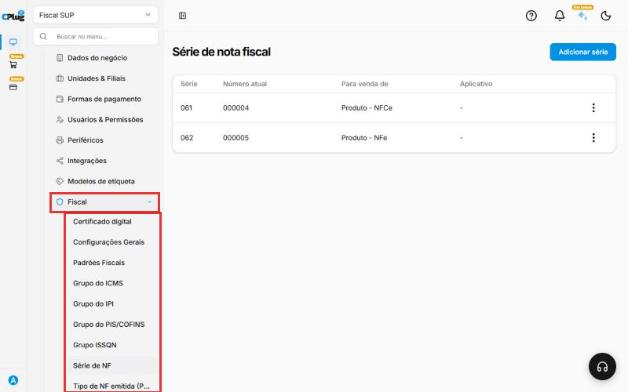{ loading=lazy }

Nos prints, o **quadrado vermelho** mostra onde você deve clicar ou digitar.

## Etapa 1 · Dados da empresa

Clique em **Configurações → Dados do negócio**. Na aba **Cadastro**, confira:

- **Razão social:** igual ao cartão CNPJ. É o nome que sai na nota.
- **CNPJ:** da empresa que vai emitir as notas.
- **CNAE principal:** a atividade principal da empresa, também no cartão CNPJ.
- **Endereço da empresa:** completo, com CEP, número, bairro, cidade e estado. Precisa ser igual ao cadastro da Sefaz.

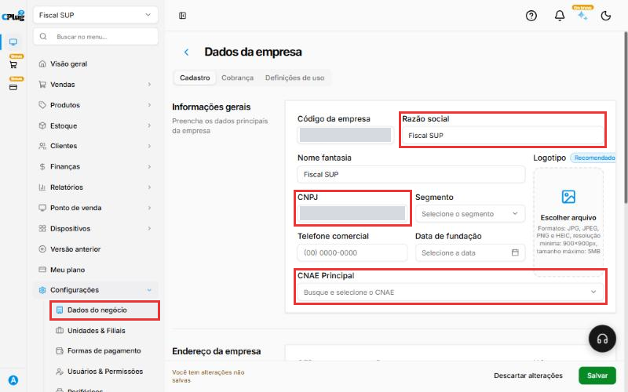{ loading=lazy }

Depois de conferir, clique em **Salvar**, no canto de baixo, à direita.

## Etapa 2 · Regime tributário e Inscrição estadual

Clique em **Configurações → Fiscal → Configurações gerais**. Na parte **Informações tributárias**:

- **Código de Regime Tributário - CRT:** escolha o regime da empresa (veja a tabela abaixo).
- **Inscrição Estadual:** só os números. Se a empresa não tem IE, marque **Isento IE**.
- **Inscrição Municipal:** preencha se a empresa tiver (é usada para nota de serviço).

Na parte **Informações fiscais**, confira o **Ambiente de Geração (NFe)**:

- **Homologação:** ambiente de **teste**. As notas não têm valor fiscal.
- **Produção:** ambiente **real**. Use este para vender de verdade.

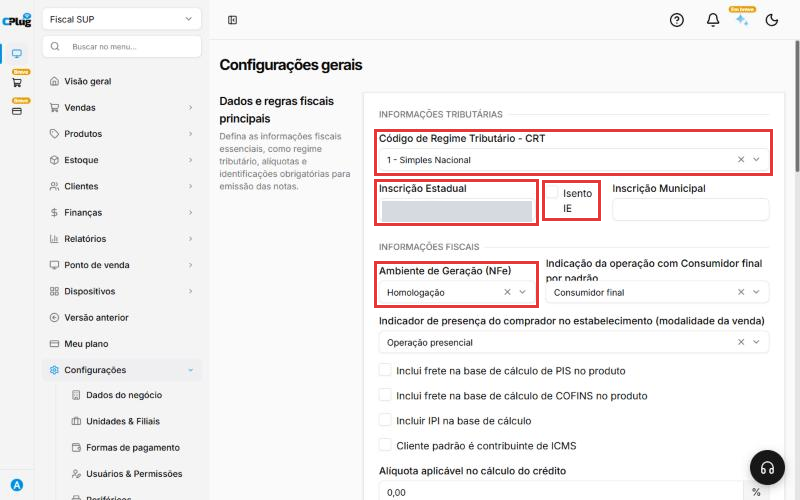{ loading=lazy }

| CRT | Quando usar |
| --- | --- |
| **1 - Simples Nacional** | Empresa do Simples Nacional, dentro do limite de faturamento. É o caso mais comum. |
| **2 - Simples Nacional - Excesso Sublimite** | Empresa do Simples que passou do sublimite de receita do estado. O contador avisa quando for o caso. |
| **3 - Regime Normal** | Empresa do Lucro Presumido ou do Lucro Real. |
| **4 - Simples Nacional - MEI** | Microempreendedor individual. |

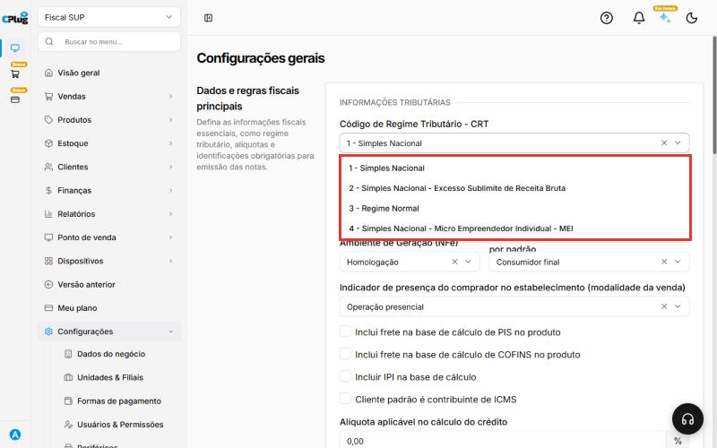{ loading=lazy }

!!! tip "O regime e os códigos de imposto precisam combinar"
    Simples Nacional (CRT 1, 2 e 4) usa os códigos de ICMS de **3 números** (CSOSN, ex.: 102). Regime Normal (CRT 3) usa os de **2 números** (CST, ex.: 00). Se não combinarem, a Sefaz recusa a nota.

Depois, clique em **Salvar**.

## Etapa 3 · Certificado digital

O certificado digital é a "assinatura" da empresa na nota. Sem ele, nenhuma nota é emitida.

- **Tipo:** **A1**, que é um **arquivo** (termina em `.pfx` ou `.p12`) com uma **senha**. Ele é comprado em uma certificadora e emitido para o CNPJ da empresa (e-CNPJ).
- **Validade:** normalmente **1 ano**. Quando vence, as notas param de sair. Renove antes do vencimento.
- **Senha:** é definida na compra. Guarde em local seguro.

Para enviar ou trocar o certificado:

1. Clique em **Configurações → Fiscal → Certificado digital**. A tela mostra o certificado atual e **até quando ele vale**.
2. Clique em **Alterar certificado** (ou no botão de envio, se ainda não houver certificado).

    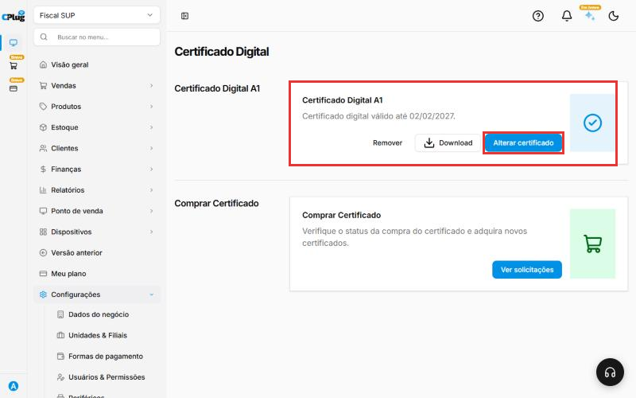{ loading=lazy }

3. Clique em **Escolha os arquivos** (ou arraste o arquivo para a área tracejada) e selecione o arquivo do certificado.
4. Em **Senha do certificado**, digite a senha.
5. Clique em **Alterar**.

    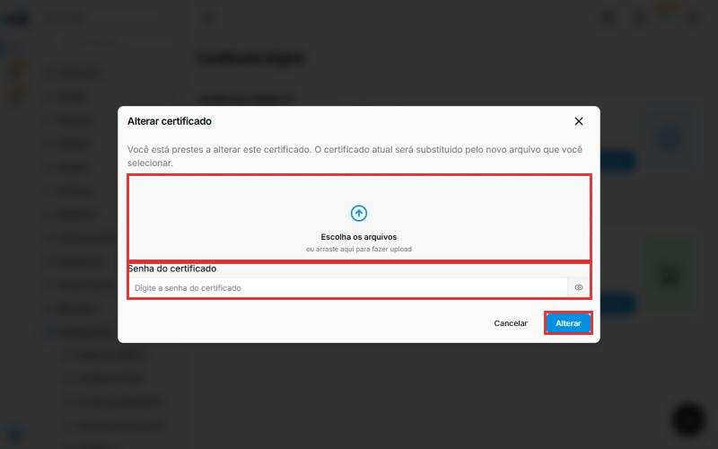{ loading=lazy }

!!! tip "Ainda não tem certificado?"
    Na mesma tela, a parte **Comprar Certificado** permite comprar um novo e acompanhar o pedido em **Ver solicitações**.

## Etapa 4 · CSC e ID Token (para a NFC-e)

O **CSC** (Código de Segurança do Contribuinte) e o **ID Token** são gerados no **site da Sefaz do seu estado**, na área da NFC-e. É com eles que o sistema monta o **QR Code** do cupom. Normalmente o contador gera para você.

1. Clique em **Configurações → Fiscal → Configurações gerais** e role até **Autenticação e QR Code**.
2. Em **CSC / Token**, digite o código exatamente como a Sefaz forneceu, com letras e números.
3. Em **ID Token**, digite o identificador do CSC. Exemplo: 000001.
4. Clique em **Salvar**.

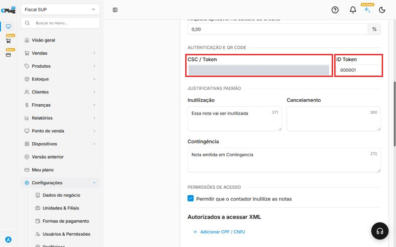{ loading=lazy }

!!! warning "O CSC é um código sigiloso"
    Não envie o CSC para pessoas de fora da empresa e não poste em lugar público.

!!! tip "O contador precisa dos XML?"
    Nessa mesma tela, em **Autorizados a acessar XML**, clique em **+ Adicionar CPF / CNPJ** e informe o CPF ou CNPJ do contador. Assim ele consegue baixar os XML das notas direto na Sefaz.

## Etapa 5 · Série e numeração

Cada tipo de nota tem uma **série**, que é como um "talão", e um **número atual**, o da última nota emitida.

1. Clique em **Configurações → Fiscal → Série de NF**.
2. Confira se existe uma série para **NFC-e** (venda no caixa) e outra para **NF-e**. Se não existir, clique em **Adicionar série**.
3. Se a empresa já emitia notas em outro sistema, ajuste o **número atual** para o **último número usado lá**, na mesma série. Assim a próxima nota não repete um número já usado.

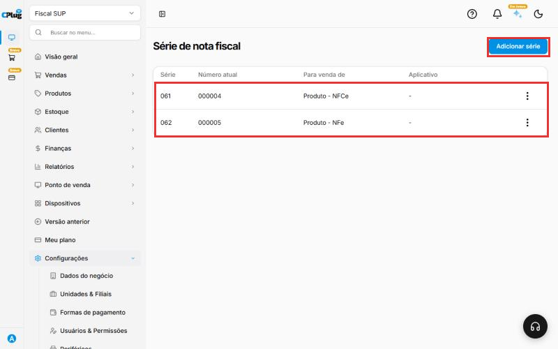{ loading=lazy }

## Etapa 6 · Grupos de ICMS e de PIS/COFINS

Os **grupos** guardam as regras de cada imposto. Você cria os grupos uma vez e depois liga cada produto ao grupo certo.

### Exemplos por regime

Os exemplos abaixo são os casos mais comuns, **só para referência**. Quem define os códigos da sua empresa é o contador.

| Regime | ICMS (venda comum) | ICMS (produto com substituição tributária, ex.: bebidas) | PIS e COFINS |
| --- | --- | --- | --- |
| **Simples Nacional** | CSOSN **102** - Tributada pelo Simples Nacional sem permissão de crédito | CSOSN **500** - ICMS cobrado anteriormente por substituição tributária | CST **49** ou **99** - Outras operações, sem alíquota (os impostos já são pagos no DAS) |
| **Lucro Presumido** | CST **00** - Tributada integralmente, com a alíquota do estado | CST **60** - ICMS cobrado anteriormente por substituição tributária | CST **01** - PIS 0,65% e COFINS 3% |
| **Lucro Real** | CST **00** - Tributada integralmente, com a alíquota do estado | CST **60** - ICMS cobrado anteriormente por substituição tributária | CST **01** - PIS 1,65% e COFINS 7,6% |

Alguns produtos, como bebidas frias, têm regras especiais de PIS e COFINS (monofásico). O contador indica quando for o caso.

!!! tip "Dê nomes que digam a regra"
    Exemplos: "Simples - 102", "Simples - ST 500", "Presumido - Tributado 00", "PIS/COFINS Simples - 49". Assim, na hora de configurar o produto, fica fácil escolher o grupo certo.

### Criar um grupo de ICMS

1. Clique em **Configurações → Fiscal → Grupo do ICMS**. A lista mostra os grupos que já existem.
2. Clique em **Novo grupo ICMS**.

    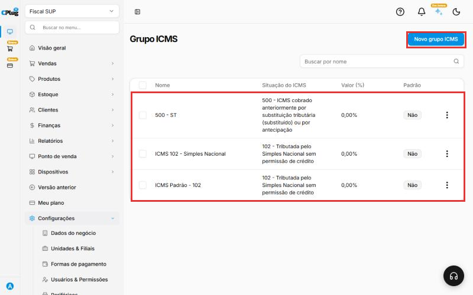{ loading=lazy }

3. Em **Nome**, digite o nome do grupo. Exemplo: "Simples - 102".
4. Em **Situação do ICMS**, escolha o código indicado pelo contador.
5. As **alíquotas por estado** já vêm preenchidas. Só altere com orientação do contador.
6. Clique em **Salvar**.

    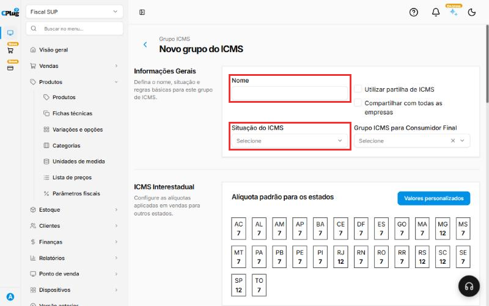{ loading=lazy }

### Criar um grupo de PIS/COFINS

1. Clique em **Configurações → Fiscal → Grupo do PIS/COFINS** e depois em **Novo Grupo PIS/COFINS**.

    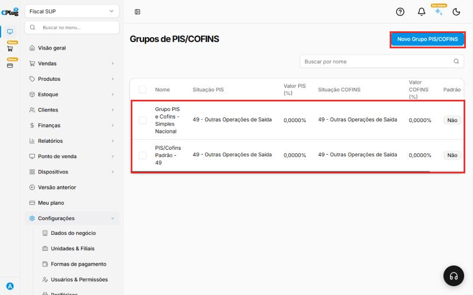{ loading=lazy }

2. Preencha:
    - **Nome:** exemplo, "PIS/COFINS Simples - 49".
    - **Situação do PIS** e **Situação do COFINS:** os códigos indicados pelo contador. Quando o código exigir, o sistema pede também a alíquota.
3. Clique em **Salvar**.

    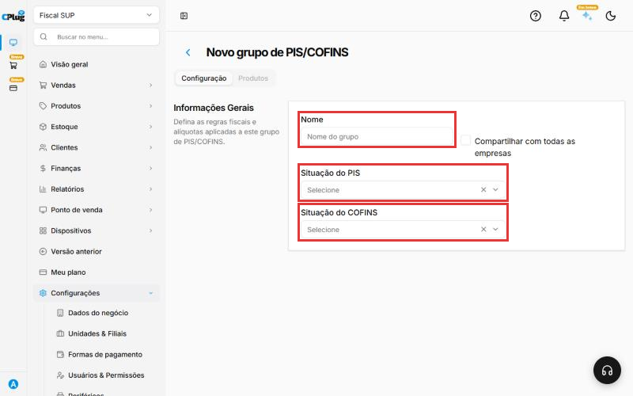{ loading=lazy }

!!! tip "Grupo padrão"
    Em **Configurações → Fiscal → Padrões Fiscais**, você escolhe um grupo **padrão** para cada imposto (ICMS, IPI, PIS/COFINS, ISSQN e CFOP). Ele é usado automaticamente nas notas quando o produto não tiver outro grupo definido.

### Ligar os grupos aos produtos

Depois de criar os grupos, configure cada produto: veja [Como configurar os dados fiscais de um produto](../produtos/parametros-fiscais.md).

!!! success "Como saber que deu certo"
    Com o **Ambiente de Geração** em **Produção**, faça uma **venda de teste** de valor baixo com nota. Se a nota for **autorizada**, a configuração está completa. Se for recusada, a mensagem da Sefaz diz o motivo. Veja os casos mais comuns abaixo.

!!! tip "Boas práticas"
    - **Anote o vencimento do certificado** e renove com 30 dias de folga. A tela de NF-e mostra "Renovação em X dias".
    - **Guarde a senha do certificado** em local seguro: sem ela, o arquivo não serve.
    - **Teste em Homologação** sempre que mudar algo importante (regime, certificado, série).
    - **Revise com o contador uma vez por ano** os grupos de impostos e o regime.
    - **Nunca divulgue o CSC** nem o arquivo do certificado.
    - **Cadastre o contador em Autorizados a acessar XML**, para ele baixar as notas direto na Sefaz.

## Deu algum problema?

??? question "Certificado vencido ou inválido"
    Veja a validade em **Configurações → Fiscal → Certificado digital**. Se venceu, renove com a certificadora e envie o arquivo novo, com a senha (etapa 3).

??? question "As notas não têm valor fiscal"
    Confira o **Ambiente de Geração (NFe)** em **Configurações gerais**. Em **Homologação** as notas são só de teste. Para vender de verdade, use **Produção**.

??? question "Rejeição de QR Code ou CSC inválido (NFC-e)"
    Confira se o **CSC** e o **ID Token** foram digitados exatamente como a Sefaz forneceu, sem espaços a mais. Se o CSC foi trocado na Sefaz, atualize também no sistema.

??? question "Rejeição de duplicidade de numeração"
    O número da nota já foi usado. Isso acontece quando a empresa veio de outro sistema. Ajuste o **número atual** da série para o último número já emitido (etapa 5).

??? question "Rejeição de CSOSN ou CST incompatível com o regime"
    O **CRT** da empresa não combina com o código do grupo de ICMS. Simples Nacional usa CSOSN (3 números); Regime Normal usa CST (2 números). Confira com o contador.

??? question "Rejeição por dados do emitente"
    Confira a razão social, o CNPJ e o endereço (etapa 1) e a Inscrição estadual (etapa 2). Eles precisam ser iguais ao cadastro na Sefaz.

**Relacionados:** [Como configurar os dados fiscais de um produto](../produtos/parametros-fiscais.md) · [Como cadastrar um cliente](../clientes/cadastrar-cliente.md)

emitir nota fiscal nfc-e nf-e cupom fiscal certificado digital a1 pfx senha validade csc token id token qr code série numeração emitente inscrição estadual isento ie crt regime tributário simples nacional mei lucro presumido lucro real regime normal csosn cst icms pis cofins grupo fiscal padrões fiscais homologação produção ambiente sefaz rejeição credenciamento contador xml
