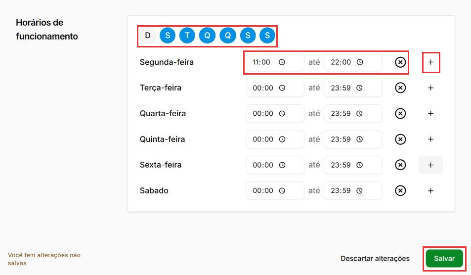

# Como configurar o horário de funcionamento

:material-clock-outline: 4 minutos · :material-format-list-numbered: 4 passos · :material-calendar-check: Atualizado em 24/11/2026

O **horário de funcionamento** registra os dias e os horários de funcionamento da loja no sistema. Exemplo: a lanchonete não abre no domingo e, na segunda, funciona das 11:00 às 22:00. Ela tira o domingo da lista e ajusta o horário de segunda.

## Entenda o conceito

**Onde fica.** Os horários ficam no fim da tela **Preferências de autoatendimento**, em **Configurações** → **Preferências do sistema** → **Autoatendimento**, no bloco **Horários de funcionamento** (veja também [Como configurar o autoatendimento](autoatendimento.md)). Na versão anterior do sistema, os mesmos horários aparecem em **Horários de Funcionamento**. Para saber em quais canais da sua loja esse horário vale, fale com o suporte.

**Como a tela funciona:**

- **Letras dos dias** (**D S T Q Q S S**, de domingo a sábado): letra azul é dia em que a loja abre. Clique na letra para tirar o dia: a letra fica cinza e o dia some da lista. Clique de novo para ele voltar.
- **Horários:** cada dia tem o horário de abertura e o de fechamento (depois de **até**), no formato de 24 horas (22:00 = 10 da noite). Vem **00:00 até 23:59**, o dia inteiro.
- **⊗:** zera o horário do dia (fica **00:00 até 00:00**), para digitar de novo. Para fechar a loja num dia, use a letra do dia, não o ⊗.
- **+:** cria um segundo horário no mesmo dia (por exemplo, almoço e jantar). A **lixeira** ao lado do segundo horário tira esse horário.

**Quando usar:** ao começar a usar o sistema ou quando o horário da loja mudar. **Quando não usar:** para os horários de atendimento de um aplicativo específico, como entrega ou cardápio, fale com o suporte.

!!! info "Antes de começar"
    - Tenha em mãos os dias e horários da loja.
    - As mudanças só valem depois de clicar em **Salvar**, no rodapé.

Nos prints, o **quadrado vermelho** mostra onde você deve clicar ou digitar.

## Abra os horários de funcionamento

No menu do lado esquerdo, clique em **Configurações** → **Preferências do sistema** → **Autoatendimento**. Desça até o bloco **Horários de funcionamento**.

## Tire os dias em que a loja não abre

Clique na letra de cada dia em que a loja **não** abre (no exemplo, o **D** de domingo). A letra fica cinza e o dia some da lista abaixo.

## Ajuste os horários

Em cada dia, clique na parte da hora do horário de abertura e digite os dois números; depois, clique nos minutos e digite. Faça o mesmo no horário depois de **até**. No exemplo, **Segunda-feira** ficou das **11:00** às **22:00**.

Se a loja fecha no meio do dia, clique no **+** do dia: aparece uma segunda linha. Ajuste a primeira para o primeiro turno (por exemplo, 11:00 até 15:00) e a segunda para o outro (por exemplo, 18:00 até 23:00). A **lixeira** tira a segunda linha.

{ loading=lazy }

## Salve

Clique em **Salvar**, no rodapé. Aparece **Preferências de autoatendimento atualizadas com sucesso**. Enquanto não salvar, o rodapé avisa **Você tem alterações não salvas**; **Descartar alterações** desfaz o que foi mudado.

!!! tip "Boas práticas"
    - **Confira depois de salvar:** reabra a tela e veja se os dias e os horários ficaram certos.
    - **Use o formato de 24 horas:** 22:00 é 10 da noite.
    - **Mantenha em dia:** quando o horário da loja mudar, atualize aqui.

## Deu algum problema?

??? question "Não encontro o horário de funcionamento no menu"
    Ele fica dentro de **Configurações** → **Preferências do sistema** → **Autoatendimento**, no fim da tela.

??? question "Cliquei no ⊗ e o horário ficou 00:00 até 00:00"
    O **⊗** zera o horário do dia. Digite de novo os horários ou, se ainda não salvou, clique em **Descartar alterações**.

??? question "Digitei o horário e ele não mudou"
    Clique primeiro na parte da hora, digite os dois números, e depois na parte dos minutos. Se continuar, fale com o suporte.

??? question "A loja funciona depois da meia-noite"
    Para horários que passam da meia-noite (por exemplo, das 18:00 às 02:00), fale com o suporte.

??? question "Onde esse horário é usado?"
    Para saber em quais canais e aplicativos o horário vale na sua loja, fale com o suporte.

**Relacionados:** [Como configurar o autoatendimento](autoatendimento.md) · [Como configurar o totem de autoatendimento](../dispositivos/totem.md) · [Como ajustar as preferências do sistema](preferencias-do-sistema.md)

horário de funcionamento horários de funcionamento horário da loja dias de funcionamento abrir fechar loja fechada domingo feriado almoço jantar dois horários intervalo 24 horas preferências de autoatendimento
