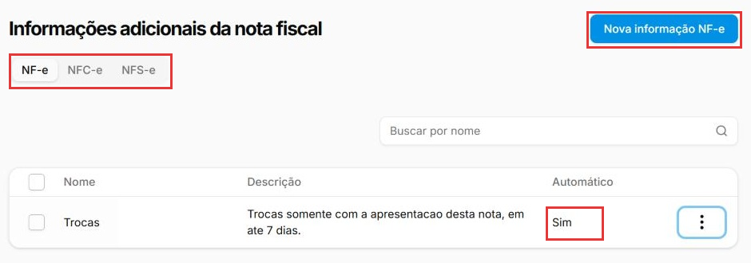
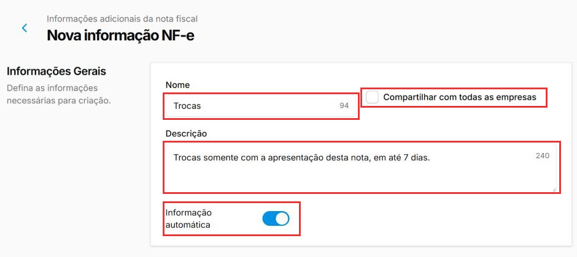

# Como configurar informações adicionais nas notas

:material-clock-outline: 5 minutos · :material-format-list-numbered: 3 passos · :material-calendar-check: Atualizado em 20/11/2026

Toda nota fiscal tem um espaço para **informações adicionais**: textos que vão impressos na nota, além dos produtos e dos impostos. Muitas lojas repetem sempre os mesmos recados ali. Exemplo: uma loja de roupas avisa em toda nota que "trocas somente com a apresentação desta nota, em até 7 dias". Em vez de digitar toda vez, você cadastra o texto uma vez nesta tela.

## Entenda o conceito

**Uma lista por tipo de nota.** A tela tem três abas, uma para cada tipo de nota fiscal:

| Aba | Tipo de nota |
| --- | --- |
| **NF-e** | Modelo 55. Venda para empresas, com entrega ou para outro estado. Impressa como DANFE. |
| **NFC-e** | Modelo 65. A nota do caixa, para o consumidor final. Impressa como cupom com QR Code. |
| **NFS-e** | Nota fiscal de serviço. |

Para entender a diferença, veja [Como definir o tipo de nota emitida no PDV](tipo-de-nota-no-pdv.md). Cada aba tem a sua lista. **Na prática:** o recado de trocas que vai no cupom do caixa é cadastrado na aba **NFC-e**; o mesmo recado nas notas de venda para empresas, na aba **NF-e**.

**Recado comercial × texto fiscal.** Avisos como o de trocas são escolha da loja. Já os textos exigidos por lei dependem da situação de cada empresa (por exemplo, empresas do Simples Nacional costumam ter uma frase sobre o regime). Confirme com o seu **contador** a redação do que precisa ir na nota.

!!! info "Antes de começar"
    Para o texto sair na nota, a emissão de notas precisa estar configurada (veja [Como configurar a emissão de notas fiscais](emissao-de-notas.md)). Tenha o texto pronto e saiba em qual nota ele vai: no cupom do caixa (NFC-e) ou na NF-e.

Nos prints, o **quadrado vermelho** mostra onde você deve clicar ou digitar.

## Abra as informações adicionais

No menu do lado esquerdo, clique em **Configurações**, depois em **Fiscal** e em **Informações Adicionais NFs**. Abre a tela **Informações adicionais da nota fiscal**, com as abas **NF-e**, **NFC-e** e **NFS-e**, a busca **Buscar por nome** e a lista com **Nome**, **Descrição** e **Automático**. Na primeira vez, a lista aparece vazia, com **Sem dados no momento**.

Escolha a aba do tipo de nota e clique no botão dela: **Nova informação NF-e** (na aba NFC-e, **Nova informação NFC-e**; na NFS-e, **Nova informação NFS-e**). O exemplo deste manual usa a aba NF-e; nas outras, os campos são os mesmos.

{ loading=lazy }

## Cadastre o texto

Na tela **Nova informação NF-e**, em **Informações Gerais**:

- **Nome:** um nome para você achar o texto na lista (até 100 caracteres; no exemplo, "Trocas").
- **Compartilhar com todas as empresas:** para quem tem mais de uma empresa (filiais) na mesma conta. Se você tem uma loja só, deixe desmarcado. Em caso de dúvida, fale com o suporte.
- **Descrição:** o texto que vai na nota (até 300 caracteres; o número no canto mostra quantos ainda cabem). No exemplo: "Trocas somente com a apresentação desta nota, em até 7 dias." Ao salvar, o sistema tira os acentos ("até" vira "ate"). É normal.
- **Informação automática:** vem desligada. Ligue para marcar o texto como automático; a lista passa a mostrar **Sim** na coluna **Automático**, como no exemplo. Depois de ligar, confira a próxima nota emitida e, se o texto não aparecer, fale com o suporte.

Ao preencher, aparece no rodapé **Você tem alterações não salvas**, com **Descartar alterações** e **Salvar**. Clique em **Salvar**. A tela volta para a lista, já com o texto novo.

{ loading=lazy }

## Edite ou exclua

Na lista, clique nos **três pontinhos** (⋮) do texto e escolha **Editar** ou **Excluir**.

!!! tip "Boas práticas"
    - **Textos curtos e claros:** a nota tem pouco espaço; vá direto ao ponto.
    - **Um texto por assunto:** um para trocas, outro para garantia. Fica mais fácil achar e ajustar cada um.
    - **Fiscal com o contador:** textos exigidos por lei mudam conforme a empresa. Peça ao contador a redação certa.
    - **Confira a primeira nota:** depois de cadastrar ou mudar um texto automático, confira a próxima nota emitida.

## Deu algum problema?

??? question "O texto foi gravado sem acentos"
    É assim mesmo: a tela grava as informações adicionais sem acentos. Escreva normalmente; o sistema faz a troca.

??? question "Cadastrei na aba NF-e e o texto não aparece na nota do caixa"
    A nota do caixa é a **NFC-e**, que tem a sua própria aba. Cadastre o texto também na aba **NFC-e**.

??? question "O texto automático não entrou na nota"
    Confira se a **Informação automática** está ligada (coluna **Automático** com **Sim**) e se o texto foi cadastrado na aba certa. Se continuar fora, fale com o suporte.

??? question "Que texto a minha empresa é obrigada a colocar na nota?"
    Depende do regime de tributação e da atividade da empresa. Pergunte ao seu contador.

**Relacionados:** [Como configurar a emissão de notas fiscais](emissao-de-notas.md) · [Como definir o tipo de nota emitida no PDV](tipo-de-nota-no-pdv.md) · [Como configurar a natureza de operação](natureza-de-operacao.md)

informações adicionais informação adicional informações complementares observação na nota texto na nota nota fiscal nf-e nfc-e nfs-e nota de serviço nota do caixa trocas garantia informação automática compartilhar com todas as empresas sem acentos contador dados adicionais mensagem na nota texto padrão da nota rodapé da nota observação da nfc-e aviso de troca no cupom infcpl
