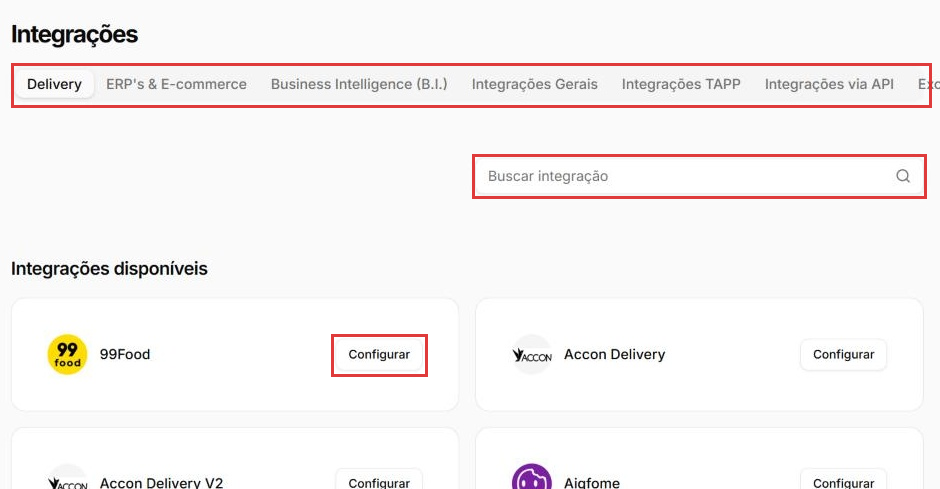
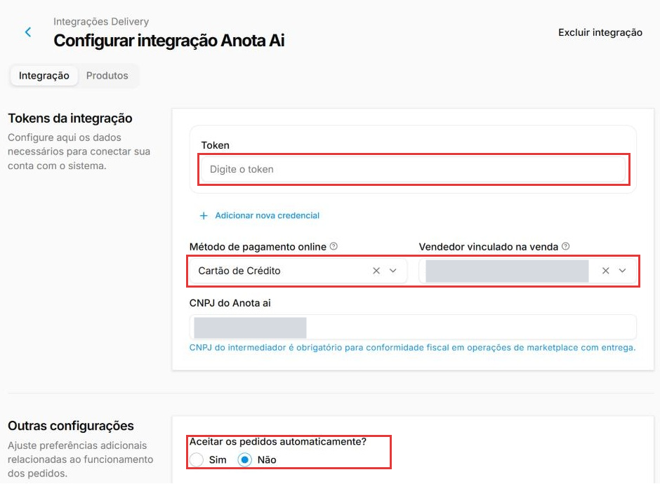

# Como ativar integrações

:material-clock-outline: 6 minutos · :material-format-list-numbered: 4 passos · :material-calendar-check: Atualizado em 20/11/2026

Uma **integração** liga o ERP a outro sistema que a loja já usa, para os dois trocarem informações sem digitação. Exemplo: uma lanchonete vende pelo Anota Ai. A ideia é que os pedidos feitos no aplicativo entrem no sistema da loja, sem precisar digitar de novo.

## Entenda o conceito

**Toda integração tem dois lados.** De um lado, a sua conta no parceiro (o aplicativo de delivery, a loja virtual, o sistema da chopeira). Do outro, o ERP. Na maioria das integrações de pedidos, quem liga os dois é um **token** (ou credencial): um código que o parceiro fornece para autorizar a conexão. No Anota Ai, por exemplo, o campo **Token** é o primeiro da tela.

As integrações ficam separadas em abas:

| Aba | Exemplos |
| --- | --- |
| **Delivery** | 99Food, Aiqfome, Anota Ai, Goomer, Ifood (V2), Keeta Delivery, Rappi e outros aplicativos de pedido. |
| **ERP's & E-commerce** | Tray e Bling. |
| **Business Intelligence (B.I.)** | No momento, a aba aparece vazia (**Nenhuma integração encontrada**). |
| **Integrações Gerais** | Webhooks, CRM & Bonus, Fidelidade, Receptor de pedidos, Uber Eats, Maquininha Smart POS e outras. |
| **Integrações TAPP** | Beerpass, EasyChopp, Enjoy e ITap. |
| **Integrações via API** | O botão **Adicionar Integrador**, o **ID do tenant** e a lista **Integrações ativas**. |
| **Excluídas** | As integrações que foram excluídas. |

Algumas aparecem com o selo **Novo**, como **Webhooks**.

**Quando usar:** quando a loja já tem conta num desses parceiros e quer receber os pedidos ou trocar dados com o ERP. **Quando não usar:** se a loja não usa o parceiro, não há o que configurar.

!!! info "Antes de começar"
    - Tenha em mãos os dados que o parceiro fornece, como o **token**. Cada integração pede os seus dados. Se não souber onde pegar, peça ao parceiro ou ao suporte.
    - O token dá acesso aos dados da loja: guarde com cuidado e não compartilhe por mensagem. Se precisar de ajuda para configurar, o suporte orienta como fazer.
    - Na dúvida sobre qual integração usar ou como pegar o token, fale com o suporte antes de configurar.

Nos prints, o **quadrado vermelho** mostra onde você deve clicar ou digitar.

## Abra a tela de integrações

No menu do lado esquerdo, clique em **Configurações** e depois em **Integrações**. A tela abre na aba **Delivery**, com a lista **Integrações disponíveis**.

## Encontre a integração

Clique na aba do tipo de integração ou digite o nome em **Buscar integração**. Cada integração aparece num cartão, com o botão **Configurar**.

{ loading=lazy }

## Preencha a configuração

Clique em **Configurar**. Abre a tela **Configurar integração**, com o nome do parceiro. Os campos mudam de uma integração para outra; no exemplo do **Anota Ai**, a aba **Integração** tem:

- **Tokens da integração — Token:** cole aqui o token que o parceiro forneceu. Há também o link **Adicionar nova credencial**, para quando o parceiro fornecer mais de uma credencial; na dúvida, use só um token.
- **Método de pagamento online:** como explica a dica (?) ao lado do nome, para vendas com pagamento online, é o método de pagamento usado para registrar a venda.
- **Vendedor vinculado na venda:** como explica a dica (?), é o vendedor ligado às vendas que chegam pela integração.
- **CNPJ do Anota ai:** vem preenchido com o CNPJ do parceiro. Como avisa a tela, o CNPJ do intermediador é obrigatório para a conformidade fiscal em vendas de marketplace com entrega. Não altere; em dúvida fiscal, fale com o seu contador.
- **Outras configurações — Aceitar os pedidos automaticamente?:** **Sim** ou **Não** (vem **Não**). Na dúvida sobre qual escolher para a sua operação, fale com o suporte antes de mudar.

Na aba **Produtos** aparecem os produtos do ERP, com o filtro **Categoria** e as colunas **Nome**, **Código (SKU)**, **Preço base**, **Estoque**, **Chave de integração** e **Opções**. Cada produto tem uma **Chave de integração** (por exemplo, prod-125165-166), o código que identifica o produto na integração.

{ loading=lazy }

## Salve

Ao mudar qualquer campo, aparece no rodapé **Você tem alterações não salvas**, com **Descartar alterações** e **Salvar**. Clique em **Salvar**.

Depois de salvar, faça um pedido no parceiro e confirme com o suporte se ele chegou ao sistema.

!!! tip "Boas práticas"
    - **Um parceiro de cada vez:** configure uma integração, teste com um pedido e só depois passe para a próxima.
    - **Cadastros em ordem antes:** na aba **Produtos** aparecem os produtos do ERP com a **Chave de integração**; deixe os cadastros em ordem antes de ligar a integração.
    - **Token é segredo:** trate o token como uma senha. Se desconfiar que alguém teve acesso, peça um novo token ao parceiro e troque aqui.

## Deu algum problema?

??? question "Não encontro a integração que eu uso"
    Procure em todas as abas e use o campo **Buscar integração**. Se não estiver na lista, fale com o suporte.

??? question "Não sei onde pegar o token"
    O token vem do parceiro. Se não souber onde pegar, peça ao parceiro ou ao suporte.

??? question "Configurei, mas os pedidos não chegam"
    Confira o token e se a integração foi salva (a mensagem **Você tem alterações não salvas** não pode continuar no rodapé). Se continuar sem chegar, fale com o suporte.

??? question "Para que serve a aba Integrações via API?"
    A aba mostra o botão **Adicionar Integrador**, o **ID do tenant** e a lista **Integrações ativas**. Para usar, fale com o suporte.

??? question "Como desfaço uma integração?"
    Na tela de configuração da integração há o botão **Excluir integração**, no alto. Antes de usar, fale com o suporte.

**Relacionados:** [Como cadastrar um produto](../produtos/cadastrar-produto.md) · [Como cadastrar formas de pagamento](../financas/formas-de-pagamento.md) · [Como ajustar as preferências do sistema](preferencias-do-sistema.md)

integração integrações ativar integração configurar integração token credencial delivery ifood rappi anota ai aiqfome 99food goomer keeta uber eats tray bling e-commerce loja virtual webhooks fidelidade crm receptor de pedidos maquininha smart pos tapp beerpass easychopp chopeira api integrador aceitar pedidos automaticamente chave de integração vendedor vinculado método de pagamento online anota aí anotaai pedidos online marketplace intermediador cnpj do intermediador sku excluir integração delivery much scanntech todo cartões
