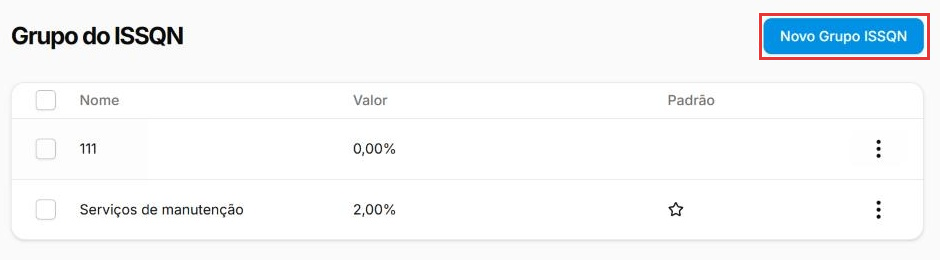
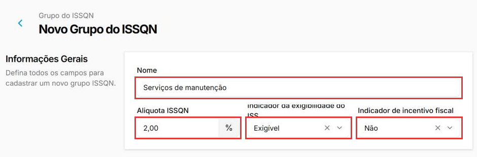
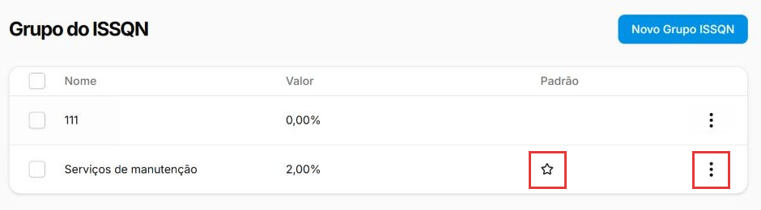

# Como configurar o ISSQN (nota de serviço)

:material-clock-outline: 5 minutos · :material-format-list-numbered: 3 passos · :material-calendar-check: Atualizado em 20/11/2026

O **ISSQN** (ou ISS) é o imposto sobre serviços, cobrado pela prefeitura. Toda empresa que emite nota de serviço precisa informar na nota a alíquota e algumas indicações sobre esse imposto. Exemplo: uma loja que também faz manutenção de equipamentos cadastra o grupo "Serviços de manutenção", com a alíquota que o contador passou, e liga esse grupo aos serviços que presta.

## Entenda o conceito

**ISS é o imposto do serviço.** Venda de mercadoria paga ICMS (imposto do estado); prestação de serviço paga ISS (imposto da cidade). Os grupos de ICMS e PIS/COFINS ficam em [Como configurar os dados fiscais de um produto](../produtos/parametros-fiscais.md).

**Grupo de ISSQN é um "pacote" de regras do imposto.** Em vez de preencher a alíquota em cada serviço, você cadastra o grupo uma vez e liga o grupo aos produtos de serviço. Cada grupo tem:

| Campo | O que é |
| --- | --- |
| **Nome** | Um nome para você reconhecer o grupo. |
| **Aliquota ISSQN** | A porcentagem do imposto. Ela é definida pela prefeitura e varia de cidade para cidade e de serviço para serviço. |
| **Indicador da exigibilidade do ISS** | A situação do imposto para aquele serviço (veja a lista abaixo). |
| **Indicador de incentivo fiscal** | **Sim** só se a prefeitura concedeu à empresa um benefício de incentivo fiscal; senão, **Não**. |

O significado geral de cada **Indicador da exigibilidade do ISS** (quem escolhe o certo para a sua empresa é o contador):

- **Exigível:** o imposto é devido normalmente (o caso mais comum).
- **Isenção:** uma lei da prefeitura dispensa o pagamento.
- **Imunidade:** a Constituição proíbe a cobrança para aquela entidade ou serviço.
- **Não Incidência:** o ISS não se aplica àquela situação.
- **Exportação:** serviço prestado para o exterior.
- **Exigibilidade Suspensa por Decisão Judicial** e **Exigibilidade Suspensa por Processo Administrativo:** a cobrança está suspensa enquanto a Justiça ou a prefeitura analisa o caso.

**O grupo padrão.** Um dos grupos pode ser marcado como **padrão**. Como explica a própria tela, ele é usado quando não existir grupo de ISSQN selecionado no produto.

**Quando usar:** a empresa presta serviço e emite nota de serviço. **Quando não usar:** a empresa só vende mercadoria.

!!! warning "Assunto fiscal: confirme com o seu contador"
    A alíquota e os indicadores dependem da cidade, do serviço e da situação da empresa. Antes de cadastrar, peça ao seu **contador**: a alíquota de cada serviço, a exigibilidade e se há incentivo fiscal. Um valor errado pode sair errado na nota e gerar imposto cobrado a mais ou a menos.

Nos prints, o **quadrado vermelho** mostra onde você deve clicar ou digitar.

## Abra os grupos de ISSQN

No menu do lado esquerdo, clique em **Configurações**, depois em **Fiscal** e em **Grupo ISSQN**. Abre a tela **Grupo do ISSQN**, com a lista de grupos: **Nome**, **Valor** (a alíquota) e **Padrão** (a estrela aparece no grupo padrão).

Clique em **Novo Grupo ISSQN**.

{ loading=lazy }

## Cadastre o grupo

Na tela **Novo Grupo do ISSQN**, em **Informações Gerais**, preencha:

- **Nome:** no exemplo, "Serviços de manutenção".
- **Aliquota ISSQN:** a porcentagem, com duas casas (no exemplo, **2,00**; digite 200).
- **Indicador da exigibilidade do ISS:** no exemplo, **Exigível**.
- **Indicador de incentivo fiscal:** no exemplo, **Não**.

Ao preencher, aparece no rodapé **Você tem alterações não salvas**, com **Descartar alterações** e **Salvar**. Clique em **Salvar**. A tela volta para a lista, já com o grupo novo e a alíquota na coluna **Valor**.

{ loading=lazy }

## Defina o grupo padrão (opcional)

Na lista, clique nos **três pontinhos** (⋮) do grupo e em **Definir como padrão**. Abre a confirmação **Alterar grupo padrão do ISSQN**: "Esse grupo será utilizado por padrão quando não existir Grupo de ISSQN selecionado no produto. Deseja continuar?". Clique em **OK**. Aparece **Grupo do ISSQN alterado com sucesso**, e uma estrela aparece nesse grupo, na coluna **Padrão**.

É a mesma configuração do campo **ISSQN** em **Configurações** → **Fiscal** → **Padrões Fiscais**: depois de marcar a estrela, esse campo passa a mostrar o grupo escolhido.

{ loading=lazy }

Nos mesmos **três pontinhos** ficam **Editar** e **Excluir**.

!!! tip "Boas práticas"
    - **Um grupo por tipo de serviço:** se a empresa presta serviços com alíquotas diferentes, crie um grupo para cada um.
    - **Nomes claros:** use o nome do serviço no grupo (por exemplo, "Serviços de manutenção"), não só o número da alíquota.
    - **Padrão com cuidado:** o grupo padrão vale para todo produto sem grupo definido. Escolha o grupo do serviço mais comum da empresa.
    - **Revise quando a lei mudar:** se o contador avisar de mudança na alíquota da prefeitura, atualize o grupo em **Editar**.
    - **Cuidado ao editar ou excluir um grupo em uso:** confirme com o contador antes.

## Deu algum problema?

??? question "Não sei qual alíquota usar"
    A alíquota do ISS é definida pela prefeitura e depende do serviço. Pergunte ao seu contador.

??? question "A alíquota ficou diferente do que eu digitei"
    O campo preenche as casas decimais a partir da direita. Para 2,00%, digite **200**; confira o valor antes de salvar.

??? question "Onde escolho o grupo de ISSQN do serviço?"
    Quando o produto não tem grupo de ISSQN, vale o grupo **padrão** (a estrela). Por isso, deixe como padrão o grupo do serviço mais comum da empresa. Para um serviço com alíquota diferente, fale com o suporte sobre como ligar outro grupo a ele.

??? question "Preciso disto se não emito nota de serviço?"
    Em geral, não: o ISSQN é o imposto dos serviços. Se a empresa só vende mercadoria, confirme com o seu contador antes de cadastrar.

**Relacionados:** [Como configurar a emissão de notas fiscais](emissao-de-notas.md) · [Como configurar os dados fiscais de um produto](../produtos/parametros-fiscais.md) · [Como configurar informações adicionais nas notas](informacoes-adicionais.md)

issqn iss imposto sobre serviços nota de serviço nfs-e grupo issqn grupo do issqn novo grupo issqn alíquota alíquota do iss exigibilidade exigível isenção imunidade não incidência exportação incentivo fiscal grupo padrão definir como padrão prefeitura contador
