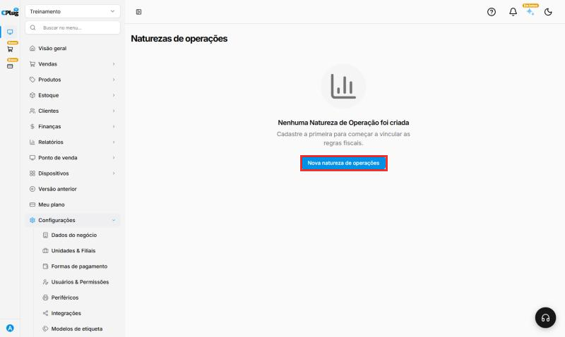
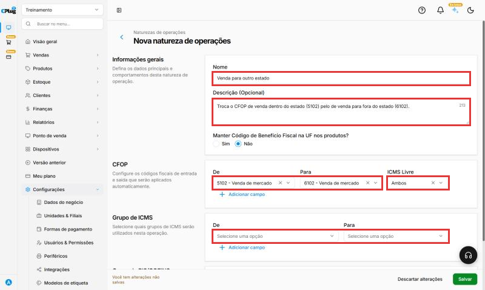
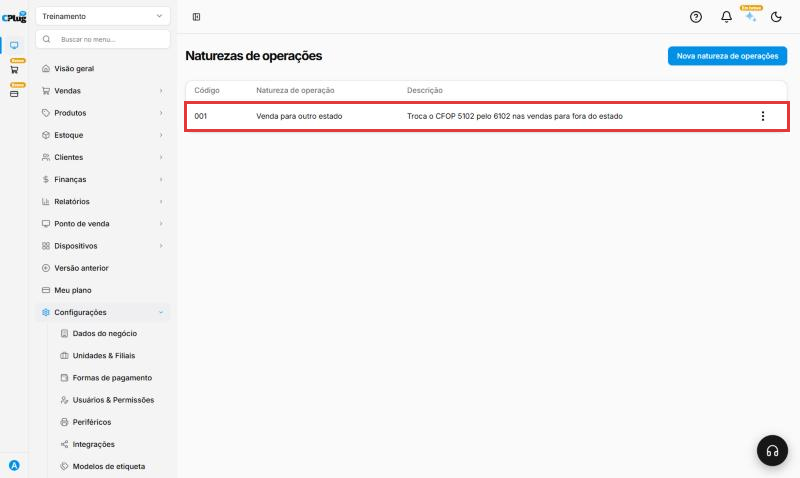

# Como configurar a natureza de operação

:material-clock-outline: 5 minutos · :material-format-list-numbered: 5 passos · :material-calendar-check: Atualizado em 30/10/2026

A **natureza de operação** diz que tipo de operação a nota representa: venda, devolução, transferência, remessa... Cada operação pode exigir **outro CFOP** e **outros impostos** do que os do cadastro do produto.

Aqui você cria **regras "De → Para"**: quando a operação é usada, o sistema troca o código do produto ("De") pelo código da operação ("Para").

**Exemplo:** o produto está cadastrado com o CFOP **5102** (venda dentro do estado). Numa **venda para outro estado**, o CFOP certo é **6102**. A natureza "Venda para outro estado" faz essa troca sozinha.

!!! warning "Configuração fiscal avançada"
    Quais naturezas criar e quais códigos usar é decisão do **contador**. Este manual mostra **onde** e **como** cadastrar.

Nos prints, o **quadrado vermelho** mostra onde você deve clicar ou digitar.

## Abra a tela

No menu do lado esquerdo, clique em **Configurações → Fiscal → Natureza de Operações**. Se ainda não houver nenhuma, clique em **Nova natureza de operações**.

{ loading=lazy }

## Preencha as informações gerais

- **Nome:** o nome da operação. Exemplo: "Venda para outro estado".
- **Descrição (Opcional):** uma explicação curta. Evite símbolos como parênteses: o sistema pode recusar.
- **Manter Código de Benefício Fiscal na UF nos produtos?:** use **Sim** só se o contador orientar.

## Crie as regras de CFOP

Em **CFOP**:

- **De:** o CFOP que está no cadastro do produto. Exemplo: **5102**.
- **Para:** o CFOP que deve ir na nota desta operação. Exemplo: **6102**.
- **ICMS Livre:** **Ambos**, **Sim** ou **Não**, conforme a orientação do contador. No exemplo, **Ambos**.

Para mais uma troca, clique em **Adicionar campo**.

{ loading=lazy }

## Crie as regras de impostos (se precisar)

Em **Grupo de ICMS** e **Grupo de PIS/COFINS**, faça o mesmo: **De** (o grupo do produto) e **Para** (o grupo desta operação). Deixe em branco se a operação não muda os impostos.

## Salve e confira

Clique em **Salvar**, no canto de baixo, à direita. A natureza aparece na lista com um **código** (001, 002...), o nome e a descrição. Nos **três pontinhos** você pode alterar a natureza depois.

{ loading=lazy }

## Exemplos comuns

Só para referência. Confirme os códigos com o contador.

| Operação | CFOP De → Para |
| --- | --- |
| Venda para outro estado | 5102 → 6102 |
| Venda de produto com ST para outro estado | 5405 → 6404 |
| Devolução de compra ao fornecedor (mesmo estado) | 5102 → 5202 |

## Deu algum problema?

??? question "Apareceu \"Os dados enviados são inválidos\" na descrição"
    Tire símbolos especiais do texto, como parênteses, e salve de novo.

??? question "A nota saiu com o CFOP do cadastro, sem a troca"
    Confira se a regra **De** está com o mesmo CFOP do cadastro do produto. Se o produto usa outro CFOP, crie mais uma regra com **Adicionar campo**.

**Relacionados:** [Como configurar os dados fiscais de um produto](../produtos/parametros-fiscais.md) · [Como configurar a emissão de notas fiscais](emissao-de-notas.md)

natureza de operação cfop de para troca de cfop venda interestadual 6102 devolução remessa transferência regra fiscal grupo de icms grupo de pis cofins benefício fiscal icms livre
