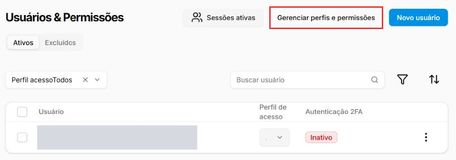
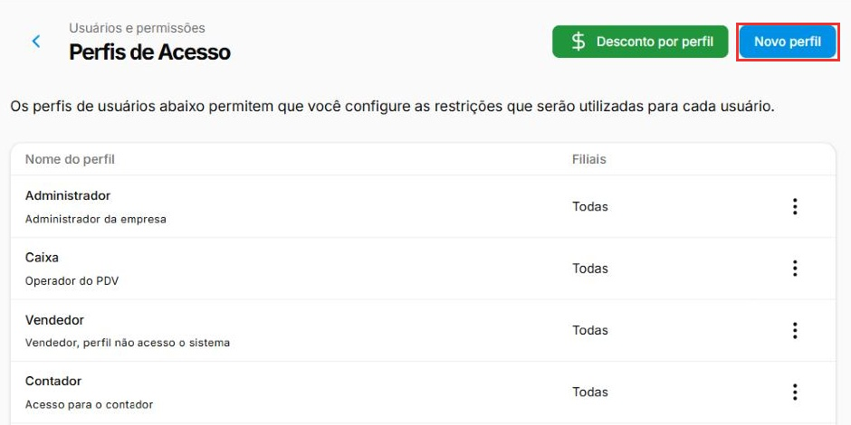
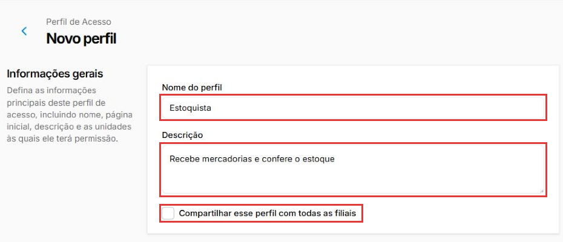
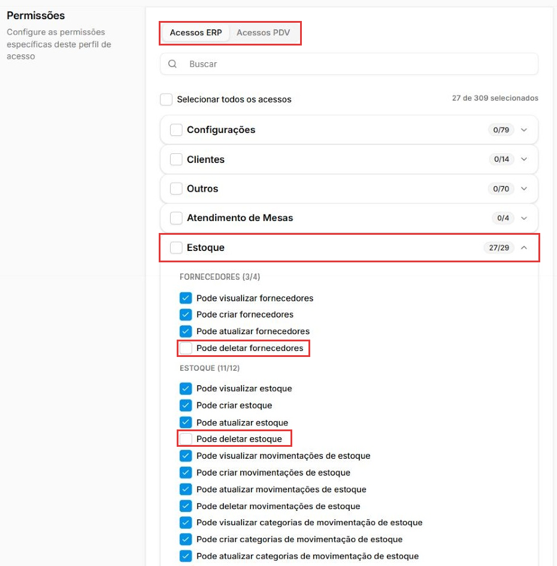
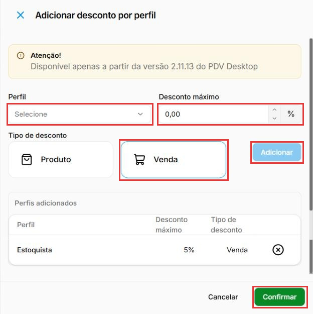

# Como criar perfis de acesso

:material-clock-outline: 7 minutos · :material-format-list-numbered: 5 passos · :material-calendar-check: Atualizado em 20/11/2026

Nem todo mundo da loja precisa mexer em tudo. O caixa vende, o estoquista recebe mercadoria, o contador consulta as notas. O **perfil de acesso** é o conjunto de permissões de uma função: você marca o que ela pode ver e fazer, e cada usuário recebe um perfil. Exemplo: o perfil **Estoquista** pode ver e lançar movimentações de estoque e cadastrar fornecedores, mas não pode excluir estoque nem fornecedores.

## Entenda o conceito

**Um perfil, várias pessoas.** Você não dá permissão pessoa por pessoa: cria o perfil da função uma vez e depois escolhe esse perfil no cadastro de cada usuário (campo **Selecionar perfil**).

**As permissões ficam em duas abas:**

| Aba | O que controla | Exemplos de permissão |
| --- | --- | --- |
| **Acessos ERP** | O que a pessoa pode fazer no sistema web, por assunto (Estoque, Vendas, Financeiro…). | **Pode visualizar estoque**, **Pode criar movimentações de estoque**, **Pode deletar fornecedores**. |
| **Acessos PDV** | O que a pessoa pode fazer no caixa. | **Cancelamento de Venda**, **Desconto na venda**, **Sangria e Reforço**. |

No ERP, quase todo assunto tem quatro permissões: **visualizar** (ver), **criar** (cadastrar), **atualizar** (alterar) e **deletar** (excluir). Assim dá para deixar alguém ver e cadastrar sem poder excluir.

**Quando usar:** sempre que alguém além do dono for usar o sistema. **Quando não usar:** não use o perfil **Administrador** para a equipe só para "não dar trabalho": ele é o perfil do responsável pela empresa e libera o sistema inteiro.

!!! info "Antes de começar"
    - Veja na lista os perfis que já existem (por exemplo, **Administrador**, **Caixa**, **Vendedor** e **Contador**). Os perfis prontos do sistema não abrem para edição; se nenhum servir do jeito que está, crie um novo.
    - Liste as tarefas de cada função da loja: isso facilita marcar as permissões.

Nos prints, o **quadrado vermelho** mostra onde você deve clicar ou digitar.

## Abra os perfis de acesso

No menu do lado esquerdo, clique em **Configurações** e depois em **Usuários & Permissões**. No alto da tela, clique em **Gerenciar perfis e permissões**.

{ loading=lazy }

Abre a tela **Perfis de Acesso**, com o nome e a descrição de cada perfil e, na coluna **Filiais**, onde ele vale: **Todas** ou **Esta filial**. Nos **três pontinhos** (⋮) de cada perfil ficam **Editar** e **Excluir**.

Clique em **Novo perfil**.

{ loading=lazy }

## Dê nome ao perfil

Em **Informações gerais**:

- **Nome do perfil:** o nome da função (no exemplo, "Estoquista").
- **Descrição:** o que essa função faz (no exemplo, "Recebe mercadorias e confere o estoque"). Ajuda quem for escolher o perfil depois.
- **Compartilhar esse perfil com todas as filiais:** marque se a empresa tem várias unidades e o perfil deve valer em todas. Desmarcada, o perfil vale só para a unidade em que você está, e a lista mostra **Esta filial**.

{ loading=lazy }

## Marque as permissões

Em **Permissões**, escolha a aba **Acessos ERP** ou **Acessos PDV**. As permissões ficam em grupos, com a contagem do que está marcado (por exemplo, **27/29**). No alto aparece o total da aba (no exemplo, **27 de 309 selecionados** na aba **Acessos ERP**; a aba **Acessos PDV** tem 24 permissões).

- **Marcar um grupo inteiro:** clique no quadradinho ao lado do nome do grupo (no exemplo, **Estoque**).
- **Ver e ajustar item por item:** clique na setinha à direita do grupo. Aparecem as permissões, separadas por assunto, e você marca ou desmarca cada uma. No exemplo, o grupo Estoque foi marcado inteiro e depois foram desmarcadas **Pode deletar fornecedores** e **Pode deletar estoque**.
- **Selecionar todos os acessos:** marca todas as permissões da aba aberta (na aba **Acessos ERP**, fica **309 de 309 selecionados**); a outra aba continua como estava. Use com cuidado: na aba **Acessos ERP**, isso libera todo o sistema web.

{ loading=lazy }

Na aba **Acessos PDV** ficam as permissões do caixa, por exemplo:

- **Ponto de Venda:** a permissão **Ponto de Venda**.
- **Vendas:** **Devolução de Venda**, **Cancelamento de Venda**, **Desconto na venda**, **Alterar método de pagamento na Venda** e **Visualizar Informações da Venda**.
- **Financeiro:** **Sangria e Reforço**.
- **Clientes:** **Crédito de Cliente** e **Autorizar venda no crediário com parcela em atraso**, entre outras.
- **Atendimento de Mesas:** **Fechamento de Mesas / Comanda**, **Cancelamento de Mesas / Comanda**, **Pagamento parcial de Mesas / Comanda** e outras.
- **Configurações:** **Configurações**, **Reenvio de impressão**, **Área Administrativa** e **Painel de Senha**.
- **Estoque:** **Visualizar informações de consignados** e **Criar consignados**.

## Salve

Ao mudar qualquer coisa, aparece no rodapé **Você tem alterações não salvas**, com **Descartar alterações** e **Salvar**. Clique em **Salvar**. Aparece **Perfil de acesso criado com sucesso**, e o perfil entra na lista.

Para mudar depois, clique nos **três pontinhos** (⋮) do perfil e em **Editar**.

## Limite o desconto do perfil (opcional)

Aqui você define o desconto máximo, em porcentagem, que quem tem o perfil pode dar no PDV Desktop. Na tela **Perfis de Acesso**, clique em **Desconto por perfil**. Abre o painel **Adicionar desconto por perfil**. Como avisa o painel, esse limite está disponível apenas a partir da versão 2.11.13 do PDV Desktop.

1. Em **Perfil**, escolha o perfil. No exemplo foi usado o **Estoquista**; na sua loja, escolha os perfis de quem vende, como o **Caixa**.
2. Em **Desconto máximo**, digite o limite em porcentagem (no exemplo, **5**).
3. Em **Tipo de desconto**, escolha **Produto** (o desconto dado em um item) ou **Venda** (o desconto no total da venda).
4. Clique em **Adicionar**. O perfil aparece em **Perfis adicionados**, e os campos voltam a ficar em branco para você adicionar outro perfil. O **X** ao lado remove o perfil da lista.

Clique em **Confirmar**. Aparece **Descontos por perfil salvos com sucesso**.

{ loading=lazy }

!!! tip "Boas práticas"
    - **Comece pelo mínimo:** marque só o que a função precisa. É mais fácil liberar depois do que descobrir que alguém excluiu o que não devia.
    - **Cuidado com "deletar":** deixe as permissões de excluir só para quem é responsável pelo assunto.
    - **Um perfil por função:** crie perfis pelo nome da função (Caixa, Estoquista, Gerente), não pelo nome da pessoa.
    - **Revise de tempos em tempos:** quando uma função mudar, ajuste o perfil dela.

## Deu algum problema?

??? question "Não encontro a tela Perfis de Acesso"
    Ela não aparece no menu. Entre em **Configurações** → **Usuários & Permissões** e clique em **Gerenciar perfis e permissões**, no alto da tela.

??? question "Cliquei em Salvar e nada mudou"
    O **Nome do perfil** é obrigatório: sem ele, aparece **O preenchimento é obrigatório** embaixo do campo. Preencha e clique em **Salvar** de novo. Se a mensagem **Você tem alterações não salvas** continuar no rodapé, as mudanças não foram gravadas.

??? question "O limite de desconto não funciona no caixa"
    Confira a versão do PDV Desktop: o desconto por perfil vale a partir da versão 2.11.13. Se não souber como atualizar, ou para dúvidas sobre o desconto no caixa, fale com o suporte.

??? question "Cliquei em Editar num perfil pronto e nada aconteceu"
    Os perfis prontos do sistema (como **Caixa**) não abrem para edição. Crie um perfil novo com as permissões que você precisa.

??? question "Posso excluir um perfil que já está em uso?"
    Por segurança, antes de excluir, troque o perfil dos usuários que o usam, para ninguém ficar sem acesso. Se tiver dúvida, fale com o suporte.

**Relacionados:** [Como configurar o terminal de vendas](../ponto-de-venda/configurar-terminal.md) · [Como vender no crediário](../ponto-de-venda/crediario.md) · [Como vender em consignado](../ponto-de-venda/consignado.md) · [Como configurar o painel de senhas](../ponto-de-venda/painel-de-senhas.md)

perfil de acesso perfis de acesso permissões permissão novo perfil gerenciar perfis e permissões usuários e permissões restringir acesso bloquear acesso acessos erp acessos pdv visualizar criar atualizar deletar excluir administrador caixa vendedor contador gerente estoquista compartilhar com todas as filiais desconto por perfil desconto máximo limite de desconto tipo de desconto produto venda sangria cancelamento de venda
