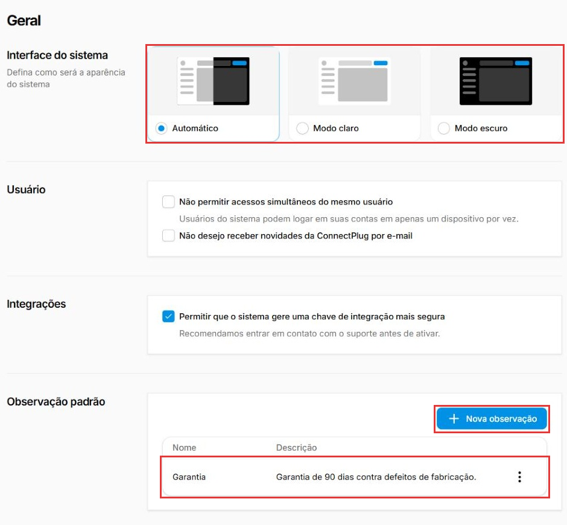
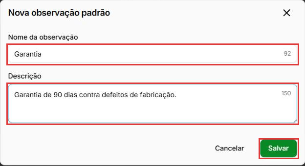
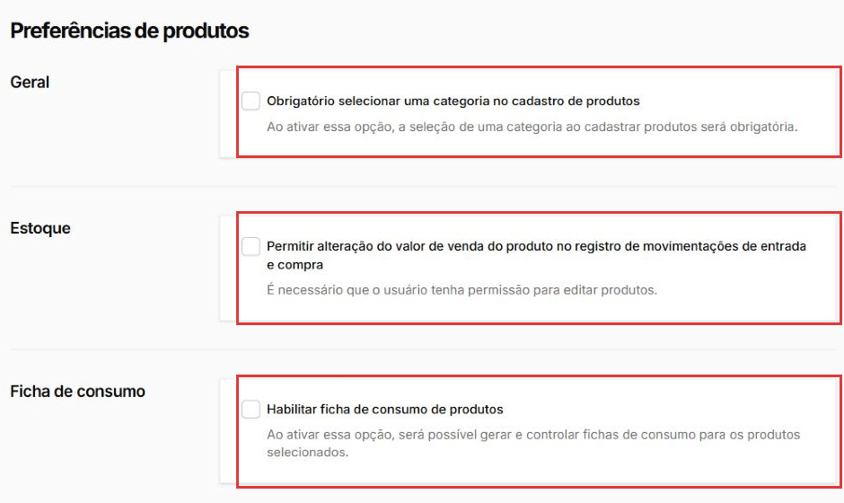
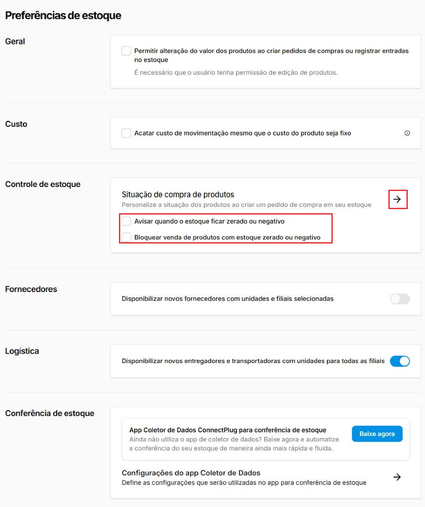
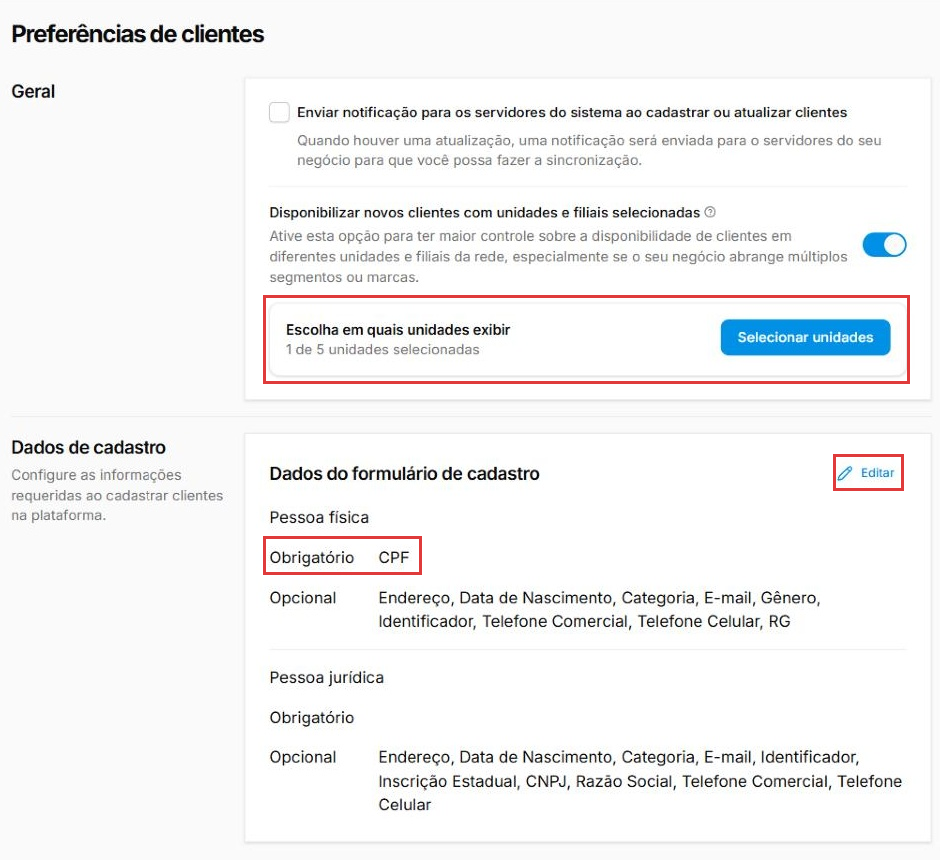

# Como ajustar as preferências do sistema

:material-clock-outline: 8 minutos · :material-format-list-numbered: 5 passos · :material-calendar-check: Atualizado em 20/11/2026

As **preferências do sistema** são as regras da casa: pequenos ajustes que mudam como o ERP funciona para todo mundo da empresa. Exemplo: uma loja que quer todos os produtos organizados por categoria liga a opção que obriga a escolher uma categoria no cadastro; outra, que vende no crediário e precisa do CPF de todo cliente, deixa o CPF obrigatório no cadastro de clientes.

## Entenda o conceito

As preferências ficam em páginas separadas por assunto:

| Página | O que ajusta |
| --- | --- |
| **Geral** | A aparência do sistema, o acesso dos usuários, a chave de integração e as observações padrão. |
| **Produtos** | A categoria obrigatória no cadastro, a alteração do valor de venda na entrada e a ficha de consumo. |
| **Estoque** | O valor e o custo nas entradas, o controle de estoque zerado, a situação das compras e a disponibilidade de fornecedores e entregadores. |
| **Clientes** | A disponibilidade de clientes nas unidades e os campos obrigatórios do cadastro de clientes. |

A página **Autoatendimento** também fica em Preferências do sistema: veja [Como configurar o autoatendimento](autoatendimento.md) e [Como configurar o horário de funcionamento](horario-de-funcionamento.md).

**Quase tudo vale para a empresa toda.** Por exemplo, o CPF obrigatório vale para todo mundo que cadastrar cliente. Por isso, combine com a equipe antes de mudar e confira o efeito logo depois.

!!! info "Antes de começar"
    Ao mudar uma opção da página, aparece no rodapé **Você tem alterações não salvas**, com **Descartar alterações** e **Salvar**. Só depois de clicar em **Salvar** a mudança vale. As observações padrão são a exceção: elas são gravadas pelo **Salvar** da própria janela.

Nos prints, o **quadrado vermelho** mostra onde você deve clicar ou digitar.

## Ajuste as preferências gerais

No menu do lado esquerdo, clique em **Configurações**, depois em **Preferências do sistema** e em **Geral**.

- **Interface do sistema:** a aparência do ERP: **Automático**, **Modo claro** ou **Modo escuro**. Ao salvar, a tela muda de cor na hora.
- **Usuário:** **Não permitir acessos simultâneos do mesmo usuário** (como explica a tela, cada usuário só consegue entrar em um aparelho por vez; útil para a mesma senha não ser usada em dois lugares ao mesmo tempo) e **Não desejo receber novidades da ConnectPlug por e-mail** (marque se não quiser receber os e-mails de novidades).
- **Integrações:** **Permitir que o sistema gere uma chave de integração mais segura**. A própria tela recomenda falar com o suporte antes de mexer nessa opção.

Clique em **Salvar**, no rodapé. Aparece **Configurações gerais atualizadas com sucesso**.

**Observação padrão** são textos prontos que a empresa repete com frequência. Como diz a tela, servem para organizar padrões em pedidos, propostas, vendas, compras e ordem de serviço. No **Novo Pedido de Venda** e na **Nova compra**, as observações são digitadas no próprio campo; para saber onde escolher as observações padrão, fale com o suporte. Para criar, clique em **Nova observação**.

{ loading=lazy }

Na janela **Nova observação padrão**, preencha o **Nome da observação** (até 100 caracteres; no exemplo, "Garantia") e a **Descrição** (até 200 caracteres; no exemplo, "Garantia de 90 dias contra defeitos de fabricação."). Clique em **Salvar**, na janela. Aparece **Observação criada com sucesso**, e ela entra na lista. Nos **três pontinhos** (⋮) da observação ficam **Editar** e **Excluir**.

{ loading=lazy }

## Ajuste as preferências de produtos

Em **Preferências do sistema**, clique em **Produtos**.

- **Obrigatório selecionar uma categoria no cadastro de produtos:** com essa opção marcada, o produto sem categoria não é salvo: o campo **Categoria** mostra **O preenchimento é obrigatório**, e aparece **Erro ao criar o produto**. Boa para manter o cardápio e os relatórios organizados (veja [Como cadastrar uma categoria](../produtos/cadastrar-categoria.md)).
- **Permitir alteração do valor de venda do produto no registro de movimentações de entrada e compra:** deixa mudar o preço de venda na hora de dar entrada. Como avisa a tela, o usuário precisa ter permissão para editar produtos.
- **Habilitar ficha de consumo de produtos:** a ficha de consumo é um papel individual de cada produto, útil em comandas e vendas fracionadas (veja [Como configurar recibos e notas impressas](../ponto-de-venda/recibos-e-notas.md)). Ao marcar, aparecem a **Configuração geral de validade das fichas** (**Sem validade**, **Minutos**, **Horas**, **Dias** ou **Meses**) e o botão **Produtos habilitados**, para escolher os produtos que terão ficha de consumo impressa.

Clique em **Salvar**. Aparece **Preferências de produtos atualizadas com sucesso**.

{ loading=lazy }

## Ajuste as preferências de estoque

Em **Preferências do sistema**, clique em **Estoque**.

- **Geral — Permitir alteração do valor dos produtos ao criar pedidos de compras ou registrar entradas no estoque:** também exige que o usuário tenha permissão de edição de produtos. Se tiver dúvida sobre a diferença para a opção parecida de **Produtos**, fale com o suporte.
- **Custo — Acatar custo de movimentação mesmo que o custo do produto seja fixo:** como explica a dica (ⓘ) da tela, o custo da entrada (por exemplo, da nota fiscal de compra) passa a valer no lugar do custo fixo do produto. O custo fixo só é usado se a entrada vier com custo zerado.
- **Controle de estoque — Situação de compra de produtos:** as etapas em que pode estar cada produto de um pedido de compra (veja [Como lançar uma compra](../estoque/lancar-compra.md)). Clique na seta: abre o painel **Controle de estoque**, com as abas **Abertos** (por exemplo, "Aguardando Fornecedor"), **Fechados** ("Produto Entregue") e **Cancelados** ("Compra Cancelada"). Cada situação tem o nome num campo editável, a alça **≡** para arrastar e a lixeira; embaixo fica **Adicionar nova situação** (por exemplo, para criar "Em conferência" em Abertos). O painel termina com **Cancelar** e **Continuar**.
- **Avisar quando o estoque ficar zerado ou negativo:** a ideia é o sistema alertar quando um produto fica sem saldo.
- **Bloquear venda de produtos com estoque zerado ou negativo:** a ideia é não deixar vender produto sem saldo. Antes de bloquear, confira se o estoque está em dia; senão, a loja pode ficar sem vender produtos que estão na prateleira. Para saber em quais telas o aviso e o bloqueio valem, fale com o suporte.
- **Fornecedores — Disponibilizar novos fornecedores com unidades e filiais selecionadas** e **Logística — Disponibilizar novos entregadores e transportadoras com unidades para todas as filiais:** só fazem diferença para empresas com mais de uma unidade ou filial. Escolhem em quais unidades os novos fornecedores e os novos entregadores e transportadoras ficam disponíveis, como diz cada opção.
- **Conferência de estoque:** o atalho **Baixe agora** para o aplicativo Coletor de Dados (veja [Como baixar os aplicativos da CPlug](../dispositivos/baixar-aplicativos.md)) e as **Configurações do app Coletor de Dados**.

Clique em **Salvar**, no rodapé.

{ loading=lazy }

## Ajuste as preferências de clientes

Em **Preferências do sistema**, clique em **Clientes**.

- **Enviar notificação para os servidores do sistema ao cadastrar ou atualizar clientes:** como explica a tela, avisa os servidores da loja quando há cadastro novo ou alterado, para fazer a sincronização. Se não souber se a sua empresa usa essa sincronização, fale com o suporte antes de ligar.
- **Disponibilizar novos clientes com unidades e filiais selecionadas:** como explica a tela, dá mais controle sobre em quais unidades e filiais cada cliente aparece, especialmente para negócios com vários segmentos ou marcas. Ligada, mostra **Escolha em quais unidades exibir**. Clique em **Selecionar unidades**, marque as unidades e clique em **Salvar**, na janela. O cadastro de cliente novo já vem com essas unidades marcadas. Com a chave ligada, escolha pelo menos uma unidade: sem nenhuma, a página não salva e mostra **O preenchimento é obrigatório**.
- **Dados de cadastro:** clique em **Editar**. Para cada campo do cadastro, nas abas **Pessoa física** e **Pessoa jurídica**, escolha **Opcional** ou **Obrigatório**. O botão **Visibilidade geral** volta para o resumo.

Clique em **Salvar**. Aparece **Preferências de clientes atualizadas com sucesso**. No exemplo, com o **CPF** obrigatório, o cadastro de um cliente sem CPF não é salvo e aparece **O campo de documentos não pode estar vazio.**

{ loading=lazy }

## Confira o efeito

Depois de salvar, abra a tela que a preferência afeta e faça um teste rápido. Por exemplo, com o CPF obrigatório, comece um cadastro de cliente sem CPF e veja se o sistema avisa. Se o efeito não for o esperado, volte à preferência, ajuste e salve de novo.

!!! tip "Boas práticas"
    - **Uma mudança por vez:** mude uma preferência, salve e confira. Fica fácil saber o que causou cada efeito.
    - **Avise a equipe:** campos que viram obrigatórios mudam o dia a dia de quem cadastra.
    - **Obrigatório só o que é necessário:** cada campo obrigatório deixa o cadastro mais demorado. Use para o que a loja realmente precisa. Sobre os dados exigidos nas notas fiscais, confirme com o seu contador.
    - **Cuidado com o bloqueio de estoque:** só bloqueie a venda com estoque zerado se o estoque estiver conferido.

## Deu algum problema?

??? question "Cliquei em Salvar e a página não salvou"
    Procure um aviso **O preenchimento é obrigatório** na página. Em **Clientes**, ele aparece quando **Disponibilizar novos clientes com unidades e filiais selecionadas** está ligada sem nenhuma unidade: escolha pelo menos uma em **Selecionar unidades** ou desligue a chave, e salve de novo.

??? question "Não consigo salvar um produto e aparece Erro ao criar o produto"
    Veja se algum campo mostra **O preenchimento é obrigatório**. Se for a **Categoria**, a opção **Obrigatório selecionar uma categoria** está ligada: escolha uma categoria para o produto.

??? question "Não consigo salvar um cliente e aparece O campo de documentos não pode estar vazio"
    O **CPF** (ou outro documento) está como **Obrigatório** em **Clientes** → **Dados de cadastro**. Preencha o documento ou, se a loja não precisar dele, volte o campo para **Opcional**.

??? question "Não encontro a observação padrão no pedido de venda"
    No **Novo Pedido de Venda** e na **Nova compra**, as observações são digitadas no próprio campo. Para saber em quais telas a observação padrão aparece para escolher, fale com o suporte.

**Relacionados:** [Como criar perfis de acesso](perfis-de-acesso.md) · [Como configurar recibos e notas impressas](../ponto-de-venda/recibos-e-notas.md) · [Como cadastrar um cliente](../clientes/cadastrar-cliente.md) · [Como cadastrar um produto](../produtos/cadastrar-produto.md) · [Como dar entrada no estoque](../estoque/entrada-de-estoque.md)

preferências do sistema preferências configurações gerais interface tema modo escuro modo claro automático acessos simultâneos chave de integração observação padrão nova observação preferências de produtos categoria obrigatória valor de venda ficha de consumo validade preferências de estoque acatar custo custo fixo situação de compra estoque zerado estoque negativo bloquear venda fornecedores entregadores transportadoras coletor de dados preferências de clientes campos obrigatórios cpf obrigatório dados de cadastro unidades tema escuro dark mode categoria obrigatória produto campos obrigatórios cliente documento obrigatório situação do pedido de compra
