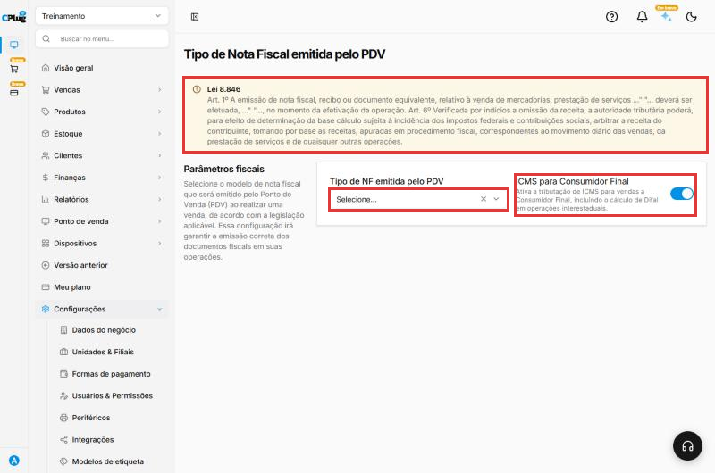
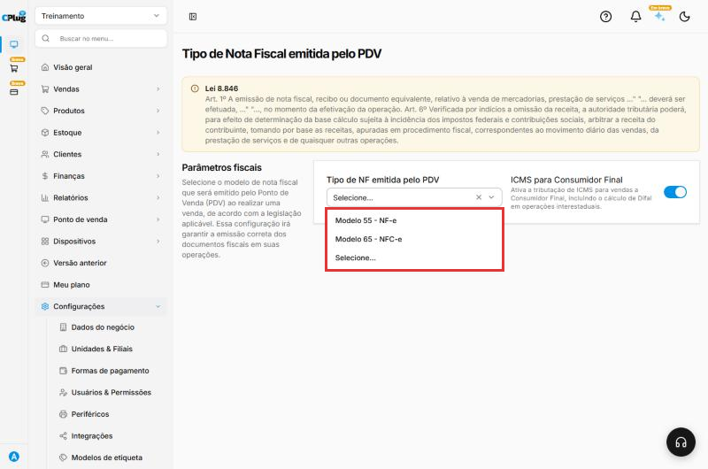

# Como definir o tipo de nota emitida no PDV

:material-clock-outline: 2 minutos · :material-format-list-numbered: 3 passos · :material-calendar-check: Atualizado em 30/10/2026

Esta configuração diz ao **caixa (PDV)** qual nota fiscal emitir em cada venda. Pela **Lei 8.846**, a nota deve ser emitida **no momento da venda**, por isso o caixa precisa saber qual modelo usar.

| Modelo | Quando usar |
| --- | --- |
| **Modelo 65 - NFC-e** | O cupom fiscal eletrônico, para vendas ao **consumidor final** no balcão. É o mais comum em lanchonetes, restaurantes e lojas. |
| **Modelo 55 - NF-e** | A nota fiscal eletrônica completa, usada principalmente quando a loja vende para **empresas**. |

!!! warning "Confirme com o contador"
    O modelo depende do tipo de negócio e do estado. Antes de mudar, confirme com o contador. E lembre: para emitir, a configuração fiscal precisa estar completa. Veja [Como configurar a emissão de notas fiscais](emissao-de-notas.md).

Nos prints, o **quadrado vermelho** mostra onde você deve clicar.

## Abra a tela

No menu do lado esquerdo, clique em **Configurações → Fiscal → Tipo de NF emitida (PDV)**.

A tela mostra o aviso da Lei 8.846, o campo **Tipo de NF emitida pelo PDV** e a opção **ICMS para Consumidor Final**.

{ loading=lazy }

## Escolha o modelo de nota

Clique em **Tipo de NF emitida pelo PDV** e escolha **Modelo 65 - NFC-e** ou **Modelo 55 - NF-e**.

{ loading=lazy }

## Confira o ICMS para Consumidor Final

A opção **ICMS para Consumidor Final** ativa a tributação de ICMS nas vendas para consumidor final, incluindo o cálculo do **Difal** em vendas para outro estado. Ligue ou desligue conforme a orientação do contador.

## Deu algum problema?

??? question "O caixa não emite nota"
    Confira se o **Tipo de NF emitida pelo PDV** está escolhido (não pode ficar em "Selecione...") e se a configuração fiscal da empresa está completa (certificado, CSC, série e grupos de impostos).

??? question "Escolhi NFC-e e o cliente pediu nota com CNPJ"
    Venda para empresa que precisa de nota completa: emita uma **NF-e**. Veja [Como emitir uma NF-e de venda](../vendas/emitir-nfe.md).

**Relacionados:** [Como configurar a emissão de notas fiscais](emissao-de-notas.md) · [Como emitir uma NF-e de venda](../vendas/emitir-nfe.md)

tipo de nota pdv caixa nfc-e modelo 65 nf-e modelo 55 cupom fiscal nota no caixa lei 8846 icms consumidor final difal configuração fiscal
