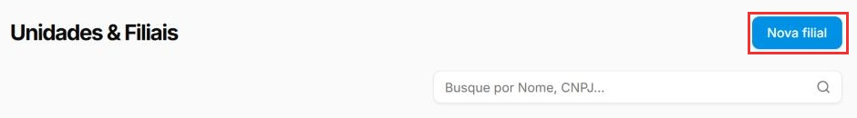
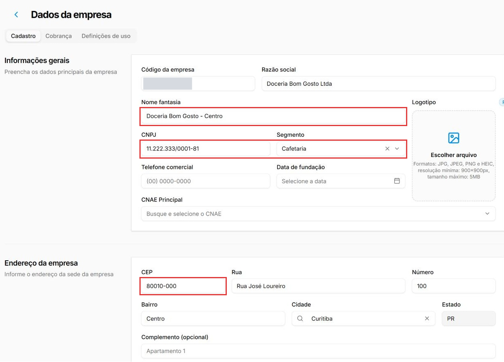
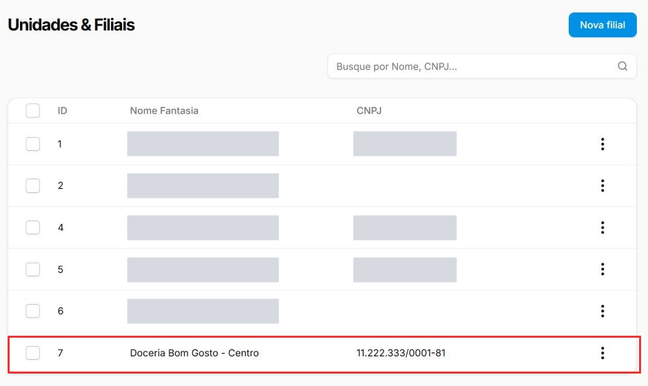

# Como cadastrar unidades e filiais

:material-clock-outline: 6 minutos · :material-format-list-numbered: 4 passos · :material-calendar-check: Atualizado em 22/11/2026

Quando a empresa abre uma nova loja, ela vira uma **filial** (ou **unidade**) na mesma conta da CPlug. Cada filial tem os seus próprios dados (razão social, CNPJ, endereço), e alguns cadastros podem ser compartilhados entre as lojas. Para trabalhar em cada loja, veja [Como trocar de empresa ou loja](../primeiros-passos/trocar-de-empresa.md). Exemplo: a Doceria Bom Gosto abre uma loja no centro e cadastra a filial "Doceria Bom Gosto - Centro".

## Entenda o conceito

| Termo | O que é |
| --- | --- |
| **Unidade / filial** | Cada loja da conta. Na tela aparece como "unidades", "filiais", "empresas" ou "lojas". |
| **Matriz** | A loja principal da conta. |
| **Seletor de unidade** | A lista no alto do menu lateral, onde você escolhe em qual loja está trabalhando (veja [Como trocar de empresa ou loja](../primeiros-passos/trocar-de-empresa.md)). |
| **Código da empresa** | O código da conta; a filial nova recebe o mesmo código da conta. |

!!! warning "Cada nova filial precisa ser contratada"
    Antes de cadastrar, fale com o time de Upgrade da CPlug para alinhar a contratação da nova unidade. Se não souber como falar com eles, peça ao suporte.

**Quando usar:** a empresa abriu uma nova loja (um novo estabelecimento, com CNPJ próprio). O CNPJ de uma filial costuma ter os mesmos 8 primeiros números da matriz e terminar em /0002, /0003…; confira com o seu **contador**. **Quando não usar:** para separar áreas da mesma loja (salão e varanda, cozinha e bar). Para isso existem outros recursos, como setores de mesas e estoques.

!!! info "Antes de começar"
    - Tenha em mãos: razão social, nome fantasia, CNPJ, segmento, telefone comercial, endereço completo e o nome dos contatos financeiro e do proprietário. Confira os dados fiscais com o seu **contador**.

Nos prints, o **quadrado vermelho** mostra onde você deve clicar ou digitar.

## Abra as unidades e filiais

No menu do lado esquerdo, clique em **Configurações** e depois em **Unidades & Filiais**. A tela lista as unidades da conta, com **ID**, **Nome Fantasia** e **CNPJ**, e tem a busca **Busque por Nome, CNPJ...**. Nos **três pontinhos** (⋮) de cada unidade ficam **Editar** e **Excluir**.

Clique em **Nova filial**.

{ loading=lazy }

## Preencha os dados da filial

Abre a tela **Nova empresa**, com as abas **Cadastro**, **Cobrança** e **Definições de uso**, os mesmos campos de [Como configurar os dados do negócio](dados-do-negocio.md). O **Código da empresa** vem bloqueado; depois de salvar, a filial mostra o código da conta.

Na aba **Cadastro**, preencha os campos obrigatórios:

- **Informações gerais:** **Razão social**, **Nome fantasia**, **CNPJ**, **Segmento** e **Telefone comercial**.
- **Endereço da empresa:** **CEP**, **Rua**, **Número** e **Bairro**. Ao digitar o **CEP**, a tela preenche sozinha a **Rua**, o **Bairro**, a **Cidade** e o **Estado**; confira e complete o **Número**.
- **Contato financeiro** e **Contato proprietário:** o **Nome** de cada um.

Os outros campos (data de fundação, logotipo, CNAE, e-mails, telefones dos contatos) são opcionais, mas vale preencher.

{ loading=lazy }

## Salve

No rodapé ficam **Descartar alterações**, **Salvar e selecionar plano** e **Salvar**. Clique em **Salvar**. Aparece **Dados salvos com sucesso**, e o título muda para **Dados da empresa**: a filial foi criada e você está no cadastro dela. O botão **Salvar e selecionar plano** só deve ser usado com a orientação do time de Upgrade.

Se faltar algum campo obrigatório, aparece a mensagem: **Não foi possível salvar os dados da empresa. Verifique os campos destacados e tente novamente.** A aba com campos faltando ganha um ícone de alerta; abra a aba e procure os campos com **O preenchimento é obrigatório**.

## Confira a filial

Volte para **Unidades & Filiais**: a nova filial aparece na lista, com um número de **ID**, o **Nome Fantasia** e o **CNPJ**. Para mudar os dados depois, clique nos **três pontinhos** (⋮) e em **Editar**.

{ loading=lazy }

!!! tip "Boas práticas"
    - **Nome fantasia claro:** inclua o bairro ou a cidade no nome (por exemplo, "Doceria Bom Gosto - Centro"). Assim fica fácil reconhecer a loja.
    - **Dados fiscais com o contador:** razão social, CNPJ e CNAE são dados oficiais da filial. Confira com o seu contador antes de salvar.
    - **Prepare a filial como uma loja nova:** equipe, estoque, preços e, se for emitir, notas fiscais. Fale com o suporte para alinhar essa configuração.

## Deu algum problema?

??? question "Apareceu Não foi possível salvar os dados da empresa"
    A aba com campos faltando ganha um ícone de alerta. Abra a aba, procure os campos com **O preenchimento é obrigatório** e preencha. Na aba **Cadastro**, são obrigatórios: razão social, nome fantasia, CNPJ, segmento, telefone comercial, CEP, rua, número, bairro e o nome dos contatos financeiro e do proprietário.

??? question "Não consigo digitar o Código da empresa"
    É assim mesmo: no cadastro da filial esse campo vem bloqueado, porque a filial usa o código da conta.

??? question "O telefone comercial sumiu depois de salvar"
    Depois de salvar, o **Telefone comercial** pode aparecer vazio ao abrir a filial em **Editar**. Se for mudar algo nessa tela, preencha o telefone de novo antes de **Salvar**, porque ele é obrigatório. Se tiver dúvida, fale com o suporte.

??? question "Posso excluir uma filial?"
    Nos **três pontinhos** (⋮) da unidade há a opção **Excluir**. Antes de usar, fale com o suporte e com o time de Upgrade, por causa dos dados e do plano da filial.

**Relacionados:** [Como trocar de empresa ou loja](../primeiros-passos/trocar-de-empresa.md) · [Como configurar os dados do negócio](dados-do-negocio.md) · [Como cadastrar um usuário](cadastrar-usuario.md) · [Como configurar a emissão de notas fiscais](emissao-de-notas.md)

unidade unidades filial filiais nova filial nova loja abrir loja nova empresa unidades e filiais cnpj razão social nome fantasia segmento cep endereço contato financeiro contato proprietário seletor de unidade trocar de loja upgrade contratação plano salvar e selecionar plano matriz abrir filial segunda loja cnpj da filial telefone comercial sumiu código da empresa bloqueado
