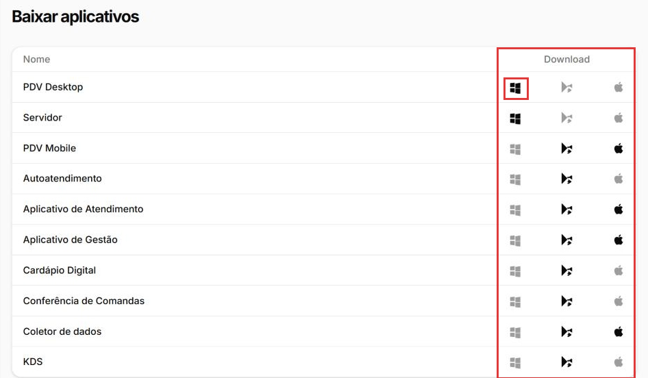

# Como baixar os aplicativos da CPlug

:material-clock-outline: 4 minutos · :material-format-list-numbered: 2 passos · :material-calendar-check: Atualizado em 20/11/2026

A CPlug tem um aplicativo para cada parte da loja: o caixa no computador, o computador servidor, a tela da cozinha e outros. A tela **Baixar aplicativos** reúne todos eles, com o atalho para baixar cada um no sistema certo. Exemplo: para montar um caixa num computador com Windows, baixe o **PDV Desktop**; para a tela da cozinha num tablet Android, baixe o **KDS**.

## Entenda o conceito

**Cada aplicativo roda em um tipo de aparelho.** Na tela, cada aplicativo tem três ícones: **Windows**, **Android** (Google Play) e **iOS** (Apple). O ícone em **preto** é onde o aplicativo está disponível; o ícone **cinza** quer dizer que ele não está disponível para aquele sistema.

| Aplicativo | Windows | Android | iOS (iPhone) |
| --- | :---: | :---: | :---: |
| **PDV Desktop** | ✔ | | |
| **Servidor** | ✔ | | |
| **PDV Mobile** | | ✔ | ✔ |
| **Autoatendimento** | | ✔ | |
| **Aplicativo de Atendimento** | | ✔ | ✔ |
| **Aplicativo de Gestão** | | ✔ | ✔ |
| **Cardápio Digital** | | ✔ | |
| **Conferência de Comandas** | | ✔ | |
| **Coletor de dados** | | ✔ | ✔ |
| **KDS** | | ✔ | |

Os mais usados são o **PDV Desktop** (o caixa no computador), o **Servidor** (o programa do computador servidor da loja, que guarda os dados e conversa com os caixas) e o **KDS** (a tela da cozinha). A instalação do Servidor é feita com o suporte. Para os demais, o nome indica a função; se não souber qual a sua loja precisa, fale com o suporte antes de instalar.

**O que acontece ao clicar:** nos ícones de **Windows**, o arquivo de instalação é baixado no computador. Nos ícones de **Android** e **iOS**, abre a página do aplicativo na **Google Play** ou na **App Store**, onde ele é instalado como qualquer outro aplicativo.

**Quando usar:** ao montar um caixa ou um aparelho novo na loja, ou ao trocar de aparelho. **Quando não usar:** para atualizar um aplicativo que já está funcionando, fale antes com o suporte.

!!! info "Antes de começar"
    Cada aplicativo é usado no aparelho da função dele: o PDV Desktop no computador do caixa, o KDS no tablet da cozinha. Para o PDV Desktop e o Servidor, use um computador com Windows.

Nos prints, o **quadrado vermelho** mostra onde você deve clicar.

## Abra a tela Baixar aplicativos

No menu do lado esquerdo, clique em **Dispositivos** e depois em **Baixar aplicativos**. A tela mostra a lista de aplicativos e, na coluna **Download**, os ícones de cada sistema.

{ loading=lazy }

## Clique no ícone do sistema do aparelho

Na linha do aplicativo, clique no ícone **preto** do sistema: **Windows**, **Android** ou **iOS**. Ao parar o mouse sobre um ícone disponível, aparece a dica **Baixar para Windows**, **Baixar para Android** ou **Baixar para iOS**.

- **Windows:** o arquivo de instalação é baixado. Abra o arquivo no computador do caixa (ou do servidor) e siga as instruções que aparecerem.
- **Android** ou **iOS:** abre a página do aplicativo na Google Play ou na App Store. Instale no aparelho em que ele vai ser usado.

!!! tip "Boas práticas"
    - **Baixe sempre por esta tela:** os ícones levam aos aplicativos da CPlug, e assim você não instala um aplicativo errado.
    - **Cada aparelho com a sua função:** instale em cada aparelho só os aplicativos da função dele. Na dúvida sobre o Servidor, fale com o suporte.
    - **Mantenha atualizado:** algumas funções exigem uma versão mínima do aplicativo; por exemplo, o **QR Code de engajamento** exige uma versão mínima do PDV Desktop (veja [Como configurar recibos e notas impressas](../ponto-de-venda/recibos-e-notas.md)). Se não souber como atualizar, fale com o suporte.

## Deu algum problema?

??? question "O ícone do meu sistema está cinza"
    O aplicativo não está disponível para esse sistema. Confira na tabela acima em quais sistemas ele está disponível. Se o seu aparelho não for compatível, fale com o suporte.

??? question "Não sei qual aplicativo a minha loja precisa"
    Fale com o suporte antes de instalar: ele indica os aplicativos de acordo com o jeito que a sua loja atende.

??? question "Instalei o aplicativo, e agora?"
    Os aparelhos da loja aparecem em **Dispositivos** → **Terminais & Dispositivos**. Para ligar um aparelho novo à sua loja, fale com o suporte.

**Relacionados:** [Como cadastrar um ponto de venda](../ponto-de-venda/cadastrar-ponto-de-venda.md) · [Como configurar o terminal de vendas](../ponto-de-venda/configurar-terminal.md) · [Como configurar recibos e notas impressas](../ponto-de-venda/recibos-e-notas.md)

baixar aplicativo download app instalar pdv desktop servidor pdv mobile autoatendimento totem aplicativo de atendimento aplicativo de gestão cardápio digital conferência de comandas coletor de dados kds tela da cozinha windows android google play iphone ios apple app store
