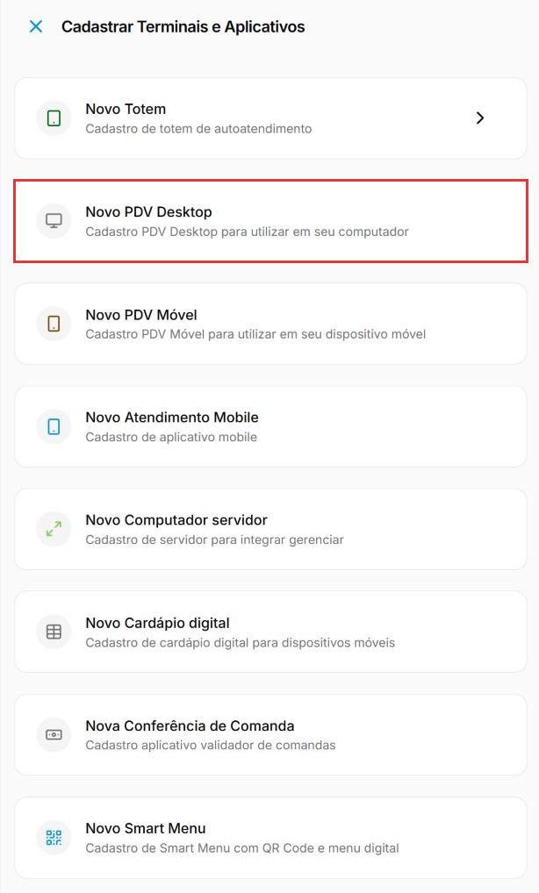
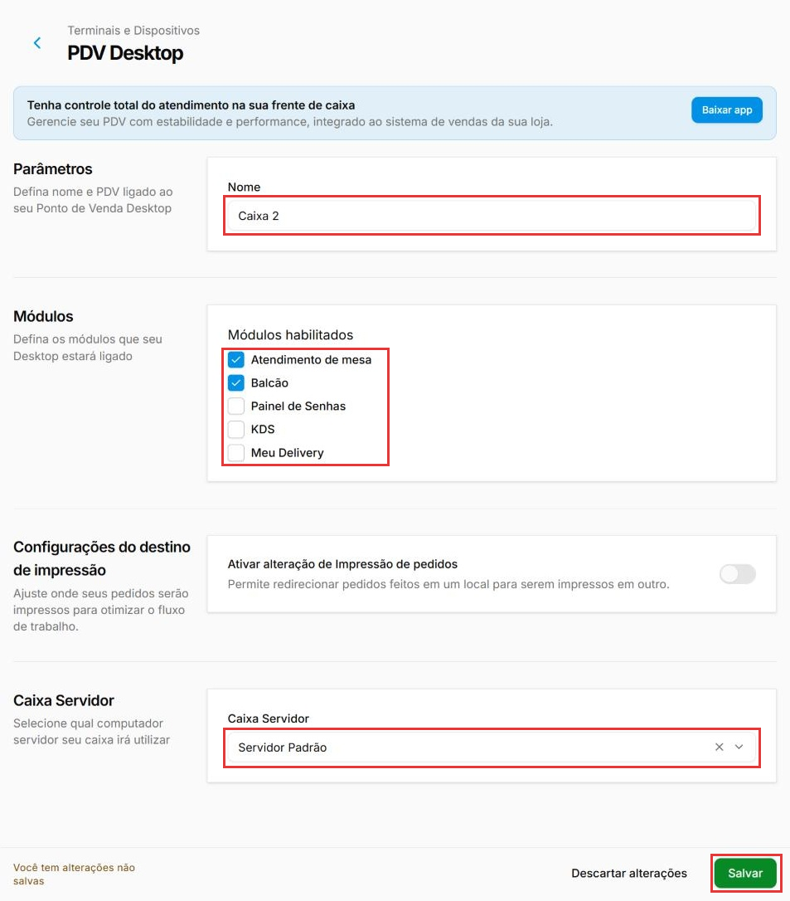
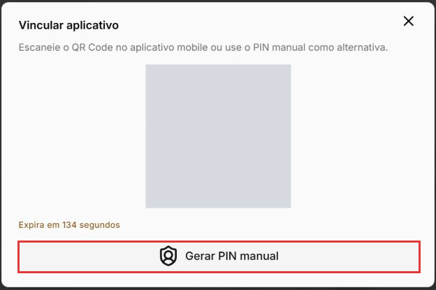
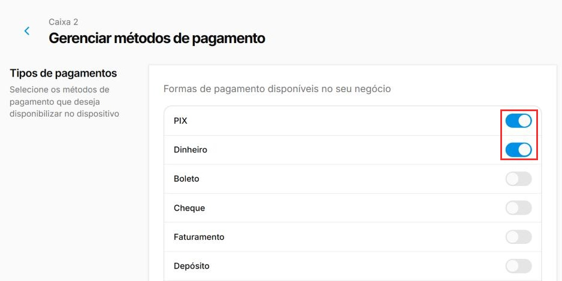
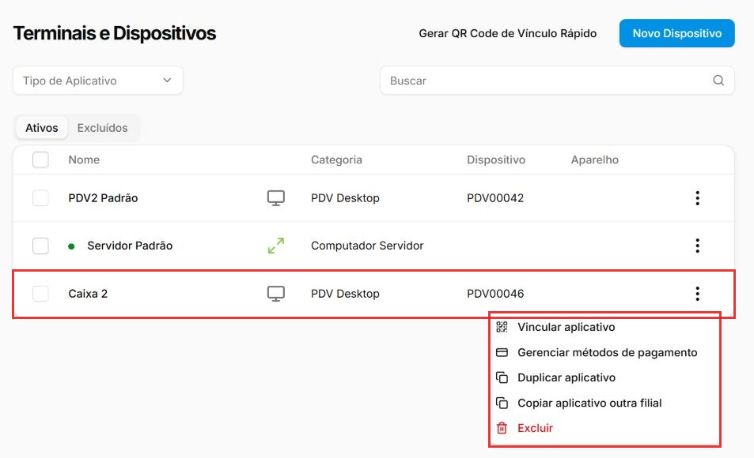

# Como cadastrar um terminal ou dispositivo

:material-clock-outline: 9 minutos · :material-format-list-numbered: 6 passos · :material-calendar-check: Atualizado em 22/11/2026

Cada aparelho que usa um aplicativo da CPlug na loja (o computador do caixa, o celular do garçom, o tablet do cardápio) precisa de um **cadastro** no ERP. É nesse cadastro que você diz o que o aparelho faz e com o que ele se conecta; depois, o aplicativo instalado no aparelho é ligado a esse cadastro. Exemplo: a loja vai abrir um segundo caixa. O responsável cadastra o **PDV Desktop** "Caixa 2", escolhe os módulos dele e liga o aplicativo do computador novo a esse cadastro.

## Entenda o conceito

**Cadastro × aparelho.** O cadastro (o "terminal") fica no ERP; o aparelho é o computador, celular ou tablet com o aplicativo instalado. Primeiro você cria o cadastro; depois **vincula** o aplicativo a ele. Para instalar os aplicativos, veja [Como baixar os aplicativos da CPlug](baixar-aplicativos.md). Os nomes mudam um pouco entre as duas telas: por exemplo, o cadastro **PDV Móvel** corresponde ao aplicativo **PDV Mobile**, e o **Computador servidor**, ao **Servidor**.

**Os tipos de cadastro**, como aparecem no botão **Novo Dispositivo**:

| Tipo | Descrição na tela |
| --- | --- |
| **Totem** | "Cadastro de totem de autoatendimento" |
| **PDV Desktop** | "Cadastro PDV Desktop para utilizar em seu computador" |
| **PDV Móvel** | "Cadastro PDV Móvel para utilizar em seu dispositivo móvel" |
| **Atendimento Mobile** | "Cadastro de aplicativo mobile" |
| **Computador servidor** | "Cadastro de servidor para integrar gerenciar" |
| **Cardápio digital** | "Cadastro de cardápio digital para dispositivos móveis" |
| **Conferência de Comanda** | "Cadastro aplicativo validador de comandas" |
| **Smart Menu** | "Cadastro de Smart Menu com QR Code e menu digital" |

Cada tipo tem o seu formulário. Este manual mostra o **PDV Desktop**, o caixa no computador. Para os outros tipos, se tiver dúvida sobre algum campo, fale com o suporte.

**Terminal × ponto de venda × terminal de vendas.** São três telas diferentes:

- **Este cadastro** (Terminais & Dispositivos): o aparelho com o aplicativo.
- **Ponto de venda** (veja [Como cadastrar um ponto de venda](../ponto-de-venda/cadastrar-ponto-de-venda.md)): o caixa do ponto de vista do dinheiro, com a gaveta, a abertura e o fechamento.
- **Terminal de vendas** (veja [Como configurar o terminal de vendas](../ponto-de-venda/configurar-terminal.md)): as regras de venda que valem para todos os caixas.

Para saber quais desses cadastros a sua loja precisa para um caixa novo, fale com o suporte.

**O código do dispositivo.** Ao salvar um PDV, o cadastro recebe um código na coluna **Dispositivo** (por exemplo, **PDV00046**). Informe esse código ao pedir ajuda ao suporte sobre esse aparelho.

**Quando usar:** ao colocar um aparelho novo para trabalhar na loja, como um caixa a mais ou um celular para o garçom. **Quando não usar:** para trocar o computador de um caixa que já existe, fale antes com o suporte.

!!! info "Antes de começar"
    - Tenha o aparelho com o aplicativo instalado (veja [Como baixar os aplicativos da CPlug](baixar-aplicativos.md)).
    - O PDV Desktop e o PDV Móvel têm o campo **Caixa Servidor**: o computador servidor da loja, que aparece na lista com a categoria **Computador Servidor**.

Nos prints, o **quadrado vermelho** mostra onde você deve clicar ou digitar.

## Abra os terminais e dispositivos

No menu do lado esquerdo, clique em **Dispositivos** e depois em **Terminais & Dispositivos**. Abre a tela **Terminais e Dispositivos**, com os cadastros da unidade: **Nome**, **Categoria** (o tipo), **Dispositivo** (o código) e **Aparelho**. O filtro **Tipo de Aplicativo** e a busca ajudam quando a lista é grande.

Clique em **Novo Dispositivo**. Abre o painel **Cadastrar Terminais e Aplicativos**, com os tipos. Clique no tipo do aparelho (no exemplo, **Novo PDV Desktop**).

{ loading=lazy }

## Preencha o cadastro do PDV Desktop

No formulário **PDV Desktop**:

- **Nome:** um nome que identifique o caixa (no exemplo, "Caixa 2"; a tela sugere "Terminal de entrada").
- **Módulos habilitados:** "Defina os módulos que seu Desktop estará ligado". As opções são **Atendimento de mesa**, **Balcão**, **Painel de Senhas**, **KDS** (a tela da cozinha) e **Meu Delivery**. Marque os que este caixa vai usar; no exemplo, foram marcados **Atendimento de mesa** e **Balcão**. Veja também [Como cadastrar mesas e setores](mesas.md) e [Como configurar o painel de senhas](../ponto-de-venda/painel-de-senhas.md).
- **Ativar alteração de Impressão de pedidos** (opcional): "Permite redirecionar pedidos feitos em um local para serem impressos em outro". Ao ligar, aparecem **Imprime em** (a impressora de origem), **Redirecionar para** (a que vai receber no lugar dela) e o botão **Aplicar alteração**. Exemplo: os pedidos que sairiam na impressora da cozinha passam a sair na do bar. As mesas também têm uma rota de impressão por setor (veja [Como cadastrar mesas e setores](mesas.md)); se for usar as duas, fale com o suporte. Se este caixa não precisa de desvio, deixe a chave desligada.
- **Caixa Servidor:** "Selecione qual computador servidor seu caixa irá utilizar" (no exemplo, **Servidor Padrão**).

No alto do formulário fica o botão **Baixar app**; os aplicativos também estão em [Como baixar os aplicativos da CPlug](baixar-aplicativos.md).

{ loading=lazy }

## Salve

No rodapé aparece **Você tem alterações não salvas**, com **Descartar alterações** e **Salvar**. Clique em **Salvar**. A tela volta para a lista, e o novo cadastro aparece com o seu código na coluna **Dispositivo** (no exemplo, **PDV00046**).

## Vincule o aplicativo do aparelho

Na lista, clique nos **três pontinhos** (⋮) do cadastro e em **Vincular aplicativo**. Abre uma janela com um **QR Code**: "Escaneie o QR Code no aplicativo mobile ou use o PIN manual como alternativa." O código vale por pouco tempo: a tela mostra a contagem (**Expira em … segundos**). Se expirar, feche e abra de novo.

- **QR Code:** como diz a tela, é para escanear no aplicativo mobile, ou seja, no celular ou tablet.
- **PIN manual:** a alternativa ao QR Code, útil quando não dá para escanear. Clique em **Gerar PIN manual** e em **Gerar PIN**. Aparecem um **Login** e um **PIN**, cada um com o botão de copiar, para informar no aplicativo do aparelho.

{ loading=lazy }

!!! warning "O QR Code e o PIN são chaves de acesso"
    Quem usa o QR Code ou o PIN liga um aparelho à sua loja. Gere na hora de vincular, com o aparelho na mão, e não envie por mensagem.

## Confira as formas de pagamento do aparelho

Nos **três pontinhos** (⋮) do cadastro, clique em **Gerenciar métodos de pagamento**. Como diz a tela, aqui você seleciona "os métodos de pagamento que deseja disponibilizar no dispositivo". A tela tem:

- **Formas de pagamento disponíveis no seu negócio:** por exemplo, PIX, Dinheiro, Boleto, Cheque, Vale Refeição, Crédito em Loja, Cartão de Crédito e Cartão de Débito.
- **Formas de pagamento criadas por você disponíveis no seu negócio:** as formas que a sua empresa criou (no exemplo, **Pix na maquininha**).
- **Configurações TEF:** a integração com o TEF (pagamento com cartão integrado ao caixa), com o botão **Configurações de VPN**.

Para ligar ou desligar uma forma, clique na chave dela. A mudança grava na hora: ao ligar, aparece **Pagamento ativado com sucesso**. Num cadastro novo, todas as chaves vêm desligadas, e o caixa que já vem pronto na conta também pode estar assim. Antes de ligar ou desligar formas de pagamento, fale com o suporte para alinhar como o seu caixa vai receber. A configuração do TEF e da VPN é feita com o suporte.

{ loading=lazy }

## Edite, duplique ou exclua um cadastro

Para mudar um cadastro, clique no **nome** dele na lista: abre o mesmo formulário, para editar. Nos **três pontinhos** (⋮) de cada cadastro ficam:

- **Vincular aplicativo** e **Gerenciar métodos de pagamento:** os dois passos anteriores.
- **Duplicar aplicativo:** "Essa ação criará um novo app com as mesmas configurações do original." Você escolhe o **Nome do dispositivo** (o nome vem como "Copia de Caixa 2") e clica em **Confirmar**. Útil para montar vários caixas parecidos. A janela tem ainda a chave **Manter o ID da TEF**; se a loja usa TEF, fale com o suporte antes de decidir.
- **Copiar aplicativo outra filial:** abre a mesma janela do duplicar, com mais um campo, **Selecione a empresa para enviar o dispositivo duplicado**. Antes de copiar para outra unidade, fale com o suporte.
- **Excluir:** pede confirmação ("Tem certeza que deseja deletar o terminal?"). O cadastro excluído vai para a aba **Excluídos**, onde os **três pontinhos** (⋮) dele têm a opção **Restaurar**. Antes de excluir o cadastro de um aparelho que ainda está em uso, fale com o suporte.

{ loading=lazy }

!!! tip "Boas práticas"
    - **Nomes claros:** use nomes que digam onde fica o aparelho ("Caixa 2", "Garçom Salão", "Totem Entrada"). Fica fácil achar o cadastro certo na hora de vincular ou de pedir ajuda.
    - **Um cadastro para cada aparelho:** assim cada aparelho fica com o seu nome e o seu código. Para montar vários caixas parecidos, use **Duplicar aplicativo** e troque o nome.
    - **Mudanças em caixa que já vende:** antes de desmarcar módulos ou mudar formas de pagamento de um caixa em uso, fale com o suporte.

## Deu algum problema?

??? question "O QR Code expirou antes de eu escanear"
    Feche a janela e clique de novo em **Vincular aplicativo**. Se não conseguir escanear, use **Gerar PIN manual**.

??? question "Onde escaneio o QR Code ou digito o Login e o PIN?"
    No aplicativo da CPlug instalado no aparelho que você está ligando. Se não encontrar onde, fale com o suporte.

??? question "Preciso cadastrar também o ponto de venda?"
    O ponto de venda é outro cadastro, ligado ao dinheiro do caixa (veja [Como cadastrar um ponto de venda](../ponto-de-venda/cadastrar-ponto-de-venda.md)). Para saber o que a sua loja precisa ao abrir um caixa novo, fale com o suporte.

??? question "O Computador servidor não aparece na lista Caixa Servidor"
    A lista mostra os computadores servidores cadastrados na unidade. Se a sua loja ainda não tem um, fale com o suporte: a instalação do servidor é feita com ele.

??? question "Para que serve o Gerar QR Code de Vínculo Rápido?"
    O botão, no alto da lista, abre um QR Code que, como diz a tela, é para escanear "no aplicativo mobile para vincular automaticamente um novo dispositivo". Na dúvida entre ele e o **Vincular aplicativo** de um cadastro, fale com o suporte.

??? question "Excluí um cadastro por engano"
    Abra a aba **Excluídos**: o cadastro está lá, e os **três pontinhos** (⋮) dele têm a opção **Restaurar**. Se tiver dúvida, fale com o suporte.

??? question "Posso usar o botão Revogar licença?"
    Esse botão aparece ao editar um cadastro já salvo. Não use sem orientação do suporte.

**Relacionados:** [Como baixar os aplicativos da CPlug](baixar-aplicativos.md) · [Como cadastrar um ponto de venda](../ponto-de-venda/cadastrar-ponto-de-venda.md) · [Como configurar o terminal de vendas](../ponto-de-venda/configurar-terminal.md) · [Como cadastrar mesas e setores](mesas.md) · [Como configurar o painel de senhas](../ponto-de-venda/painel-de-senhas.md)

terminal terminais dispositivo dispositivos novo dispositivo cadastrar caixa novo caixa segundo caixa pdv desktop pdv móvel pdv mobile atendimento mobile garçom computador servidor caixa servidor cardápio digital conferência de comanda smart menu totem vincular aplicativo vincular aparelho qr code pin manual login e pin vínculo rápido métodos de pagamento formas de pagamento tef vpn duplicar aplicativo copiar para outra filial excluir restaurar módulos atendimento de mesa balcão painel de senhas kds meu delivery revogar licença código do dispositivo
