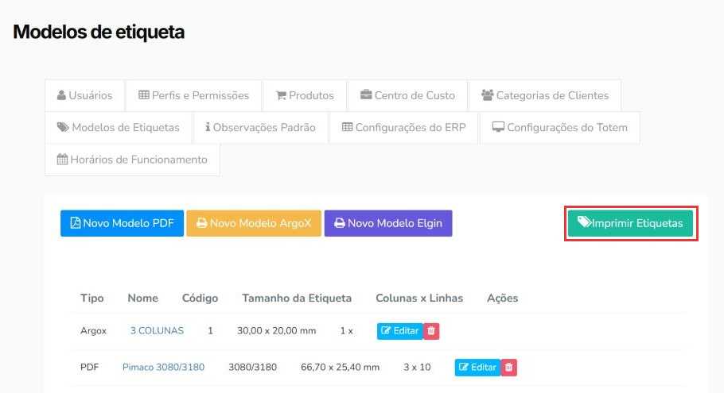
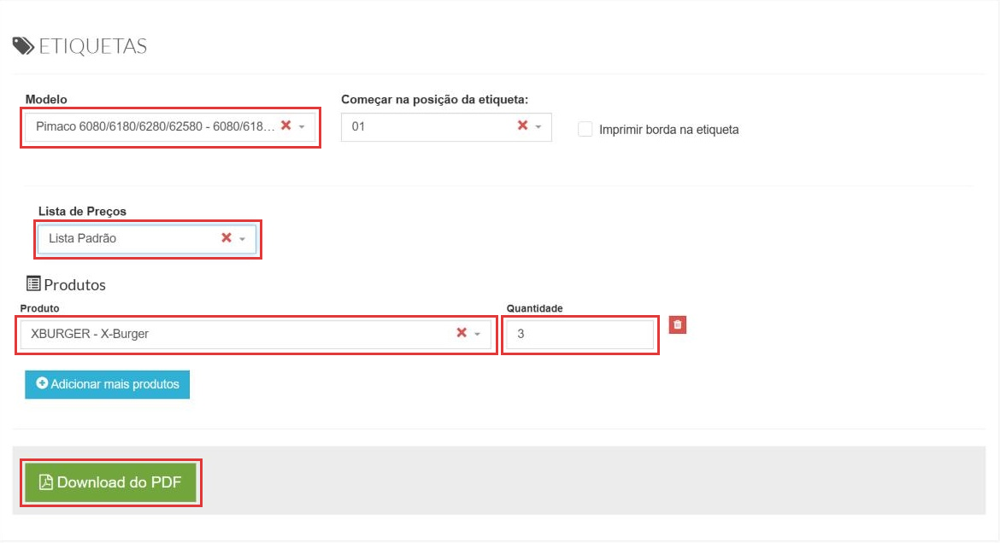

# Como imprimir etiquetas

:material-clock-outline: 7 minutos · :material-format-list-numbered: 4 passos · :material-calendar-check: Atualizado em 22/11/2026

As etiquetas identificam os produtos na prateleira ou na embalagem. O sistema usa um **modelo de etiqueta**, no tamanho da folha que você compra, e gera um PDF com as etiquetas para imprimir numa impressora comum. Exemplo: a loja quer etiquetar 3 unidades do **X-Burger**. Ela escolhe o modelo da folha Pimaco que tem, o produto e a quantidade, e baixa o PDF.

## Entenda o conceito

**Modelo de etiqueta** é o "molde" da folha: o tamanho da folha e de cada etiqueta, quantas colunas e linhas, e o que aparece em cada etiqueta. A lista de modelos costuma trazer as folhas **Pimaco** mais comuns (no exemplo, **Pimaco 6080/6180/6280/62580**, com etiquetas de 66,70 × 25,40 mm, em 3 colunas × 10 linhas).

Há três tipos de modelo, um para cada botão da tela:

| Tipo | Para quê | Onde ver |
| --- | --- | --- |
| **PDF** (**Novo Modelo PDF**) | Folhas de etiquetas, como as Pimaco, numa impressora comum. | Este manual. |
| **ArgoX** (**Novo Modelo ArgoX**) | Etiquetadora térmica Argox. | [Configuração e problemas de etiquetas (Elgin e Argox)](../suporte/perifericos/etiquetas-elgin-argox.md) |
| **Elgin** (**Novo Modelo Elgin**) | Etiquetadora térmica Elgin. | O mesmo manual acima. |

**O que sai na etiqueta.** Cada modelo define, em **Exibir na Etiqueta**, uma lista de linhas, e cada linha mostra um **Campo**: **Nome da Empresa**, **Código do Produto**, **Nome do Produto**, **Código + Nome do Produto**, **Categoria do Produto**, **Valor do Produto**, **Validade do Produto**, **Texto personalizado** ou **Logo da Empresa**. No exemplo, o modelo **Pimaco 6080/6180/6280/62580** mostra **Nome da Empresa**, **Código do Produto**, **Nome do Produto** e **Valor do Produto**. O modelo também define a **Fonte** e a **Imagem de Leitura** (**Nenhuma**, **Código de Barras** ou **QrCode**; no exemplo, **Nenhuma**).

**Quando usar:** para etiquetar produtos na chegada da mercadoria, na troca de preço ou para montar a vitrine. **Quando não usar:** com etiquetadora térmica (veja o manual da tabela acima) ou para imprimir pedidos e cupons (veja [Como configurar uma impressora](impressora.md)).

!!! info "Antes de começar"
    - Tenha a folha de etiquetas e confira o número dela na embalagem (por exemplo, Pimaco 6180). O modelo do sistema precisa ter o mesmo número.
    - O preço que sai na etiqueta vem da lista de preços escolhida (veja [Como criar uma lista de preços](../produtos/lista-de-precos.md)).
    - A tela de etiquetas abre no formato do sistema antigo, dentro do ERP. As abas do alto (**Usuários**, **Perfis e Permissões** e outras) levam a outras telas e não são usadas aqui.

Nos prints, o **quadrado vermelho** mostra onde você deve clicar ou digitar.

## Abra os modelos e encontre o da sua folha

No menu do lado esquerdo, clique em **Configurações** e depois em **Modelos de etiqueta**. A tela mostra a lista de modelos, com **Tipo**, **Nome**, **Código**, **Tamanho da Etiqueta** e **Colunas x Linhas**. Procure o modelo com o número da sua folha na coluna **Código**.

## Confira o que sai na etiqueta (opcional)

Para ver o que o modelo imprime, clique em **Editar** na linha dele. A seção **Exibir na Etiqueta** mostra as linhas da etiqueta: em cada uma, o **Campo** escolhido e o botão **Excluir**; **Adicionar nova linha** inclui outra. Abaixo ficam a **Fonte** (**Tipo**, **Tamanho (pt)** e **Alinhamento**) e a **Imagem de Leitura**. Para gravar uma mudança, clique em **Salvar**.

!!! warning "A mudança vale para todas as impressões com esse modelo"
    Se mudar um modelo, todas as etiquetas impressas com ele saem do novo jeito. Não mude as medidas de **Folha**, **Colunas e Linhas da Folha** e **Etiqueta - Dimensões** de um modelo Pimaco: elas são as da folha. Na dúvida, fale com o suporte.

## Abra a impressão e escolha o modelo

Na lista de modelos, clique em **Imprimir Etiquetas**.

{ loading=lazy }

Abre a tela **Etiquetas**. Preencha:

- **Modelo:** o modelo da sua folha (no exemplo, **Pimaco 6080/6180/6280/62580**).
- **Começar na posição da etiqueta:** a etiqueta da folha onde a impressão começa (vem **01**, a primeira). Serve para aproveitar uma folha que já foi usada em parte. Escolha uma posição que exista na sua folha (numa folha de 3 × 10, de 01 a 30).
- **Imprimir borda na etiqueta** (opcional).
- **Lista de Preços:** escolha sempre a lista de onde vem o preço (no exemplo, **Lista Padrão**). Como diz a tela, a lista escolhida neste campo "terá prioridade sobre as outras listas".

## Escolha os produtos e gere o PDF

Em **Produtos**:

- **Produto:** digite o nome e escolha na lista (no exemplo, **XBURGER - X-Burger**).
- **Quantidade:** quantas etiquetas desse produto (no exemplo, **3**).

Para incluir outro produto na mesma impressão, clique em **Adicionar mais produtos**. A **lixeira** vermelha ao lado tira o produto.

Com um modelo **PDF** escolhido, aparece o botão **Download do PDF**. Clique nele: o sistema gera o arquivo das etiquetas para você abrir e imprimir na folha de etiquetas.

{ loading=lazy }

!!! tip "Boas práticas"
    - **Imprima em tamanho real:** na janela de impressão do computador, escolha o tamanho real (100%), sem "ajustar à página".
    - **Teste numa folha comum:** antes de usar a folha de etiquetas, imprima o PDF numa folha comum (com **Imprimir borda na etiqueta**, se quiser ver o contorno) e coloque por cima da folha de etiquetas, contra a luz, para conferir o alinhamento.
    - **Aproveite a folha:** anote em qual posição parou e, na próxima vez, use **Começar na posição da etiqueta**.
    - **Preço atualizado:** confira a lista de preços antes de imprimir, para a etiqueta não sair com preço antigo.

## Deu algum problema?

??? question "Não encontro o modelo da minha folha"
    Confira o número na embalagem da folha e procure na coluna **Código** da lista de modelos. Se não houver, fale com o suporte para criar o modelo com as medidas da sua folha.

??? question "As etiquetas saem desalinhadas"
    Confira se imprimiu em tamanho real (100%) e se o modelo escolhido é o mesmo número da folha. Se continuar, fale com o suporte.

??? question "O preço da etiqueta está errado"
    Confira a **Lista de Preços** escolhida na tela e o preço do produto nessa lista (veja [Como criar uma lista de preços](../produtos/lista-de-precos.md)).

??? question "O código de barras não sai na etiqueta"
    Abra o modelo em **Editar** e veja a **Imagem de Leitura**: ela precisa estar em **Código de Barras**. Confira também se o produto tem código de barras no cadastro. Lembre que a mudança vale para todas as impressões com esse modelo.

??? question "Meu modelo não aparece na lista Modelo, ou não aparece o botão Download do PDF"
    O botão **Download do PDF** aparece com modelos do tipo **PDF**. Se você usa etiquetadora térmica (Elgin ou Argox), veja [Configuração e problemas de etiquetas (Elgin e Argox)](../suporte/perifericos/etiquetas-elgin-argox.md); se o modelo dela não aparecer na lista **Modelo**, fale com o suporte.

**Relacionados:** [Configuração e problemas de etiquetas (Elgin e Argox)](../suporte/perifericos/etiquetas-elgin-argox.md) · [Como criar uma lista de preços](../produtos/lista-de-precos.md) · [Como configurar uma impressora](impressora.md)

etiqueta etiquetas imprimir etiquetas etiqueta de produto etiqueta de preço etiqueta de gôndola modelos de etiqueta pimaco 6180 6080 folha de etiquetas download do pdf pdf começar na posição da etiqueta borda lista de preços quantidade de etiquetas código de barras qrcode exibir na etiqueta imagem de leitura fonte argox elgin etiquetadora
