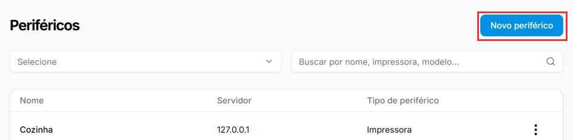
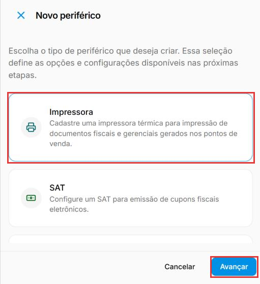
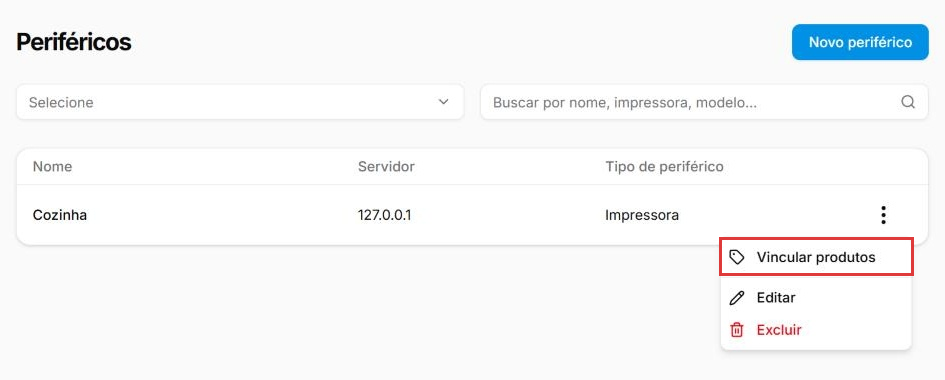
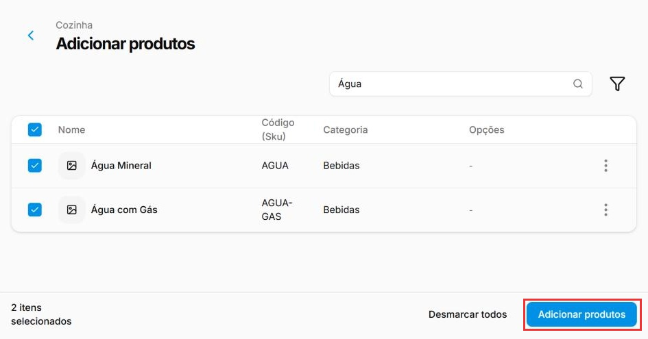
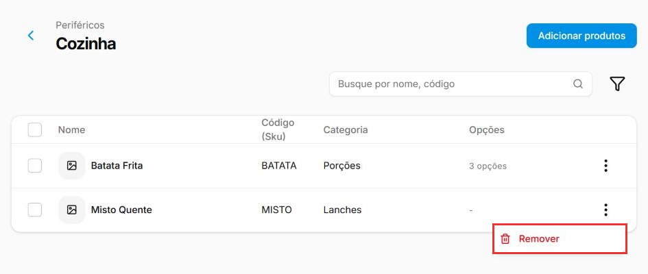
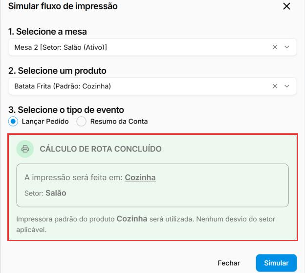

# Como configurar uma impressora

:material-clock-outline: 7 minutos · :material-format-list-numbered: 5 passos · :material-calendar-check: Atualizado em 22/11/2026

A impressora térmica é a que imprime o cupom do caixa, o pedido que vai para a cozinha e o resumo da conta das mesas. Para o sistema usar uma impressora, ela precisa estar **cadastrada** e, para os pedidos, cada produto precisa saber **em qual impressora sair**. Exemplo: a lanchonete tem a impressora **Cozinha**. Ela cadastra a impressora e vincula a ela a **Batata Frita** e o **Misto Quente**: o sistema passa a mandar o pedido desses produtos para a Cozinha.

## Entenda o conceito

**Periféricos** são os aparelhos que trabalham junto com o caixa. Ao cadastrar um (janela **Novo periférico**), há quatro tipos:

| Tipo | Descrição na tela |
| --- | --- |
| **Impressora** | "Cadastre uma impressora térmica para impressão de documentos fiscais e gerenciais gerados nos pontos de venda." |
| **SAT** | "Configure um SAT para emissão de cupons fiscais eletrônicos." |
| **Etiquetadora** | "Cadastre uma impressora de etiquetas para identificação de produtos, gôndolas e outras finalidades." |
| **Balança** | "Configure uma balança ou gere um arquivo de produtos para carga no software da balança." |

Este manual trata da **impressora**.

**Impressora padrão do produto.** Cada produto tem a sua impressora de pedidos. Ela não fica no cadastro do produto: você vincula os produtos à impressora em **Periféricos**, pela opção **Vincular produtos**. Depois disso, o produto passa a mostrar a impressora como padrão (por exemplo, **Batata Frita (Padrão: Cozinha)** no simulador de impressão).

**Onde mais a impressora aparece.** Depois de cadastrada, ela também pode ser escolhida:

- no **setor das mesas**, para o resumo da conta e as rotas de impressão (veja [Como cadastrar mesas e setores](mesas.md));
- no **ponto de venda**, como **Ponto de Impressão** do caixa, onde saem o cupom e os recibos (veja [Como cadastrar um ponto de venda](../ponto-de-venda/cadastrar-ponto-de-venda.md));
- no cadastro do **PDV Desktop**, para desviar pedidos de uma impressora para outra (veja [Como cadastrar um terminal ou dispositivo](cadastrar-terminal.md)).

**Pedidos × caixa.** Os passos 3 a 5 deste manual são para os **pedidos** que saem na cozinha ou no bar. Para o **caixa** imprimir o cupom e os recibos, depois do passo 2 escolha a impressora no **Ponto de Impressão** do ponto de venda (veja [Como cadastrar um ponto de venda](../ponto-de-venda/cadastrar-ponto-de-venda.md)).

**Quando usar:** ao instalar uma impressora nova na loja ou ao lançar produtos que precisam sair na cozinha ou no bar.

!!! info "Antes de começar"
    - A impressora está ligada na tomada, com papel, e conectada ao computador (USB) ou à rede da loja.
    - Saiba como ela está ligada: **na USB do computador**, **no cabo de rede com IP próprio** ou **na rede com driver do Windows**. Cada jeito tem um manual técnico (veja o passo 2). Se não souber, fale com o suporte.

Nos prints, o **quadrado vermelho** mostra onde você deve clicar ou o que conferir.

## Abra os periféricos

No menu do lado esquerdo, clique em **Configurações** e depois em **Periféricos**. A lista mostra o **Nome**, o **Servidor** e o **Tipo de periférico** de cada aparelho. A lista **Selecione** filtra pelo tipo (**Balança**, **Etiquetadora**, **Impressora**, **SAT** ou **Todos**), e a busca procura por nome, impressora ou modelo.

Se a impressora já está na lista, vá direto para o passo 3. Se não, clique em **Novo periférico**.

{ loading=lazy }

## Cadastre a impressora

Na janela **Novo periférico**, clique em **Impressora** e depois em **Avançar**. Abre a tela **Novo ponto de impressão**, onde você informa o nome (por exemplo, "Cozinha"), a descrição (obrigatória), o fabricante, o modelo e como o sistema chega até a impressora.

Os campos de conexão mudam conforme a impressora está ligada. Preencha seguindo o manual do seu caso e clique em **Salvar**:

| Como a impressora está ligada | Manual |
| --- | --- |
| Na USB do computador | [Impressora USB no ERP 2.0](../suporte/perifericos/impressora-usb-erp2.md) |
| No cabo de rede, com IP próprio | [Como cadastrar uma impressora de rede direta no ERP 2.0](../suporte/perifericos/impressora-rede-erp2.md) |
| Na rede, instalada com driver no Windows | [Impressora de rede com spooler/driver do Windows no ERP 2.0](../suporte/perifericos/impressora-spooler-erp2.md) |

{ loading=lazy }

## Abra os produtos da impressora

Na lista de **Periféricos**, clique nos **três pontinhos** (⋮) da impressora e em **Vincular produtos**. No mesmo menu ficam **Editar** e **Excluir**.

Abre a tela com o nome da impressora (no exemplo, **Cozinha**) e a lista dos produtos que saem nela. Na primeira vez, aparece **Sem dados no momento**. Clique em **Adicionar produtos**.

{ loading=lazy }

## Adicione os produtos

Abre a tela **Adicionar produtos**, com os produtos que ainda não estão nesta impressora: **Nome**, **Código (Sku)**, **Categoria** e **Opções**. Para achar os produtos mais rápido, use a busca (**Busque por nome, código**) ou o **funil**, que filtra por **Categoria**, **Unidade de medida** e **Opções** (com ou sem variações e complementos).

Há dois jeitos de adicionar:

- **Um produto:** clique nos **três pontinhos** (⋮) da linha e em **Adicionar**. Aparece **Produto associado com sucesso**, e o produto some desta lista.
- **Vários de uma vez:** marque a caixinha ao lado de cada produto. No rodapé aparecem a contagem (por exemplo, **2 itens selecionados**), **Desmarcar todos** e **Adicionar produtos**. Clique em **Adicionar produtos**. A gravação em lote roda em segundo plano: a tela avisa **Atualizando seus produtos** e, ao terminar, **Seus produtos foram atualizados**. Enquanto isso, você pode continuar usando o sistema.

{ loading=lazy }

Volte (seta **‹** ao lado do título) para ver os produtos vinculados à impressora. Para tirar um produto desta impressora, clique nos **três pontinhos** (⋮) dele e em **Remover**. O botão **Adicionar produtos**, no alto, volta para a lista do passo anterior.

{ loading=lazy }

## Confira no simulador de impressão

Para ver onde o pedido de um produto vai sair, use o simulador das mesas. Ele precisa de pelo menos uma mesa cadastrada; se a loja não usa mesas, pule este passo e faça um pedido de teste com a equipe. em **Ponto de venda** → **Mesas**, clique em **Gerenciar Setores** e na seta do quadro **Simulador de impressão** (veja o passo a passo em [Como cadastrar mesas e setores](mesas.md)). Escolha uma mesa, o produto e o evento **Lançar Pedido**, e clique em **Simular**.

No exemplo, o produto aparece como **Batata Frita (Padrão: Cozinha)**, e o resultado é **CÁLCULO DE ROTA CONCLUÍDO**: "A impressão será feita em: Cozinha", com a explicação "Impressora padrão do produto Cozinha será utilizada. Nenhum desvio do setor aplicável." Ou seja: o setor Salão não tem rota de impressão que troque a Cozinha por outra impressora.

{ loading=lazy }

!!! tip "Boas práticas"
    - **Nome pelo lugar:** chame a impressora pelo lugar onde ela fica ("Cozinha", "Bar", "Caixa 1"), não pela marca.
    - **Vincule logo depois de cadastrar o produto:** ao lançar um produto que vai para a cozinha ou o bar, vincule-o à impressora certa. Sem isso, o simulador avisa que o produto não tem impressora padrão configurada.
    - **Use o filtro por categoria:** para vincular vários produtos (por exemplo, todos os **Lanches**), filtre pela categoria, marque as caixinhas e clique em **Adicionar produtos**.
    - **Teste antes do movimento:** depois de qualquer mudança, confira no simulador e faça um pedido de teste com a equipe.

## Deu algum problema?

??? question "O simulador diz que o produto não possui impressora padrão configurada"
    A mensagem diz "Configure a impressora de pedidos no cadastro do produto e tente novamente". Apesar disso, a impressora não fica no cadastro do produto: em **Periféricos**, nos **três pontinhos** (⋮) da impressora, clique em **Vincular produtos** → **Adicionar produtos** e adicione o produto.

??? question "Marquei os produtos e nada foi gravado"
    Marcar a caixinha só seleciona. Depois de marcar, clique em **Adicionar produtos**, no rodapé. A gravação de vários produtos roda em segundo plano; volte à lista da impressora depois de alguns instantes para conferir.

??? question "O produto que eu procuro não aparece em Adicionar produtos"
    Essa lista mostra só os produtos que ainda não estão nesta impressora. Confira se ele já está na lista de produtos dela (volte pela seta **‹**). Confira também se o filtro do **funil** não está escondendo o produto.

??? question "A impressora está cadastrada, mas o pedido não sai"
    Confira, nesta ordem:

    1. A impressora está ligada, com papel e conectada.
    2. O produto está vinculado a ela (passo 4) e o simulador mostra a impressora certa (passo 5).
    3. Nenhum desvio manda o pedido para outra impressora: a **rota de impressão** do setor das mesas (veja [Como cadastrar mesas e setores](mesas.md)) ou o desvio do PDV Desktop (veja [Como cadastrar um terminal ou dispositivo](cadastrar-terminal.md)).
    4. O cadastro da impressora, pelo manual do seu tipo de conexão (passo 2). Se a impressora não imprime nem a página de teste do Windows, veja [Impressora não imprime a página de teste do Windows](../suporte/perifericos/impressora-sem-pagina-de-teste.md).

    Se continuar, fale com o suporte.

??? question "Posso excluir uma impressora?"
    Nos **três pontinhos** (⋮) há a opção **Excluir**. Antes de excluir uma impressora que a loja usa, fale com o suporte: ela pode estar vinculada a produtos, setores de mesas e caixas.

**Relacionados:** [Como cadastrar mesas e setores](mesas.md) · [Como cadastrar um terminal ou dispositivo](cadastrar-terminal.md) · [Como cadastrar um ponto de venda](../ponto-de-venda/cadastrar-ponto-de-venda.md) · [Impressora não imprime a página de teste do Windows](../suporte/perifericos/impressora-sem-pagina-de-teste.md)

impressora configurar impressora cadastrar impressora periféricos novo periférico ponto de impressão impressora térmica impressora da cozinha impressora do bar vincular produtos adicionar produtos produto associado remover produto impressora padrão do produto pedido não sai na cozinha simulador de impressão lançar pedido usb rede ip spooler driver vincular produtos em lote
