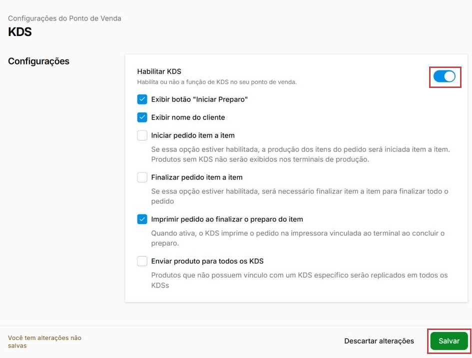
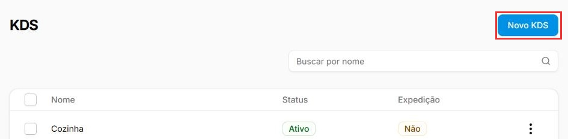
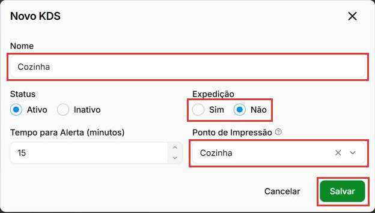
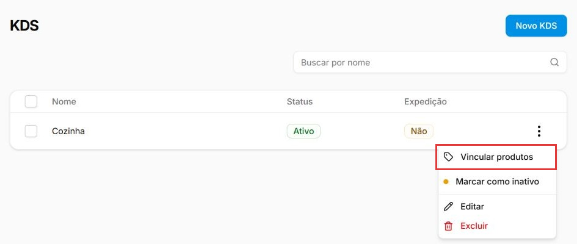
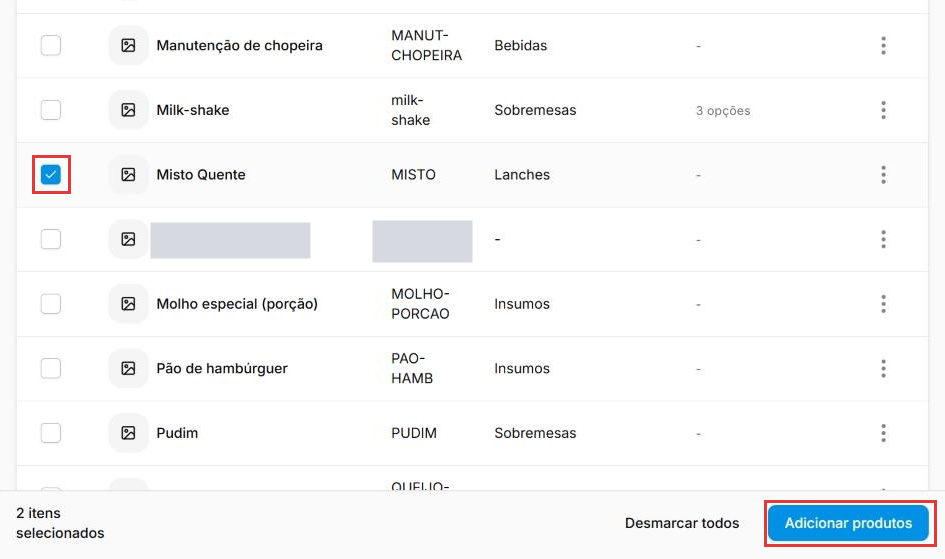
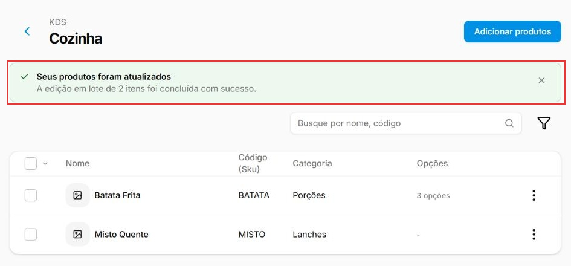

# Como configurar a tela da cozinha (KDS)

:material-clock-outline: 8 minutos · :material-format-list-numbered: 5 passos · :material-calendar-check: Atualizado em 22/11/2026

O **KDS** (do inglês *Kitchen Display System*, sistema de tela na cozinha) é feito para mostrar os pedidos para quem prepara numa tela, normalmente um tablet, no lugar do papel impresso. Exemplo: a lanchonete cadastra o KDS **Cozinha** e vincula a ele a **Batata Frita** e o **Misto Quente**, os produtos que a cozinha prepara.

## Entenda o conceito

Para o KDS funcionar, quatro peças trabalham juntas:

| Peça | Onde fica | O que faz |
| --- | --- | --- |
| **A função KDS** | **Ponto de venda** → **Configurações** → **KDS** | Liga o KDS e define as opções de preparo. |
| **Os KDS da loja** | **Ponto de venda** → **KDS** | Um cadastro para cada área de preparo (Cozinha, Bar), com status, expedição, tempo para alerta e impressora. |
| **Os produtos de cada KDS** | **Vincular produtos**, em cada KDS | Diz quais produtos vão para qual KDS. |
| **O aplicativo** | No tablet | O aplicativo **KDS**, para Android (veja [Como baixar os aplicativos da CPlug](baixar-aplicativos.md)). |

**Vários KDS.** Uma loja pode ter mais de um: por exemplo, os lanches no KDS **Cozinha** e as bebidas no KDS **Bar**. Cada produto vai para o KDS a que estiver vinculado.

**KDS × impressora.** A impressora imprime o pedido em papel (veja [Como configurar uma impressora](impressora.md)); o KDS mostra o pedido na tela. As duas coisas podem conviver: há uma opção para o KDS imprimir o pedido ao concluir o preparo (passo 1).

**KDS no PDV Desktop.** O cadastro do caixa **PDV Desktop** também tem o módulo **KDS** (veja [Como cadastrar um terminal ou dispositivo](cadastrar-terminal.md)). Se a loja vende pelo PDV Desktop, fale com o suporte para saber se esse módulo precisa ser marcado no seu caixa.

**Quando usar:** cozinhas e bares que querem acompanhar os pedidos numa tela. **Quando não usar:** se a equipe trabalha só com o pedido impresso, a impressora basta.

!!! info "Antes de começar"
    - Para usar o KDS no dia a dia, a loja vai precisar de um tablet com o aplicativo **KDS** (veja [Como baixar os aplicativos da CPlug](baixar-aplicativos.md)). A configuração no ERP pode ser feita antes.
    - Se o KDS for imprimir o pedido ao concluir o preparo, cadastre antes a impressora (veja [Como configurar uma impressora](impressora.md)).
    - As opções do passo 1 ficam nas **Configurações do Ponto de Venda**. Combine com a equipe da cozinha antes de mudar com a loja aberta.

Nos prints, o **quadrado vermelho** mostra onde você deve clicar ou digitar.

## Ligue o KDS no ponto de venda

No menu do lado esquerdo, clique em **Ponto de venda** → **Configurações** → **KDS**. Ligue a chave **Habilitar KDS** ("Habilita ou não a função de KDS no seu ponto de venda."). Aparecem as opções de preparo:

| Opção | O que a tela diz |
| --- | --- |
| **Exibir botão "Iniciar Preparo"** | (sem explicação na tela) |
| **Exibir nome do cliente** | (sem explicação na tela) |
| **Iniciar pedido item a item** | "Se essa opção estiver habilitada, a produção dos itens do pedido será iniciada item a item. Produtos sem KDS não serão exibidos nos terminais de produção." |
| **Finalizar pedido item a item** | "Se essa opção estiver habilitada, será necessário finalizar item a item para finalizar todo o pedido" |
| **Imprimir pedido ao finalizar o preparo do item** | "Quando ativa, o KDS imprime o pedido na impressora vinculada ao terminal ao concluir o preparo." A impressora é o **Ponto de Impressão** de cada KDS (passo 2). |
| **Enviar produto para todos os KDS** | "Produtos que não possuem vínculo com um KDS específico serão replicados em todos os KDSs" |

No exemplo, foram marcadas **Exibir botão "Iniciar Preparo"**, **Exibir nome do cliente** e **Imprimir pedido ao finalizar o preparo do item**. Na dúvida sobre quais marcar para o jeito de trabalhar da sua cozinha, combine com o suporte. Clique em **Salvar**, no rodapé. Aparece **Configurações do PDV atualizadas com sucesso**.

{ loading=lazy }

## Cadastre o KDS

Clique em **Ponto de venda** → **KDS**. Na primeira vez, a tela mostra **Nenhum KDS cadastrado**. Clique em **Novo KDS**.

{ loading=lazy }

Na janela **Novo KDS**, preencha:

- **Nome:** a área de preparo (no exemplo, "Cozinha").
- **Status:** deixe **Ativo** (vem marcado) para usar o KDS.
- **Expedição:** **Sim** ou **Não**. A janela vem com **Sim** marcado; no exemplo, o KDS Cozinha ficou com **Não**. Antes de escolher, fale com o suporte para saber qual combina com o jeito que a sua loja entrega os pedidos.
- **Tempo para Alerta (minutos):** o tempo, em minutos (no exemplo, 15).
- **Ponto de Impressão:** "Impressora que emite o pedido ao finalizar o preparo do item, caso a configuração esteja habilitada" (no exemplo, **Cozinha**). Só imprime se a opção **Imprimir pedido ao finalizar o preparo do item** do passo 1 estiver marcada.

Clique em **Salvar**. Aparece **KDS criado com sucesso**, e o KDS entra na lista, com o **Status** e a **Expedição**. Para mudar depois, use **Editar**, nos **três pontinhos** (⋮) do KDS: abre a janela **Editar KDS**, com os mesmos campos.

{ loading=lazy }

## Abra os produtos do KDS

Na lista, clique nos **três pontinhos** (⋮) do KDS e em **Vincular produtos**. No mesmo menu ficam **Marcar como inativo**, **Editar** e **Excluir**.

Abre a lista dos produtos do KDS; na primeira vez, **Sem dados no momento**. Clique em **Adicionar produtos**.

{ loading=lazy }

## Adicione os produtos

A tela **Adicionar produtos** lista os produtos que ainda não estão neste KDS, com a busca **Busque por nome, código** e o **funil** de filtros. Há dois jeitos de adicionar:

- **Vários de uma vez:** marque a caixinha ao lado de cada produto. No rodapé aparecem a contagem (no exemplo, **2 itens selecionados**, a Batata Frita e o Misto Quente), **Desmarcar todos** e **Adicionar produtos**. Clique em **Adicionar produtos**.
- **Um produto:** clique nos **três pontinhos** (⋮) da linha e em **Adicionar**. Aparece **Produto associado com sucesso**.

A gravação roda em segundo plano: a tela avisa **Atualizando seus produtos** ("A edição em lote de 2 itens está em andamento. Você pode continuar navegando enquanto processamos as alterações.").

{ loading=lazy }

## Confira os produtos do KDS

Volte para a lista de produtos do KDS (seta **‹** ao lado do título). Quando a gravação termina, aparece **Seus produtos foram atualizados** ("A edição em lote de 2 itens foi concluída com sucesso."), com os produtos na lista. Se a lista ainda não mudou, espere alguns instantes e abra de novo.

Para tirar um produto do KDS, clique nos **três pontinhos** (⋮) dele e em **Remover**. Aparece **Produto removido com sucesso**; a retirada também roda em segundo plano, e o produto some da lista quando termina.

{ loading=lazy }

!!! tip "Boas práticas"
    - **Um KDS por área de preparo:** cozinha, bar e confeitaria com KDS próprios. Cada equipe vê o que é dela.
    - **Vincule todos os produtos que são preparados:** com a opção **Iniciar pedido item a item**, a própria tela avisa que "Produtos sem KDS não serão exibidos nos terminais de produção". Confira se nenhum produto preparado ficou de fora.
    - **Nomes pela área:** "Cozinha", "Bar", "Confeitaria". Fica fácil escolher o KDS certo.
    - **Confira antes do movimento:** depois de configurar, faça um pedido de teste com a equipe e veja se ele aparece no KDS certo.

## Deu algum problema?

??? question "Não vejo as opções do KDS em Configurações"
    Ligue primeiro a chave **Habilitar KDS**. As opções só aparecem com ela ligada.

??? question "Um produto não aparece no KDS"
    Confira, nesta ordem:

    1. A chave **Habilitar KDS** (passo 1) está ligada.
    2. O KDS está com **Status** **Ativo** na lista.
    3. O produto está vinculado ao KDS (passo 5). Se não estiver, adicione pelo passo 4.
    4. Com a opção **Iniciar pedido item a item** marcada, produtos sem KDS não são exibidos. Vincule o produto a um KDS ou, se fizer sentido para a loja, marque **Enviar produto para todos os KDS**, que manda os produtos sem vínculo para todos os KDS.

    Se continuar, fale com o suporte.

??? question "Adicionei ou removi produtos e a lista não mudou"
    A gravação roda em segundo plano. Espere alguns instantes e abra de novo a lista de produtos do KDS: ao terminar, aparece **Seus produtos foram atualizados**.

??? question "O KDS não imprime ao finalizar o preparo"
    Confira se a opção **Imprimir pedido ao finalizar o preparo do item** (passo 1) está marcada e se o KDS tem um **Ponto de Impressão** (em **Editar**). Depois, confira a impressora (veja [Como configurar uma impressora](impressora.md)).

??? question "Como ligo o tablet ao KDS cadastrado?"
    Instale o aplicativo **KDS** no tablet (veja [Como baixar os aplicativos da CPlug](baixar-aplicativos.md)). Para ligar o aplicativo à sua loja e ao KDS certo, fale com o suporte.

**Relacionados:** [Como configurar uma impressora](impressora.md) · [Como baixar os aplicativos da CPlug](baixar-aplicativos.md) · [Como cadastrar um terminal ou dispositivo](cadastrar-terminal.md) · [Como configurar o terminal de vendas](../ponto-de-venda/configurar-terminal.md)

kds kitchen display system tela da cozinha monitor da cozinha tablet cozinha pedidos na tela novo kds editar kds habilitar kds expedição tempo para alerta ponto de impressão vincular produtos adicionar produtos em lote remover produto iniciar preparo finalizar preparo item a item nome do cliente imprimir pedido ao finalizar enviar produto para todos os kds bar confeitaria marcar como inativo
