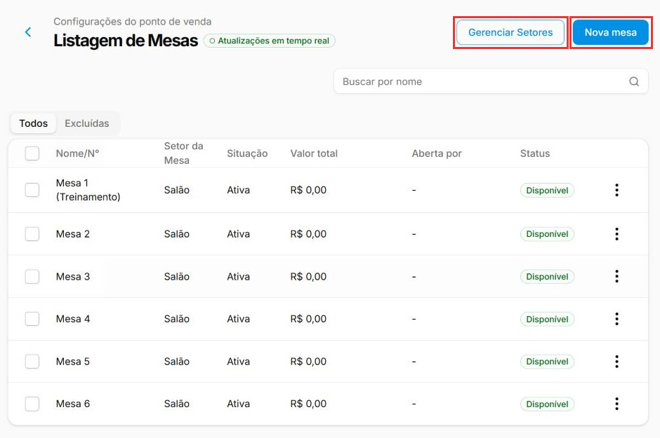
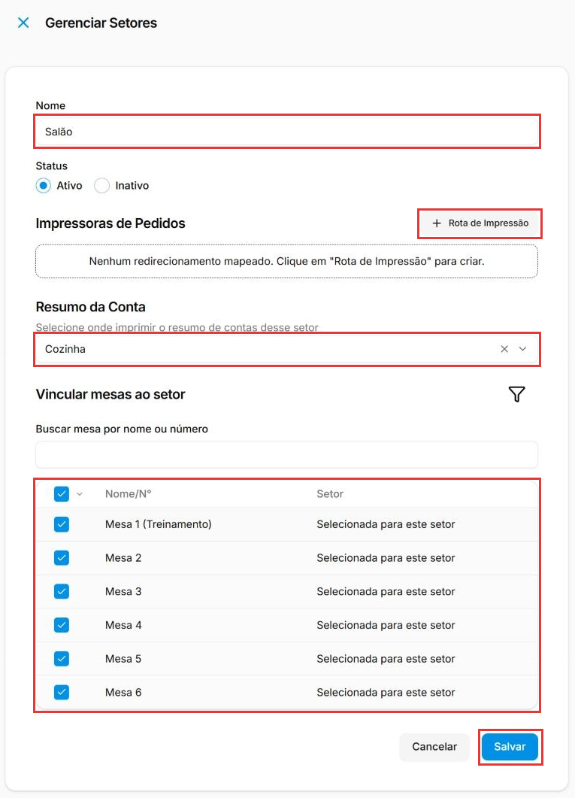
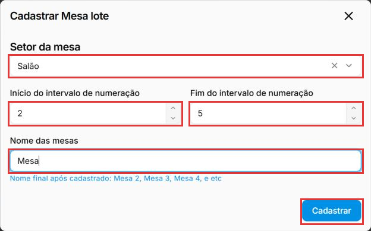
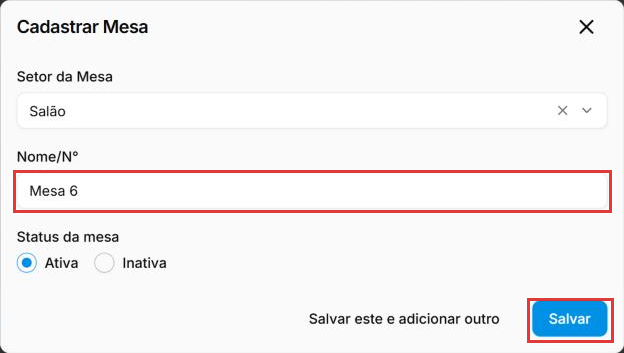
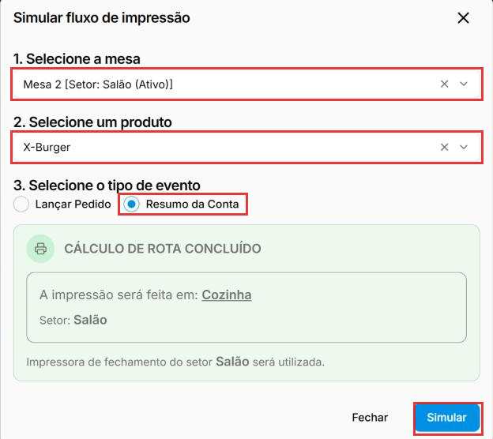

# Como cadastrar mesas e setores

:material-clock-outline: 8 minutos · :material-format-list-numbered: 5 passos · :material-calendar-check: Atualizado em 20/11/2026

Em restaurantes, bares e lanchonetes com atendimento na mesa, cada mesa precisa estar cadastrada no sistema para receber os pedidos e a conta. Exemplo: um restaurante tem 6 mesas no **Salão**. Ele cria o setor Salão, escolhe a impressora onde sai o resumo da conta dessas mesas e cadastra várias mesas de uma vez, em lote. Este manual prepara o sistema.

## Entenda o conceito

**Mesa** é o lugar onde o cliente consome; cada uma tem um nome ou número (Mesa 1, Mesa 2…). **Setor** é um grupo de mesas, como uma área da loja:

| Setor | Mesas | Para que serve |
| --- | --- | --- |
| **Salão** | Mesa 1 a Mesa 6 | As mesas do salão principal. |
| **Varanda** | Mesa 7 a Mesa 10 | As mesas da área externa. |

O setor diz **onde imprimir** o que é das mesas dele:

- **Resumo da Conta:** a impressora de fechamento do setor, onde sai o resumo da conta das mesas dele.
- **Rota de Impressão:** um desvio de impressora para os pedidos. Cada produto tem a sua impressora de pedidos, definida em **Configurações** → **Periféricos**, na opção **Vincular produtos** da impressora (por exemplo, o lanche sai na cozinha; veja [Como configurar uma impressora](impressora.md)). A rota de impressão troca essa impressora para as mesas do setor: quando um pedido sairia na impressora de origem, o setor manda para outra. Use quando uma área tem impressora própria, por exemplo um deck afastado com impressora perto do bar.

**Quando usar:** atendimento na mesa, em que a conta fica aberta e é fechada no fim. **Quando não usar:** venda só no balcão, paga na hora. Se a loja usa cartões numerados por cliente, veja também [Como usar comandas](../ponto-de-venda/comandas.md).

**Mesas no caixa.** Para atender as mesas pelo caixa, ligue a chave **Ponto de Venda oferece atendimento de mesa e comandas**, no atendimento **No estabelecimento**, em **Ponto de venda** → **Configurações** → **Modos de pedidos** (veja [Como configurar o terminal de vendas](../ponto-de-venda/configurar-terminal.md)).

!!! info "Antes de começar"
    - Conte as mesas da loja e decida como dividir em setores (salão, varanda, deck).
    - As impressoras que aparecem no setor são as cadastradas em **Configurações** → **Periféricos** (veja [Como configurar uma impressora](impressora.md)). Cadastre antes as impressoras que vai usar.

Nos prints, o **quadrado vermelho** mostra onde você deve clicar ou digitar.

## Abra a tela de mesas

No menu do lado esquerdo, clique em **Ponto de venda** e depois em **Mesas**. Abre a **Listagem de Mesas**, com as colunas **Nome/N°**, **Setor da Mesa**, **Situação**, **Valor total**, **Aberta por** e **Status**. Não confunda as duas últimas: **Situação** é o cadastro da mesa (**Ativa** ou **Inativa**); **Status** mostra o uso no momento (por exemplo, **Disponível**).

No alto ficam os dois botões deste manual: **Gerenciar Setores** e **Nova mesa**. A busca **Buscar por nome** ajuda quando há muitas mesas.

{ loading=lazy }

## Crie o setor

Clique em **Gerenciar Setores**. Abre um painel à direita. Na primeira vez, clique em **Configurar primeiro setor**; depois, use **Adicionar**. Preencha:

- **Nome:** o nome da área (no exemplo, "Salão"; a tela sugere "Salão VIP, Deck, Varanda").
- **Status:** deixe **Ativo** (vem marcado). O simulador de impressão mostra o status do setor ao lado da mesa, por exemplo **Salão (Ativo)**. Antes de inativar um setor em uso, fale com o suporte.
- **Impressoras de Pedidos:** para desviar a impressão dos pedidos deste setor, clique em **Rota de Impressão**. Aparecem duas listas: em **Imprime em**, escolha a impressora de origem; em **Redirecionar para**, a impressora que vai receber no lugar dela. O **X** ao lado remove a rota. Se não precisar de desvio, deixe como está (**Nenhum redirecionamento mapeado**).
- **Resumo da Conta:** escolha a impressora de fechamento do setor, onde sai o resumo da conta das mesas dele. No exemplo aparece **Cozinha**, a única impressora cadastrada; na sua loja, escolha a impressora de onde a equipe leva a conta ao cliente (normalmente a do caixa).
- **Vincular mesas ao setor:** marque as mesas que fazem parte do setor. A mesa marcada aparece como **Selecionada para este setor**. O **funil** ao lado do título filtra a lista: **Não vinculadas**, **Todas** ou **Vinculadas**. Mesas que já estão em outro setor podem ser movidas para este ao salvar. Na primeira vez a lista fica vazia: salve o setor só com o nome e as impressoras. As mesas cadastradas em lote no passo seguinte já entram no setor; este campo serve para as mesas cadastradas uma por vez e para trocar mesas de setor.

Clique em **Salvar**. O setor aparece em **Setores Cadastrados**, com o número de mesas vinculadas, as rotas de pedidos e a impressora do resumo da conta. Para mudar depois, clique no **lápis** do setor.

{ loading=lazy }

## Cadastre as mesas

Clique em **Nova mesa**. Aparecem duas opções:

**Cadastrar mesas em lote** (o jeito mais rápido para várias mesas). Na janela **Cadastrar Mesa lote**:

- **Setor da mesa:** o setor das mesas (no exemplo, **Salão**).
- **Início do intervalo de numeração** e **Fim do intervalo de numeração:** a faixa de números (no exemplo, de **2** a **5**).
- **Nome das mesas:** o nome que vem antes do número. Logo abaixo, a tela mostra como as mesas vão ficar; com "Mesa": "Nome final após cadastrado: Mesa 2, Mesa 3, Mesa 4, e etc".

Clique em **Cadastrar**. Aparece **4 mesas criadas com sucesso** (o número muda conforme a faixa), e as mesas entram na lista já com o setor.

{ loading=lazy }

**Cadastrar nova mesa** (uma de cada vez). Na janela **Cadastrar Mesa**, preencha o **Nome/N°** (obrigatório; sem ele aparece **O preenchimento é obrigatório**) e escolha o **Status da mesa**: **Ativa** ou **Inativa**. Clique em **Salvar** para fechar a janela ou em **Salvar este e adicionar outro** para gravar e já limpar a janela para a próxima mesa. Aparece **Mesa criada com sucesso**.

!!! warning "Confira o setor da mesa cadastrada uma por vez"
    A janela **Cadastrar Mesa** tem o campo **Setor da Mesa**, mas a mesa pode ser gravada sem setor, mesmo com ele preenchido. Depois de salvar, confira na lista se a coluna **Setor da Mesa** mostra o setor (se precisar, atualize a página com a tecla **F5**). Se aparecer **-**, vincule a mesa em **Gerenciar Setores**: clique no **lápis** do setor, marque a mesa em **Vincular mesas ao setor** e clique em **Salvar**. No cadastro **em lote**, o setor é gravado normalmente.

{ loading=lazy }

Cada mesa precisa de um nome diferente. Com um nome que já existe, a janela mostra **Os dados enviados são inválidos** e não salva.

## Confira no simulador de impressão

Em **Gerenciar Setores**, clique na seta do quadro **Simulador de impressão** ("Simule onde cada impressão será efetuada com essa configuração"). Na janela **Simular fluxo de impressão**:

1. **Selecione a mesa** (a lista mostra o setor de cada uma, por exemplo **Mesa 2 [Setor: Salão (Ativo)]**).
2. **Selecione um produto** do cardápio.
3. **Selecione o tipo de evento:** **Lançar Pedido** (a impressão do pedido) ou **Resumo da Conta**. Para simular **Lançar Pedido**, o produto precisa estar ligado a uma impressora (veja [Como configurar uma impressora](impressora.md)).

Clique em **Simular**. O sistema mostra **CÁLCULO DE ROTA CONCLUÍDO** e em qual impressora a impressão vai sair. No exemplo, o resumo da conta da Mesa 2 sai na **Cozinha**, a impressora de fechamento do setor Salão.

{ loading=lazy }

## Edite, desative ou exclua uma mesa

Na lista, clique nos **três pontinhos** (⋮) da mesa:

- **Detalhes:** abre a tela **Detalhes da Mesa**, com a situação, o total de comandas, o valor total, o subtotal, a quantidade de pedidos, a taxa de serviço, o desconto e o que já foi pago.
- **Editar:** abre a janela **Editar Mesa**, com o setor, o nome e o status. Altere e clique em **Salvar**. Aparece **Mesa atualizada com sucesso**. Com **Inativa**, a mesa continua no cadastro, na aba **Todos**, e a coluna **Situação** mostra **Inativa**.
- **Excluir:** pede confirmação ("Tem certeza que deseja excluir a mesa…?"). Clique em **Excluir**. Aparece **Mesa excluída com sucesso**, e a mesa vai para a aba **Excluídas**.

Para trazer de volta uma mesa excluída, abra a aba **Excluídas**, clique nos **três pontinhos** (⋮) da mesa e em **Restaurar**, e confirme em **OK**. Aparece **Mesa restaurada com sucesso**.

!!! tip "Boas práticas"
    - **Nomes iguais aos da loja:** use na mesa o mesmo número que está na mesa física, para a equipe não se confundir.
    - **Cadastre em lote:** para várias mesas, o cadastro em lote é mais rápido e já grava o setor.
    - **Teste antes de abrir:** use o **Simulador de impressão** para conferir se cada setor imprime no lugar certo.
    - **Excluir não apaga de vez:** a mesa excluída fica na aba **Excluídas** e volta com **Restaurar**.

## Deu algum problema?

??? question "Cadastrei a mesa com setor e ela ficou sem setor"
    No cadastro de uma mesa por vez, a mesa pode ficar sem setor. Confira a coluna **Setor da Mesa** (atualize com **F5**) e, se aparecer **-**, abra **Gerenciar Setores**, clique no **lápis** do setor, marque a mesa em **Vincular mesas ao setor** e clique em **Salvar**.

??? question "Mudei o setor da mesa e a lista continua mostrando o antigo"
    Atualize a página (tecla **F5**): a coluna **Setor da Mesa** pode demorar a mostrar a mudança. Para conferir as mesas de cada setor, abra **Gerenciar Setores** e clique no **lápis** do setor.

??? question "Apareceu Os dados enviados são inválidos"
    Já existe uma mesa com esse nome. Use outro nome ou número.

??? question "O simulador diz que o produto não possui impressora padrão configurada"
    Ao simular **Lançar Pedido**, o sistema avisa quando o produto não tem impressora de pedidos ("Configure a impressora de pedidos no cadastro do produto e tente novamente"). Apesar da mensagem, a impressora não fica no cadastro do produto: ligue o produto à impressora em **Configurações** → **Periféricos**, nos **três pontinhos** (⋮) da impressora, em **Vincular produtos** (veja [Como configurar uma impressora](impressora.md)).

??? question "A impressora que eu quero não aparece na lista do setor"
    O setor mostra as impressoras cadastradas em **Configurações** → **Periféricos**. Confira se ela está cadastrada (veja [Como configurar uma impressora](impressora.md)). Se estiver e continuar sem aparecer, fale com o suporte.

??? question "Como gero o QR Code das mesas?"
    O QR Code com o cardápio digital fica no **Smart Menu**, um tipo de dispositivo: em **Dispositivos** → **Terminais & Dispositivos** → **Novo Dispositivo** → **Novo Smart Menu** ("Cadastro de Smart Menu com QR Code e menu digital"). Veja [Como configurar o Smart Menu (QR Code e cardápio digital)](smart-menu.md).

??? question "Como excluo um setor?"
    O setor tem um ícone de **lixeira** em **Setores Cadastrados**. Antes de excluir um setor com mesas, fale com o suporte.

??? question "Como abro, lanço pedidos e fecho a conta da mesa no caixa?"
    Este manual prepara o sistema. Para dúvidas sobre o atendimento das mesas no caixa, fale com o suporte.

**Relacionados:** [Como usar comandas](../ponto-de-venda/comandas.md) · [Como configurar o terminal de vendas](../ponto-de-venda/configurar-terminal.md) · [Como baixar os aplicativos da CPlug](baixar-aplicativos.md)

mesa mesas cadastrar mesa nova mesa mesas em lote cadastrar mesa lote setor setores gerenciar setores salão varanda deck rota de impressão redirecionar impressora resumo da conta vincular mesas simulador de impressão simular fluxo de impressão lançar pedido detalhes da mesa editar mesa mesa inativa excluir mesa restaurar mesa qr code qrcode smart menu cardápio digital conta da mesa numerar mesas impressora da cozinha restaurante bar atendimento na mesa
