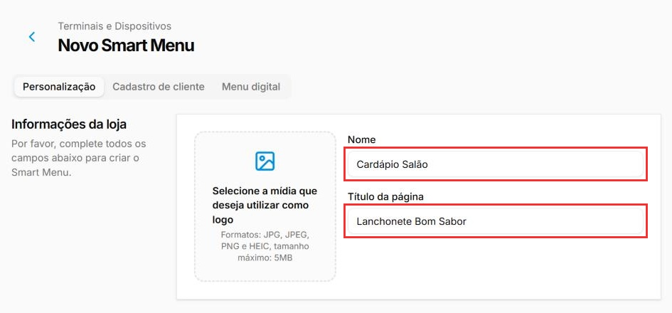
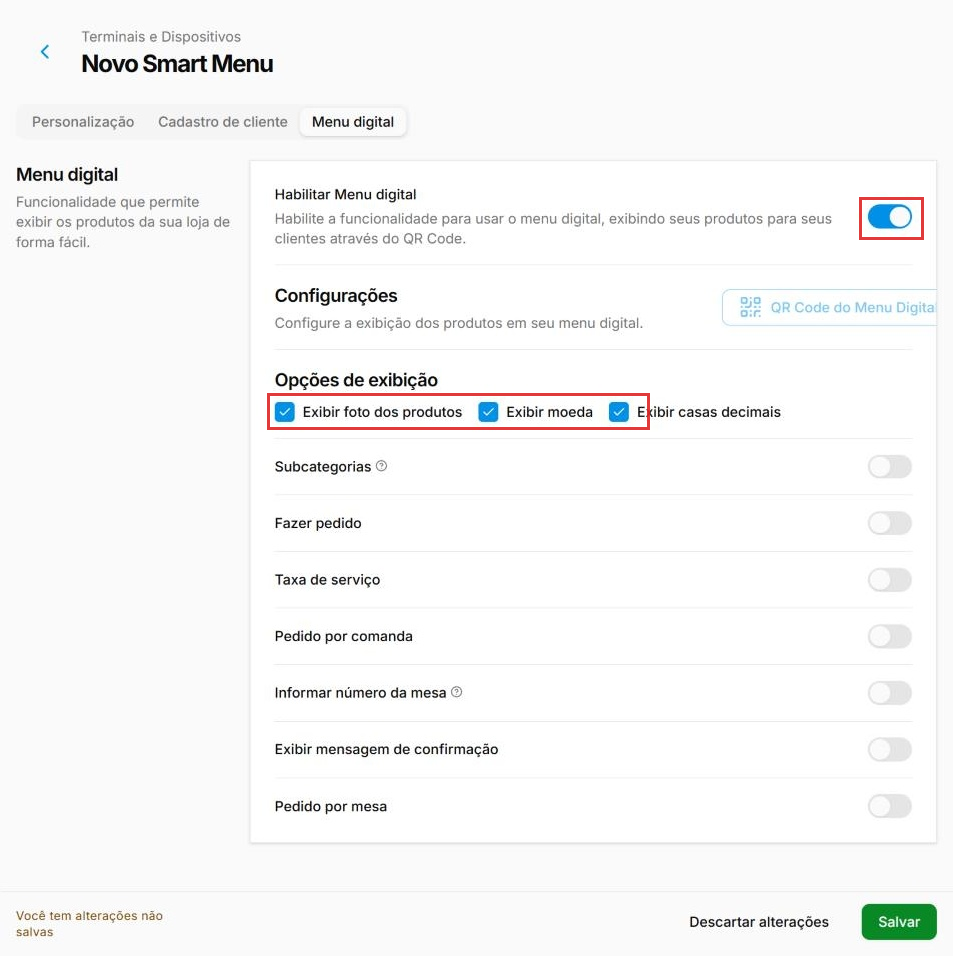
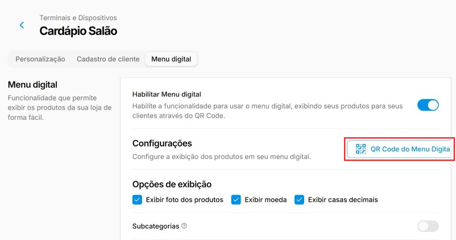
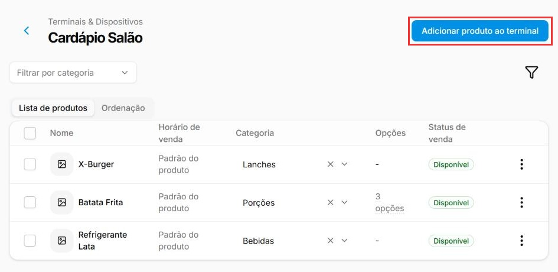

# Como configurar o Smart Menu (QR Code e cardápio digital)

:material-clock-outline: 8 minutos · :material-format-list-numbered: 6 passos · :material-calendar-check: Atualizado em 22/11/2026

O **Smart Menu** é o cardápio digital da loja. Como diz a tela, ele exibe "seus produtos para seus clientes através do QR Code": o cliente aponta a câmera do próprio celular para o QR Code e abre o cardápio. Exemplo: a lanchonete cria o Smart Menu **Cardápio Salão**, com o título "Lanchonete Bom Sabor", liga o menu digital e coloca nele o X-Burger, a Batata Frita e o Refrigerante Lata.

## Entenda o conceito

O cadastro do Smart Menu tem três abas:

| Aba | O que define |
| --- | --- |
| **Personalização** | "Informações da loja" (logo, **Nome** e **Título da página**) e "Parâmetros de cor". |
| **Cadastro de cliente** | "Funcionalidade que permite o cliente escanear o QR Code e realizar o cadastro em sincronia com o PDV." |
| **Menu digital** | "Funcionalidade que permite exibir os produtos da sua loja de forma fácil." |

**Não precisa de aparelho na loja.** O Smart Menu fica na lista de **Terminais & Dispositivos** e recebe um código na coluna **Dispositivo**, mas esse código só identifica o cadastro: quem abre o cardápio é o celular do cliente.

**Cadastro × cardápio.** O cadastro diz como o Smart Menu aparece e funciona. Os produtos ficam em **Disponibilidade de produtos**, nos três pontinhos do Smart Menu. Nessa tela, o sistema chama o Smart Menu de **terminal** ("Adicionar produto ao terminal").

**Quando usar:** para o cliente consultar o cardápio pelo celular, na mesa ou no balcão. **Quando não usar:** para um aparelho de autoatendimento na loja, use o totem (veja [Como configurar o totem de autoatendimento](totem.md)).

!!! info "Antes de começar"
    - Confira os produtos e as fotos no cadastro de produtos.
    - O logo é opcional. Se for usar, tenha o arquivo em JPG, JPEG, PNG ou HEIC, com até 5 MB.

Nos prints, o **quadrado vermelho** mostra onde você deve clicar ou digitar.

## Crie o Smart Menu e preencha a Personalização

No menu do lado esquerdo, clique em **Dispositivos** e depois em **Terminais & Dispositivos**. Na tela, clique em **Novo Dispositivo** e em **Novo Smart Menu**. Abre a tela **Novo Smart Menu**, na aba **Personalização**:

- **Logo** (opcional): clique no quadro **Selecione a mídia que deseja utilizar como logo** (JPG, JPEG, PNG ou HEIC, até 5 MB). A tela pede "complete todos os campos", mas o Smart Menu salva sem logo.
- **Nome:** o nome do Smart Menu no ERP (no exemplo, "Cardápio Salão").
- **Título da página:** o título do cardápio (no exemplo, "Lanchonete Bom Sabor").
- **Parâmetros de cor:** a cor **Primária** (vem **#009CDE**, um azul) e a **Secundária** (vem **#000000**, o preto), em código de cor. Como diz a tela, a primária é usada em "botões de ação, ícones, textos importantes", e a secundária em detalhes e textos de apoio. Para usar as cores da sua marca, fale com o suporte se não souber o código delas.

{ loading=lazy }

## Ligue o menu digital e escolha as opções

Na aba **Menu digital**, ligue **Habilitar Menu digital** ("Habilite a funcionalidade para usar o menu digital, exibindo seus produtos para seus clientes através do QR Code."). Aparecem as **Configurações**:

- **Opções de exibição:** **Exibir foto dos produtos**, **Exibir moeda** e **Exibir casas decimais** (as três vêm marcadas).
- **Subcategorias:** "Ao habilitar essa opção, será possível vincular um nível de subcategoria de produtos no aplicativo."
- **Informar número da mesa:** "Será exibido uma opção para o cliente informar o número da mesa apenas se o acesso ao cardápio for através de um QR Code sem vínculo com a mesa." Ou seja, vale para o QR Code geral, que não é de uma mesa específica.
- **Fazer pedido**, **Taxa de serviço**, **Pedido por comanda**, **Exibir mensagem de confirmação** e **Pedido por mesa**: chaves ligadas a pedidos pelo cardápio. Vêm desligadas, e assim ficaram no exemplo. Antes de ligar qualquer uma, principalmente a **Taxa de serviço**, fale com o suporte.

{ loading=lazy }

## Decida o cadastro de cliente (opcional)

Na aba **Cadastro de cliente** fica a chave **Habilitar Cadastro de cliente via QR Code**. Como diz a tela: "Ao escanear o QR Code, o cliente conseguirá fazer o seu cadastro, e as informações enviadas serão sincronizadas com o PDV em tempo real." No exemplo, ela ficou desligada.

## Salve

Clique em **Salvar**, no rodapé. A tela volta para **Terminais & Dispositivos**, e o Smart Menu aparece na lista com a categoria **Smart Menu** e o código na coluna **Dispositivo** (no exemplo, **PDV00049**). Para mudar depois, clique no nome dele. Nos **três pontinhos** (⋮) ficam **Disponibilidade de produtos**, **Duplicar aplicativo**, **Copiar aplicativo outra filial** e **Excluir**. Antes de excluir um Smart Menu em uso, fale com o suporte.

## Pegue o QR Code

Abra o Smart Menu (clique no nome dele na lista) e vá à aba **Menu digital**. O botão **QR Code do Menu Digital** fica ativo depois de salvar. Clique nele: aparecem **Baixar QR Code** e **Copiar código**. Para saber como usar cada um na sua loja (imprimir para as mesas, colocar no balcão), fale com o suporte.

{ loading=lazy }

## Monte o cardápio

Na lista de **Terminais & Dispositivos**, clique nos **três pontinhos** (⋮) do Smart Menu e em **Disponibilidade de produtos**. Na primeira vez, a lista aparece vazia (**Sem dados no momento**).

1. Clique em **Adicionar produto ao terminal**.
2. Marque a caixinha dos produtos do cardápio. No rodapé aparecem a contagem (no exemplo, **3 itens selecionados**), **Desmarcar todos** e **Adicionar ao terminal**.
3. Clique em **Adicionar ao terminal** e confirme em **Adicionar produtos**. Aparece a mensagem "Os produtos selecionados foram adicionados ao seu terminal/canal de venda."

A lista mostra cada produto com **Horário de venda** (no exemplo, **Padrão do produto**), **Categoria**, **Opções** (por exemplo, **3 opções**, quando o produto tem variações ou complementos) e **Status de venda** (**Disponível**). Nos **três pontinhos** (⋮) de cada produto ficam **Marcar como Indisponível** e **Remover deste terminal**. A aba **Ordenação** define a ordem das categorias e dos produtos ("Pressione e arraste os itens…"). É a mesma tela do cardápio do totem (veja [Como configurar o totem de autoatendimento](totem.md)).

{ loading=lazy }

!!! tip "Boas práticas"
    - **Fotos nos produtos:** a opção **Exibir foto dos produtos** vem marcada; cadastre fotos boas nos produtos.
    - **Título com o nome da loja:** use no **Título da página** o nome que o cliente conhece.
    - **Teste o QR Code:** antes de espalhar pelas mesas, aponte o celular para o QR Code e confira o cardápio.
    - **Cardápio em dia:** produto em falta, use **Marcar como Indisponível**; produto que saiu do cardápio, **Remover deste terminal**.

## Deu algum problema?

??? question "O botão QR Code do Menu Digital está apagado"
    Ele fica ativo depois que o Smart Menu é salvo. Salve, abra o Smart Menu pela lista e volte à aba **Menu digital**.

??? question "A tela pede para completar todos os campos, mas não tenho logo"
    O logo é opcional: o Smart Menu salva só com o **Nome** e o **Título da página**.

??? question "Um produto não aparece no cardápio"
    Confira se ele está em **Disponibilidade de produtos** e se o **Status de venda** está **Disponível**. Se não estiver na lista, adicione pelo passo 6.

??? question "Quero que o cliente faça pedidos pelo cardápio"
    Os pedidos dependem das chaves **Fazer pedido**, **Pedido por mesa** e **Pedido por comanda**, na aba **Menu digital**. Para configurar, fale com o suporte.

??? question "Quero um QR Code para cada mesa"
    Fale com o suporte. O cadastro das mesas está em [Como cadastrar mesas e setores](mesas.md).

**Relacionados:** [Como cadastrar mesas e setores](mesas.md) · [Como configurar o totem de autoatendimento](totem.md) · [Como cadastrar um terminal ou dispositivo](cadastrar-terminal.md)

smart menu cardápio digital menu digital qr code qrcode cardápio pelo celular cardápio na mesa baixar qr code copiar código novo smart menu título da página logo cores exibir foto dos produtos exibir moeda casas decimais subcategorias fazer pedido taxa de serviço pedido por comanda pedido por mesa informar número da mesa cadastro de cliente via qr code disponibilidade de produtos adicionar produto ao terminal
