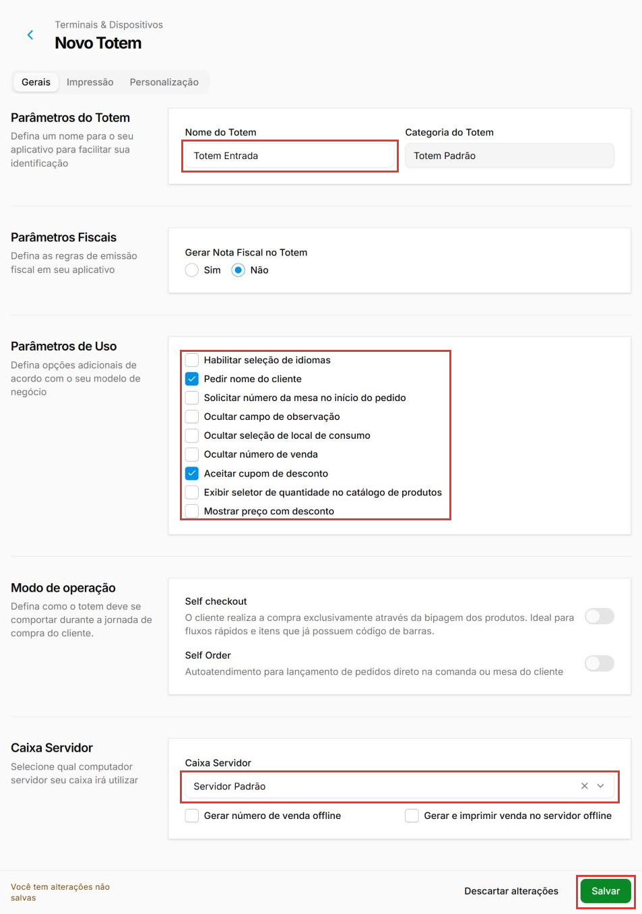
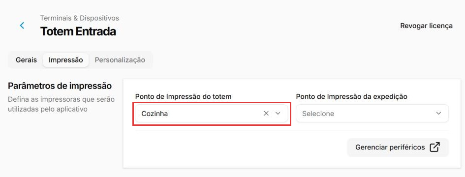
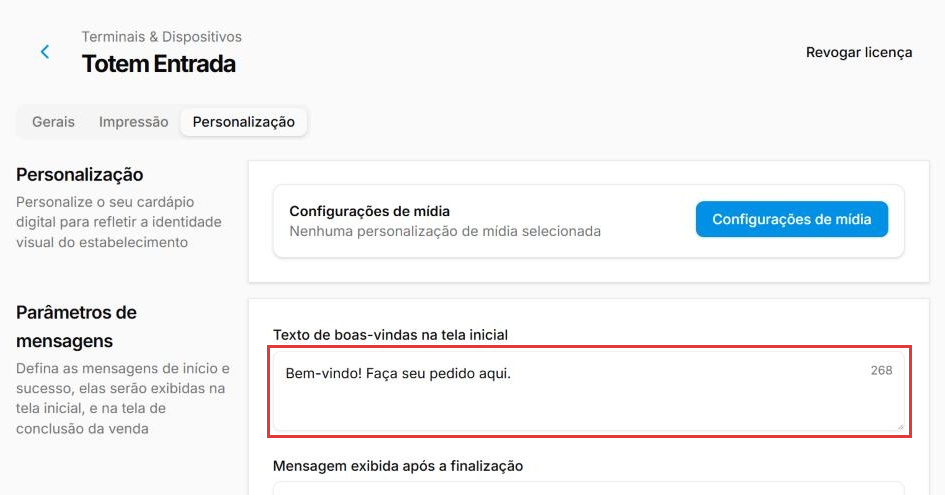
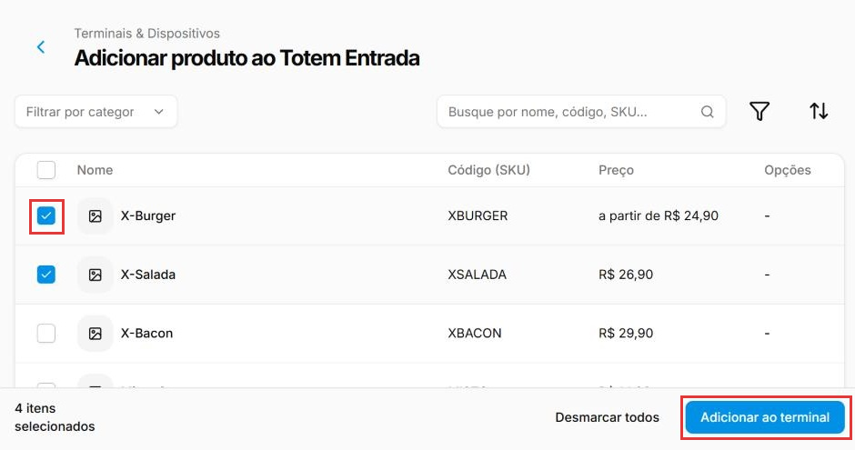
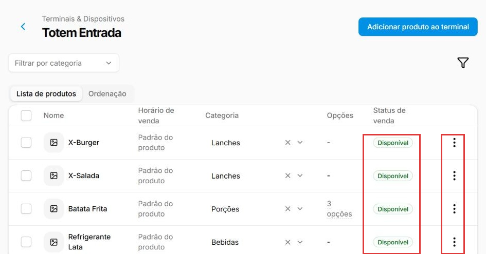

# Como configurar o totem de autoatendimento

:material-clock-outline: 10 minutos · :material-format-list-numbered: 6 passos · :material-calendar-check: Atualizado em 22/11/2026

O **totem de autoatendimento** é um aparelho, normalmente uma tela de toque, em que o próprio cliente escolhe os produtos e faz o pedido sozinho. No ERP, você cadastra o totem, escolhe como ele funciona e monta o cardápio que aparece nele. Exemplo: a lanchonete cadastra o **Totem Entrada**, configurado para pedir o nome do cliente e aceitar cupom de desconto, com os lanches, a batata e o refrigerante no cardápio.

## Entenda o conceito

**Os tipos de totem.** Ao cadastrar, o sistema pergunta o tipo (janela **Opções novo Totem**):

| Tipo | Descrição na tela |
| --- | --- |
| **Padrão** | "Autoatendimento para seleção e compra de produtos somente via catálogo" |
| **Selfcheckout** | "Autoatendimento para seleção e compra de produtos somente por leitor de códigos de barras" |
| **TAPP** | "Autoatendimento de Totem para autosserviço integrado às torneiras de chopp" |
| **Self Order** | "Autoatendimento para lançamento de pedidos direto na comanda ou mesa do cliente" |

Este manual mostra o **Padrão**, em que o cliente escolhe os produtos num catálogo na tela. Para os outros tipos, fale com o suporte. Depois de salvo, o tipo aparece travado em **Categoria do Totem**.

**Cadastro × cardápio.** O cadastro diz como o totem funciona (opções, impressora, mensagens, cores). O **cardápio** é a lista de produtos do totem, montada em **Disponibilidade e Ordenação**. Nessas telas, o sistema chama o totem de **terminal** ("Adicionar produto ao terminal", "Remover deste terminal").

**Quando usar:** para o cliente fazer o pedido sozinho, sem esperar atendimento. **Quando não usar:** se a loja não tem o aparelho do totem; fale antes com o suporte.

!!! info "Antes de começar"
    - O totem usa o aplicativo de autoatendimento (veja [Como baixar os aplicativos da CPlug](baixar-aplicativos.md)). A configuração no ERP pode ser feita antes.
    - Se o totem for imprimir, cadastre antes a impressora (veja [Como configurar uma impressora](impressora.md)).
    - Os produtos vêm do cadastro de produtos. Confira-os antes de montar o cardápio.

Nos prints, o **quadrado vermelho** mostra onde você deve clicar ou digitar.

## Cadastre o totem e preencha a aba Gerais

No menu do lado esquerdo, clique em **Dispositivos** e depois em **Terminais & Dispositivos**. Na tela, clique em **Novo Dispositivo**, em **Novo Totem** e escolha o tipo **Padrão**. Abre a tela **Novo Totem**, com as abas **Gerais**, **Impressão** e **Personalização**. Na aba **Gerais**:

- **Nome do Totem:** um nome que identifique o aparelho (no exemplo, "Totem Entrada"; a tela sugere "Totem Entrada, Totem do bar"). A **Categoria do Totem** vem com o tipo escolhido (**Totem Padrão**).
- **Gerar Nota Fiscal no Totem:** **Sim** ou **Não** (vem **Não**). Confira com o seu **contador** e com o suporte antes de ligar.
- **Parâmetros de Uso:** as opções do pedido no totem. No exemplo, foram marcadas **Pedir nome do cliente** e **Aceitar cupom de desconto**. As outras são **Habilitar seleção de idiomas**, **Solicitar número da mesa no início do pedido**, **Ocultar campo de observação**, **Ocultar seleção de local de consumo**, **Ocultar número de venda**, **Exibir seletor de quantidade no catálogo de produtos** e **Mostrar preço com desconto**. Na dúvida sobre alguma, fale com o suporte.
- **Modo de operação:** as chaves **Self checkout** ("O cliente realiza a compra exclusivamente através da bipagem dos produtos. Ideal para fluxos rápidos e itens que já possuem código de barras.") e **Self Order** ("Autoatendimento para lançamento de pedidos direto na comanda ou mesa do cliente"). Têm os mesmos nomes de outros tipos de totem. No exemplo, com o tipo Padrão, as duas ficaram desligadas; antes de ligar, fale com o suporte.
- **Caixa Servidor:** o computador servidor que o totem vai usar (no exemplo, **Servidor Padrão**). Abaixo ficam **Gerar número de venda offline** e **Gerar e imprimir venda no servidor offline**; na dúvida, fale com o suporte.

{ loading=lazy }

## Escolha a impressora

Na aba **Impressão** ("Defina as impressoras que serão utilizadas pelo aplicativo"), escolha o **Ponto de Impressão do totem** (no exemplo, **Cozinha**). Há também o **Ponto de Impressão da expedição** e o botão **Gerenciar periféricos**. Para saber o que cada impressora deve imprimir na sua loja, fale com o suporte.

{ loading=lazy }

## Personalize o totem

Na aba **Personalização**:

- **Configurações de mídia:** a tela mostra "Nenhuma personalização de mídia selecionada" e o botão **Configurações de mídia**. Para escolher as imagens, fale com o suporte.
- **Texto de boas-vindas na tela inicial** e **Mensagem exibida após a finalização**, com até 300 caracteres cada. A primeira aparece na tela inicial; a segunda, na tela de conclusão da venda. No exemplo: "Bem-vindo! Faça seu pedido aqui." e "Obrigado! Retire seu pedido no balcão."
- **Parâmetros de cor:** a cor **Primária** e a **Secundária**, em código de cor. Como diz a tela, a primária é usada em "botões de ação, ícones, textos importantes", e a secundária em detalhes e textos de apoio. O valor que já vem, **#000000**, é o preto.

{ loading=lazy }

## Salve

Clique em **Salvar**, no rodapé. A tela volta para **Terminais e Dispositivos**, e o totem aparece na lista com a categoria **Totem** e um código na coluna **Dispositivo** (no exemplo, **TT000048**). Para mudar depois, clique no nome do totem.

Nos **três pontinhos** (⋮) do totem ficam também:

- **Vincular aplicativo:** liga o aparelho a este cadastro (veja [Como cadastrar um terminal ou dispositivo](cadastrar-terminal.md)).
- **Gerenciar métodos de pagamento:** as formas de pagamento do totem. Num cadastro novo, as chaves vêm desligadas; alinhe com o suporte quais ligar.
- **Sincronizar aplicativo:** se mudou o totem e o aparelho não mostrou a mudança, fale com o suporte antes de usar.
- **Disponibilidade e Ordenação:** o cardápio (próximo passo).

## Adicione os produtos ao cardápio do totem

Nos **três pontinhos** (⋮) do totem, clique em **Disponibilidade e Ordenação**. Na primeira vez, a lista aparece vazia (**Sem dados no momento**). Clique em **Adicionar produto ao terminal**.

Abre a tela **Adicionar produto ao Totem Entrada** (com o nome do seu totem), com **Nome**, **Código (SKU)**, **Preço** e **Opções**, a busca e os filtros. Marque a caixinha dos produtos do cardápio. No rodapé aparecem a contagem (no exemplo, **4 itens selecionados**), **Desmarcar todos** e **Adicionar ao terminal**. Clique em **Adicionar ao terminal** e confirme em **Adicionar produtos** ("Adicionar 4 produtos ao terminal?"). Aparece a mensagem "Os produtos selecionados foram adicionados ao seu terminal/canal de venda."

{ loading=lazy }

## Confira o cardápio e a ordem

A **Lista de produtos** do totem mostra cada produto com **Horário de venda** (no exemplo, **Padrão do produto**), **Categoria**, **Opções** e **Status de venda** (**Disponível**). Nos **três pontinhos** (⋮) de cada produto ficam **Marcar como Indisponível** e **Remover deste terminal**.

Na aba **Ordenação** ("Organizar exibição no terminal"), como diz a tela: "Pressione e arraste os itens para ajustar a ordem de exibição de categorias, subcategorias ou produtos dentro do terminal selecionado".

{ loading=lazy }

!!! tip "Boas práticas"
    - **Cardápio enxuto:** coloque no totem os produtos que o cliente pede sozinho sem dúvida. Itens que precisam de explicação ficam melhor no balcão.
    - **Ordem que vende:** na aba **Ordenação**, deixe primeiro as categorias mais pedidas.
    - **Mensagens curtas e claras:** a mensagem final é um bom lugar para dizer onde retirar o pedido.
    - **Formas de pagamento alinhadas:** antes de colocar o totem para funcionar, confira com o suporte as formas de pagamento dele.

## Deu algum problema?

??? question "Um produto não aparece no cardápio do totem"
    Confira se ele está na **Lista de produtos** do totem (**Disponibilidade e Ordenação**) e se o **Status de venda** está **Disponível**. Se não estiver na lista, adicione pelo passo 5.

??? question "Marquei os produtos e não sei como gravar"
    Depois de marcar, clique em **Adicionar ao terminal**, no rodapé, e confirme em **Adicionar produtos**.

??? question "Mudei o cardápio e o totem não mudou"
    Fale com o suporte. Nos **três pontinhos** (⋮) do totem existe a opção **Sincronizar aplicativo**; use com orientação do suporte.

??? question "O totem não mostra as formas de pagamento"
    Confira **Gerenciar métodos de pagamento**, nos **três pontinhos** (⋮) do totem, e alinhe com o suporte quais formas ligar.

??? question "O Computador servidor não aparece em Caixa Servidor"
    A lista mostra os computadores servidores cadastrados na unidade. Se a sua loja ainda não tem um, fale com o suporte.

??? question "Escolhi o tipo de totem errado"
    O tipo fica travado em **Categoria do Totem**. Fale com o suporte.

??? question "Posso emitir nota fiscal no totem?"
    A opção **Gerar Nota Fiscal no Totem** fica na aba **Gerais**. Antes de ligar, confira com o seu contador e fale com o suporte para alinhar a configuração fiscal.

**Relacionados:** [Como cadastrar um terminal ou dispositivo](cadastrar-terminal.md) · [Como configurar uma impressora](impressora.md) · [Como baixar os aplicativos da CPlug](baixar-aplicativos.md) · [Como configurar a tela da cozinha (KDS)](kds.md) · [Reset e reconfiguração do aplicativo do totem](../suporte/totem/resetar-totem.md)

totem autoatendimento auto atendimento novo totem totem padrão selfcheckout self checkout self order tapp chope chopp catálogo cardápio do totem disponibilidade e ordenação adicionar produto ao terminal remover deste terminal marcar como indisponível ordenação pedir nome do cliente cupom de desconto número da mesa idiomas mensagem de boas-vindas cores do totem ponto de impressão do totem expedição sincronizar aplicativo métodos de pagamento do totem nota fiscal no totem
