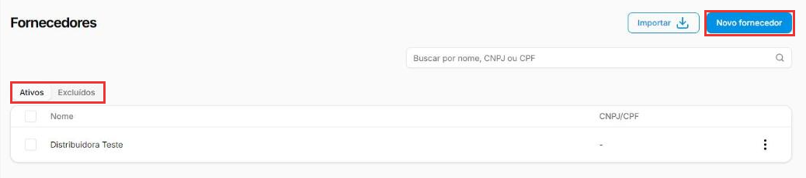
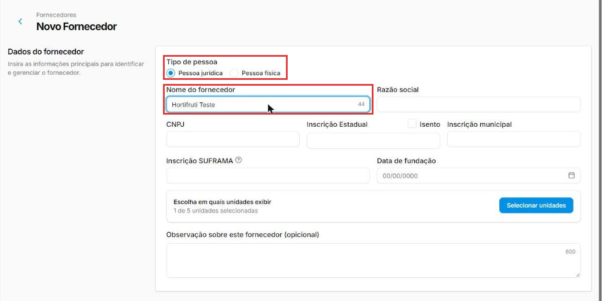
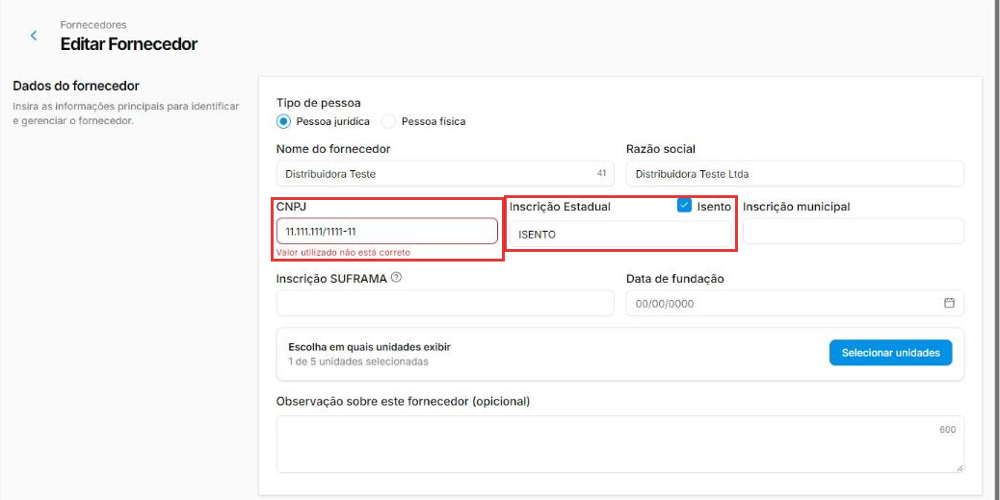
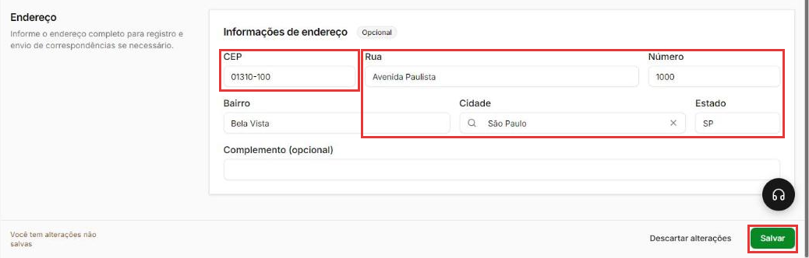
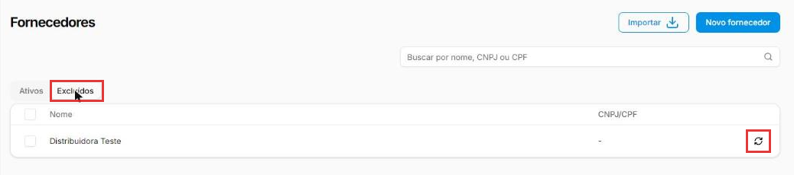

# Como cadastrar um fornecedor

:material-clock-outline: 7 minutos · :material-format-list-numbered: 6 passos · :material-calendar-check: Atualizado em 01/11/2026

O **fornecedor** é quem vende para você: a distribuidora de bebidas, o hortifrúti, a padaria que entrega o pão. Ter cada um cadastrado deixa o sistema ligar as suas compras e os seus produtos a quem vendeu.

## Entenda o conceito

O cadastro do fornecedor sozinho não mexe no estoque nem no financeiro. Ele é a **ficha de quem vende**, usada em outras partes do sistema:

| Onde | Para quê |
| --- | --- |
| **Cadastro do produto** (seção Fornecedores) | Ligar o produto a quem vende, com o código que o fornecedor usa e a conversão (por exemplo, caixa com 12). Veja [Como cadastrar um produto](../produtos/cadastrar-produto.md). |
| **Nova compra** (Estoque → Compras) | Escolher de quem você comprou, no campo **Fornecedor**. |
| **Importação da nota de compra (XML)** | A importação cadastra sozinha o fornecedor que emitiu a nota e cria a conta a pagar a ele. Veja [Como importar a nota fiscal de compra (XML)](importar-nota-de-compra.md). |
| **Inventário** | Filtrar os produtos por fornecedor, para contar o estoque por partes. Veja [Como fazer um inventário](inventario.md). |

**Pessoa jurídica × pessoa física:** a maioria dos fornecedores é empresa (tem **CNPJ**). Quando você compra de uma pessoa, como um produtor rural ou um artesão, escolha **Pessoa física**: o cadastro passa a pedir **CPF** e **Data de nascimento** no lugar dos dados de empresa.

**Basta o nome para começar.** No teste, um fornecedor só com o nome foi salvo sem problema. Os outros dados ajudam a reconhecer o fornecedor e a ter o contato à mão. O campo de busca da lista diz **Buscar por nome, CNPJ ou CPF**.

!!! tip "Compra com nota? Deixe o XML cadastrar"
    Se o fornecedor emite nota fiscal, você não precisa digitar o cadastro: ao importar o XML da compra, o sistema cria o fornecedor com os dados da nota. Se mesmo assim for cadastrar à mão um fornecedor que manda nota, preencha o **CNPJ** igual ao da nota.

Nos prints, o **quadrado vermelho** mostra onde você deve clicar ou digitar.

## Abra os fornecedores

No menu do lado esquerdo, clique em **Estoque** e depois em **Fornecedores**. A lista mostra o **Nome** e o **CNPJ/CPF** de cada um. A aba **Ativos** mostra os fornecedores em uso; a aba **Excluídos** guarda os excluídos, que podem ser restaurados.

Clique em **Novo fornecedor**.

{ loading=lazy }

!!! info "Muitos fornecedores de uma vez"
    O botão **Importar** abre a importação por planilha: ela tem um **Template de Importação de Fornecedores** para baixar e preencher, e aceita arquivo **XLSX**. Na dúvida sobre como preencher a planilha, fale com o suporte.

## Escolha o tipo e dê o nome

Em **Dados do fornecedor**:

- **Tipo de pessoa:** **Pessoa jurídica** (empresa) ou **Pessoa física**.
- **Nome do fornecedor:** o nome pelo qual você conhece o fornecedor, com até 60 caracteres. Exemplo: "Hortifruti do Centro". Na pessoa física, o campo se chama **Nome completo**.

{ loading=lazy }

## Preencha os documentos, se tiver

Para **pessoa jurídica**:

- **Razão social:** o nome oficial da empresa, como está no CNPJ (o "nome do fornecedor" pode ser o nome fantasia).
- **CNPJ:** o sistema confere se o número é válido. No teste, um CNPJ inválido ficou em vermelho com o aviso **Valor utilizado não está correto**, e o cadastro não salvou.
- **Inscrição Estadual (IE):** o registro da empresa no estado; está na nota fiscal do fornecedor. Se ele não tem IE, marque **Isento**: o campo é preenchido com "ISENTO". Na dúvida, pergunte ao seu contador.
- **Inscrição municipal:** o registro na prefeitura, comum em prestadores de serviço. Opcional.
- **Data de fundação:** opcional.
- **Inscrição SUFRAMA:** só para empresas da Zona Franca de Manaus com incentivos fiscais (é o que diz a dica do ⓘ). Para os outros, deixe em branco.

Para **pessoa física**, os campos são **CPF** e **Data de nascimento** (somem a Razão social, as inscrições e a Data de fundação).

{ loading=lazy }

!!! warning "Trocar o tipo de pessoa muda os campos"
    No teste, ao trocar para Pessoa física e voltar para Pessoa jurídica, a marcação **Isento** foi desmarcada e a **Inscrição Estadual** ficou em branco. Escolha o tipo **antes** de preencher os documentos e, se trocar, confira tudo de novo.

## Escolha as unidades e anote o que importa

- **Escolha em quais unidades exibir:** se a empresa tem mais de uma loja, é aqui que você escolhe em quais lojas o fornecedor fica disponível. Clique em **Selecionar unidades**, marque as lojas e clique em **Salvar** na janela. A janela tem busca, filtro por **UF** e **Selecionar todas as lojas**. No teste, a loja atual já vinha marcada (**1 de 5 unidades selecionadas**).
- **Observação sobre este fornecedor:** até 600 caracteres. Exemplo: "Entrega às terças. Pedido mínimo R$ 300."

## Preencha o contato e o endereço

As duas seções são **opcionais**:

- **Informações de contato:** **E-mail**, **Telefone comercial** e **Celular**, com DDD.
- **Informações de endereço:** digite o **CEP** e o sistema preenche sozinho **Rua**, **Bairro**, **Cidade** e **Estado**, e leva você para o **Número**. Complete o número e, se precisar, o **Complemento**.

!!! warning "Use um e-mail que exista"
    No teste, um e-mail inventado impediu o cadastro de salvar, e a tela não mostrou nenhum aviso. Se não tiver o e-mail certo, deixe em branco.

Clique em **Salvar**, no canto de baixo, à direita. O fornecedor aparece na lista. Enquanto não salvar, o rodapé avisa **Você tem alterações não salvas**; **Descartar alterações** desfaz o que você digitou.

{ loading=lazy }

## Edite, exclua ou restaure

Nos **três pontinhos** do fornecedor ficam **Editar** (abre o mesmo cadastro) e **Excluir** (pede confirmação). Ao marcar as caixinhas da lista, o rodapé mostra quantos itens estão selecionados, **Desmarcar todos** e o botão **Excluir**.

O fornecedor excluído vai para a aba **Excluídos**. Lá, o botão de **setas circulares** restaura o fornecedor (o sistema pede confirmação).

{ loading=lazy }

!!! tip "Boas práticas"
    - **Um cadastro por fornecedor.** Antes de criar, confira na lista se ele já existe. Dois cadastros para a mesma empresa confundem quem escolhe o fornecedor no produto e no inventário.
    - **Preencha o CNPJ ou o CPF** quando tiver: ele aparece na lista e diferencia fornecedores com nomes parecidos.
    - **Use a Observação** para o que a equipe precisa saber: dia de entrega, pedido mínimo, quem atende.
    - **Não reaproveite um cadastro para outro fornecedor.** Se deixou de comprar de alguém, exclua: o fornecedor excluído fica na aba Excluídos e pode ser restaurado.

## Deu algum problema?

??? question "Cliquei em Salvar e nada aconteceu"
    Confira o **E-mail**. No teste, um e-mail que não existe de verdade (um endereço de exemplo) foi recusado pelo sistema, mas **a tela não mostrou nenhum aviso**: o botão Salvar simplesmente não fez nada. Corrija o e-mail (ou apague, se não souber) e salve de novo. Confira também se algum campo está em vermelho, como o CNPJ.

??? question "O CNPJ fica vermelho: Valor utilizado não está correto"
    O número não é um CNPJ válido: algum dígito foi digitado errado. Confira com a nota fiscal ou com o cartão CNPJ do fornecedor.

??? question "Excluí um fornecedor por engano"
    Abra a aba **Excluídos** e clique nas **setas circulares** do fornecedor. No teste, depois de restaurar, a aba Ativos só mostrou o fornecedor depois de **recarregar a página** (tecla F5).

??? question "Não vejo as abas Ativos e Excluídos"
    No teste, quando não havia nenhum fornecedor ativo, a tela mostrou só **Nenhum fornecedor encontrado**, sem as abas. Isso acontece, por exemplo, se você excluiu todos. Para chegar à aba **Excluídos** e restaurar, cadastre um fornecedor: no teste, com ele na lista, as abas voltaram.

??? question "O fornecedor não aparece em outra loja"
    Abra o cadastro dele e confira **Escolha em quais unidades exibir**. Se a loja estiver marcada e mesmo assim o fornecedor não aparecer, fale com o suporte.

**Relacionados:** [Como importar a nota fiscal de compra (XML)](importar-nota-de-compra.md) · [Como cadastrar um produto](../produtos/cadastrar-produto.md) · [Como fazer um inventário](inventario.md)

fornecedor cadastrar fornecedor novo fornecedor distribuidora pessoa jurídica pessoa física cnpj cpf razão social nome fantasia inscrição estadual isento inscrição municipal suframa zona franca data de fundação unidades observação e-mail telefone celular cep endereço importar fornecedores planilha xlsx excluir restaurar excluídos salvar não funciona e-mail inválido isento ie
