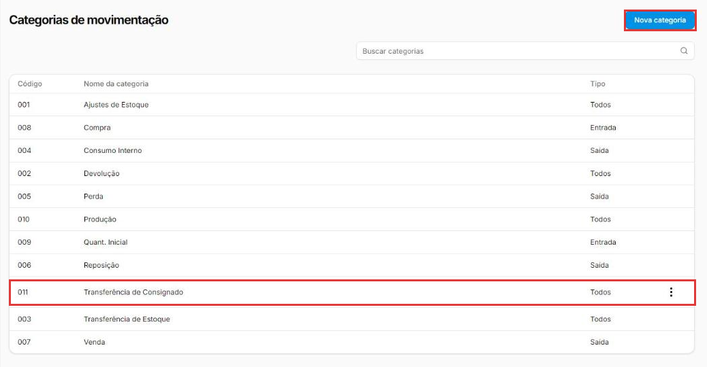
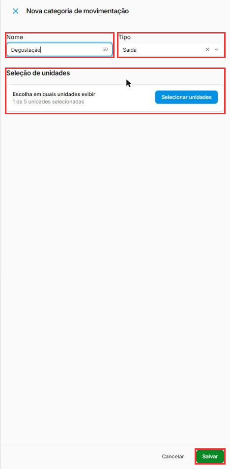
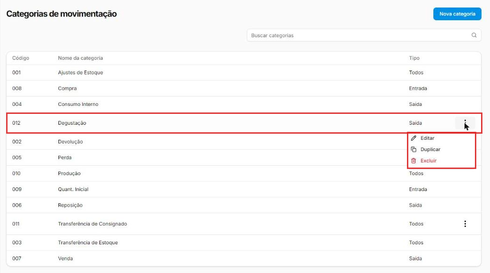
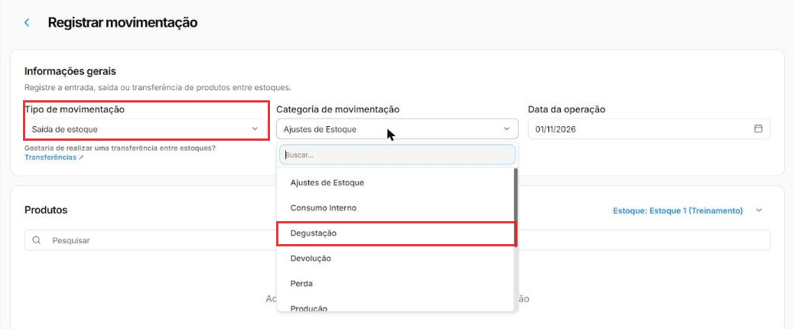

# Como criar categorias de movimentação

:material-clock-outline: 6 minutos · :material-format-list-numbered: 4 passos · :material-calendar-check: Atualizado em 01/11/2026

Toda entrada ou saída de estoque tem uma **categoria**: o **motivo** do lançamento. O sistema já vem com as mais comuns (Compra, Perda, Venda...). Quando a sua loja tem um motivo que não está na lista, como **Degustação** ou **Doação**, você cria uma categoria própria.

## Entenda o conceito

A categoria não muda o saldo: quem soma ou subtrai é o **tipo** do lançamento (entrada ou saída). Ela serve para **contar a história** do estoque. Meses depois, é a categoria que mostra se a mercadoria saiu por venda, por perda ou por degustação.

Cada categoria tem um **tipo**, que define em que lançamento ela aparece:

| Tipo | Aparece em | Categorias do sistema |
| --- | --- | --- |
| **Entrada** | Só em Registrar entrada | Compra, Quant. Inicial |
| **Saída** | Só em Registrar saída | Consumo Interno, Perda, Reposição, Venda |
| **Todos** | Nas duas | Ajustes de Estoque, Devolução, Produção, Transferência de Estoque |

**Categorias do sistema × criadas por você:** as do sistema não podem ser alteradas (não têm os três pontinhos). As que você cria têm os três pontinhos, com **Editar**, **Duplicar** e **Excluir**. Na empresa de teste, por exemplo, havia uma categoria própria chamada **Transferência de Consignado**, ao lado das do sistema.

Uma observação sobre nomes: a categoria **Transferência de Estoque** aparece no histórico dos produtos só como **Transferência**. É ela que o sistema usa sozinho quando você faz uma [transferência entre estoques](transferencia.md).

Para ver como as categorias são usadas no dia a dia, veja [Como dar entrada no estoque](entrada-de-estoque.md).

Nos prints, o **quadrado vermelho** mostra onde você deve clicar ou digitar.

## Abra as categorias de movimentação

No menu do lado esquerdo, clique em **Estoque** e depois em **Categorias de Movimentação**. A lista mostra o **Código**, o **Nome da categoria** e o **Tipo** de cada uma. Só as categorias criadas pela empresa têm os **três pontinhos**.

Clique em **Nova categoria**, no canto de cima, à direita.

{ loading=lazy }

## Preencha a categoria

Na janela **Nova categoria de movimentação**:

- **Nome:** o motivo, com até 60 caracteres. Exemplo: "Degustação".
- **Tipo:** **Entrada**, **Saída** ou **Todos**. Degustação é algo que **sai** do estoque, então: **Saída**.
- **Seleção de unidades:** se a empresa tem mais de uma loja, clique em **Selecionar unidades** e marque as lojas que vão usar a categoria. No teste, a janela já mostrava **1 de 5 unidades selecionadas**.

Clique em **Salvar**.

{ loading=lazy }

## Confira na lista

A categoria entra na lista com o **próximo código** (no exemplo, **012**), em ordem alfabética. Nos **três pontinhos** dela ficam **Editar**, **Duplicar** e **Excluir**. O **Editar** abre a mesma janela, já preenchida, com **Nome**, **Tipo** e **Seleção de unidades**.

{ loading=lazy }

## Use a categoria nos lançamentos

Ao registrar uma **saída** de estoque, a nova categoria já aparece na lista de **Categoria de movimentação**. A lista tem um campo **Buscar** para achar mais rápido.

Como ela é do tipo **Saída**, não aparece ao registrar uma entrada: no teste, a lista da entrada mostrou só as categorias de entrada e as do tipo Todos.

!!! warning "A categoria já vem preenchida"
    No teste, tanto na entrada quanto na saída, o campo já veio com **Ajustes de Estoque**. Confira e troque pela categoria certa antes de salvar: é ela que vai contar a história do lançamento.

{ loading=lazy }

!!! tip "Boas práticas"
    - **Use primeiro as categorias do sistema.** Crie uma nova só quando o motivo for realmente diferente.
    - **Nomes curtos e claros**, que qualquer funcionário entenda: "Degustação", "Doação", "Brinde".
    - **Escolha o tipo certo.** Uma categoria só de saída evita que alguém a use por engano numa entrada.
    - **Poucas categorias.** Muitas parecidas ("Perda", "Quebra", "Estragou") confundem o relatório; combine com a equipe quais usar.

## Deu algum problema?

??? question "Não consigo editar uma categoria (não tem os três pontinhos)"
    É uma categoria do **sistema**. Elas não podem ser alteradas. Se precisar de um motivo diferente, crie uma categoria nova.

??? question "A categoria nova não aparece no lançamento"
    Confira o **Tipo**: uma categoria de **Saída** não aparece em Registrar entrada, e vice-versa. Confira também se a loja em que você está foi marcada em **Seleção de unidades**.

??? question "Errei o nome ou o tipo"
    Nos três pontinhos da categoria, clique em **Editar**. A janela abre com o nome, o tipo e as unidades: corrija e clique em **Salvar**.

**Relacionados:** [Como dar entrada no estoque](entrada-de-estoque.md) · [Como consultar o saldo e o histórico do estoque](saldo-do-estoque.md) · [Como transferir mercadorias entre estoques](transferencia.md)

categoria de movimentação motivo entrada saída estoque degustação doação brinde perda consumo interno ajuste de estoque nova categoria tipo entrada tipo saída todos editar duplicar excluir transferência de consignado
