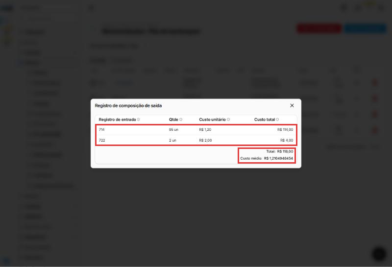
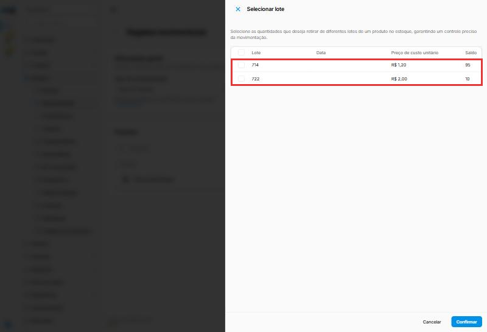
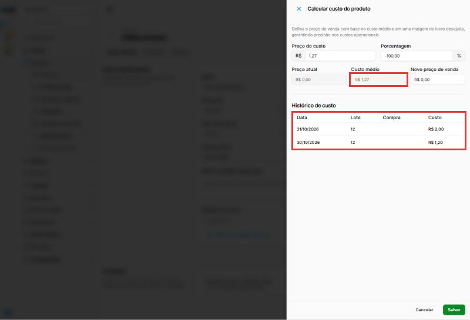
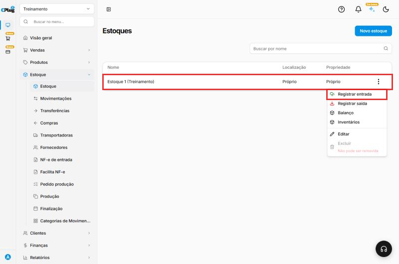
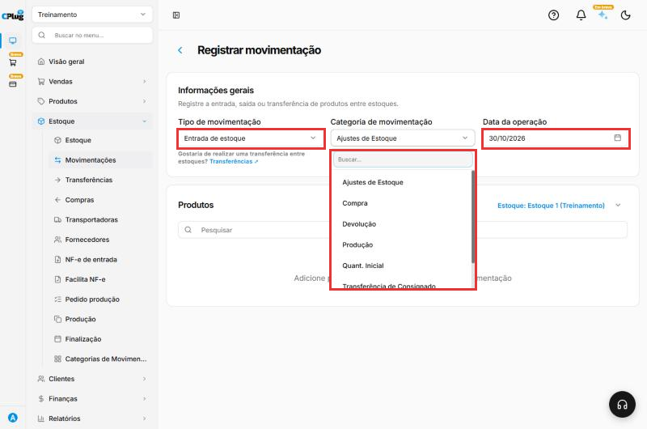
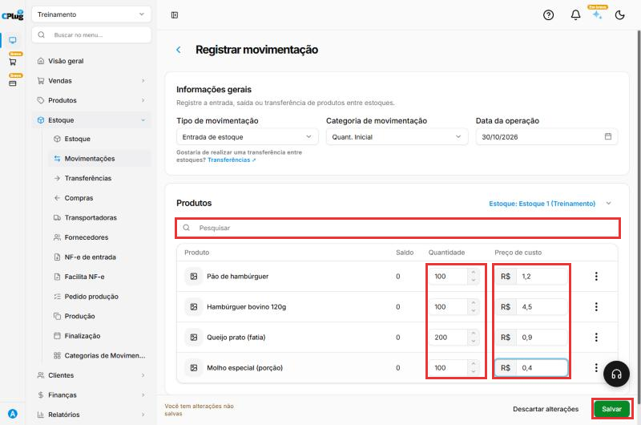
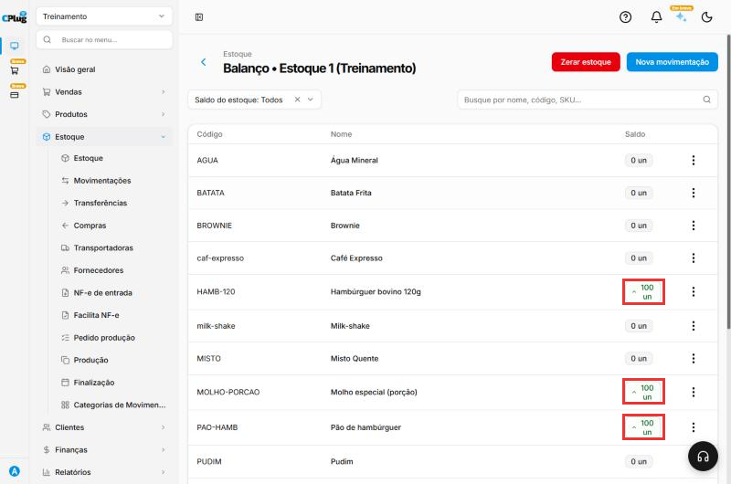

# Como dar entrada no estoque

:material-clock-outline: 10 minutos · :material-format-list-numbered: 5 passos · :material-calendar-check: Atualizado em 31/10/2026

Use este manual para lançar mercadorias no estoque **sem nota fiscal de compra**. Exemplos:

- o **estoque inicial**, quando a loja começa a usar o sistema;
- um **ajuste** depois de achar mercadoria a mais;
- uma **devolução** de cliente.

!!! tip "Comprou com nota fiscal?"
    Se a mercadoria veio com nota do fornecedor, não lance à mão: **importe o XML da nota**. Assim entram também o custo, o fornecedor e a conta a pagar. Veja [Como importar a nota fiscal de compra (XML)](importar-nota-de-compra.md).

## Entenda o conceito

Pense no estoque como uma **prateleira com etiquetas**. Toda mercadoria que chega ganha uma etiqueta com a data e quanto custou. Toda mercadoria que sai leva junto a etiqueta de onde veio. É assim que o sistema sabe **quanto você tem** e **quanto custou o que você vendeu ou perdeu**.

| Termo | O que é |
| --- | --- |
| **Movimentação** | Cada lançamento no estoque: uma **entrada** (soma) ou uma **saída** (subtrai). |
| **Categoria de movimentação** | O **motivo** do lançamento: estoque inicial, compra, perda, devolução... Serve para você entender depois o que aconteceu. |
| **Saldo** | Quanto existe agora: a soma das entradas menos as saídas. |
| **Lote** | Cada entrada vira um lote, com quantidade e **custo próprios**. O número do lote é o número da entrada. |
| **Custo médio** | A média do custo de todas as entradas do produto, pesada pela quantidade. |

### Cada entrada vira um lote

No exemplo, o pão de hambúrguer teve duas entradas:

- **Lote 714:** 100 pães a **R$ 1,20** (estoque inicial);
- **Lote 722:** 10 pães a **R$ 2,00** (o pão ficou mais caro).

O sistema não mistura os dois: cada lote guarda o seu custo.

### A saída consome os lotes mais antigos primeiro

Quando sai mercadoria, o sistema tira **primeiro do lote mais antigo**. Esse método se chama **PEPS**: o primeiro que entra é o primeiro que sai.

No teste, uma saída de 97 pães levou os **95** que restavam do lote 714 (a R$ 1,20) e **2** do lote 722 (a R$ 2,00). O custo dessa saída foi **R$ 118,00**. Você vê essa conta clicando em **Composição**, no histórico do produto:

{ loading=lazy }

Na tela de saída também dá para **escolher o lote** à mão: nos três pontinhos da linha do produto, clique em **Editar**. Aparece a lista dos lotes, com o custo e o saldo de cada um. Se você não escolher, vale o PEPS.

{ loading=lazy }

### O custo da entrada alimenta o custo médio

O custo que você digita na entrada também entra no **custo médio** do produto. No exemplo: (100 × R$ 1,20 + 10 × R$ 2,00) ÷ 110 = **R$ 1,27**.

Esse número aparece no cadastro do produto, em **Cálculo de custo**, junto com o **Histórico de custo** (cada entrada, com data e custo). É dele que o sistema parte para sugerir o preço de venda.

{ loading=lazy }

!!! warning "Custo errado na entrada = custo errado em tudo"
    Se você deixar o custo em **0** ou digitar errado, o lote fica com esse custo. As saídas dele vão parecer de graça, e o custo médio e o lucro ficam errados. **Sempre preencha o custo.**

### As categorias de movimentação

As categorias que aparecem dependem do tipo:

| Entrada | Saída | Nas duas |
| --- | --- | --- |
| **Quant. Inicial**, **Compra** | **Venda**, **Perda**, **Consumo Interno**, **Reposição** | **Ajustes de Estoque**, **Devolução**, **Produção**, **Transferência de Estoque** |

As categorias do sistema não podem ser editadas. Se precisar de outro motivo, crie uma categoria sua em **Estoque → Categorias de Movimentação**.

### Quando usar e quando não usar

- **Use** para o estoque inicial, compras sem nota, devoluções e correções.
- **Não use** para compras com nota: importe o XML (veja o quadro acima).
- **Não use** para levar mercadoria de um estoque para outro: use **Transferências**. O link fica logo abaixo do **Tipo de movimentação**.
- **Não use** para corrigir a contagem inteira da loja: faça um **inventário** (veja [Como fazer um inventário](inventario.md)).

Nos prints, o **quadrado vermelho** mostra onde você deve clicar ou digitar.

## Abra o registro de entrada

No menu do lado esquerdo, clique em **Estoque** e depois em **Estoque**. Na linha do estoque (por exemplo, "Estoque 1"), clique nos **três pontinhos** e depois em **Registrar entrada**.

{ loading=lazy }

No mesmo menu ficam **Registrar saída**, **Balanço** (o saldo de cada produto) e **Inventários** (a contagem).

## Escolha o tipo, a categoria e a data

- **Tipo de movimentação:** **Entrada de estoque**. Para tirar mercadoria, use **Saída de estoque**.
- **Categoria de movimentação:** o motivo. Para o estoque inicial, **Quant. Inicial**. A tela abre com **Ajustes de Estoque**: troque se o motivo for outro.
- **Data da operação:** vem com a data de hoje. Mude se estiver lançando algo que aconteceu antes.

Escolher a categoria certa não muda o saldo, mas é ela que conta a história do estoque depois. Uma perda lançada como "Ajustes" some no meio dos outros ajustes.

{ loading=lazy }

## Adicione os produtos

Em **Produtos**, clique em **Pesquisar**, digite parte do nome e clique no produto. Repita para cada produto. Para cada um, preencha:

- **Quantidade:** quanto está entrando. A coluna **Saldo** mostra quanto havia antes.
- **Preço de custo:** quanto custou **cada unidade**. O campo começa em **0**: não esqueça de preencher. Esse valor vira o custo do lote e entra no custo médio.

Para tirar um produto da lista antes de salvar, use os **três pontinhos** da linha e **Excluir**.

{ loading=lazy }

## Salve a entrada

Clique em **Salvar**, no canto de baixo, à direita. Aparece a mensagem **Movimentação criada com sucesso** e o sistema volta para a lista de estoques.

## Confira o saldo

Nos **três pontinhos** do estoque, clique em **Balanço**. Os produtos aparecem com a nova quantidade.

{ loading=lazy }

No **Balanço**, os três pontinhos de cada produto também têm **Registrar entrada**, **Registrar saída** e **Movimentações** (o histórico). É um atalho para lançar um produto só.

!!! warning "Estoque inicial é o primeiro passo do inventário"
    O inventário só consegue ajustar produtos que **já tiveram alguma movimentação**. Por isso, ao começar a usar o sistema, dê sempre a **entrada inicial** (categoria **Quant. Inicial**) antes de fazer inventários. Veja [Como fazer um inventário](inventario.md).

!!! tip "Boas práticas"
    - **Sempre preencha o custo.** Use o custo real de cada unidade. Se não souber, peça a nota ou o recibo do fornecedor.
    - **Escolha a categoria pelo motivo real.** Perda é perda, consumo interno é consumo interno. Assim o relatório mostra para onde vai a sua mercadoria.
    - **Lance no dia em que aconteceu.** Se precisar lançar depois, ajuste a **Data da operação**.
    - **Confira o Balanço depois de salvar.** Um zero a mais (1000 em vez de 100) é fácil de digitar e difícil de achar depois.
    - **Errou? Corrija o lançamento, não compense.** Excluir o lançamento errado e lançar de novo deixa o histórico limpo. Uma "saída para compensar" deixa dois lançamentos errados no histórico.
    - **Comprou com nota? Importe o XML.** É mais rápido e já traz custo e fornecedor.

## Deu algum problema?

??? question "O produto não aparece na pesquisa"
    Confira se ele está cadastrado na **mesma loja** e se, no cadastro do produto, aba **Estoque**, a opção **Controlar quantidade em estoque** está ligada. Ela "define se o produto terá movimentações em estoque".

??? question "Lancei a quantidade ou o custo errado"
    No **Balanço**, clique nos três pontinhos do produto e em **Movimentações**. Na linha do lançamento errado, clique na **lixeira** e confirme em **Excluir**. Depois, lance de novo do jeito certo.

    O que acontece ao excluir (testado):

    - O lançamento **sai do saldo** e passa para a aba **Canceladas**, que fica ao lado de **Fechadas**. Ele não volta a contar no estoque.
    - Excluir uma **saída** devolve as quantidades aos lotes de onde ela tirou.
    - Excluir uma **entrada** tira o custo dela do **custo médio** e do **Histórico de custo**.

    Se a entrada errada já teve saídas, exclua primeiro a saída e depois a entrada. Foi nessa ordem que o teste funcionou. Veja [Como consultar o saldo e o histórico do estoque](saldo-do-estoque.md).

??? question "Quero tirar mercadoria (perda, quebra, consumo)"
    Use **Registrar saída**, no mesmo menu do estoque, e escolha a categoria que explica o motivo: **Perda**, **Consumo Interno**... A saída não pede custo: ele vem dos lotes.

??? question "Por que o custo da saída ficou diferente do custo do cadastro?"
    Porque a saída usa o custo dos **lotes** que ela consumiu, começando pelo mais antigo (PEPS). Clique em **Composição**, no histórico do produto, para ver de quais lotes saiu cada unidade.

??? question "O custo médio do produto ficou estranho"
    Ele é a média de **todas** as entradas. Uma entrada lançada com custo 0 ou com um zero a mais puxa a média. Confira o **Histórico de custo**, em **Cálculo de custo** no cadastro do produto, e corrija a entrada errada.

??? question "Quero passar mercadoria de um estoque para outro"
    Não lance uma saída e uma entrada: use **Transferências** (o link fica abaixo do **Tipo de movimentação**).

**Relacionados:** [Como fazer um inventário](inventario.md) · [Como consultar o saldo e o histórico do estoque](saldo-do-estoque.md) · [Como importar a nota fiscal de compra (XML)](importar-nota-de-compra.md)

entrada de estoque estoque inicial quantidade inicial registrar entrada registrar saída ajuste de estoque movimentação devolução produção perda consumo interno preço de custo custo médio lote PEPS primeiro que entra primeiro que sai composição de saída selecionar lote lançar estoque sem nota categoria de movimentação excluir movimentação
