# Como importar a nota fiscal de compra (XML)

:material-clock-outline: 10 minutos · :material-format-list-numbered: 9 passos · :material-calendar-check: Atualizado em 30/10/2026

Quando você compra de um fornecedor, ele emite uma **nota fiscal eletrônica (NF-e)**. Junto com a nota vem um arquivo **XML**, que tem todos os dados da compra: fornecedor, produtos, quantidades, valores e impostos.

Importando esse arquivo, o sistema faz tudo de uma vez:

- dá **entrada no estoque** das mercadorias;
- registra o **preço de custo** de cada produto;
- cadastra o **fornecedor**;
- cria a **compra** e a **conta a pagar**.

!!! info "Antes de começar"
    - **Tenha o arquivo XML da nota.** Ele termina em `.xml`. O PDF da nota (DANFE) **não serve**. O fornecedor costuma mandar o XML por e-mail junto com o PDF. Se não mandou, peça a ele ou ao seu contador.
    - **Crie os grupos de impostos da sua empresa**, para preencher a parte fiscal dos produtos novos. Veja [Como configurar a emissão de notas fiscais](../configuracoes/emissao-de-notas.md).

Nos prints, o **quadrado vermelho** mostra onde você deve clicar ou digitar. Os dados do fornecedor aparecem cobertos de cinza de propósito.

## Abra a tela de notas de entrada

No menu do lado esquerdo, clique em **Estoque** e depois em **NF-e de entrada**.

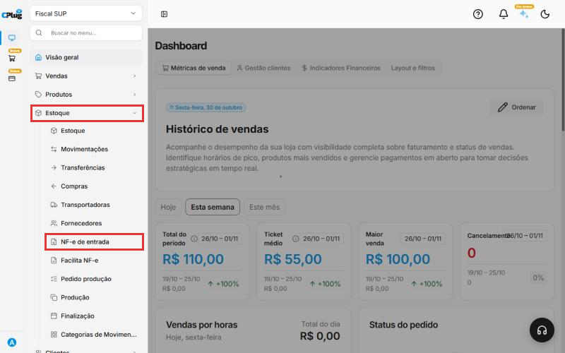{ loading=lazy }

## Envie o arquivo XML

1. Clique em **Importar XML**, no canto de cima, à direita.

    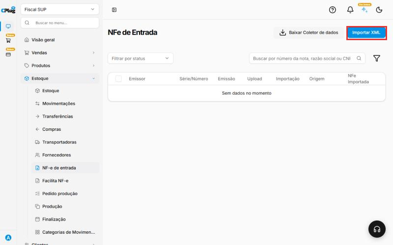{ loading=lazy }

2. Clique em **Escolha o arquivo** e selecione o XML no seu computador. Você também pode arrastar o arquivo para dentro da área.
3. O nome do arquivo aparece embaixo. Clique em **Importar**.

    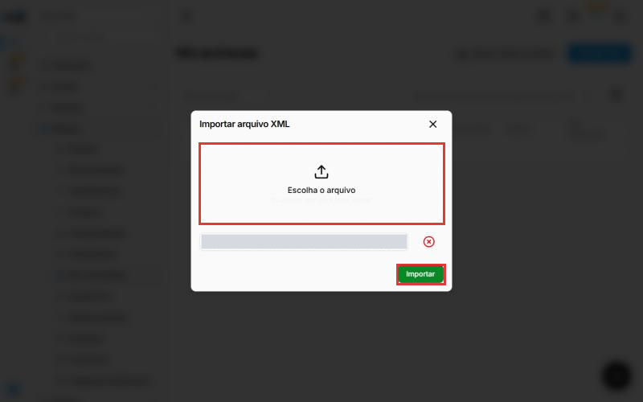{ loading=lazy }

A nota entra na lista com **NFe importada: Não**. Isso é normal: o arquivo foi enviado, mas a mercadoria **ainda não entrou no estoque**. Para isso, siga os próximos passos.

## Abra a importação da nota

Na linha da nota, clique nos **três pontinhos** (no fim da linha) e depois em **Importar dados XML**.

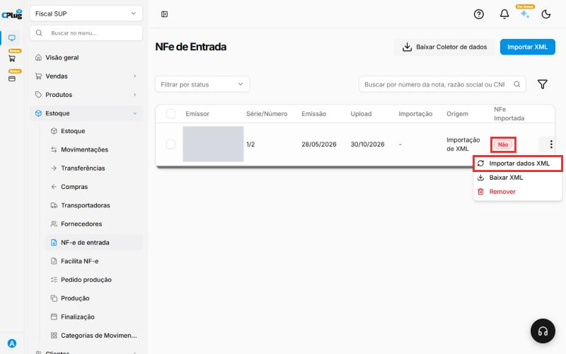{ loading=lazy }

A importação tem três abas, nesta ordem: **Fornecedor**, **Produtos** e **Pagamentos**.

## Confira o fornecedor

A aba **Fornecedor** mostra a série, o número e a data da nota, e os dados do fornecedor. Tudo vem do XML.

Confira e clique em **Avançar**. Depois da importação, o fornecedor aparece em **Estoque → Fornecedores**.

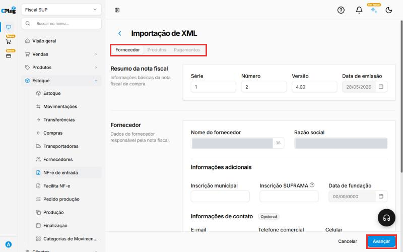{ loading=lazy }

## Revise cada produto da nota

A aba **Produtos** mostra um quadro para cada item da nota. No topo de cada quadro ficam os dados que vieram do XML: nome, código do fornecedor, quantidade e unidade. Em **Dados importados do XML** aparecem os valores (total, desconto, IPI, ST).

- **Importar produto:** deixe **ligado** para dar entrada do item. Desligue só se não quiser esse item no estoque.

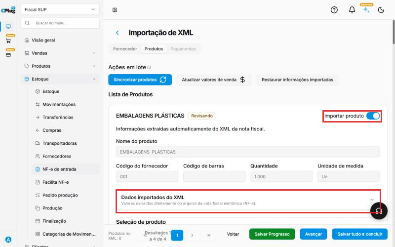{ loading=lazy }

Em **Seleção de produto**, escolha uma opção:

- **Criar novo produto:** quando é a **primeira vez** que você compra esse produto. O sistema cadastra o produto com os dados da nota.
- **Vincular produto existente:** quando o produto **já está cadastrado** no sistema. Escolha o produto na lista. Assim você **não duplica** o cadastro, e a quantidade entra no produto que você já tem.

Em **Informações do produto**, revise:

- **Nome do produto:** o nome vem como o fornecedor escreveu. Troque por um nome que você reconheça. Exemplo: de "EMBALAGENS PLÁSTICAS" para "Embalagem plástica 22x40x12".
- **Categoria:** escolha a categoria do produto.
- **Valor unitário:** é o **preço de venda**. Vem zerado. Preencha se você vai vender esse produto.
- **Preço de custo:** vem da nota. É quanto você pagou por unidade.
- **Fator de conversão:** use quando a unidade da nota for diferente da que você controla. Exemplo: a nota vem em **caixa** com 12 unidades e você vende por unidade: o fator é **12**. Se a unidade é a mesma, deixe **1**.
- **Estoque:** em qual estoque a mercadoria vai entrar.

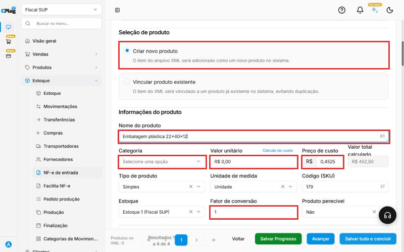{ loading=lazy }

## Preencha as informações tributárias

Ainda no quadro do item, clique em **Informações tributárias** para abrir.

- **NCM** e **Origem** já vêm preenchidos pela nota.
- **CFOP padrão NFC-e**, **ICMS** e **PIS/COFINS:** escolha os **grupos da sua empresa**, que serão usados quando **você vender** esse produto.

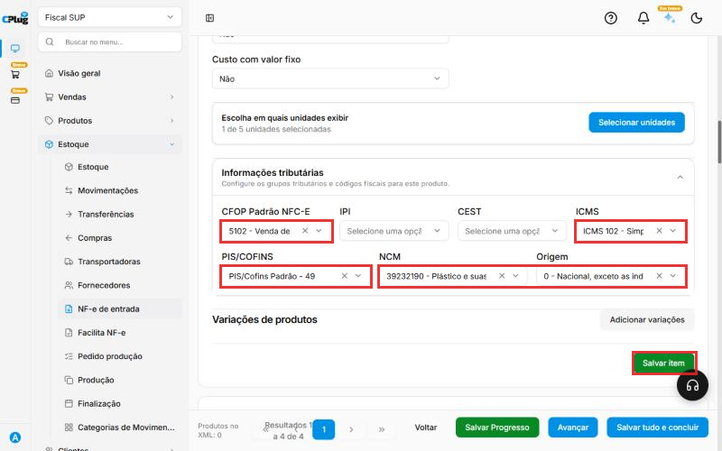{ loading=lazy }

!!! warning "Não copie os impostos da nota do fornecedor"
    Os códigos da nota de compra são do **fornecedor**. Na nota deste exemplo, o CFOP é **6102** (venda para outro estado). Na sua venda no caixa, o CFOP costuma ser **5102**.

    Escolha sempre os grupos da **sua** empresa, conforme o regime. Exemplo no Simples Nacional: ICMS **102**, PIS/COFINS **49** e CFOP **5102**. Na dúvida, confirme com o contador. Veja também [Como configurar os dados fiscais de um produto](../produtos/parametros-fiscais.md).

## Salve cada item

No fim do quadro, clique em **Salvar item**. Aparece a mensagem **Item salvo com sucesso** e o quadro fica marcado como **Produto salvo**.

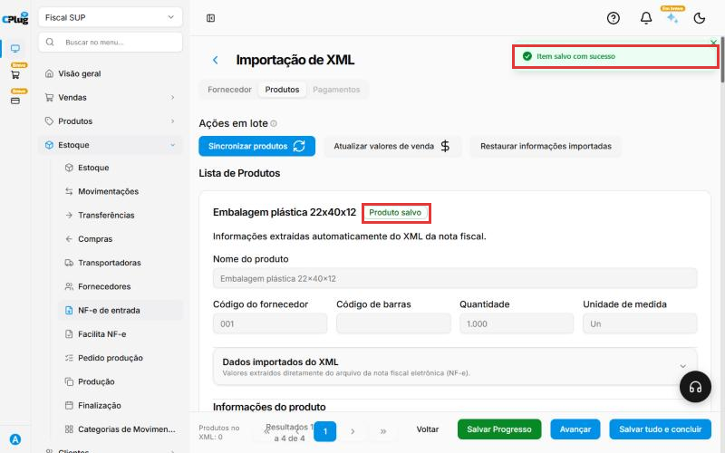{ loading=lazy }

Repita os passos 5 a 7 para **todos os itens** da nota. Se precisar parar no meio, clique em **Salvar Progresso**, no rodapé.

Quando terminar, clique em **Avançar**.

## Informe o pagamento e finalize

A aba **Pagamentos** mostra o resumo da nota e dos itens. Em **Pagamentos**, confira:

- **Forma de pagamento:** como você vai pagar o fornecedor (dinheiro, boleto, PIX...).
- **Conta bancária:** de qual conta o dinheiro vai sair. **É obrigatório.**
- **Vencimento:** a data de pagamento combinada com o fornecedor.
- **Categoria:** a categoria financeira da despesa.

Se a compra for parcelada (vários boletos, por exemplo), clique em **Adicionar pagamento** para cada parcela. Se houver custo extra, como frete cobrado à parte, use **Adicionar despesa**.

Clique em **Finalizar**.

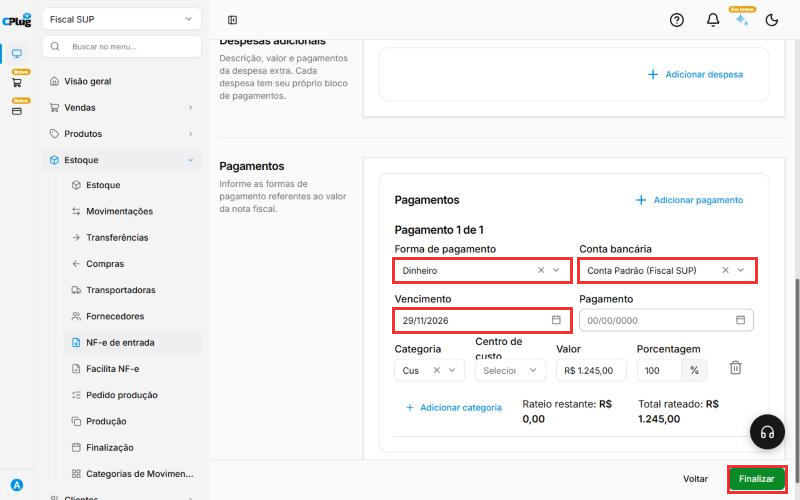{ loading=lazy }

## Confira se deu certo

1. Em **Estoque → NF-e de entrada**, a nota agora aparece com **NFe importada: Sim**.

    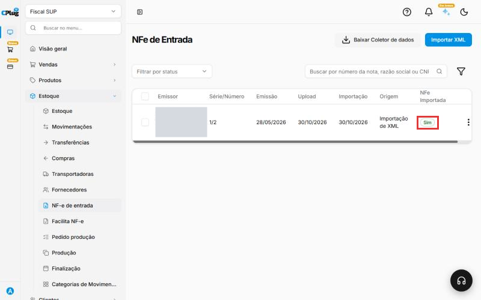{ loading=lazy }

2. Em **Estoque → Compras**, aparece a compra com o valor da nota e o status **Recebido**.

    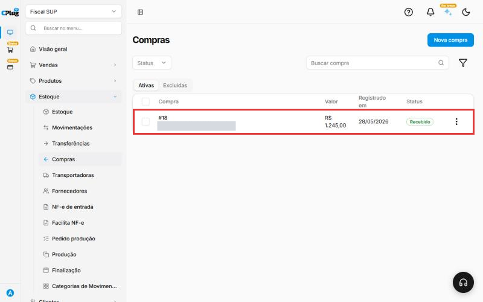{ loading=lazy }

3. Em **Estoque → Estoque**, abra o estoque escolhido: os produtos estão com a quantidade da nota.

    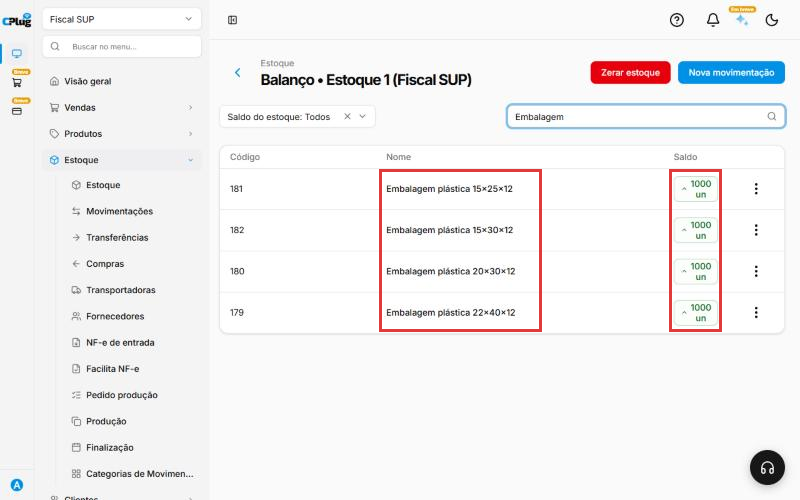{ loading=lazy }

!!! success "Pronto!"
    A mercadoria entrou no estoque, com custo e fornecedor registrados, e a conta a pagar foi criada.

## Deu algum problema?

??? question "Apareceu \"Nota fiscal já importada\""
    O sistema avisa quando essa mesma nota já foi enviada antes. Se a nota já está na lista de **NF-e de entrada**, clique em **Cancelar** e continue por ela. Isso evita dar entrada duas vezes na mesma mercadoria.

    Clique em **Sim, importar novamente!** só se você tem certeza de que a importação anterior não foi concluída (por exemplo, foi removida).

    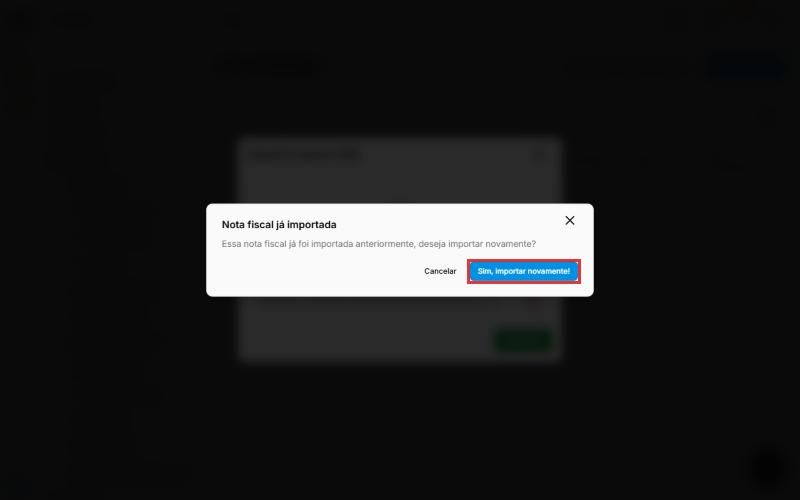{ loading=lazy }

??? question "Não consigo finalizar: \"O preenchimento é obrigatório\" na conta bancária"
    Escolha uma **Conta bancária** no pagamento. Se a lista estiver vazia, cadastre uma conta primeiro: veja [Como cadastrar uma conta bancária](../financas/conta-bancaria.md).

??? question "O produto ficou duplicado no cadastro"
    Isso acontece quando o produto já existia e foi escolhido **Criar novo produto**. Nas próximas notas, use **Vincular produto existente**.

??? question "A quantidade no estoque ficou errada"
    Confira o **Fator de conversão** do item. Se a nota vem em caixa e você controla por unidade, o fator precisa ser a quantidade de unidades da caixa.

??? question "Tenho só o PDF da nota"
    O PDF (DANFE) não pode ser importado. Peça o **XML** ao fornecedor ou ao seu contador.

**Relacionados:** [Como configurar os dados fiscais de um produto](../produtos/parametros-fiscais.md) · [Como configurar a emissão de notas fiscais](../configuracoes/emissao-de-notas.md) · [Como cadastrar um produto](../produtos/cadastrar-produto.md)

importar xml nota fiscal de compra nf-e de entrada nota de entrada entrada de estoque entrada de mercadoria compra fornecedor danfe arquivo xml preço de custo fator de conversão vincular produto criar produto conta a pagar estoque saldo nota já importada cfop icms pis cofins ncm
