# Como fazer um inventário

:material-clock-outline: 15 minutos · :material-format-list-numbered: 7 passos · :material-calendar-check: Atualizado em 31/10/2026

O **inventário** é a contagem do que existe de verdade na loja. Você informa a quantidade contada, o sistema mostra a **diferença** em relação ao saldo e, ao finalizar, **ajusta o estoque** para a quantidade contada.

## Entenda o conceito

O saldo do sistema é uma **conta**: entradas menos saídas. Na prática, a prateleira sempre se afasta um pouco dessa conta, por quebra, consumo não lançado, erro de digitação ou furto. O inventário é o momento de **acertar a conta com a realidade**.

| Termo | O que é |
| --- | --- |
| **Saldo** | Quanto o sistema acha que você tem. |
| **Novo saldo** | Quanto você **contou**. O campo começa em **0**. |
| **Diferença** | Novo saldo − Saldo. Negativa quando falta mercadoria; positiva quando sobra. |
| **Custo Unitário** | O custo de cada unidade. Só é usado se você marcar **Atualizar custo**. |
| **Atualizar custo** | Faz o estoque inteiro do produto passar a valer o custo informado. |

### O que o sistema grava ao finalizar

O inventário não "apaga e reescreve" o saldo. Ele cria **movimentações** da categoria **Ajustes de Estoque**, que ficam no histórico do produto. O jeito depende de **Atualizar custo**:

| | **Atualizar custo desmarcado** | **Atualizar custo marcado** |
| --- | --- | --- |
| **O que é lançado** | Só a **diferença**. | Uma **saída de todo o saldo** antigo e uma **entrada da quantidade contada**. |
| **Exemplo testado** | Hambúrguer: saldo 100, contado 99 → **saída de 1**, tirada do lote mais antigo (R$ 4,50). O custo digitado (R$ 9,99) foi **ignorado**. | Pão: saldo 95, contado 97 → **saída de 95** e **entrada de 97 a R$ 1,50**. |
| **Lotes e custo** | Continuam os mesmos lotes, com os custos de antes. | Os lotes antigos são zerados; fica **um lote novo** com o custo informado. |
| **Quando usar** | No inventário do dia a dia. | Quando o custo cadastrado está errado ou desatualizado e você quer recomeçar o produto com o custo certo. |

Para entender lotes e custo médio, veja [Como dar entrada no estoque](entrada-de-estoque.md).

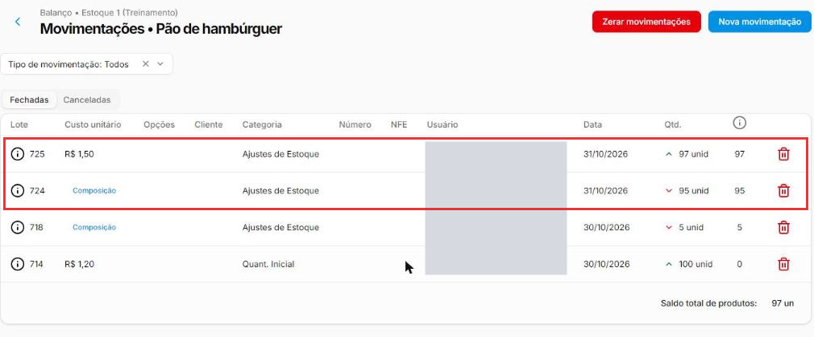{ loading=lazy }

!!! danger "O inventário só ajusta produtos que já tiveram movimentação"
    No teste, a **Água Mineral** (que nunca teve entrada) foi contada com **12**, o inventário foi finalizado **sem nenhum aviso**, e o saldo **continuou 0**. Antes do primeiro inventário, dê a **entrada inicial** dos produtos: veja [Como dar entrada no estoque](entrada-de-estoque.md).

Neste exemplo contamos o **Pão de hambúrguer**: o sistema dizia 100, mas na prateleira havia 95.

Nos prints, o **quadrado vermelho** mostra onde você deve clicar ou digitar.

## Abra os inventários do estoque

No menu do lado esquerdo, clique em **Estoque** e depois em **Estoque**. Na linha do estoque, clique nos **três pontinhos** e depois em **Inventários**.

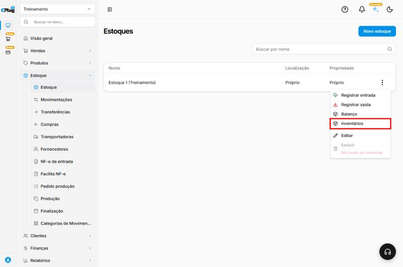{ loading=lazy }

A tela mostra os inventários **Em aberto** (em contagem) e os **Finalizados**. O botão **Exportar produtos** gera a lista para contar no papel. Clique em **Novo inventário**.

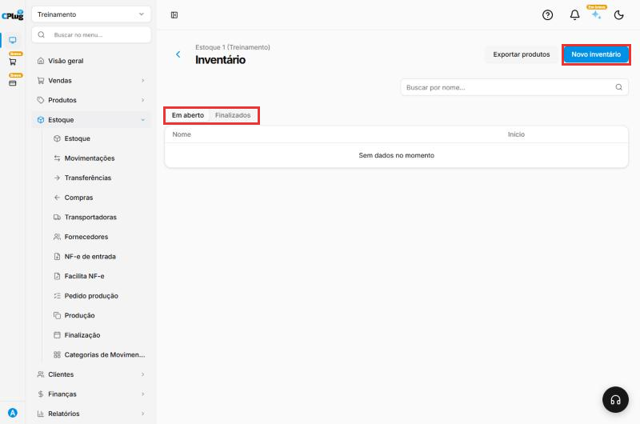{ loading=lazy }

## Dê um nome ao inventário

Digite um nome que ajude a encontrar depois. Exemplo: "Contagem de insumos - outubro". Clique em **Confirmar**.

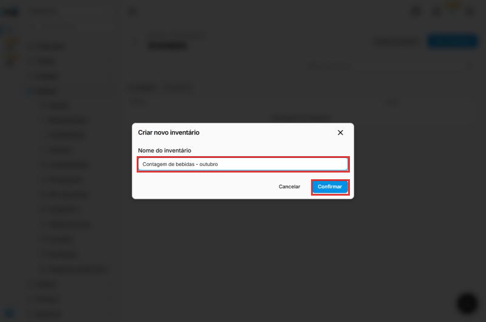{ loading=lazy }

## Abra o inventário

Na lista **Em aberto**, clique nos **três pontinhos** do inventário e depois em **Produtos**. No mesmo menu ficam **Editar** (o nome) e **Excluir**.

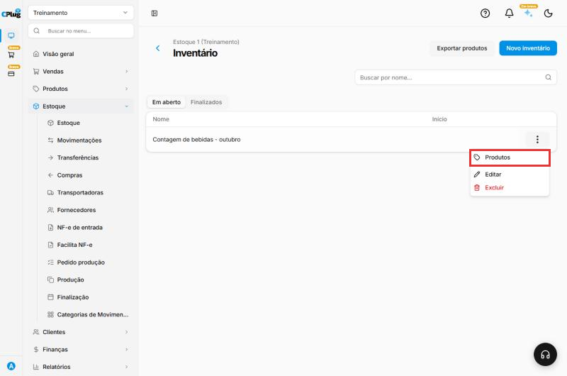{ loading=lazy }

Leia o aviso amarelo no topo: o inventário **salva sozinho** cada produto que você adiciona ou altera. Clique em **Adicionar produto**.

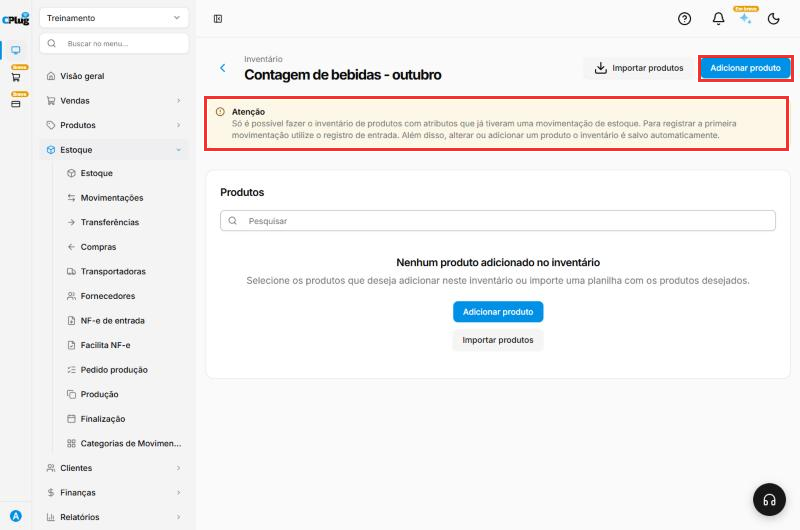{ loading=lazy }

## Escolha os produtos que vai contar

Marque a caixinha de cada produto e clique em **Adicionar ao inventário**, no rodapé. Para achar mais rápido, use a busca, o **Filtrar por categoria** ou o filtro (funil), que separa por **Categoria**, **Fornecedor**, faixa de **Valor** e produtos **com ou sem opções**.

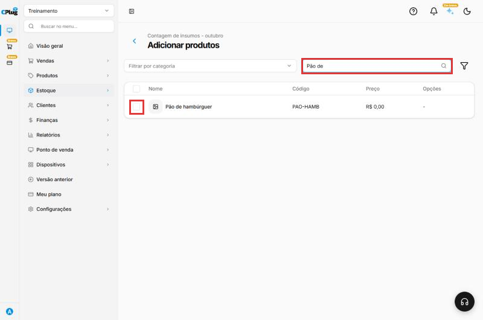{ loading=lazy }

Se forem muitos produtos, use **Importar produtos** (planilha).

## Informe a quantidade contada

Para cada produto, digite em **Novo saldo** a quantidade que você **contou**. A **Diferença** aparece na hora.

- Deixe **Atualizar custo desmarcado** no inventário comum: o sistema ajusta só a diferença e mantém os custos dos lotes.
- Marque **Atualizar custo** só quando quiser trocar o custo do produto, e preencha o **Custo Unitário** certo.

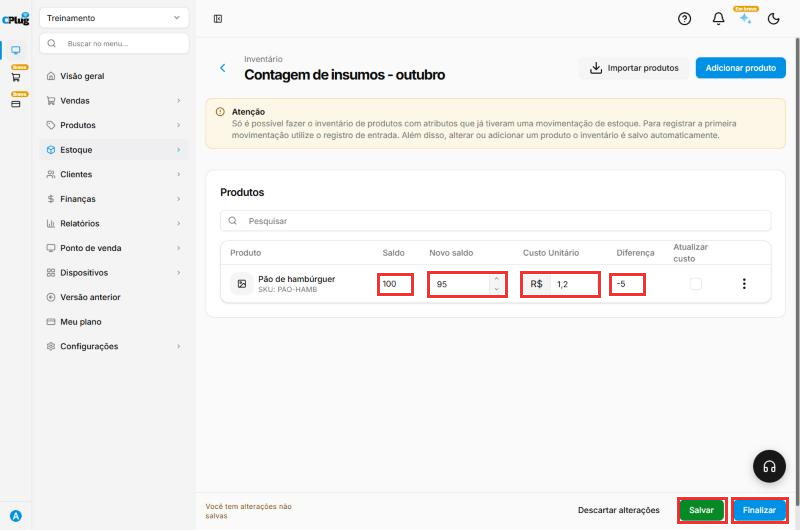{ loading=lazy }

Exemplo com **Atualizar custo** marcado no Pão (Novo saldo 97, custo R$ 1,50):

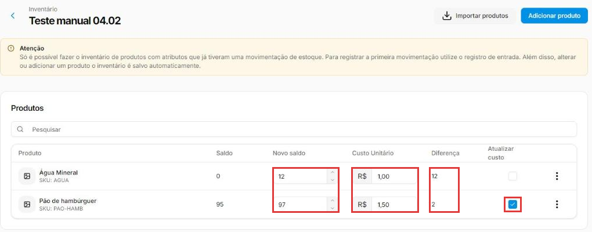{ loading=lazy }

Nos **três pontinhos** da linha, **Excluir** tira o produto do inventário. Para parar e continuar depois, clique em **Salvar**: o inventário fica em **Em aberto**.

## Finalize o inventário

Antes, confira se **todos** os produtos da lista têm o **Novo saldo** preenchido e se a **Diferença** faz sentido. Clique em **Finalizar** e confirme. Depois de finalizado, **não dá mais para editar** a contagem. Se ainda não terminou, use **Salvar e finalizar depois**.

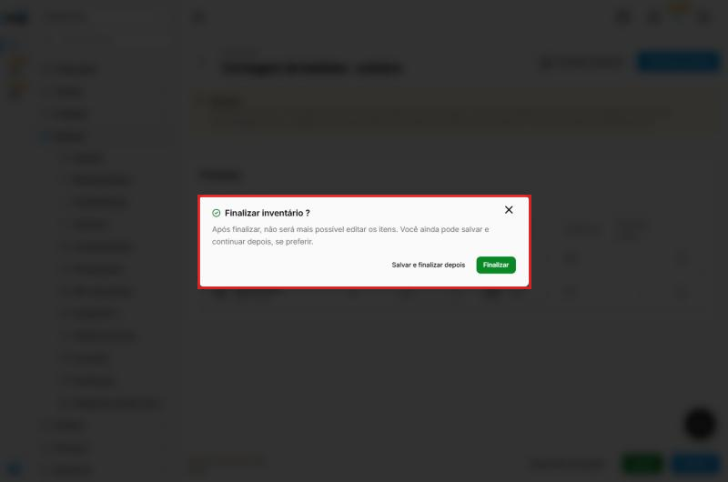{ loading=lazy }

## Confira o resultado

O inventário vai para a aba **Finalizados**, com a data de início e a data final.

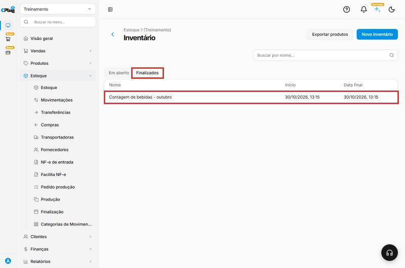{ loading=lazy }

No **Balanço** do estoque, o produto passa a ter o saldo contado (no exemplo, 95). No histórico do produto, o ajuste aparece como movimentação da categoria **Ajustes de Estoque**. Veja [Como consultar o saldo e o histórico do estoque](saldo-do-estoque.md).

!!! tip "Boas práticas"
    - **Tenha uma rotina.** Conte os itens mais caros ou que mais somem toda semana e o estoque inteiro uma vez por mês.
    - **Conte com a loja parada** ou fora do horário de vendas. Venda durante a contagem bagunça o resultado.
    - **Conte por partes.** Um inventário por categoria ou por fornecedor (use o filtro) é mais fácil de conferir.
    - **Imprima a lista** com **Exportar produtos** e conte no papel; depois só digite.
    - **Investigue diferenças grandes** antes de finalizar: pode ser uma nota de compra não lançada ou uma unidade de medida errada.
    - **Use Atualizar custo com cuidado.** Ele refaz o estoque do produto com o custo novo; no dia a dia, deixe desmarcado.
    - **Dê a entrada inicial antes** do primeiro inventário.

## Deu algum problema?

??? question "Finalizei e o saldo não mudou"
    O produto provavelmente **nunca teve movimentação** de estoque. O sistema finaliza sem avisar. Dê a entrada inicial (categoria **Quant. Inicial**) e, se precisar, faça um novo inventário.

??? question "O produto com variações (tamanho, sabor) não aparece para adicionar"
    Produtos com variações só podem entrar no inventário depois da **primeira entrada** no estoque, como diz o aviso amarelo da tela.

??? question "Errei a contagem e já finalizei"
    O inventário finalizado não pode ser editado. No histórico do produto, exclua as movimentações de **Ajustes de Estoque** geradas pelo inventário e conte de novo, ou faça um novo inventário só com esse produto. Veja [Como dar entrada no estoque](entrada-de-estoque.md), pergunta "Lancei a quantidade ou o custo errado".

??? question "Marquei Atualizar custo e o histórico mostra uma saída e uma entrada grandes"
    É o esperado: com **Atualizar custo**, o sistema tira todo o saldo antigo e lança a quantidade contada de novo, com o custo informado. O saldo final é o que você contou.

??? question "Digitei um custo, mas ele não mudou nada"
    Sem **Atualizar custo** marcado, o custo digitado no inventário é ignorado: o ajuste usa o custo dos lotes que já existem.

**Relacionados:** [Como dar entrada no estoque](entrada-de-estoque.md) · [Como consultar o saldo e o histórico do estoque](saldo-do-estoque.md)

inventário contagem de estoque balanço contar estoque ajuste de estoque novo saldo diferença finalizar inventário estoque físico perda sobra falta atualizar custo custo unitário lote exportar produtos importar produtos filtro por fornecedor inventário não ajustou
