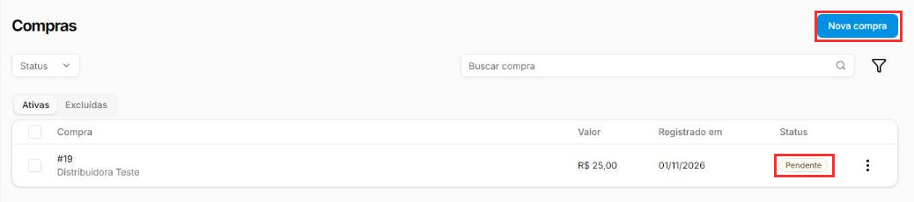
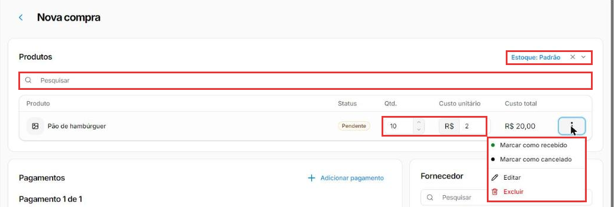
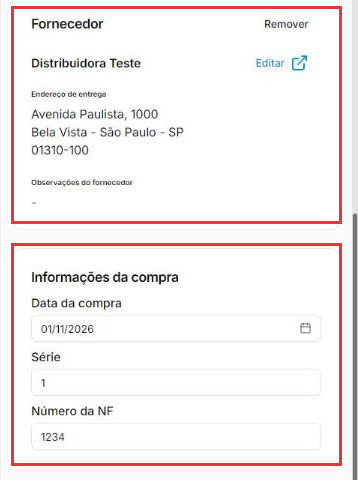
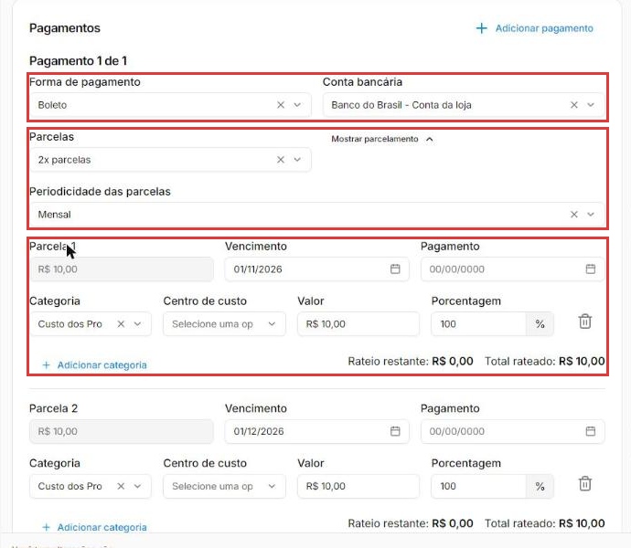
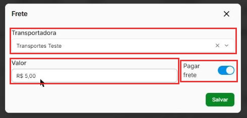
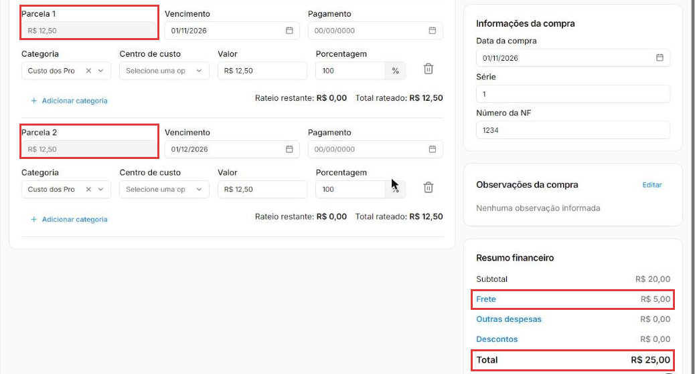
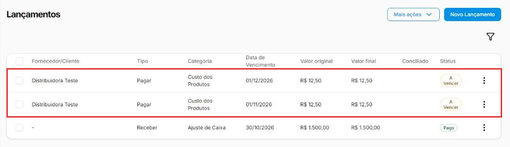
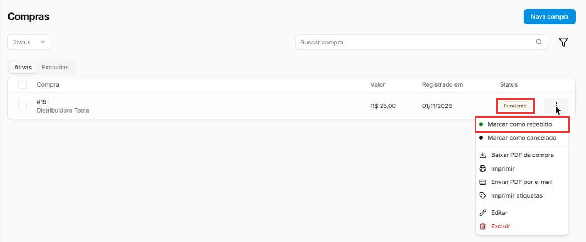
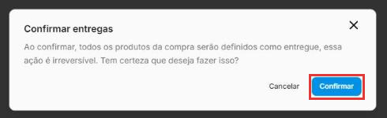
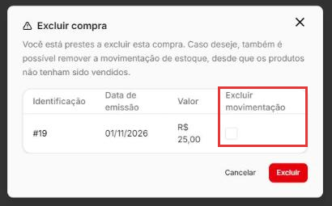

# Como lançar uma compra

:material-clock-outline: 10 minutos · :material-format-list-numbered: 8 passos · :material-calendar-check: Atualizado em 01/11/2026

A tela **Compras** registra o que você comprou de um fornecedor: os produtos, o custo, como vai pagar e quando a mercadoria chegou. Uma compra lançada aqui alimenta **o estoque** e **o financeiro** ao mesmo tempo.

## Entenda o conceito

A compra tem **duas etapas**, e cada uma mexe numa parte diferente do sistema:

| Quando | O que acontece | No teste |
| --- | --- | --- |
| **Ao salvar** a compra | Nascem as **contas a pagar** em **Finanças → Lançamentos**, uma por parcela, já com o fornecedor. A compra fica **Pendente**. | 2 parcelas de R$ 12,50 "A Vencer", na categoria Custo dos Produtos. |
| **Ao marcar como recebida** | A mercadoria **entra no estoque**, com a categoria **Compra** e um **lote** com o custo que você digitou. | Entraram 10 pães num lote novo a R$ 2,00. |

Ou seja: enquanto a mercadoria não chega, a compra é um **pedido** (a dívida já existe, o estoque ainda não). Quando chega, você confirma o recebimento e o estoque é atualizado. Para entender lotes e custo, veja [Como dar entrada no estoque](entrada-de-estoque.md).

**Compra ou entrada de estoque?** A **compra** registra o fornecedor e cria as contas a pagar. A **entrada de estoque** (Estoque → Estoque → Registrar entrada) só mexe no saldo: na empresa de teste, as entradas feitas à mão não apareceram em Lançamentos. Se você vai pagar um fornecedor por aquela mercadoria, lance como **compra**.

!!! tip "Tem o XML da nota? Use a importação"
    Se o fornecedor mandou o **XML** da nota fiscal, não digite a compra: importe. Produtos, custos, fornecedor e parcelas vêm da nota. Veja [Como importar a nota fiscal de compra (XML)](importar-nota-de-compra.md). Lance à mão quando não há nota eletrônica ou o fornecedor não manda o XML.

!!! info "Antes de começar"
    - Os **produtos** precisam estar cadastrados (veja [Como cadastrar um produto](../produtos/cadastrar-produto.md)).
    - Cadastre o **fornecedor** (veja [Como cadastrar um fornecedor](cadastrar-fornecedor.md)) e confira a **conta bancária** de onde sai o pagamento (veja [Como cadastrar uma conta bancária](../financas/conta-bancaria.md)).

Nos prints, o **quadrado vermelho** mostra onde você deve clicar ou digitar.

## Abra as compras

No menu do lado esquerdo, clique em **Estoque** e depois em **Compras**. A lista mostra cada compra com o número, o fornecedor, o **Valor**, a data em **Registrado em** e o **Status** (no teste: **Pendente**, **Recebido** e, na aba **Excluídas**, **Cancelado**). As abas **Ativas** e **Excluídas** separam as compras válidas das excluídas.

Clique em **Nova compra**.

{ loading=lazy }

## Adicione os produtos

Em **Produtos**, clique em **Pesquisar**, digite parte do nome e clique no produto. Na linha:

- **Qtd.:** quantas unidades você comprou.
- **Custo unitário:** quanto pagou por **unidade**. É esse custo que vai para o lote no estoque.
- **Custo total:** a conta é feita sozinha.

O **Status** do item começa **Pendente**. No canto de cima, **Estoque: Padrão** é o estoque onde a mercadoria vai entrar: no teste, foi o estoque principal da loja (**Estoque 1**). Não testamos trocar o estoque.

Os **três pontinhos** do item têm **Marcar como recebido**, **Marcar como cancelado**, **Editar** (abre a janela **Editar produto**, com **Quantidade** e **Custo**) e **Excluir**.

{ loading=lazy }

## Escolha o fornecedor e informe a nota

- **Fornecedor:** clique em **Pesquisar** e busque pelo nome, telefone ou e-mail. O quadro passa a mostrar o fornecedor, o **Endereço de entrega** (que vem do cadastro dele) e as observações, com **Editar** e **Remover**.
- **Informações da compra:** a **Data da compra** vem com a data de hoje. Se houver nota fiscal, preencha **Série** e **Número da NF**: servem para conferir a compra com a nota do fornecedor.

{ loading=lazy }

## Monte o pagamento

Em **Pagamentos**, o valor já vem preenchido com o total dos produtos:

- **Forma de pagamento:** PIX, Dinheiro, Boleto, Cheque, Faturamento, Depósito... (as cadastradas em [Formas de pagamento](../financas/formas-de-pagamento.md)).
- **Conta bancária:** de onde o dinheiro vai sair.
- **Parcelas** e **Periodicidade das parcelas:** apareceram ao escolher **Boleto**. No teste, **2x parcelas** com periodicidade **Mensal** dividiu o valor em duas parcelas iguais, com vencimentos em 01/11 e 01/12.
- Para cada parcela: **Vencimento**, **Pagamento** (deixe em branco se ainda não pagou), **Categoria** (vem **Custo dos Produtos**), **Centro de custo**, **Valor** e **Porcentagem**.
- Cada parcela também tem **Adicionar categoria**, **Rateio restante** e **Total rateado**. No teste, com uma categoria só, a parcela ficou 100% nela (Rateio restante R$ 0,00) e o Centro de custo ficou em branco. Não testamos dividir a parcela entre categorias.
- O botão **Adicionar pagamento** fica no topo (a tela mostra "Pagamento 1 de 1"). Não testamos lançar mais de um pagamento.

{ loading=lazy }

!!! warning "Pagamento preenchido = conta paga"
    No teste, ao editar a compra já salva e preencher a data de **Pagamento** de uma parcela, a conta passou a **Pago** em Lançamentos. Só preencha quando o dinheiro já saiu.

## Lance o frete

No **Resumo financeiro** ficam **Subtotal**, **Frete**, **Outras despesas**, **Descontos** e **Total**. Antes de lançar o frete, o resumo mostra "Não incluso no valor total". **Outras despesas** e **Descontos** também ficam ali (não testados).

Clique em **Frete**. A janela tem **Transportadora**, **Valor** e a chave **Pagar frete**. No teste, com o frete de R$ 5,00 e **Pagar frete** ligado:

- o frete entrou no **Total** (R$ 25,00) e foi dividido nas parcelas (2 x R$ 12,50);
- as parcelas continuaram sendo do **fornecedor**: não foi criada uma conta separada para a transportadora.

Use **Pagar frete** ligado quando o frete vem cobrado junto com a conta do fornecedor. Não testamos lançar um frete com a chave desligada.

{ loading=lazy }

{ loading=lazy }

!!! note "O frete não muda o custo do produto"
    No teste, mesmo com o frete pago, o lote do produto entrou no estoque com o **custo unitário digitado** (R$ 2,00). O frete aumenta o que você paga ao fornecedor, não o custo de cada unidade. Se você quer que o custo do produto inclua o frete, combine com o seu contador como fazer.

## Salve e confira as contas a pagar

Clique em **Salvar**. A compra aparece na lista como **Pendente**, e as parcelas já aparecem em **Finanças → Lançamentos** como **A Vencer**, com o fornecedor.

{ loading=lazy }

Depois de salva, a compra pode ser aberta de novo pelo **Editar** (nos três pontinhos da lista). No teste, foi por ali que a data de **Pagamento** de uma parcela foi preenchida.

## Marque como recebida quando a mercadoria chegar

Na lista, nos **três pontinhos** da compra, clique em **Marcar como recebido**. O menu também tem **Marcar como cancelado**, **Baixar PDF da compra**, **Imprimir**, **Enviar PDF por e-mail**, **Imprimir etiquetas**, **Editar** e **Excluir**.

{ loading=lazy }

O sistema pede para **Confirmar entregas** e avisa que a ação é **irreversível**. Clique em **Confirmar**. A compra passa a **Recebido** e a mercadoria entra no estoque.

{ loading=lazy }

Dentro da compra, cada produto também tem **Marcar como recebido** nos três pontinhos, e o rodapé tem **Marcar todos como recebidos**. Não testamos esses caminhos: no teste, o recebimento foi feito pelo menu da lista.

Depois de recebida, o menu perde as opções de marcar, e no **Editar** a **quantidade** e o **custo** dos itens ficam travados; os pagamentos continuam editáveis.

## Exclua uma compra lançada errado

Nos três pontinhos da compra, clique em **Excluir**. A janela **Excluir compra** tem a caixinha **Excluir movimentação**: marque para tirar do estoque a mercadoria que entrou, **desde que os produtos não tenham sido vendidos**.

{ loading=lazy }

No teste, com a caixinha marcada, a compra foi para a aba **Excluídas** (status **Cancelado**, movimentação **Excluída**), o lote saiu do estoque e a parcela **a vencer** sumiu de Lançamentos. **A parcela já paga continuou lá** (veja "Deu algum problema?").

**Excluir** não é o mesmo que **Marcar como cancelado**, que também aparece no menu. Não testamos o Marcar como cancelado.

!!! tip "Boas práticas"
    - **Tem XML? Importe.** Lance à mão só o que não tem nota eletrônica.
    - **Digite o custo por unidade**, do jeito que você controla o estoque. Se o produto é controlado por unidade e você comprou uma caixa com 12, a quantidade é 12 e o custo é o de cada unidade.
    - **Só marque como recebido o que chegou.** É nesse momento que o estoque muda, e a compra não volta para Pendente. Para desfazer, só excluindo a compra.
    - **Não preencha a data de Pagamento antes de pagar.** Ela dá baixa na conta.
    - **Preencha Série e Número da NF** quando houver nota: ligam a compra ao papel que você guardou.

## Deu algum problema?

??? question "Lancei a compra e o estoque não mudou"
    A compra está **Pendente**. O estoque só muda quando você **marca como recebido**.

??? question "Lancei a compra e a conta a pagar já apareceu"
    É assim que funciona: as parcelas nascem ao **salvar** a compra, mesmo antes da mercadoria chegar. Elas ficam **A Vencer** até você pagar.

??? question "Errei a quantidade ou o custo depois de receber"
    Depois de recebida, a quantidade e o custo ficam travados. Exclua a compra marcando **Excluir movimentação** (se os produtos ainda não foram vendidos) e lance de novo. Atenção: se alguma parcela já estava **paga**, ela continua em Lançamentos depois da exclusão, e a compra nova cria parcelas de novo.

??? question "Excluí a compra e uma parcela continua em Lançamentos"
    No teste, a parcela que já estava **paga** não foi apagada junto com a compra, porque o dinheiro já saiu. Antes de mexer nela, veja com o fornecedor se o valor vira crédito ou devolução, e com o seu contador como registrar.

??? question "Lancei frete e não aparece conta para a transportadora"
    No teste, com **Pagar frete** ligado, o frete foi somado às parcelas do **fornecedor**. Não foi criada uma conta separada para a transportadora.

??? question "O frete não entrou no total"
    Abra o **Frete** e confira se a chave **Pagar frete** está ligada: no teste, ligada, o frete entrou no Total e nas parcelas.

**Relacionados:** [Como importar a nota fiscal de compra (XML)](importar-nota-de-compra.md) · [Como cadastrar um fornecedor](cadastrar-fornecedor.md) · [Como dar entrada no estoque](entrada-de-estoque.md) · [Como cadastrar uma transportadora ou um entregador](transportadora.md) · [Formas de pagamento](../financas/formas-de-pagamento.md) · [Como cadastrar uma conta bancária](../financas/conta-bancaria.md)

compra lançar compra nova compra pedido de compra fornecedor custo unitário parcelas boleto periodicidade vencimento pagamento conta a pagar lançamentos rateio categoria centro de custo frete pagar frete outras despesas descontos marcar como recebido marcar todos como recebidos confirmar entregas pendente recebido cancelado excluir compra excluir movimentação estoque não mudou série número da nf compra ou entrada de estoque
