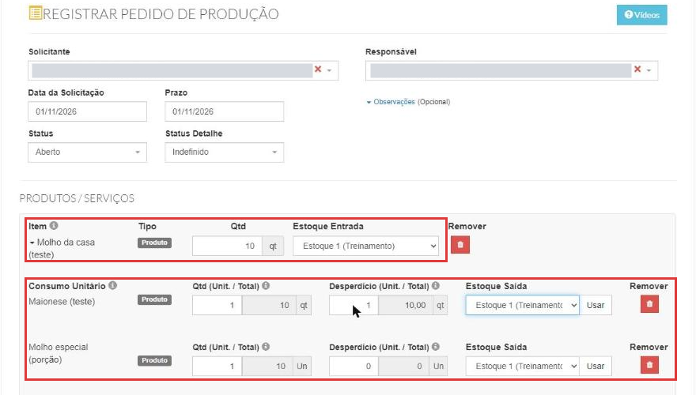
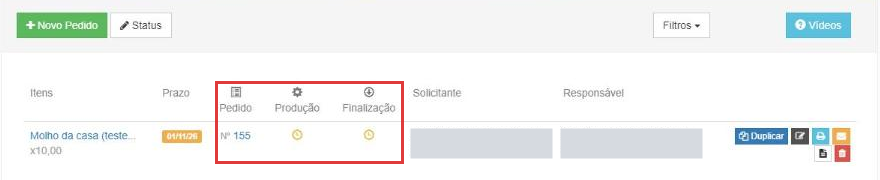
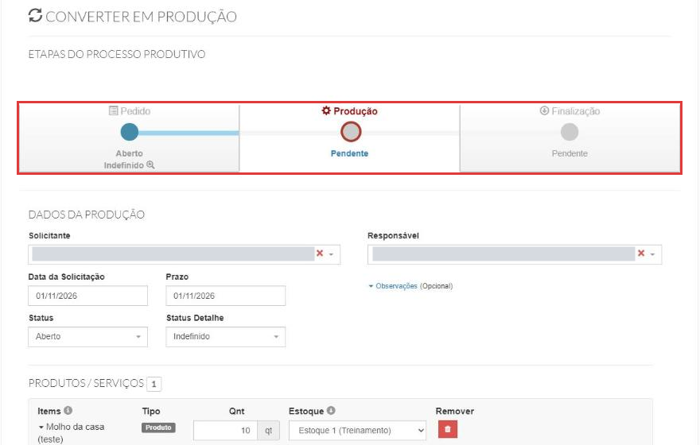
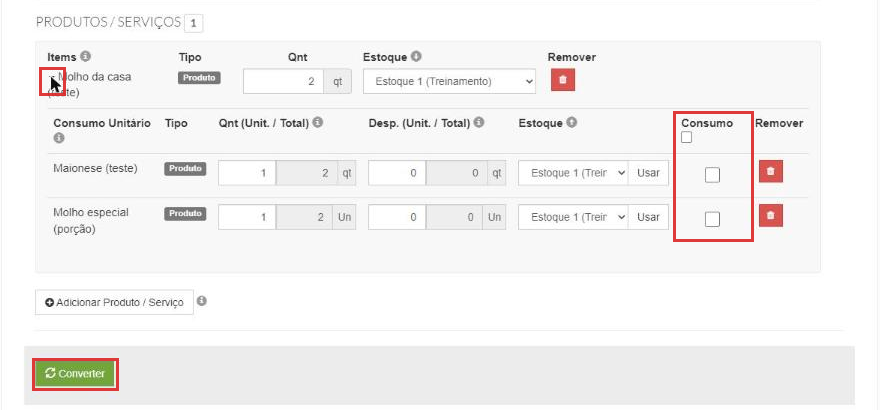
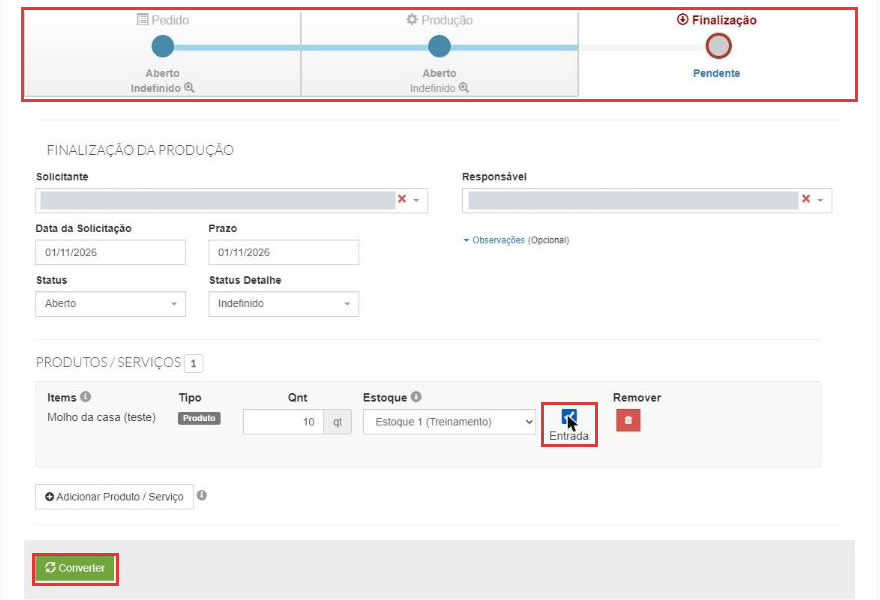

# Como criar uma ordem de produção

:material-clock-outline: 12 minutos · :material-format-list-numbered: 5 passos · :material-calendar-check: Atualizado em 06/11/2026

A **ordem de produção** registra o que a sua cozinha produz **antes** de vender: o molho da casa, a massa, o pão caseiro, a porção que fica pronta no freezer. Feita na ordem certa (veja abaixo), ela tira os ingredientes do estoque e coloca o produto pronto, com o custo dos ingredientes.

## Entenda o conceito

Na [ficha técnica](../produtos/ficha-tecnica.md) existem dois tipos de produção:

| Tipo de produção | Quando os ingredientes saem do estoque | Exemplo |
| --- | --- | --- |
| **Produção automática** | Na hora da **venda**. Não usa ordem de produção. | X-Burger, suco |
| **Processo produtivo** | Quando você registra a **produção**, por esta tela. | Molho da casa, massa de pizza |

**Quando usar:** o que você produz antes e guarda (molho, massa, pão), para saber quanto tem pronto e quanto custou. **Quando não usar:** o que é preparado na hora do pedido; aí a ficha técnica com Produção automática já tira os ingredientes na venda.

A ordem de produção passa por **três etapas**, que aparecem no topo da tela:

| Etapa | No menu | O que faz no estoque (no teste) |
| --- | --- | --- |
| **Pedido** | Estoque → Pedido produção | Nada. É o planejamento: o que produzir, quanto e para quando. |
| **Produção** | Estoque → Produção | Com a caixinha **Consumo** marcada, **tira os ingredientes** do estoque (categoria **Produção**). |
| **Finalização** | Estoque → Finalização | Com a caixinha **Entrada** marcada, **coloca o produto pronto** no estoque (categoria **Produção**). |

**De onde vem o custo do produto pronto.** No teste, a ficha do **Molho da casa** levava 1 maionese (R$ 3,00) e 1 molho especial (R$ 0,40). Com o consumo registrado **antes** da finalização, os 2 molhos produzidos entraram no estoque a **R$ 3,40** cada: a soma dos ingredientes (teste sem desperdício). Para entender lotes e custo, veja [Como dar entrada no estoque](entrada-de-estoque.md).

!!! warning "Consumo e Entrada vêm desmarcados"
    No teste, as caixinhas **Consumo** (na Produção) e **Entrada** (na Finalização) vieram **desmarcadas**. Sem marcar **Consumo**, a produção é salva mas os ingredientes não saem do estoque. E a ordem importa: no teste em que a finalização foi feita **antes** do consumo, o produto pronto entrou com custo **R$ 0,00**.

!!! info "Antes de começar"
    - O produto a ser produzido precisa ter **ficha técnica** do tipo **Processo produtivo**, com os ingredientes (veja [Como montar uma ficha técnica](../produtos/ficha-tecnica.md)). A janela de adicionar produto mostra só esses produtos: no teste, o X-Burger, que é de Produção automática, não apareceu.
    - Os ingredientes precisam ter **estoque e custo** (veja [Como dar entrada no estoque](entrada-de-estoque.md)).
    - Estas telas têm o **visual antigo** do sistema, mas abrem normalmente dentro do menu.

Nos prints, o **quadrado vermelho** mostra onde você deve clicar ou digitar. Os nomes de pessoas aparecem cobertos de cinza de propósito.

## Crie o pedido de produção

No menu do lado esquerdo, clique em **Estoque** e depois em **Pedido produção**. Clique em **Novo Pedido**.

Preencha o topo:

- **Solicitante** e **Responsável:** quem pediu e quem vai produzir (os usuários do sistema).
- **Data da Solicitação** e **Prazo:** quando foi pedido e para quando precisa estar pronto.
- **Status** (**Aberto**, **Fechado** ou **Cancelado**) e **Status Detalhe:** no teste, ficaram em **Aberto** e **Indefinido** em todas as etapas, mesmo depois de finalizar. Não testamos Fechado nem Cancelado.

Em **Produtos / Serviços**, clique em **Adicionar Produto / Serviço**, busque o produto e clique em **Adicionar e Fechar**. Na linha do produto:

- **Qtd:** quanto vai produzir. Exemplo: 10 molhos.
- **Estoque Entrada:** onde o produto pronto vai entrar.

Clique na **setinha** ao lado do nome para ver o **Consumo Unitário**: os ingredientes da ficha técnica, um por linha.

- **Qtd (Unit. / Total):** quanto de cada ingrediente vai em **uma** unidade, e o total para a quantidade pedida (a conta é feita sozinha).
- **Desperdício (Unit. / Total):** a perda esperada por unidade produzida. No teste, 1 maionese de desperdício por molho deu um total de 10.
- **Estoque Saída:** de onde o ingrediente sai. Pela dica da tela, o botão **Usar** aplica esse estoque em todos os ingredientes.

{ loading=lazy }

Clique em **Salvar**.

## Acompanhe as etapas na lista

A mensagem de sucesso traz o atalho **Converter em Produção agora**. O pedido aparece na lista com as colunas **Pedido**, **Produção** e **Finalização**; o relógio indica que a etapa ainda está pendente.

{ loading=lazy }

Nesse momento **nada mudou no estoque**: no teste, a maionese continuou com o mesmo saldo e o molho ainda não existia no estoque.

## Converta em produção e marque o consumo

Clique em **Converter em Produção agora**. A tela **Converter em Produção** mostra as etapas no topo, com **Produção** em destaque.

{ loading=lazy }

Desça até o produto e clique na **setinha** ao lado do nome. Na tabela de ingredientes, marque a caixinha **Consumo** (a do cabeçalho marca todas). É ela que tira os ingredientes do estoque. Clique em **Converter**.

{ loading=lazy }

Com **Consumo** marcado, saem do estoque os ingredientes **mais o desperdício**, na categoria **Produção**. Exemplo do teste: 10 molhos com 1 maionese de desperdício por molho tiraram 20 maioneses (10 de consumo + 10 de desperdício).

Se esquecer de marcar, dá para corrigir: em **Estoque → Produção**, clique no botão de editar da produção, abra a setinha, marque **Consumo** e clique em **Salvar**. Os ingredientes saem do estoque. Mas, se a finalização já tiver sido feita, o produto pronto continua com o custo com que entrou (no teste, R$ 0,00).

## Finalize e dê entrada no produto pronto

Depois de converter, a mensagem traz o atalho **Converter em Entrada de Produção agora**. Clique nele. A tela **Finalização da produção** mostra a terceira etapa em destaque.

Na linha do produto, confira a **Qnt** e o **Estoque**, e marque a caixinha **Entrada**. Clique em **Converter**.

{ loading=lazy }

No print, a finalização de 10 molhos. No teste feito na ordem certa (consumo antes), os 2 molhos produzidos entraram no estoque com a categoria **Produção** e custo de R$ 3,40 cada (o custo dos ingredientes consumidos).

## Confira no estoque

Abra o histórico dos produtos (veja [Como consultar o saldo e o histórico do estoque](saldo-do-estoque.md)):

- os **ingredientes** têm uma **saída** com a categoria **Produção**;
- o **produto pronto** tem uma **entrada** com a categoria **Produção** e o custo dos ingredientes.

Na lista de **Estoque → Produção**, o ícone ao lado do número da produção abre o **Consumo de Insumos**, com o insumo, o lote, o fornecedor e as datas de entrada e validade. No teste, sem o consumo marcado, ele ficou vazio.

!!! tip "Boas práticas"
    - **Monte a ficha técnica antes** e confira as quantidades: é dela que vem o consumo de cada ingrediente.
    - **Marque Consumo antes de finalizar.** É o consumo que dá o custo ao produto pronto.
    - **Marque a caixinha Entrada** na finalização: é ela que dá entrada no produto pronto.
    - **Use o Desperdício** quando a receita sempre perde um pouco (sobra na panela, aparas). Ele sai do estoque junto com o consumo.
    - **Confira o histórico** dos ingredientes e do produto depois de cada produção, até pegar o jeito.

## Deu algum problema?

??? question "O produto não aparece em Adicionar Produto / Serviço"
    Só aparecem produtos com ficha técnica do tipo **Processo produtivo**. A dica do ⓘ ao lado do botão diz isso. Abra a ficha técnica do produto e escolha **Processo produtivo** (veja [Como montar uma ficha técnica](../produtos/ficha-tecnica.md)).

??? question "Finalizei e os ingredientes não saíram do estoque"
    A caixinha **Consumo** não foi marcada na Produção. Abra a produção em **Estoque → Produção**, clique na setinha do produto, marque **Consumo** e salve. Os ingredientes saem, mas o produto pronto que já entrou continua com o custo daquele momento (veja a próxima pergunta).

??? question "O produto pronto entrou com custo zero"
    No teste, isso aconteceu quando a finalização foi feita **antes** de marcar o consumo. Nas próximas produções, marque o consumo antes de finalizar. Para corrigir uma entrada já feita, fale com o suporte.

??? question "Finalizei e o produto pronto não apareceu no estoque"
    Confira se a caixinha **Entrada** foi marcada na finalização. Se foi e o produto não entrou, fale com o suporte.

??? question "Fechei a mensagem e perdi o atalho Converter em Produção agora"
    No teste, a conversão foi sempre feita pelo atalho da mensagem. Se você fechou a mensagem antes de converter, fale com o suporte.

??? question "Finalizei e o status continua Aberto"
    No teste, o status ficou **Aberto** em todas as etapas, mesmo depois da finalização. O que mostra que a produção terminou é a coluna **Finalização** da lista, com o número da entrada.

**Relacionados:** [Como montar uma ficha técnica](../produtos/ficha-tecnica.md) · [Como dar entrada no estoque](entrada-de-estoque.md) · [Como consultar o saldo e o histórico do estoque](saldo-do-estoque.md)

ordem de produção pedido de produção produção finalização processo produtivo produção automática ficha técnica insumos ingredientes consumo desperdício entrada de produção converter em produção converter em entrada de produção consumo de insumos custo do produto produzido custo zero molho massa produção interna estoque saída estoque entrada status aberto
