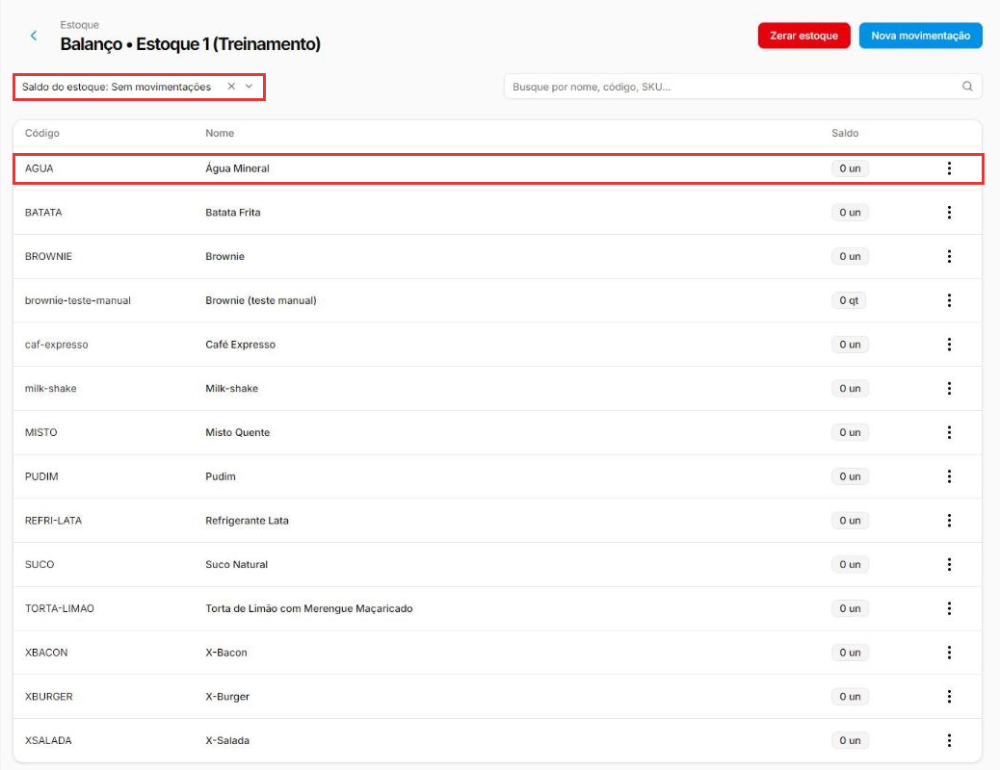

# Como consultar o saldo e o histórico do estoque

:material-clock-outline: 8 minutos · :material-format-list-numbered: 3 passos · :material-calendar-check: Atualizado em 31/10/2026

O **balanço** mostra quanto há de cada produto no estoque agora. O **histórico** (movimentações) mostra **de onde veio** esse número: cada entrada e cada saída do produto.

## Entenda o conceito

Pense no saldo como o **extrato do banco** de cada produto: o número final só faz sentido olhando os lançamentos. Quando o saldo "não bate", a resposta está no histórico.

| Onde | Responde a pergunta |
| --- | --- |
| **Balanço** | Quanto eu tenho de cada produto **agora**? Quais estão negativos? Quais nunca tiveram entrada? |
| **Movimentações** do produto | **Por que** o saldo é esse? Quem lançou, quando, com qual custo e por qual motivo? |

### Como ler uma linha do histórico

| Coluna | O que mostra |
| --- | --- |
| **Lote** | O número do lançamento. Toda entrada vira um lote (veja [Como dar entrada no estoque](entrada-de-estoque.md)). O ícone **(i)** mostra quem registrou e **quando foi lançado** no sistema. |
| **Custo unitário** | Na entrada, o custo de cada unidade do lote. Na saída aparece **Composição**: clique para ver de quais lotes a saída tirou e o custo de cada parte. |
| **Categoria** | O motivo: Quant. Inicial, Compra, Ajustes de Estoque, Perda... |
| **NFE** | A nota fiscal ligada ao lançamento, quando houver (por exemplo, numa compra importada por XML). |
| **Data** | A data **da operação**. Pode ser diferente do dia em que foi lançada. |
| **Qtd.** | Quanto entrou (seta para cima) ou saiu (seta para baixo). |
| **Última coluna (i)** | "**Saldo atual de hoje**". Na entrada, é **quanto ainda resta daquele lote** no estoque. Exemplo: entrada de 100 pães, 5 já saíram → mostra 95. |

No rodapé, **Saldo total de produtos** é o saldo atual do produto.

Nos prints, o **quadrado vermelho** mostra onde você deve olhar ou clicar.

## Abra o balanço do estoque

No menu do lado esquerdo, clique em **Estoque** e depois em **Estoque**. Na linha do estoque, clique nos **três pontinhos** e depois em **Balanço**.

A lista mostra o **código**, o **nome** e o **Saldo** de cada produto. Para achar um produto, use a **busca** (nome, código ou SKU).

{ loading=lazy }

Em **Saldo do estoque**, filtre a lista:

- **Positivo:** produtos com saldo.
- **Negativo:** produtos que saíram mais do que entraram. Sinal de entrada (compra) não lançada.
- **Sem movimentações:** produtos que **nunca tiveram nenhuma entrada ou saída**. São estes que o inventário não consegue ajustar.
- **Todos.**

{ loading=lazy }

!!! danger "Cuidado com Zerar estoque"
    O botão vermelho **Zerar estoque** apaga o saldo de **todos** os produtos desse estoque. No histórico de cada produto existe também **Zerar movimentações**. Só use com orientação do suporte ou do contador.

## Abra o histórico de um produto

Na linha do produto, clique nos **três pontinhos**. Aparecem **Registar entrada**, **Registar saída** e **Movimentações**. Clique em **Movimentações**.

{ loading=lazy }

## Leia as movimentações

Cada linha é uma entrada (seta verde para cima) ou uma saída (seta vermelha para baixo). Leia as colunas como explicado em [Como ler uma linha do histórico](#como-ler-uma-linha-do-historico).

No exemplo, o pão teve **entrada de 100** (Quant. Inicial, lote 714) e **saída de 5** (Ajustes de Estoque, feita pelo inventário). O lote 714 mostra **95** na última coluna: é o que resta dele hoje. O saldo total é **95**.

{ loading=lazy }

Use **Tipo de movimentação** para ver só entradas ou só saídas. A aba **Canceladas** mostra os lançamentos excluídos, que não contam mais no saldo.

!!! tip "Boas práticas"
    - **Olhe o filtro Negativo toda semana.** Saldo negativo quase sempre é compra que não foi lançada.
    - **Antes do primeiro inventário**, use **Sem movimentações** para achar os produtos que precisam de entrada inicial.
    - **Na dúvida sobre um saldo, vá ao histórico** antes de ajustar. Corrigir o lançamento errado é melhor que lançar um ajuste por cima.
    - **Confira o custo das entradas** no histórico: custo zerado ou com um zero a mais estraga o custo médio e o lucro.
    - **Use categorias claras** ao lançar entradas e saídas: o histórico fica fácil de ler meses depois.

## Deu algum problema?

??? question "O saldo está diferente do que tenho na loja"
    Confira o histórico para achar o lançamento que não bate. Depois, corrija com um **inventário** (veja [Como fazer um inventário](inventario.md)) ou com **Registrar entrada/saída** na categoria Ajustes de Estoque.

??? question "O produto aparece com saldo negativo"
    Saíram mais unidades do que entraram (por exemplo, vendas sem a entrada da compra). Lance as entradas que faltam ou faça um inventário.

??? question "Lancei uma movimentação errada"
    No histórico, o **ícone de lixeira** no fim da linha exclui a movimentação. Ela passa para a aba **Canceladas** e deixa de contar no saldo. Excluir uma saída devolve as quantidades aos lotes; excluir uma entrada tira o custo dela do custo médio. Veja [Como dar entrada no estoque](entrada-de-estoque.md).

??? question "A data do lançamento não é a do dia em que lancei"
    A coluna **Data** é a data **da operação** (por exemplo, a data de emissão da nota de compra). Para ver quando foi lançado no sistema, passe o mouse no **(i)** ao lado do lote.

??? question "O que é o número da última coluna?"
    É o "saldo atual de hoje" daquele lançamento. Numa entrada, mostra quanto daquele lote ainda está no estoque.

**Relacionados:** [Como dar entrada no estoque](entrada-de-estoque.md) · [Como fazer um inventário](inventario.md) · [Como importar a nota fiscal de compra (XML)](importar-nota-de-compra.md)

saldo de estoque balanço quanto tem no estoque histórico movimentações entradas e saídas kardex consultar estoque saldo negativo sem movimentações zerar estoque zerar movimentações cancelar movimentação canceladas lote custo composição saldo atual de hoje data da operação
