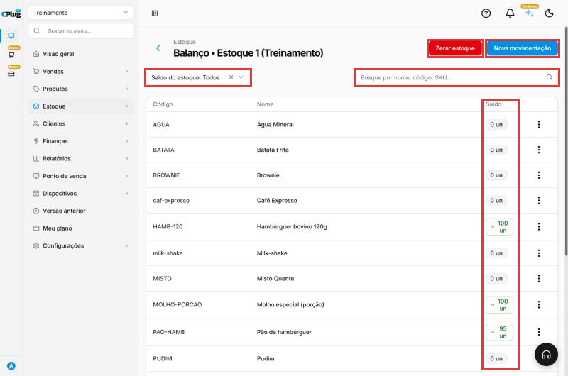
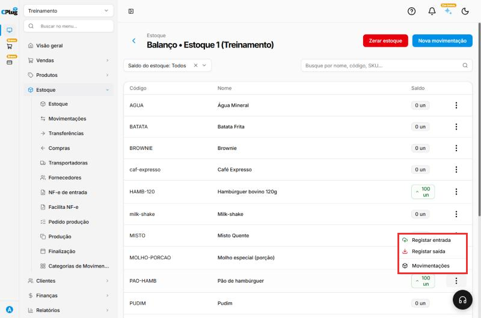
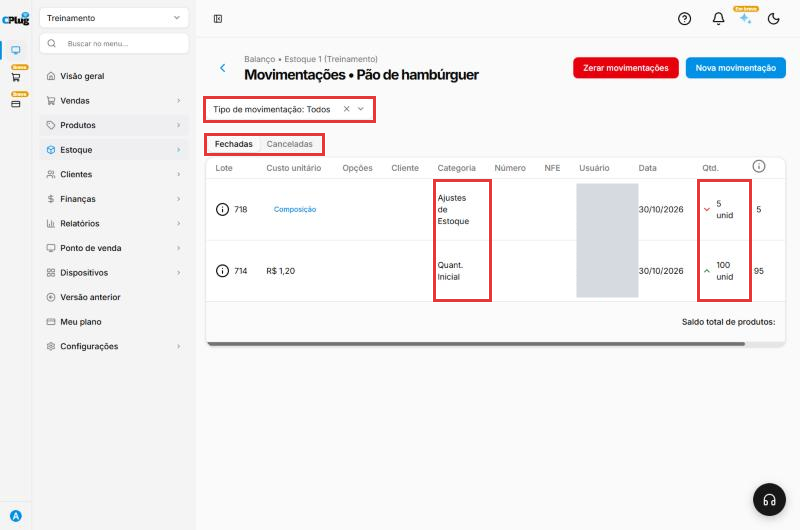

# Como consultar o saldo e o histórico do estoque

:material-clock-outline: 3 minutos · :material-format-list-numbered: 3 passos · :material-calendar-check: Atualizado em 30/10/2026

O **balanço** mostra quanto há de cada produto no estoque agora. O **histórico** (movimentações) mostra **de onde veio** esse número: cada entrada e cada saída do produto.

Nos prints, o **quadrado vermelho** mostra onde você deve olhar ou clicar.

## Abra o balanço do estoque

No menu do lado esquerdo, clique em **Estoque** e depois em **Estoque**. Na linha do estoque, clique nos **três pontinhos** e depois em **Balanço**.

A lista mostra o **código**, o **nome** e o **Saldo** de cada produto. Para achar um produto, use a **busca** (nome, código ou SKU). Em **Saldo do estoque**, filtre os produtos pelo saldo.

{ loading=lazy }

!!! danger "Cuidado com Zerar estoque"
    O botão vermelho **Zerar estoque** apaga o saldo de **todos** os produtos desse estoque. Só use com orientação do suporte ou do contador.

## Abra o histórico de um produto

Na linha do produto, clique nos **três pontinhos**. Aparecem **Registar entrada**, **Registar saída** e **Movimentações**. Clique em **Movimentações**.

{ loading=lazy }

## Leia as movimentações

Cada linha é uma entrada (seta verde para cima) ou uma saída (seta vermelha para baixo), com:

- **Lote**, **Custo unitário** e **Categoria** (Quant. Inicial, Ajustes de Estoque, Compra...);
- **Usuário** que fez o lançamento e **Data**;
- **Qtd.** movimentada e o saldo depois dela.

No exemplo, o pão teve **entrada de 100** (Quant. Inicial) e **saída de 5** (Ajustes de Estoque, feita pelo inventário), ficando com **95**.

{ loading=lazy }

Use **Tipo de movimentação** para ver só entradas ou só saídas. A aba **Canceladas** mostra os lançamentos cancelados.

## Deu algum problema?

??? question "O saldo está diferente do que tenho na loja"
    Confira o histórico para achar o lançamento que não bate. Depois, corrija com um **inventário** (veja [Como fazer um inventário](inventario.md)) ou com **Registrar entrada/saída** na categoria Ajustes de Estoque.

??? question "O produto aparece com saldo negativo"
    Saíram mais unidades do que entraram (por exemplo, vendas sem a entrada da compra). Lance as entradas que faltam ou faça um inventário.

??? question "Lancei uma movimentação errada"
    No histórico, o **ícone de lixeira** no fim da linha cancela a movimentação. Ela passa para a aba **Canceladas**. Confira o saldo depois.

**Relacionados:** [Como dar entrada no estoque](entrada-de-estoque.md) · [Como fazer um inventário](inventario.md)

saldo de estoque balanço quanto tem no estoque histórico movimentações entradas e saídas kardex consultar estoque saldo negativo zerar estoque cancelar movimentação lote custo
