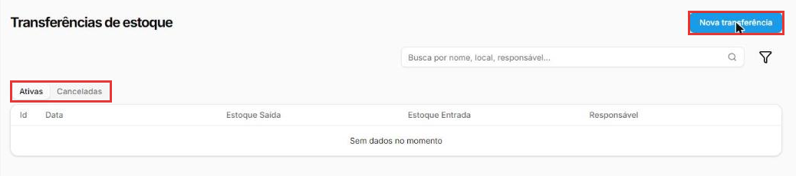
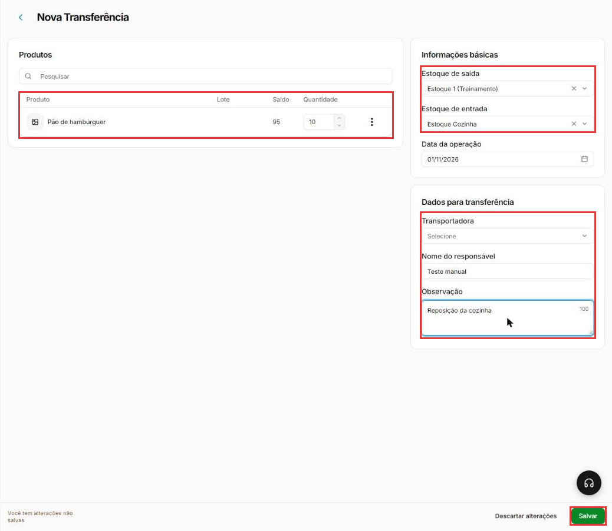
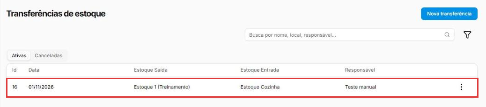
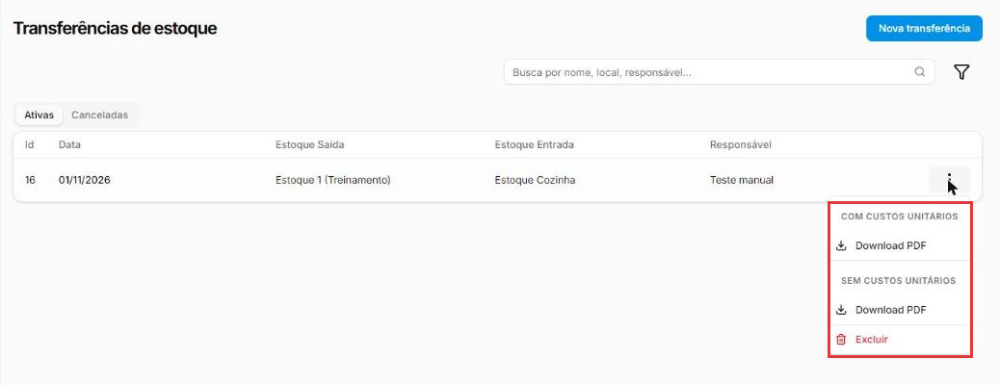

# Como transferir mercadorias entre estoques

:material-clock-outline: 8 minutos · :material-format-list-numbered: 5 passos · :material-calendar-check: Atualizado em 01/11/2026

A **transferência** leva mercadoria de um estoque para outro: do depósito para a cozinha, do estoque principal para o freezer do salão. Em um único lançamento, a mercadoria **sai** de um lugar e **entra** no outro.

## Entenda o conceito

Uma empresa pode ter **vários estoques**. Cada um tem o seu próprio saldo, e a transferência é o jeito certo de mover mercadoria entre eles.

**Por que não lançar uma saída e uma entrada?** Porque a transferência faz as duas coisas **ligadas** e **leva o custo junto**. No teste, ao transferir 10 pães do Estoque 1 para o Estoque Cozinha:

- no Estoque 1 saíram 10 pães do lote mais antigo, a **R$ 1,20** cada;
- no Estoque Cozinha entraram 10 pães, num **lote novo com o mesmo custo de R$ 1,20**.

Ou seja, a mercadoria chega com o mesmo custo, **sem você digitar nada**. Se você lançasse uma saída e uma entrada separadas, teria de digitar o custo da entrada, com risco de errar. Para entender lotes e custo, veja [Como dar entrada no estoque](entrada-de-estoque.md).

No histórico dos produtos, as duas movimentações aparecem com a categoria **Transferência** (na lista de categorias ela se chama **Transferência de Estoque**; veja [Como criar categorias de movimentação](categorias-de-movimentacao.md)).

**Quando usar:** a mercadoria mudou de lugar, mas continua sendo sua (reposição da cozinha, do freezer, de outro depósito). **Quando não usar:** a mercadoria saiu de vez (venda, perda, consumo): aí é uma **saída** de estoque.

!!! info "Antes de começar: os dois estoques precisam existir"
    Em **Estoque → Estoque**, clique em **Novo estoque** para criar outro. O cadastro pede **Nome**, **Localização do estoque** (as opções são **Próprio**, **De Cliente** e **De Fornecedor**), **Propriedade do estoque** e as **Unidades** (lojas) que têm acesso. Para um estoque dentro da sua própria loja, como a cozinha, use **Próprio** na localização.

Nos prints, o **quadrado vermelho** mostra onde você deve clicar ou digitar.

## Abra as transferências

No menu do lado esquerdo, clique em **Estoque** e depois em **Transferências**. A lista mostra cada transferência com o **Id**, a **Data**, o **Estoque Saída**, o **Estoque Entrada** e o **Responsável**. A aba **Ativas** mostra as transferências válidas; a aba **Canceladas** guarda as excluídas, só para consulta.

Clique em **Nova transferência**.

{ loading=lazy }

!!! tip "Outro caminho"
    Na tela **Registrar movimentação** (entrada ou saída de estoque), o link **Transferências**, logo abaixo do Tipo de movimentação, leva para esta mesma tela.

## Escolha os estoques e os produtos

Em **Informações básicas**:

- **Estoque de saída:** de onde a mercadoria sai. No teste, veio preenchido com o **Estoque 1**, o estoque principal.
- **Estoque de entrada:** para onde ela vai.
- **Data da operação:** vem com a data de hoje.

Em **Produtos**, clique em **Pesquisar**, digite parte do nome e clique no produto. Na linha, a coluna **Saldo** mostra quanto há no estoque de saída. Digite a **Quantidade** que vai ser transferida.

A linha tem também a coluna **Lote** e os três pontinhos, como na saída de estoque. No teste, sem escolher lote, os pães saíram do lote mais antigo.

## Preencha os dados da transferência

Em **Dados para transferência**:

- **Transportadora:** quem vai levar, se for o caso (as transportadoras ficam em **Estoque → Transportadoras**). É opcional: no teste, ficou em branco.
- **Nome do responsável:** quem está fazendo a transferência. Aparece na lista.
- **Observação:** um comentário, com até 120 caracteres. Exemplo: "Reposição da cozinha".

Clique em **Salvar**.

{ loading=lazy }

## Confira na lista

A transferência aparece na aba **Ativas**, com o número, a data, os dois estoques e o responsável.

{ loading=lazy }

## Imprima o documento, se precisar

Nos **três pontinhos** da transferência ficam:

- **Com custos unitários → Download PDF** e **Sem custos unitários → Download PDF:** baixam o documento da transferência, com ou sem os valores. A versão sem custos é a indicada para acompanhar a mercadoria, quando quem recebe não precisa ver quanto ela custou.
- **Excluir:** desfaz a transferência (veja abaixo).

{ loading=lazy }

!!! tip "Boas práticas"
    - **Transfira, não lance saída e entrada.** Só a transferência leva o custo junto, sem digitar.
    - **Confira o saldo do estoque de saída** antes de transferir: a linha do produto mostra.
    - **Preencha o responsável e a observação**: meses depois, explicam por que a mercadoria mudou de lugar.
    - **Dê nomes claros aos estoques** ("Depósito", "Cozinha", "Freezer do salão").

## Deu algum problema?

??? question "O estoque de entrada que eu quero não aparece"
    Confira se ele existe em **Estoque → Estoque**. Se existir, abra o cadastro dele e veja o campo **Unidades**: ele precisa estar liberado para a loja em que você está.

??? question "Transferi errado (produto, quantidade ou estoque)"
    Nos três pontinhos da transferência, clique em **Excluir** e confirme. O sistema avisa que a operação não pode ser desfeita. No teste, a transferência foi para a aba **Canceladas** e o saldo voltou para o estoque de saída. Depois, faça a transferência certa.

??? question "Fiz uma saída e uma entrada em vez de transferir"
    Funciona para o saldo, mas a entrada fica com o custo que você digitou. Se o custo ficou errado, exclua os dois lançamentos no histórico de cada produto e faça uma transferência. Veja [Como consultar o saldo e o histórico do estoque](saldo-do-estoque.md).

**Relacionados:** [Como dar entrada no estoque](entrada-de-estoque.md) · [Como consultar o saldo e o histórico do estoque](saldo-do-estoque.md) · [Como criar categorias de movimentação](categorias-de-movimentacao.md)

transferência de estoque transferir mercadoria entre estoques depósito cozinha freezer novo estoque estoque de saída estoque de entrada custo lote romaneio pdf sem custos responsável transportadora canceladas excluir transferência
