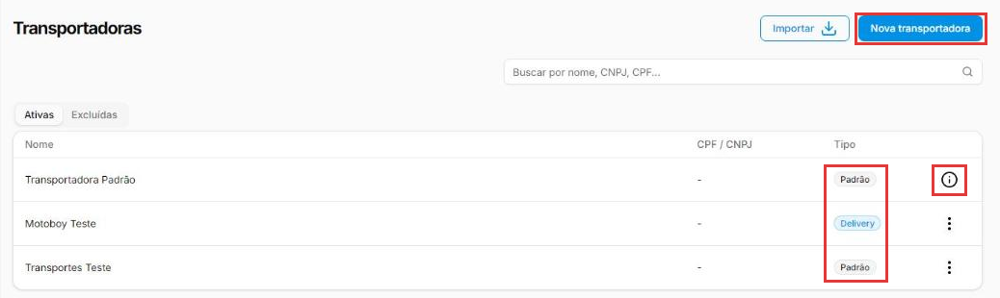
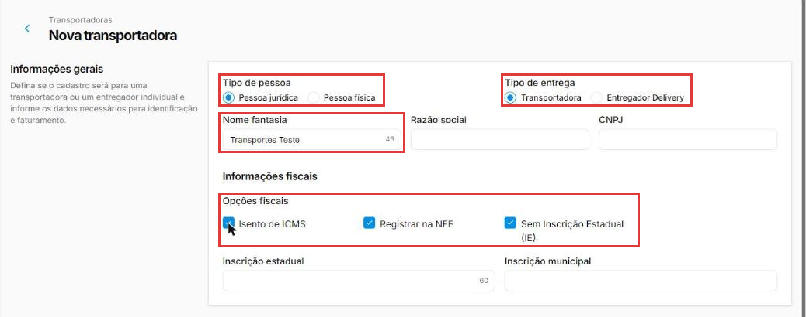
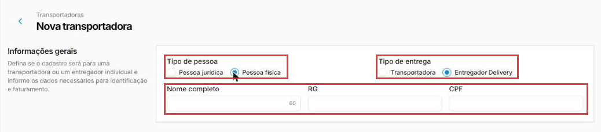
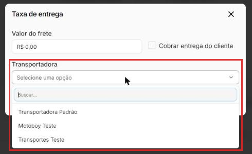
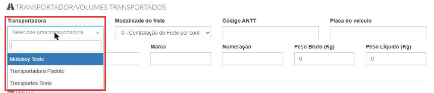

# Como cadastrar uma transportadora ou um entregador

:material-clock-outline: 8 minutos · :material-format-list-numbered: 6 passos · :material-calendar-check: Atualizado em 01/11/2026

A tela **Transportadoras** guarda **quem leva a mercadoria**: a empresa de frete que entrega suas vendas ou leva produtos entre lojas, e também os **entregadores do delivery**, como o motoboy da casa. Cadastrar quem leva deixa a escolha pronta na transferência, no pedido e na nota, sem digitar de novo.

## Entenda o conceito

O cadastro tem dois **tipos de entrega**:

| Tipo de entrega | Para quem | Na coluna Tipo da lista |
| --- | --- | --- |
| **Transportadora** | Empresa de frete ou transporte. | **Padrão** |
| **Entregador Delivery** | Pessoa que faz entregas, como um motoboy. | **Delivery** |

!!! note "\"Padrão\" na coluna Tipo"
    Na coluna **Tipo**, **Padrão** quer dizer só que o cadastro é do tipo **Transportadora**. Não tem relação com a **Transportadora Padrão**, o cadastro fixo do sistema.

**Onde a transportadora é escolhida.** No teste, as transportadoras apareceram para escolha em três lugares:

- na **transferência entre estoques**, em **Dados para transferência** (veja [Como transferir mercadorias entre estoques](transferencia.md));
- no **pedido de venda**, na janela **Taxa de entrega**;
- na **NF-e** emitida à mão, na parte **Transportador/volumes transportados**.

Nos três lugares, a lista mostrou **todas** as transportadoras liberadas para a loja, dos dois tipos, sem separar empresa de frete e motoboy. Na **compra** (Estoque → Compras) não há campo de transportadora.

!!! info "Antes de começar: a Transportadora Padrão já existe"
    A **Transportadora Padrão** já vem no sistema e aparece em todas as listas de escolha, em todas as lojas. Ela não tem os três pontinhos: a dica do ⓘ diz que ela "é uma configuração fixa do sistema e não pode ser alterada". Se você só vende no balcão e não faz entregas, não precisa cadastrar outra.

Nos prints, o **quadrado vermelho** mostra onde você deve clicar ou digitar.

## Abra as transportadoras

No menu do lado esquerdo, clique em **Estoque** e depois em **Transportadoras**. A lista mostra o **Nome**, o **CPF / CNPJ** e o **Tipo** de cada uma. A aba **Ativas** mostra as que estão em uso; a aba **Excluídas**, as que foram excluídas. Nos **três pontinhos** das transportadoras que você cadastrou ficam **Editar** (abre "Editar transportadora") e **Excluir**.

Clique em **Nova transportadora**.

{ loading=lazy }

## Escolha o tipo de pessoa e o tipo de entrega

Em **Informações gerais**:

- **Tipo de pessoa:** **Pessoa jurídica** (empresa, com CNPJ) ou **Pessoa física** (com CPF).
- **Tipo de entrega:** **Transportadora** ou **Entregador Delivery**.

A tela já abre em **Pessoa jurídica** e **Transportadora**. Trocar o **Tipo de entrega** não muda os campos: no teste, ele definiu como o cadastro aparece na coluna **Tipo** (**Padrão** ou **Delivery**).

O mais comum: empresa de frete = Pessoa jurídica + Transportadora; motoboy = Pessoa física + Entregador Delivery.

{ loading=lazy }

## Preencha a identificação

Para **pessoa jurídica**:

- **Nome fantasia:** o nome pelo qual você conhece a transportadora, com até 60 caracteres.
- **Razão social** e **CNPJ:** os dados oficiais da empresa, como estão no cartão CNPJ.

Para **pessoa física**, os campos passam a ser **Nome completo**, **RG** e **CPF**, e a parte de **Informações fiscais** some.

{ loading=lazy }

No teste, um cadastro só com o nome foi salvo sem problema.

## Confira as informações fiscais (pessoa jurídica)

Em **Informações fiscais** ficam:

- **Inscrição estadual (IE):** o registro da empresa no estado; aparece nas notas que ela emite. Até 60 caracteres.
- **Inscrição municipal:** o registro na prefeitura.
- **Isento de ICMS** e **Sem Inscrição Estadual (IE):** marque só se a transportadora confirmar que é o caso dela. No teste, marcar **Sem Inscrição Estadual (IE)** não bloqueou o campo da inscrição: deixe-o em branco você mesmo.
- **Registrar na NFE:** o nome sugere que os dados vão para a nota, mas o efeito na nota emitida não foi testado. Na NF-e emitida à mão, a lista mostrou também o entregador pessoa física, que nem tem essa caixinha. Na dúvida, fale com o suporte.

!!! warning "Dados fiscais: confirme com o contador"
    Copie a razão social e o CNPJ do cartão CNPJ, e a inscrição estadual de uma nota fiscal emitida pela transportadora. Se ela é isenta de ICMS ou não tem IE, quem confirma é a própria transportadora ou o seu contador.

## Escolha as unidades, o contato e o endereço

- **Unidades:** o texto da seção fala em "estoque", mas aqui vale para a transportadora: são as lojas onde ela aparece para escolha. Clique em **Selecionar unidades**, marque as lojas e clique em **Salvar** na janela. No teste, a loja atual já vinha marcada (**1 de 5 unidades selecionadas**); ao marcar outra loja e salvar, a transportadora passou a aparecer na NF-e dessa outra loja.
- **Contato** e **Endereço** são opcionais. O contato tem **E-mail**, **Telefone comercial** e **Celular**; o botão **+ Telefone adicional** cria mais um campo (no teste, **Celular 1**), e a lixeira ao lado remove esse campo. O endereço tem **CEP**, **Rua**, **Número**, **Bairro**, **Cidade**, **Estado** e **Complemento**.

Clique em **Salvar**, no canto de baixo, à direita. A transportadora aparece na lista, com o tipo **Padrão** ou **Delivery**.

## Use a transportadora na transferência, no pedido e na nota

**Na transferência entre estoques** (**Estoque → Transferências → Nova transferência**): em **Dados para transferência**, campo **Transportadora**.

**No pedido de venda** (**Vendas → Pedidos de venda → Novo Pedido**): no **Resumo**, clique em **Taxa de entrega**. A janela tem o **Valor do frete**, a caixinha **Cobrar entrega do cliente** e a **Transportadora**.

{ loading=lazy }

**Na NF-e emitida à mão:** na parte **Transportador/volumes transportados**, escolha a **Transportadora** e a **Modalidade do frete**, que diz quem contrata e paga o frete:

- **0 - ... por conta do Remetente (CIF):** a sua empresa paga a entrega.
- **1 - ... por conta do Destinatário (FOB):** o cliente paga.
- **2 - ... por conta de Terceiros:** outra pessoa ou empresa paga.
- **3** e **4 - Transporte Próprio:** o transporte é feito com veículo próprio, do remetente (3) ou do destinatário (4).
- **9 - Sem frete.**

A mesma parte tem campos como **Código ANTT**, **Placa do veículo**, **Quantidade**, **Espécie** e os **pesos**. Quem define a modalidade e o que preencher é o contador. Veja [Como emitir uma NF-e de venda](../vendas/emitir-nfe.md).

{ loading=lazy }

!!! tip "Boas práticas"
    - **Cadastre cada entregador com o próprio nome.** Na hora de escolher, fica claro quem é quem.
    - **Use o tipo certo.** Motoboy como **Entregador Delivery**, empresa de frete como **Transportadora**: a coluna Tipo da lista separa um do outro.
    - **Copie os dados de documentos**: razão social e CNPJ do cartão CNPJ, inscrição estadual de uma nota da transportadora. Nunca de memória.
    - **Marcou Sem Inscrição Estadual? Deixe o campo da inscrição em branco.** O sistema não bloqueia o campo sozinho.
    - **Libere só as lojas que usam** a transportadora, para a lista de escolha não ficar cheia.

## Deu algum problema?

??? question "Minha transportadora aparece como Padrão"
    Na coluna **Tipo**, **Padrão** significa só que ela é do tipo **Transportadora** (e não **Entregador Delivery**). Ela não virou a Transportadora Padrão do sistema.

??? question "Não consigo editar a Transportadora Padrão"
    Ela é fixa do sistema e não pode ser alterada. Cadastre uma transportadora nova com os dados que você precisa.

??? question "A transportadora não aparece na outra loja"
    Abra o cadastro dela e confira as **Unidades**: a loja precisa estar marcada. No teste, depois de marcar a loja e salvar, a transportadora apareceu na NF-e da outra loja. Se a loja estiver marcada e mesmo assim ela não aparecer, fale com o suporte.

??? question "Cadastrei um motoboy e ele aparece na NF-e"
    É assim que o sistema funciona hoje: no teste, as listas mostraram os dois tipos juntos. Na nota, escolha quem realmente levou a mercadoria. Na dúvida se um motoboy pode constar como transportador na nota, pergunte ao seu contador.

??? question "Não acho onde escolher a transportadora na compra"
    A tela de compra não tem campo de transportadora. Ela é escolhida na transferência, no pedido de venda e na NF-e.

??? question "Os campos de inscrição sumiram"
    O **Tipo de pessoa** está como **Pessoa física**. Só a pessoa jurídica tem as informações fiscais.

**Relacionados:** [Como transferir mercadorias entre estoques](transferencia.md) · [Como emitir uma NF-e de venda](../vendas/emitir-nfe.md) · [Como cadastrar um fornecedor](cadastrar-fornecedor.md)

transportadora entregador delivery motoboy frete taxa de entrega cobrar entrega do cliente transportadora padrão tipo padrão nova transportadora editar transportadora pessoa jurídica pessoa física cnpj cpf rg nome fantasia razão social isento de icms registrar na nfe sem inscrição estadual modalidade do frete cif fob transportador volumes transportados placa do veículo antt pedido de venda selecionar unidades telefone adicional
