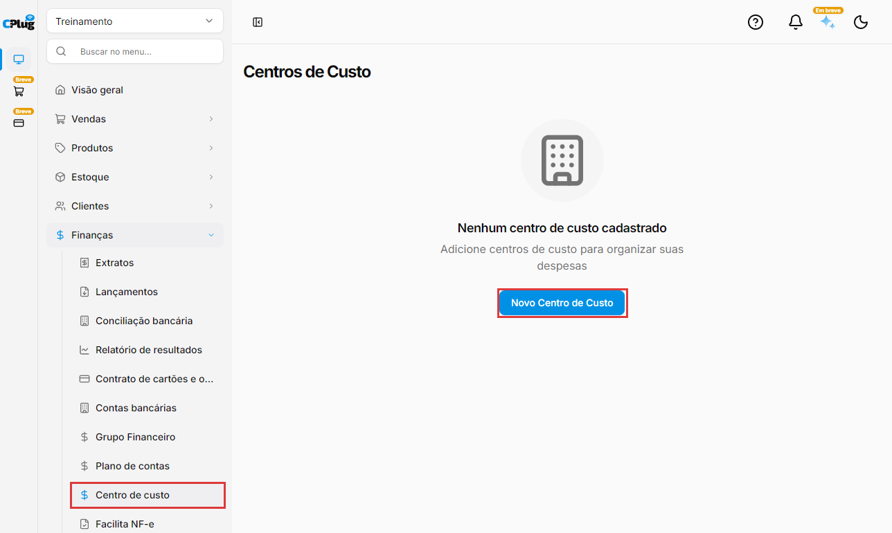
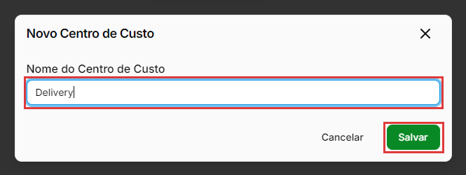
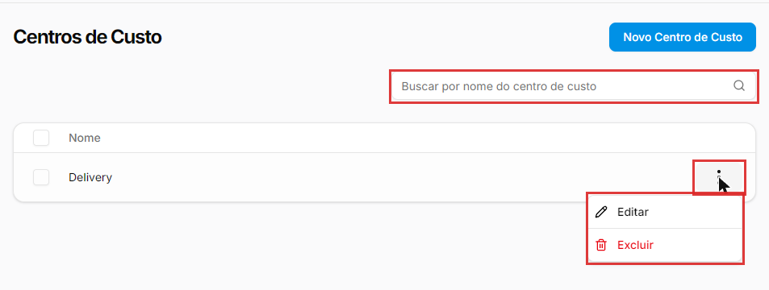
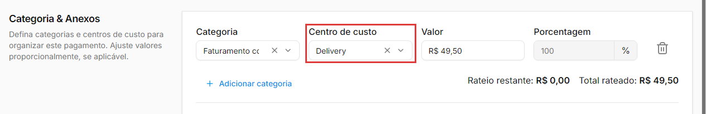
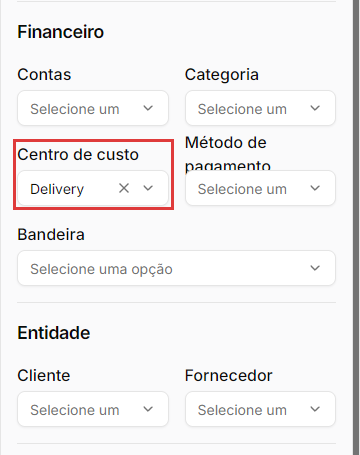
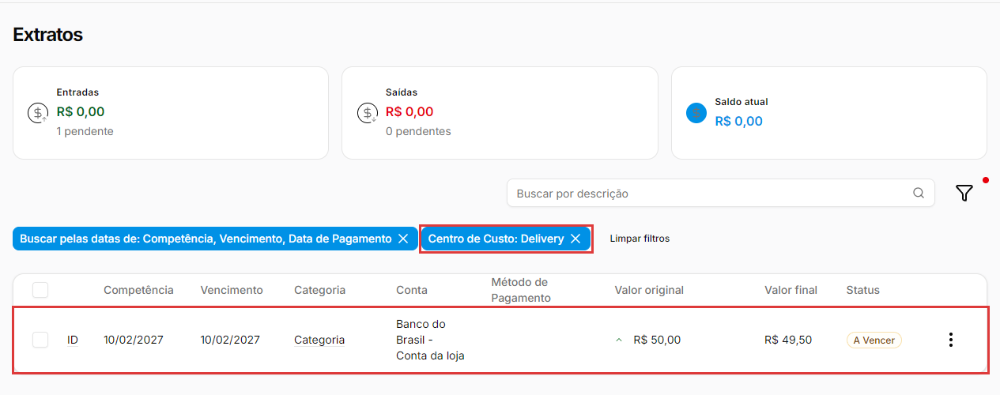

# Como usar centros de custo

:material-clock-outline: 6 minutos · :material-format-list-numbered: 5 passos · :material-calendar-check: Atualizado em 07/11/2026

Um **centro de custo** mostra **onde** o dinheiro entrou ou saiu dentro da empresa: um setor, uma área ou um projeto. Exemplos: **Delivery**, **Salão**, **Cozinha**, **Evento de fim de ano**. Com os lançamentos marcados, você filtra o extrato e vê o que entrou e saiu em cada área.

## Entenda o conceito

**Categoria ou centro de custo?** Os dois classificam o lançamento, mas respondem perguntas diferentes:

| Classificação | Pergunta | Exemplo |
| --- | --- | --- |
| **Categoria** (plano de contas) | **O quê?** Que tipo de receita ou despesa é. | Despesas Administrativas |
| **Centro de custo** | **Onde?** Que área, setor ou projeto gerou. | Delivery |

Assim, a mesma conta de luz pode ficar na categoria **Despesas Administrativas** e no centro de custo **Cozinha**. Para as categorias, veja [Como organizar o plano de contas e os grupos financeiros](plano-de-contas.md).

**É opcional.** O centro de custo não é obrigatório nos lançamentos e não muda o [relatório de resultados (DRE)](relatorio-de-resultados.md). Ele serve para filtrar e analisar no **Extratos** e em **Lançamentos**.

**Cada empresa tem os seus.** Se a sua conta tem mais de uma empresa (loja), os centros de custo cadastrados numa não aparecem na outra.

!!! info "Antes de começar"
    Defina poucos centros, que façam sentido para o seu negócio, e combine com a equipe quando usar cada um. Centro de custo só ajuda se for preenchido sempre do mesmo jeito.

Nos prints, o **quadrado vermelho** mostra onde você deve clicar ou digitar.

## Abra os centros de custo

No menu do lado esquerdo, clique em **Finanças** e depois em **Centro de custo**. Abre a tela **Centros de Custo**. Se ainda não houver nenhum, aparece **Nenhum centro de custo cadastrado**, com o botão **Novo Centro de Custo**. Quando já existem centros, o botão fica no alto da tela, e a lista mostra o **Nome** de cada um.

{ loading=lazy }

## Crie um centro de custo

Clique em **Novo Centro de Custo**. Em **Nome do Centro de Custo**, digite o nome (exemplo: **Delivery**) e clique em **Salvar**. Aparece "Centro de custo criado com sucesso", e o centro entra na lista.

{ loading=lazy }

## Busque, edite ou exclua

Com centros cadastrados, a tela mostra o campo **Buscar por nome do centro de custo**. Nos **três pontinhos** de cada centro:

- **Editar:** muda o nome. Aparece "Centro de custo atualizado com sucesso". Os lançamentos que já usam o centro passam a mostrar o nome novo.
- **Excluir:** pede confirmação ("Tem certeza que deseja excluir o centro de custo...?"). Clique em **Excluir** para confirmar. Aparece "Centro de custo excluído com sucesso".

{ loading=lazy }

!!! warning "Excluir não pergunta se o centro está em uso"
    O sistema exclui o centro de custo mesmo que ele esteja em lançamentos. Os lançamentos continuam mostrando o nome dele, mas ele some da lista do filtro **Centro de custo**, e não dá mais para filtrar por ele. Se o centro não vai mais ser usado, prefira deixá-lo na lista.

## Marque o centro de custo no lançamento

Ao cadastrar ou editar uma conta a pagar ou a receber (veja [Como lançar uma conta a pagar ou a receber](contas-a-pagar-e-receber.md)), vá até **Categoria & Anexos**. Ao lado da **Categoria** fica o campo **Centro de custo**: escolha o centro e clique em **Salvar**.

Cada linha de categoria tem o seu próprio centro de custo. Se você dividir a conta em mais de uma categoria (botão **Adicionar categoria**), pode escolher um centro diferente em cada linha, ou deixar em branco a que não tiver centro.

{ loading=lazy }

## Filtre por centro de custo

Em **Finanças → Extratos** (ou em **Finanças → Lançamentos**), clique no ícone do **funil**. No painel **Filtrar**, em **Financeiro**, escolha o centro em **Centro de custo** e clique em **Aplicar filtros**.

{ loading=lazy }

A lista mostra só os lançamentos daquele centro, e aparece a etiqueta **Centro de Custo: Delivery** acima da lista. Para voltar a ver tudo, clique no **X** da etiqueta ou em **Limpar filtros**. Para saber mais sobre os filtros e os cartões do alto, veja [Como consultar o extrato](extrato.md).

{ loading=lazy }

!!! tip "Boas práticas"
    - **Nomes curtos e claros**, que a equipe reconheça na hora (Delivery, Salão), evitam lançamentos no centro errado.
    - **Confira de tempos em tempos** o extrato filtrado por centro, para pegar lançamentos sem centro ou no centro errado.
    - **Use centros para projetos com começo e fim**, como um evento ou uma reforma, e filtre por ele para ver os lançamentos do projeto.
    - **Não exclua um centro que já foi usado.** Os lançamentos ficam com um centro que não dá mais para filtrar.

## Deu algum problema?

??? question "O centro de custo não aparece para escolher no lançamento"
    Confira se ele está cadastrado em **Finanças → Centro de custo** e se você está na empresa certa, no seletor do alto do menu: cada empresa tem os seus centros. Um centro excluído também some da lista do filtro.

??? question "Excluí um centro de custo, e os lançamentos ainda mostram o nome dele"
    É assim que o sistema funciona: os lançamentos guardam o centro, mas ele não aparece mais no filtro. Para tirar o centro de um lançamento, edite o lançamento, clique no **X** do campo **Centro de custo** e clique em **Salvar**.

??? question "Filtrei por centro de custo e os cartões do extrato ficaram zerados"
    Sem filtro de status, os cartões **Entradas** e **Saídas** somam só o que já foi **pago**. Se os lançamentos do centro ainda estão em aberto, eles aparecem como **pendentes** embaixo do valor. Para vê-los, filtre também **Status: Não pago**.

??? question "O relatório de resultados não separa por centro de custo"
    O relatório de resultados mostra a empresa toda e só tem filtro de período. Para ver um centro de custo, use o filtro no **Extratos** ou em **Lançamentos**.

**Relacionados:** [Como organizar o plano de contas e os grupos financeiros](plano-de-contas.md) · [Como lançar uma conta a pagar ou a receber](contas-a-pagar-e-receber.md) · [Como consultar o extrato](extrato.md) · [Como ler o relatório de resultados (DRE)](relatorio-de-resultados.md)

centro de custo centros de custo novo centro de custo setor área departamento projeto delivery salão cozinha filtrar por centro de custo rateio categoria e anexos excluir centro de custo editar centro de custo análise de despesas buscar por nome do centro de custo centro de custo excluído filtro centro de custo extrato lançamentos
