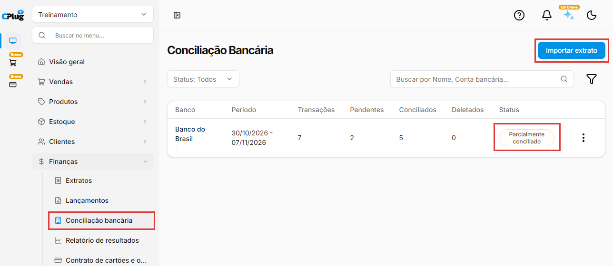
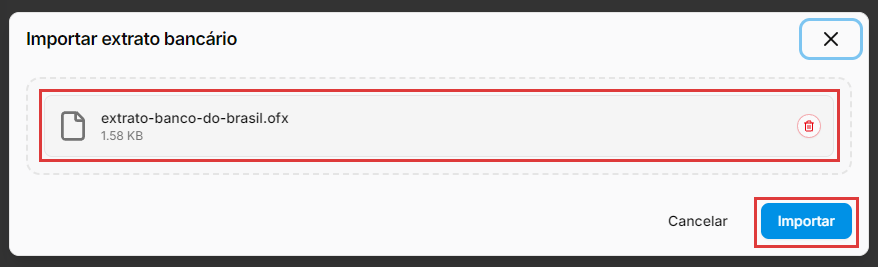
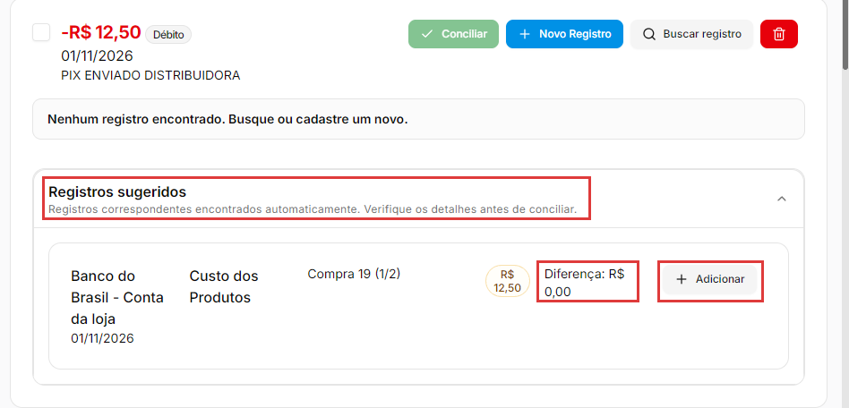
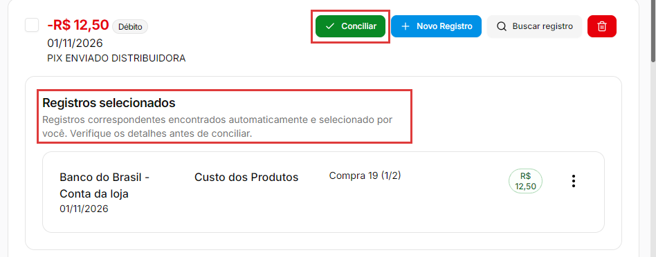
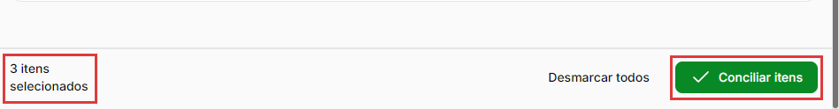
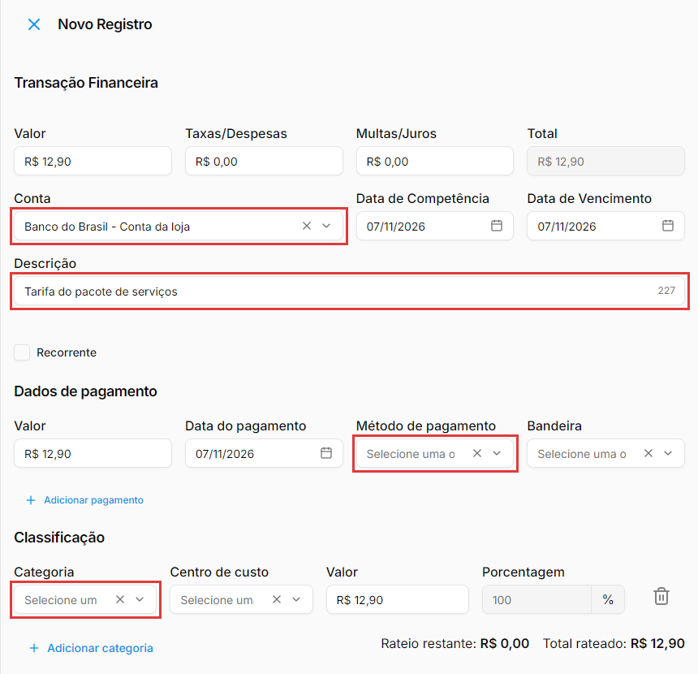
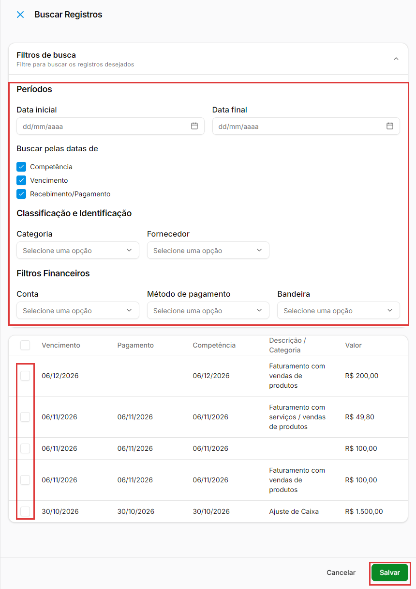
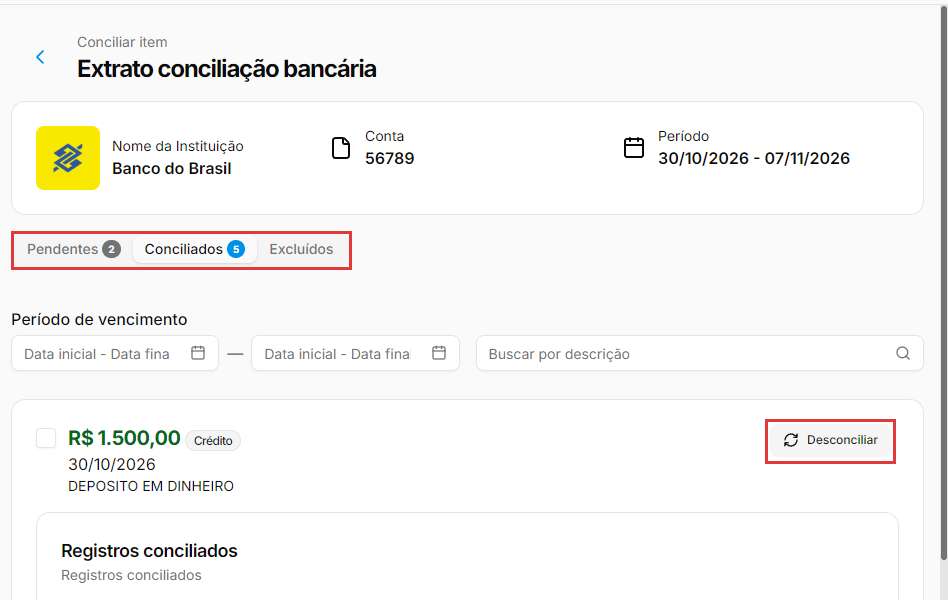

# Como fazer a conciliação bancária

:material-clock-outline: 12 minutos · :material-format-list-numbered: 8 passos · :material-calendar-check: Atualizado em 07/11/2026

**Conciliar** é comparar o extrato do banco com os lançamentos do sistema, um movimento de cada vez. No fim, tudo o que passou pelo banco está lançado no sistema, e você pode confiar nos relatórios e no saldo da conta.

## Entenda o conceito

O banco e o sistema contam a mesma história, cada um do seu lado:

| Lado | O que mostra | Exemplo |
| --- | --- | --- |
| **Extrato do banco** | O que de fato entrou e saiu da conta. | "PIX RECEBIDO CARLA MENDES", R$ 97,00 |
| **Lançamentos do sistema** | O que você registrou: contas pagas e recebidas. | "Encomenda de bolo", recebida em 06/11, R$ 97,00 |

Conciliar é **ligar** cada movimento do extrato ao lançamento certo. Quando sobra um movimento sem par, falta lançar algo no sistema (uma tarifa do banco, por exemplo). Quando sobra um lançamento sem par, ele foi registrado mas o dinheiro ainda não passou pelo banco, ou passou por outra conta.

**Por que conciliar?** A conciliação:

- acha **tarifas, juros e débitos automáticos** que ninguém lançou;
- pega lançamentos **na conta errada** ou **em dobro**;
- mostra **cobranças que você não reconhece**, para reclamar logo com o banco;
- deixa o **fluxo de caixa e os relatórios** confiáveis, porque batem com o banco.

**O arquivo OFX.** O extrato entra no sistema por um arquivo **OFX**, que o próprio banco gera. É o mesmo extrato que você vê no internet banking, num formato que outros programas conseguem ler. No internet banking, na tela do extrato, escolha o período que quer conferir e procure uma opção como **Exportar**, **Salvar como** ou **Baixar**, no formato **OFX** (em alguns bancos aparece como "Money"). O arquivo precisa terminar em **.ofx**: PDF, Excel, CSV e outros formatos não são aceitos.

**Os status de um extrato**

| Status | Quer dizer |
| --- | --- |
| **Não conciliado** | Nenhum movimento foi conciliado ainda. |
| **Parcialmente conciliado** | Parte dos movimentos foi conciliada; ainda há pendentes. |
| **Conciliado** | Não há mais movimentos pendentes. |

!!! info "Antes de começar"
    - Cadastre a **conta bancária** no sistema (veja [Como cadastrar uma conta bancária](conta-bancaria.md)).
    - Lance as contas pagas e recebidas do período, com a **data do pagamento** e a **conta bancária** certas (veja [Como lançar uma conta a pagar ou a receber](contas-a-pagar-e-receber.md)). São esses lançamentos que o sistema sugere para cada movimento do extrato.
    - Baixe o **extrato em OFX** no internet banking do seu banco.

Nos prints, o **quadrado vermelho** mostra onde você deve clicar ou digitar.

## Abra a conciliação bancária

No menu do lado esquerdo, clique em **Finanças** e depois em **Conciliação bancária**. A lista mostra cada extrato já importado: o **Banco**, o **Período**, quantas **Transações** ele tem e quantas estão **Pendentes**, **Conciliados** e **Deletados**, além do **Status**. Para achar um extrato antigo, use o filtro **Status**, a busca **Buscar por Nome, Conta bancária...** ou o ícone de filtro (por período).

Para trazer um extrato novo, clique em **Importar extrato**.

{ loading=lazy }

## Importe o extrato do banco

Na janela **Importar extrato bancário**, clique em **Escolha o arquivo OFX** e selecione o arquivo que você baixou do banco (ou arraste o arquivo para dentro da janela). O nome e o tamanho do arquivo aparecem na janela. Clique em **Importar**.

O extrato entra na lista como **Não conciliado**. O sistema não pergunta qual é a conta: ele lê do próprio arquivo o banco, o número da conta e o período.

{ loading=lazy }

## Confira as sugestões e concilie

Na lista, clique no extrato. A tela **Extrato conciliação bancária** mostra, em cima, o banco, a conta e o período. Logo abaixo ficam três abas: **Pendentes** (o que falta conciliar), **Conciliados** e **Excluídos**. Dá para filtrar por **Período de vencimento** e **Buscar por descrição**.

Cada movimento do extrato vira um cartão, com o valor (**Crédito** em verde, o que entrou; **Débito** em vermelho, o que saiu), a data e a descrição do banco.

Quando o sistema acha um lançamento que combina com o movimento, ele aparece em **Registros sugeridos**, com a conta bancária, a categoria, a descrição, o valor e a **Diferença** entre os dois valores. O ideal é **Diferença: R$ 0,00**. Confira se é mesmo o lançamento certo e clique em **Adicionar**.

{ loading=lazy }

O lançamento passa para **Registros selecionados** e o botão **Conciliar** fica verde. Clique em **Conciliar** e confirme com **OK** em **Deseja conciliar a transação?**. Aparece **Transação conciliada com sucesso**, e o movimento sai dos **Pendentes** e vai para **Conciliados**.

{ loading=lazy }

Em **Lançamentos**, a coluna **Conciliado** passa a mostrar um tique no lançamento conciliado.

## Concilie vários de uma vez

Primeiro clique em **Adicionar** na sugestão de cada movimento: a caixinha à esquerda do cartão só pode ser marcada depois que ele tem um registro selecionado. Depois marque a caixinha dos movimentos. No rodapé aparece quantos estão selecionados, com **Desmarcar todos** e **Conciliar itens**. Clique em **Conciliar itens** e confirme com **OK** em **Deseja conciliar todas as transações selecionadas?**.

{ loading=lazy }

!!! warning "Deixe as transferências fora do lote"
    Não marque no lote movimentos ligados a uma **transferência entre contas**: se houver um, nenhum item é conciliado, e a tela não avisa. Depois de conciliar em lote, confira se os itens saíram dos **Pendentes**.

## Lance o que está no banco e falta no sistema

Tarifas, juros e outros débitos automáticos costumam aparecer no extrato sem lançamento no sistema. Nesses movimentos aparece **Nenhum registro encontrado. Busque ou cadastre um novo.** Clique em **Novo Registro**.

O painel **Novo Registro** abre à direita, já com o **Valor**, as datas e o pagamento do movimento. Complete:

- **Conta:** a conta bancária do extrato.
- **Descrição:** um nome claro. Exemplo: "Tarifa do pacote de serviços".
- **Método de pagamento:** como o dinheiro saiu. Exemplo: **Débito em Conta**.
- **Categoria:** a categoria da despesa. Exemplo: **Despesas Administrativas**.

Depois de escolher, os campos **Método de pagamento** e **Categoria** continuam mostrando "Selecione uma opção", mas a escolha fica gravada: a categoria aparece no cartão depois de salvar. Os outros campos (Taxas/Despesas, Multas/Juros, Centro de custo, rateio) são os mesmos de um lançamento comum; se não souber, deixe como vieram.

{ loading=lazy }

Clique em **Salvar**. O registro aparece em **Registros selecionados**. Clique em **Conciliar**: só aí o lançamento é criado, já como **Pago**, e o movimento fica conciliado.

## Procure um lançamento que não foi sugerido

Se o lançamento existe mas não apareceu nas sugestões, clique em **Buscar registro**. O painel **Buscar Registros** lista os lançamentos do mesmo tipo: num débito, as contas a pagar; num crédito, as contas a receber. A lista mostra **Vencimento**, **Pagamento**, **Competência**, **Descrição / Categoria** e **Valor**.

Em **Filtros de busca** dá para filtrar por período, **Categoria**, **Fornecedor**, **Conta**, **Método de pagamento** e **Bandeira**. Para achar pelo dia em que o dinheiro passou no banco, preencha as datas e deixe marcado só **Recebimento/Pagamento**.

A lista também mostra lançamentos de outras contas e lançamentos já conciliados. Confira a data do pagamento e o valor, marque o lançamento certo e clique em **Salvar**. Ele passa para **Registros selecionados**.

{ loading=lazy }

Se o lançamento escolhido ainda não foi pago, ele aparece com R$ 0,00 e o aviso **Valor faltante**, e o **Conciliar** não libera. Registre o pagamento em **Lançamentos** (veja [Como lançar uma conta a pagar ou a receber](contas-a-pagar-e-receber.md)), com a data e a conta bancária do extrato, e volte: o lançamento pago já aparece em **Registros sugeridos**.

## Tire do extrato o que não precisa conciliar

Use a lixeira para um movimento que não deve ser conciliado, como um item repetido no extrato. Clique no botão vermelho da lixeira, no canto do cartão, e confirme com **Excluir**. A própria janela avisa: "Essa ação pode ser desfeita a qualquer momento."

O movimento vai para a aba **Excluídos**. Lá, o botão **Restaurar** devolve o movimento para os **Pendentes**.

## Confira o que foi conciliado e desfaça se precisar

A aba **Conciliados** mostra cada movimento com o lançamento ligado a ele. Se ligou o lançamento errado, clique em **Desconciliar**: o movimento volta na hora para os **Pendentes**, sem pedir confirmação.

{ loading=lazy }

!!! warning "Desconciliar apaga o lançamento criado pelo Novo Registro"
    Se o lançamento foi criado pelo **Novo Registro**, desconciliar o movimento **apaga esse lançamento**. Para conciliar de novo, use o **Novo Registro** outra vez. Lançamentos que já existiam antes (escolhidos pela sugestão ou pelo **Buscar registro**) continuam em **Lançamentos**.

!!! tip "Boas práticas"
    - **Concilie com frequência**, toda semana ou todo mês. Com poucos movimentos, é rápido achar o que falta.
    - **Lance com a conta bancária e a data do pagamento certas.** As sugestões dependem disso.
    - **Confira a sugestão antes de conciliar.** Dois pagamentos de mesmo valor no mesmo dia podem ser coisas diferentes.
    - **Não crie lançamento em dobro.** Antes do **Novo Registro**, use **Buscar registro** para ver se a conta já foi lançada.
    - **Pendências que sobram são um alerta:** um movimento sem lançamento é algo que ninguém registrou; um lançamento pago que nunca aparece no extrato pode ter sido registrado na conta errada.

## Deu algum problema?

??? question "Cliquei em Conciliar e nada aconteceu"
    Isso acontece com movimentos ligados a uma **transferência entre contas**, aquela feita em **Lançamentos → Mais ações** (veja [Transfira dinheiro entre contas bancárias](contas-a-pagar-e-receber.md#transfira-dinheiro-entre-contas-bancarias)). Deixe esse movimento pendente e fale com o suporte. Se acontecer com outro tipo de movimento, fale também com o suporte.

??? question "Cliquei em Conciliar itens e nenhum foi conciliado"
    Se um dos itens marcados for uma **transferência entre contas**, nenhum é conciliado. Desmarque a transferência e clique de novo em **Conciliar itens**.

??? question "Não consigo marcar a caixinha do movimento"
    A caixinha só pode ser marcada depois que o movimento tem um registro selecionado. Clique antes em **Adicionar** (na sugestão), **Novo Registro** ou **Buscar registro**.

??? question "O movimento não tem sugestão, mas a conta está lançada"
    As sugestões só trazem lançamentos **pagos**, na conta bancária do extrato. Confira se o lançamento está como **Pago**, com a conta bancária e a data do pagamento certas. Se estiver tudo certo, use **Buscar registro**.

??? question "Apareceu Valor faltante e o botão Conciliar não libera"
    O lançamento escolhido ainda não foi pago. Registre o pagamento em **Lançamentos** e volte à conciliação.

??? question "O sistema não aceita meu arquivo ou meu banco só gera PDF"
    A importação aceita só arquivos **.ofx**. Procure no internet banking, na tela do extrato, a opção de exportar em **OFX** (às vezes chamada "Money"). Se não encontrar, peça o extrato em OFX ao seu banco ou ao gerente da conta.

**Relacionados:** [Como cadastrar uma conta bancária](conta-bancaria.md) · [Como lançar uma conta a pagar ou a receber](contas-a-pagar-e-receber.md) · [Como cadastrar formas de pagamento](formas-de-pagamento.md)

conciliação bancária conciliar conciliação de extrato extrato bancário extrato do banco ofx money importar extrato baixar extrato arquivo ofx internet banking conferir banco saldo do banco tarifa bancária registros sugeridos novo registro buscar registro conciliar itens conciliação em lote desconciliar desfazer conciliação valor faltante transferência entre contas excluídos restaurar pendentes conciliados parcialmente conciliado não conciliado
