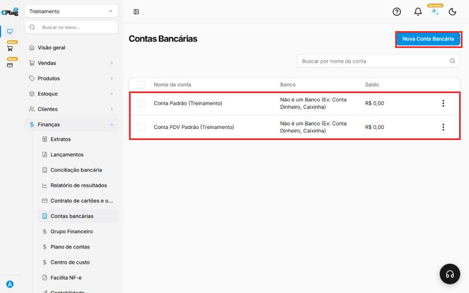
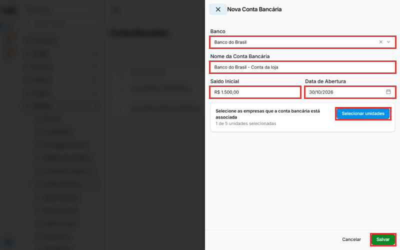
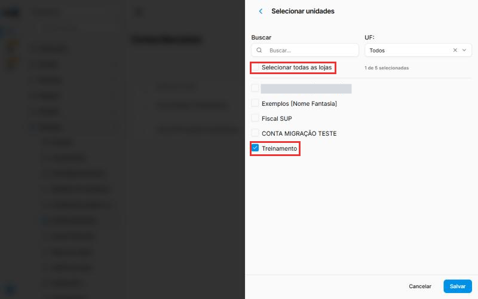
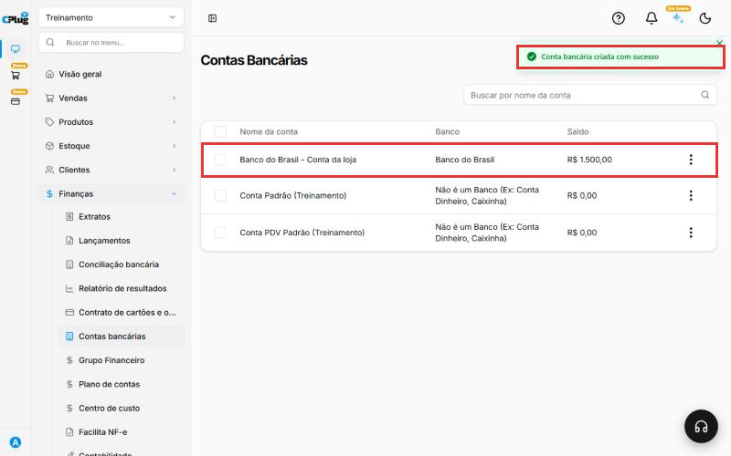
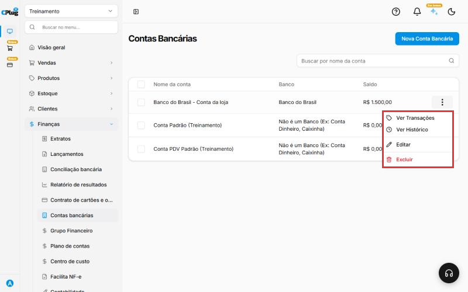

# Como cadastrar uma conta bancária

:material-clock-outline: 3 minutos · :material-format-list-numbered: 5 passos · :material-calendar-check: Atualizado em 30/10/2026

As **contas bancárias** são os lugares por onde o dinheiro da empresa entra e sai: a conta do banco, a gaveta do caixa ou uma "caixinha". Todo pagamento e recebimento do sistema fica ligado a uma delas. Assim você acompanha o **saldo** de cada uma.

Elas também são **obrigatórias** em outras telas. Por exemplo, ao [importar a nota fiscal de compra](../estoque/importar-nota-de-compra.md), o sistema pede de qual conta sai o pagamento.

!!! info "O sistema já vem com duas contas"
    Toda loja começa com a **Conta Padrão** e a **Conta PDV Padrão** (a do caixa). Nenhuma das duas é de banco. Cadastre as contas reais da empresa, uma para cada banco.

Nos prints, o **quadrado vermelho** mostra onde você deve clicar ou digitar.

## Abra a tela de contas bancárias

No menu do lado esquerdo, clique em **Finanças** e depois em **Contas bancárias**. A lista mostra cada conta, o banco e o saldo atual.

Clique em **Nova Conta Bancária**, no canto de cima, à direita.

{ loading=lazy }

## Preencha os dados da conta

- **Banco:** clique e escolha o banco. Digite parte do nome para achar mais rápido. Para dinheiro em espécie ou caixinha, escolha **Não é um Banco (Ex: Conta Dinheiro, Caixinha)**.
- **Nome da Conta Bancária:** vem com o nome do banco. Troque por um nome fácil de reconhecer. Exemplo: "Banco do Brasil - Conta da loja".
- **Saldo Inicial:** quanto havia na conta no dia da abertura. Confira no extrato do banco.
- **Data de Abertura:** a partir de que dia o sistema passa a controlar o saldo. Vem com a data de hoje.

{ loading=lazy }

## Escolha as lojas que usam a conta

Se a empresa tem mais de uma loja, clique em **Selecionar unidades** e marque as lojas que usam essa conta. A loja em que você está já vem marcada. Para todas, marque **Selecionar todas as lojas**.

Depois, clique em **Salvar** dentro dessa janela.

{ loading=lazy }

## Salve a conta

Clique em **Salvar**, no canto de baixo, à direita. Aparece a mensagem **Conta bancária criada com sucesso**, e a conta entra na lista com o saldo inicial.

{ loading=lazy }

## Conheça as opções da conta

Nos **três pontinhos** no fim da linha da conta você tem:

- **Ver Transações:** os lançamentos que passaram pela conta.
- **Ver Histórico:** o histórico da conta.
- **Editar:** muda os dados da conta.
- **Excluir:** apaga a conta.

{ loading=lazy }

## Deu algum problema?

??? question "Não encontrei os campos de agência e número da conta"
    O cadastro pede só o banco e o nome. Se você tem mais de uma conta no mesmo banco, coloque algo no nome para diferenciar. Exemplo: "Itaú - final 1234".

??? question "A conta não aparece em outra loja"
    A conta só aparece nas lojas marcadas em **Selecionar unidades**. Abra a conta pelos três pontinhos, clique em **Editar** e marque a outra loja.

??? question "Na importação da nota de compra, a conta bancária é obrigatória"
    É isso mesmo: o pagamento da compra precisa sair de alguma conta. Escolha a conta na lista ou cadastre uma seguindo este manual.

**Relacionados:** [Como cadastrar formas de pagamento](formas-de-pagamento.md) · [Como importar a nota fiscal de compra (XML)](../estoque/importar-nota-de-compra.md)

conta bancária banco caixa caixinha dinheiro saldo saldo inicial data de abertura conta padrão conta pdv nova conta finanças transações histórico unidades lojas
