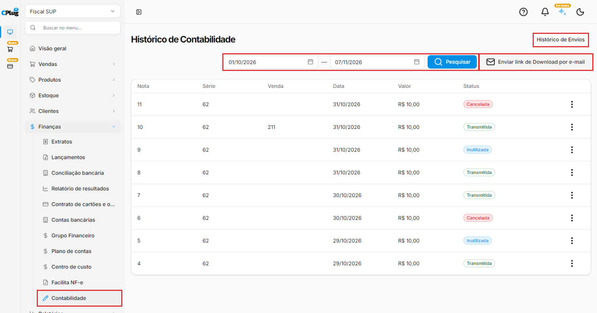
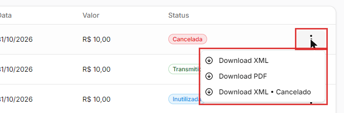
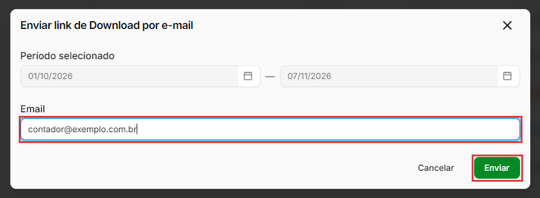

# Como enviar os documentos fiscais para a contabilidade

:material-clock-outline: 6 minutos · :material-format-list-numbered: 5 passos · :material-calendar-check: Atualizado em 07/11/2026

Todo mês, o contador precisa dos arquivos das notas fiscais que a empresa emitiu para fazer a escrituração e calcular os impostos. Em **Finanças → Contabilidade** (a tela se chama **Histórico de Contabilidade**), você vê as notas emitidas num período, baixa os arquivos de cada uma e envia para o e-mail do contador um link para baixar os documentos do período.

## Entenda o conceito

**XML ou PDF?**

| Arquivo | O que é | Quem usa |
| --- | --- | --- |
| **XML** | O arquivo oficial da nota, com todos os dados que foram para a Sefaz. | O contador. É ele que vale para a escrituração. |
| **PDF** | O DANFE: a versão para imprimir e mostrar ao cliente. | O cliente e a loja. Não substitui o XML. |

**Os status das notas**

| Status | O que quer dizer | O que baixar |
| --- | --- | --- |
| **Transmitida** | Nota autorizada pela Sefaz. | **Download XML** e **Download PDF**. |
| **Cancelada** | Nota autorizada e depois cancelada (veja [Como cancelar, inutilizar ou corrigir uma nota fiscal](../vendas/cancelar-nota.md)). | **Download XML**, **Download PDF** e **Download XML • Cancelado** (o arquivo do cancelamento). |
| **Inutilizada** | Número de nota que foi pulado e inutilizado na Sefaz. | **Download XML** (o único arquivo disponível). |

O contador precisa de **todas**, inclusive as canceladas e as inutilizadas: as canceladas mostram as notas que perderam a validade, e as inutilizadas explicam os números pulados na sequência.

!!! info "Antes de começar"
    A tela mostra as notas **emitidas pela empresa** no sistema. Confira com o seu contador quais arquivos ele quer receber e com que frequência. Em geral é todo mês, logo no começo do mês seguinte.

Nos prints, o **quadrado vermelho** mostra onde você deve clicar ou digitar.

## Abra a contabilidade

No menu do lado esquerdo, clique em **Finanças** e depois em **Contabilidade**. A tela abre com o período do primeiro dia do mês até hoje. A lista mostra, para cada nota, **Nota** (o número), **Série**, **Venda** (o número da venda, quando a nota veio de uma venda), **Data**, **Valor** e **Status**.

{ loading=lazy }

## Escolha o período e pesquise

Ajuste as duas datas (início e fim) e clique em **Pesquisar**. Para o fechamento do mês, use do primeiro ao último dia do mês anterior. Se não houver notas no período, aparece **Nenhuma nota encontrada**.

## Baixe os arquivos de uma nota

Clique nos **três pontinhos** da nota. As opções dependem do status:

- **Download XML** e **Download PDF**, nas notas transmitidas;
- também **Download XML • Cancelado**, nas canceladas;
- só **Download XML**, nas inutilizadas.

O navegador baixa o arquivo, normalmente na pasta **Downloads** do computador. O nome do arquivo usa um código interno do sistema (exemplo: **nfe-23.xml**), e não o número da nota. Se for juntar vários arquivos, renomeie ou guarde numa pasta por mês.

{ loading=lazy }

## Envie o link para o contador

Para mandar os documentos do período de uma vez, clique em **Enviar link de Download por e-mail**. Abre uma janela com:

- **Período selecionado:** o mesmo período da tela. Não dá para mudar aqui: se precisar de outro período, cancele, ajuste as datas da tela e clique em **Pesquisar** antes.
- **Email:** o e-mail que vai receber o link dos documentos. Exemplo: o e-mail do seu contador.

Clique em **Enviar**. Depois, confira o envio no passo seguinte.

{ loading=lazy }

## Confira o histórico de envios

Depois de pesquisar um período com notas, aparece **Histórico de Envios**, no alto da tela, à direita. Clique nele: abre um painel lateral com os envios já feitos. Se nenhum envio foi feito ainda, aparece **Nenhum resultado encontrado**.

!!! tip "Boas práticas"
    - **Combine uma data fixa** com o contador, por exemplo até o dia 5 de cada mês, e envie sempre o mês anterior completo. Para o envio sair sozinho todo mês, use o **Agendar envio** do [Facilita NF-e](facilita-nfe.md).
    - **Envie todas as notas do período**, inclusive as canceladas e as inutilizadas.
    - **Confira o e-mail antes de enviar.** Um e-mail digitado errado manda os documentos da empresa para outra pessoa.
    - **Guarde os XML** pelo prazo que o seu contador indicar (são anos, não meses). O XML é o documento que vale.
    - **Dúvidas fiscais são com o contador.** Ele diz o que precisa receber e como.

## Deu algum problema?

??? question "Nenhuma nota encontrada"
    Confira o período: a tela abre só com o mês atual. Aumente o período e clique em **Pesquisar**. Confira também se você está na empresa certa, no seletor do alto do menu: cada empresa tem as suas notas.

??? question "Não acho o arquivo que baixei"
    O navegador baixa o arquivo, normalmente na pasta **Downloads** do computador, com um nome como **nfe-23.xml**: o número do nome é um código interno, não o número da nota.

??? question "A nota inutilizada não tem PDF"
    É o esperado. Uma nota inutilizada nunca foi autorizada pela Sefaz, então não existe DANFE. O arquivo dela é só o XML.

??? question "Quero enviar outro período por e-mail"
    O período da janela de envio vem da tela. Cancele, ajuste as datas, clique em **Pesquisar** e abra a janela de novo. Se você já digitou o e-mail, o sistema mostra **Alterações não salvas**: clique em **Descartar** para fechar a janela.

??? question "O contador não recebeu o e-mail"
    Confira em **Histórico de Envios** se o envio aparece. Peça ao contador para olhar também a caixa de spam. Se precisar, confira o e-mail digitado e envie de novo.

??? question "Não aparece o Histórico de Envios"
    Ele aparece no alto da tela depois que você pesquisa um período com notas. Ajuste as datas e clique em **Pesquisar**.

**Relacionados:** [Como usar o Facilita NF-e](facilita-nfe.md) · [Como emitir uma NF-e de venda (dentro e fora do estado)](../vendas/emitir-nfe.md) · [Como cancelar, inutilizar ou corrigir uma nota fiscal](../vendas/cancelar-nota.md) · [Como configurar a emissão de notas fiscais](../configuracoes/emissao-de-notas.md)

contabilidade contador histórico de contabilidade enviar notas para o contador xml pdf danfe download xml download pdf xml cancelado nota cancelada nota inutilizada nota transmitida enviar link de download por e-mail histórico de envios fechamento do mês escrituração documentos fiscais nf-e mandar notas para o contador xml das notas baixar xml baixar danfe link de download
