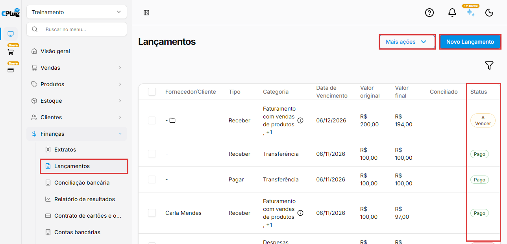
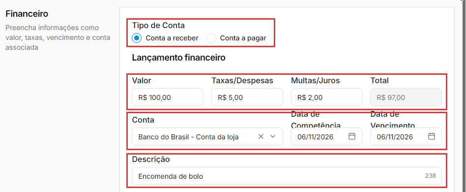
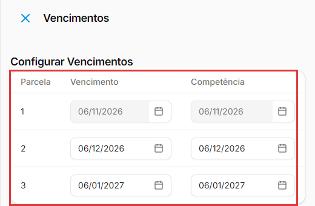
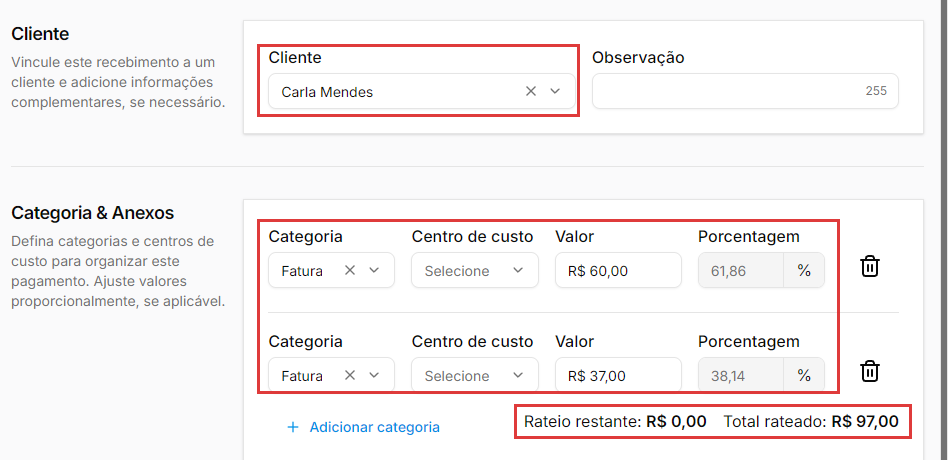
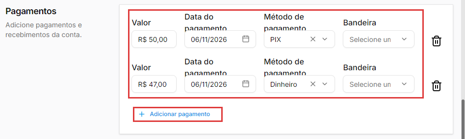
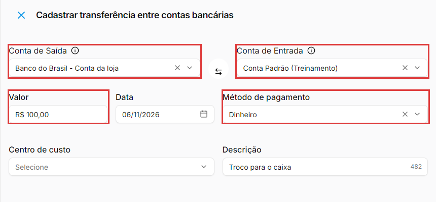
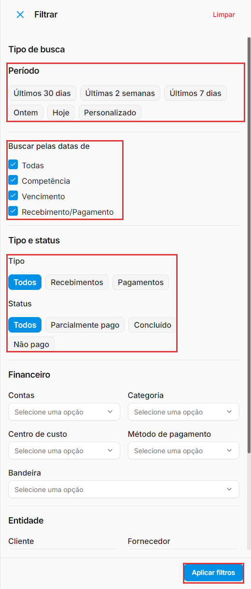

# Como lançar uma conta a pagar ou a receber

:material-clock-outline: 10 minutos · :material-format-list-numbered: 8 passos · :material-calendar-check: Atualizado em 06/11/2026

Os **lançamentos** são as contas da empresa: o que você **tem a pagar** (aluguel, luz, fornecedor) e o que **tem a receber** (uma encomenda, um cliente que paga depois). Com eles lançados, o sistema mostra o que vence, o que está atrasado e quanto entra e sai de cada conta bancária.

## Entenda o conceito

Todo lançamento tem **duas partes**:

| Parte | O que é | Quando muda o saldo |
| --- | --- | --- |
| **A conta** | O compromisso: quanto, de quem, para quando (vencimento). | Não muda. Enquanto não é paga, a conta fica **A Vencer** (ou **Vencido**, se passou do dia). |
| **O pagamento** | O dinheiro que de fato entrou ou saiu: valor, data e forma de pagamento. | Quando a conta fica **Pago**, o valor entra ou sai da conta bancária escolhida. |

Ou seja: lançar a conta é **anotar a dívida** (ou o valor a receber). O saldo do banco só muda quando a conta fica **Pago**, isto é, quando os pagamentos registrados somam o valor total.

**Os status de um lançamento**

| Status | Quer dizer |
| --- | --- |
| **A Vencer** | Ainda não foi paga e o vencimento não passou. |
| **Vencido** | Não foi paga e o vencimento já passou. |
| **Parcialmente pago** | Foi paga uma parte. O saldo da conta bancária só muda quando ela fica **Pago**. |
| **Pago** | Foi paga por inteiro. O valor já está no saldo da conta bancária. |

**Competência ou vencimento?** São duas datas diferentes:

- **Data de Vencimento:** o dia de pagar ou receber.
- **Data de Competência:** o mês a que a conta **pertence**. Exemplo: a conta de luz de outubro, que vence em 10 de novembro, tem competência em outubro e vencimento em novembro. A competência serve para saber quanto a empresa gastou e ganhou em cada mês, mesmo que o pagamento caia no mês seguinte. Na dúvida sobre qual data usar nos seus relatórios, pergunte ao seu contador.

**Algumas contas nascem sozinhas.** Ao salvar uma [compra](../estoque/lancar-compra.md), as parcelas do fornecedor já aparecem aqui como contas a pagar. Não lance de novo, ou a conta fica em dobro.

!!! info "Antes de começar"
    - Cadastre as **contas bancárias** (veja [Como cadastrar uma conta bancária](conta-bancaria.md)) e as **formas de pagamento** (veja [Como cadastrar formas de pagamento](formas-de-pagamento.md)).
    - Para ligar a conta a alguém, cadastre o **cliente** (veja [Como cadastrar um cliente](../clientes/cadastrar-cliente.md)) ou o **fornecedor** (veja [Como cadastrar um fornecedor](../estoque/cadastrar-fornecedor.md)).

Nos prints, o **quadrado vermelho** mostra onde você deve clicar ou digitar.

## Abra os lançamentos

No menu do lado esquerdo, clique em **Finanças** e depois em **Lançamentos**. A lista mostra o cliente ou fornecedor, o **Tipo** (**Receber** ou **Pagar**), a **Categoria**, a **Data de Vencimento**, o **Valor original**, o **Valor final** e o **Status**.

Clique em **Novo Lançamento**.

{ loading=lazy }

## Preencha o valor, a conta e as datas

Em **Tipo de Conta**, escolha **Conta a receber** ou **Conta a pagar**. Depois, em **Lançamento financeiro**:

- **Valor:** o valor da conta. O campo já tem a vírgula: para R$ 100,00, digite **10000**.
- **Taxas/Despesas:** o que é **descontado** do valor. Exemplo: a taxa que o banco cobra para receber.
- **Multas/Juros:** o que é **somado** ao valor, como juros de atraso.
- **Total:** a conta é feita sozinha: **Valor − Taxas/Despesas + Multas/Juros**. Exemplo: R$ 100,00 − R$ 5,00 + R$ 2,00 = **R$ 97,00**. É o **Valor final** da lista.
- **Conta:** a conta bancária por onde o dinheiro vai entrar ou sair.
- **Data de Competência** e **Data de Vencimento:** vêm com a data de hoje. Ajuste as duas (veja "Competência ou vencimento?", acima).
- **Descrição:** do que se trata. Exemplo: "Conta de luz de novembro". Aceita até 255 caracteres.

{ loading=lazy }

Depois de salvo, o **Tipo de Conta** não pode mais ser trocado. Se escolheu errado, use **Excluir** nos três pontinhos e lance de novo.

## Repita a conta todo mês (opcional)

Para contas que se repetem (aluguel, internet, mensalidade), marque **Recorrente**. Aparecem:

- **Periodicidade:** **Semanalmente**, **Mensalmente**, **Bimensalmente**, **Trimestralmente**, **Semestralmente** ou **Anualmente**.
- **Ocorrências:** quantas vezes a conta vai se repetir, contando com a primeira.
- **Vencimentos:** abre a janela **Configurar Vencimentos**, com o vencimento e a competência de cada ocorrência (a tela chama cada uma de **Parcela**). A primeira fica travada com as datas do lançamento; as outras podem ser ajustadas. Clique em **Salvar** na janela.

{ loading=lazy }

{ loading=lazy }

Ao salvar, o sistema cria **um lançamento para cada ocorrência**, cada um com o **valor total** da conta. Exemplo: Mensalmente com 3 ocorrências, a partir de 06/11, cria três contas de R$ 97,00, com vencimento em 06/11, 06/12 e 06/01. Depois, cada uma é editada e paga separadamente.

!!! note "Recorrente não é parcelamento"
    A recorrência **repete** o valor inteiro em cada ocorrência. Para dividir um valor em parcelas iguais, digite em **Valor** o valor de **uma** parcela e use **Ocorrências** para o número de parcelas. Exemplo: R$ 300,00 em 3x → Valor R$ 100,00, **Mensalmente**, 3 ocorrências.

## Escolha o cliente ou o fornecedor e a categoria

- **Cliente** (na conta a receber) ou **Fornecedor** (na conta a pagar): de quem é a conta. Na conta a pagar, o fornecedor pode ficar em branco; mesmo assim, escolha sempre que souber: ajuda a achar a conta depois. Ao lado, **Observação** guarda um recado (até 255 caracteres).
- **Categoria:** o tipo de receita ou de despesa. A lista muda conforme o tipo: na conta a receber aparecem as receitas (como **Faturamento com vendas de produtos**); na conta a pagar, as despesas (como **Despesas Administrativas** e **Custo dos Produtos**). Na dúvida sobre qual categoria usar (principalmente impostos, juros e devoluções), pergunte ao seu contador.
- **Centro de custo:** opcional, para separar os gastos por setor ou loja.
- **Valor** e **Porcentagem:** quanto da conta vai para aquela categoria. Digite o valor; a porcentagem é calculada sozinha.

{ loading=lazy }

**Dividir a conta entre categorias (rateio).** Clique em **Adicionar categoria** para dividir a conta. Exemplo: de uma encomenda de R$ 97,00, R$ 60,00 em **Faturamento com vendas de produtos** (61,86%) e R$ 37,00 em **Faturamento com serviços** (38,14%). Embaixo, o **Rateio restante** mostra quanto falta distribuir e o **Total rateado**, quanto já foi.

A soma das categorias precisa dar o **Total** da conta. Se faltar, o sistema não salva e avisa: **O total das categorias deve somar o total da conta**, e o **Valor** da categoria fica marcado com **Valor utilizado não está correto**. Mesmo com uma categoria só, digite o valor dela.

Em **Anexos & Comprovantes** ficam os botões **Selecionar arquivo** e **Adicionar anexo**, para juntar à conta um boleto ou comprovante.

## Registre o pagamento ou o recebimento

Se a conta ainda não foi paga, clique em **Salvar**, no canto de baixo, à direita: ela fica **A Vencer**. Quando pagar, abra a conta pelos **três pontinhos** → **Editar** e preencha **Pagamentos**:

- **Valor:** quanto foi pago.
- **Data do pagamento:** o dia em que o dinheiro entrou ou saiu.
- **Método de pagamento:** como foi pago, por exemplo **PIX** ou **Dinheiro** (a lista mostra as [formas de pagamento](formas-de-pagamento.md) cadastradas).
- **Bandeira:** a bandeira do cartão, quando o pagamento foi no cartão.

Pagou em partes? Clique em **Adicionar pagamento** para cada parte. Cada linha tem uma lixeira ao lado.

{ loading=lazy }

Clique em **Salvar**. Exemplo, numa conta de R$ 97,00:

- com um pagamento de R$ 50,00, a conta passa a **Parcialmente pago**, e o saldo da conta bancária **ainda não muda**;
- com mais R$ 47,00, a conta fica **Pago**, e os R$ 97,00 entram no saldo da conta bancária (veja em **Finanças → Contas bancárias**).

!!! warning "Só registre o pagamento depois que o dinheiro entrou ou saiu"
    Quando os pagamentos somam o total da conta, ela fica **Pago** e o valor entra (ou sai) do saldo da conta bancária. Registrar antes da hora deixa o saldo diferente do banco.

## Edite, exclua ou agrupe lançamentos

Nos **três pontinhos** de cada lançamento ficam **Editar** e **Excluir**. O **Excluir** pede confirmação ("Tem certeza que deseja excluir esse lançamento?").

**Agrupar lançamentos.** Marque a caixinha de dois ou mais lançamentos. Aparece uma barra embaixo, com **Desmarcar todos** e **Agrupar lançamentos**. O agrupamento junta várias contas numa só. Exemplo: um cliente que tinha duas contas de R$ 97,00 e vai pagar tudo de uma vez.

A janela **Agrupar registros** avisa que os registros escolhidos serão cancelados e que será gerado um novo registro com o valor total. Ao confirmar:

- nasce um lançamento só, com a descrição **Agrupamento de 2 Registros** e um ícone de pasta na lista;
- aparece **Lançamentos agrupados com sucesso**, e os lançamentos originais saem da lista;
- os valores, as taxas, as multas e as categorias são somados. No exemplo: Valor R$ 200,00, Taxas R$ 10,00, Multas R$ 4,00 e Total **R$ 194,00**. O valor que a janela mostra (R$ 200,00) é a soma dos valores, antes das taxas e multas;
- o vencimento é o **mais cedo** dos agrupados;
- o novo lançamento fica **sem cliente** (aparece **-** na lista);
- nos três pontinhos do novo lançamento, **Ver lançamentos agrupados** mostra as contas que foram juntadas.

## Transfira dinheiro entre contas bancárias

Para levar dinheiro de uma conta para outra da própria empresa (do banco para o caixa, por exemplo), não lance uma conta a pagar e outra a receber: use a transferência. Clique em **Mais ações** → **Transferências**. Na janela **Cadastrar transferência entre contas bancárias**:

- **Conta de Saída** e **Conta de Entrada:** de onde sai e para onde vai o dinheiro.
- **Valor** e **Data**.
- **Método de pagamento:** obrigatório. Exemplo: **Dinheiro**.
- **Centro de custo** (opcional) e **Descrição** (até 500 caracteres).

Clique em **Transferir**, no canto de baixo, à direita. Aparece **Transferência cadastrada com sucesso**, e a lista ganha **dois lançamentos já pagos**, os dois na categoria **Transferência**: um **Pagar** (a saída) e um **Receber** (a entrada). Exemplo: R$ 100,00 do banco para a Conta Padrão; o banco ficou com R$ 100,00 a menos e a Conta Padrão, com R$ 100,00 a mais.

{ loading=lazy }

## Encontre as contas com os filtros

Clique no **funil**, à direita, acima da lista. Na janela **Filtrar**:

- **Período:** Últimos 30 dias, Últimas 2 semanas, Últimos 7 dias, Ontem, Hoje ou Personalizado.
- **Buscar pelas datas de:** **Todas**, **Competência**, **Vencimento** e **Recebimento/Pagamento** (vêm todas marcadas).
- **Tipo:** Todos, Recebimentos ou Pagamentos.
- **Status:** Todos, Parcialmente pago, Concluído ou Não pago. Os nomes são diferentes dos da lista: **Não pago** mostra as contas ainda em aberto.
- **Contas**, **Categoria**, **Centro de custo**, **Método de pagamento** e **Bandeira**.
- **Entidade:** **Cliente** ou **Fornecedor**.

Clique em **Aplicar filtros** (o botão **Limpar**, no alto da janela, desmarca tudo). Os filtros em uso aparecem acima da lista, com **Limpar filtros**. Exemplo: **Pagamentos** + **Não pago** mostra só as contas que ainda faltam pagar.

{ loading=lazy }

!!! info "Importar várias contas de uma vez"
    Em **Mais ações** ficam também **Importar recebimentos** e **Importar despesas**. Em **Importar despesas**, a janela **Importar Planilha** traz a **Planilha Modelo - Contas a Pagar**. Ela aceita arquivo XLSX de até 10.000 linhas ou 5 MB, enviado em **Escolha os arquivos** (ou arrastado para a área); depois, clique em **Importar**. Use sempre o modelo.

!!! tip "Boas práticas"
    - **Lance a conta assim que ela chegar**, não no dia de pagar. Assim a lista mostra tudo o que vai vencer.
    - **Toda semana, filtre por Não pago** e confira as contas em aberto pela coluna **Status** (**A Vencer** ou **Vencido**).
    - **Registre o pagamento no dia em que ele aconteceu**, com a conta bancária certa. É o que mantém o saldo igual ao do banco.
    - **Use sempre a categoria certa.** É ela que mostra para onde vai o dinheiro da empresa. Combine com o seu contador quais usar.
    - **Descrição clara:** "Aluguel de novembro" é melhor do que "pagamento".
    - **Contas de compras não se lançam aqui**: elas nascem sozinhas quando você salva a compra.

## Deu algum problema?

??? question "Apareceu: O total das categorias deve somar o total da conta"
    O valor das categorias não fecha com o **Total** (o campo fica marcado com **Valor utilizado não está correto**). Confira o **Rateio restante**: ele precisa ficar em **R$ 0,00**. Com uma categoria só, digite nela o valor total da conta.

??? question "Registrei um pagamento e o saldo do banco não mudou"
    Confira o status. Se está **Parcialmente pago**, falta pagar uma parte: o saldo só muda quando a conta fica **Pago**. Confira também se o lançamento está na **Conta** (conta bancária) certa.

??? question "Lancei uma conta recorrente e apareceram várias contas"
    É assim que funciona: a recorrência cria um lançamento para cada ocorrência, cada um com o valor inteiro. Cada um é pago e editado separadamente.

??? question "Escolhi Conta a receber, mas era a pagar"
    Depois de salvo, o tipo não muda. Use **Excluir** nos três pontinhos do lançamento e lance de novo.

??? question "A transferência não salva"
    Confira o **Método de pagamento**: ele é obrigatório. Sem ele, a tela mostra **O preenchimento é obrigatório**.

??? question "A conta de uma compra apareceu em dobro"
    As parcelas da compra já entram sozinhas nos lançamentos. Se você também lançou à mão, fale com o suporte antes de excluir, para não apagar a conta errada.

**Relacionados:** [Como cadastrar uma conta bancária](conta-bancaria.md) · [Como cadastrar formas de pagamento](formas-de-pagamento.md) · [Como lançar uma compra](../estoque/lancar-compra.md) · [Como cadastrar um cliente](../clientes/cadastrar-cliente.md) · [Como cadastrar um fornecedor](../estoque/cadastrar-fornecedor.md)

lançamentos conta a pagar conta a receber contas a pagar contas a receber despesa receita vencimento competência vencido a vencer parcialmente pago pago pagamento recebimento baixa recorrente recorrência mensalmente parcelas rateio categoria centro de custo taxas despesas multas juros total agrupar lançamentos transferência entre contas importar despesas importar recebimentos filtros finanças
