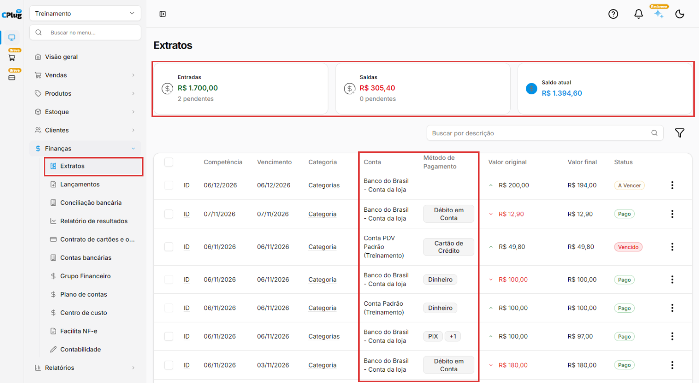
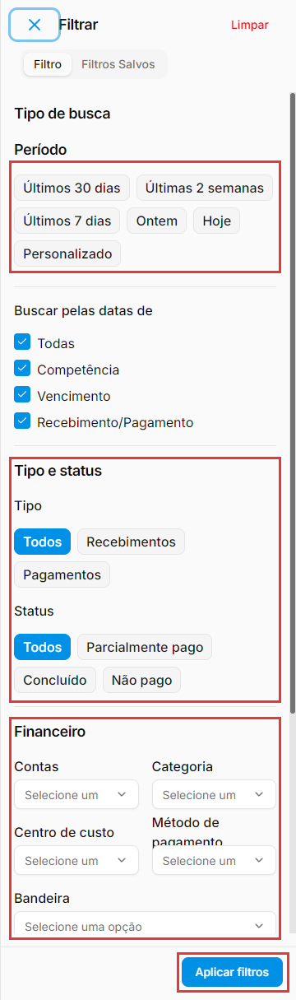
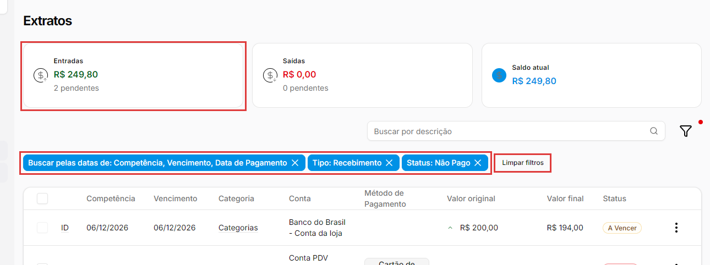

# Como consultar o extrato

:material-clock-outline: 7 minutos · :material-format-list-numbered: 5 passos · :material-calendar-check: Atualizado em 07/11/2026

O **extrato** mostra, numa lista só, o dinheiro que entra e sai da empresa: recebimentos, pagamentos e transferências, de todas as contas. No alto, três cartões somam as **Entradas**, as **Saídas** e o **Saldo**. Com a busca e os filtros, você responde perguntas como "quanto já recebi e paguei?", "quanto falta receber?" ou "quanto gastei com luz?".

## Entenda o conceito

**Extrato ou lançamentos?** As duas telas mostram os mesmos lançamentos, com objetivos diferentes:

| Tela | Para que serve |
| --- | --- |
| **Lançamentos** | Cadastrar e editar contas a pagar e a receber (veja [Como lançar uma conta a pagar ou a receber](contas-a-pagar-e-receber.md)). |
| **Extratos** | Consultar: ver as entradas e saídas, com a **conta** e o **método de pagamento** de cada uma, e os totais no alto da tela. |

**Os três cartões**

| Cartão | O que soma |
| --- | --- |
| **Entradas** | Os recebimentos **já pagos**, pelo Valor original. Embaixo, quantos recebimentos ainda estão em aberto (**pendentes**). |
| **Saídas** | Os pagamentos **já pagos**, pelo Valor original. Embaixo, quantos pagamentos ainda estão em aberto. |
| **Saldo atual** | Entradas menos Saídas. |

Os cartões seguem a busca e os filtros: somam só o resultado na tela. Se você filtrar pelo **Status** (por exemplo, **Não pago**), eles passam a somar também as contas em aberto. Aí o **Saldo atual** é uma previsão, não dinheiro que já entrou.

!!! warning "O Saldo atual não é o saldo do banco"
    O **Saldo atual** é o resultado da lista na tela, com todas as contas juntas (se não houver filtro). E os cartões somam o **Valor original** dos lançamentos. Quando um lançamento tem taxas, multas ou juros, o que de fato entrou ou saiu é o **Valor final**.

    Exemplo: um recebimento de R$ 100,00 com R$ 5,00 de taxa e R$ 2,00 de juros entra na conta como R$ 97,00, mas soma R$ 100,00 nas **Entradas**. Resultado: o **Saldo atual** fica R$ 3,00 maior que a soma das contas. Para saber quanto há em cada conta, consulte **Finanças → Contas bancárias**.

**Valor original × Valor final.** Na lista aparecem os dois: o **Valor original** é o valor da conta; o **Valor final** já desconta as taxas e soma multas e juros (veja [Como lançar uma conta a pagar ou a receber](contas-a-pagar-e-receber.md)).

Nos prints, o **quadrado vermelho** mostra onde você deve clicar ou digitar.

## Abra os extratos

No menu do lado esquerdo, clique em **Finanças** e depois em **Extratos**. No alto ficam os cartões **Entradas**, **Saídas** e **Saldo atual**. Embaixo, a lista mostra cada lançamento com **Competência**, **Vencimento**, **Categoria**, **Conta**, **Método de Pagamento**, **Valor original**, **Valor final** e **Status** (**A Vencer**, **Vencido**, **Pago**...).

Na coluna **Valor original**, as saídas aparecem em vermelho, com uma seta para baixo. A lista não tem coluna de descrição: para achar um lançamento pelo nome, use a busca (passo 3).

{ loading=lazy }

## Veja os detalhes de cada linha

Algumas informações só aparecem ao parar o mouse em cima:

- Na coluna **Categoria** aparece só a palavra **Categoria** (ou **Categorias**, quando o lançamento tem mais de uma). Pare o mouse em cima para ver o nome.
- **ID:** pare o mouse em cima para ver o código do lançamento no sistema. É útil quando o suporte pede o lançamento exato.

Na coluna **Método de Pagamento**, um **+1** quer dizer que o lançamento tem mais de um pagamento: aparece o primeiro método, e o **+1** indica que há mais. Para ver todos, abra o lançamento em **Lançamentos**.

Os **três pontinhos** de cada linha têm **Excluir** (num lançamento agrupado, também **Ver lançamentos agrupados**). **Excluir** pede confirmação: "Tem certeza que deseja excluir essa movimentação?". Use com cuidado. Para corrigir um valor ou uma data, edite em **Lançamentos**: no extrato, clicar na linha não abre o lançamento.

## Procure pela descrição

No campo **Buscar por descrição**, digite parte da descrição do lançamento. Exemplo: "luz" acha a conta de luz. A lista e os cartões mudam na hora, somando só o que foi encontrado. Se a busca deixar só saídas, o **Saldo atual** fica negativo, e isso é normal.

## Filtre o extrato

Clique no ícone do **funil**, à direita da busca. O painel **Filtrar** tem duas abas: **Filtro**, onde você monta a busca, e **Filtros Salvos**. Na aba **Filtro**:

- **Período:** **Últimos 30 dias**, **Últimas 2 semanas**, **Últimos 7 dias**, **Ontem**, **Hoje** ou **Personalizado**.
- **Buscar pelas datas de:** **Todas**, **Competência**, **Vencimento** e **Recebimento/Pagamento**. Vêm todas marcadas.
- **Tipo:** **Todos**, **Recebimentos** ou **Pagamentos**.
- **Status:** **Todos**, **Parcialmente pago**, **Concluído** ou **Não pago**. Os nomes são diferentes dos da lista: **Não pago** mostra as contas em aberto (**A Vencer** e **Vencido**).
- **Financeiro:** **Contas**, **Categoria**, **Centro de custo**, **Método de pagamento** e **Bandeira** (a bandeira do cartão, como Visa ou Mastercard).
- **Entidade:** **Cliente** ou **Fornecedor**.
- **Transferência:** **Exibir transferências**, **Exibir somente transferências** ou **Não exibir transferências**.

Clique em **Aplicar filtros**. O botão **Limpar**, no alto do painel, desfaz as escolhas. Se fechar o painel sem aplicar, aparece **Alterações não salvas**.

{ loading=lazy }

Exemplo: **Tipo** **Recebimentos** e **Status** **Não pago** mostram só o que você ainda tem a receber. O cartão **Entradas** passa a somar esses valores, que ainda não entraram.

**Transferências** entre contas da própria empresa aparecem duas vezes: uma saída numa conta e uma entrada na outra. Olhando a empresa toda, elas não são receita nem despesa: para ver só o que a empresa ganhou e gastou de verdade, use **Não exibir transferências**. Olhando uma conta só (filtro **Contas**), a transferência é entrada ou saída de verdade daquela conta: não a tire.

## Confira e limpe os filtros

Os filtros em uso aparecem como etiquetas azuis acima da lista, e o ícone do funil ganha um ponto vermelho. A etiqueta das datas aparece sempre que um filtro é aplicado. Clique no **X** de uma etiqueta para tirar só aquele filtro, ou em **Limpar filtros** para voltar à lista completa.

{ loading=lazy }

!!! tip "Boas práticas"
    - **Para o saldo de cada conta, use Contas bancárias.** O extrato serve para ver o movimento e os totais.
    - **Use o filtro Contas** para ver o movimento de uma conta. Para comparar com o banco, olhe a coluna **Valor final** (os cartões somam o Valor original). Para conferir item por item, use a [conciliação bancária](conciliacao-bancaria.md).
    - **Tire as transferências** quando olhar a empresa toda, para saber quanto ela recebeu e gastou de verdade.
    - **Olhe os pendentes** nos cartões. Para ver quais são, filtre **Status: Não pago**.

## Deu algum problema?

??? question "O Saldo atual não bate com o saldo em Contas bancárias"
    O extrato soma o **Valor original**. Se algum lançamento tem taxas, multas ou juros, o valor que entrou ou saiu da conta é o **Valor final**. Confira também se há filtros em uso. O saldo de cada conta está em **Contas bancárias**.

??? question "Os totais mudaram de repente"
    Os cartões somam só o resultado da busca e dos filtros. Apague o texto do campo **Buscar por descrição** e clique em **Limpar filtros**. Um ponto vermelho no ícone do funil indica que há filtro em uso.

??? question "Lancei uma conta e os cartões não mudaram"
    Sem filtro de status, os cartões somam só o que já foi **pago**. Enquanto a conta está em aberto, ela aparece como **pendente** embaixo do valor.

??? question "As Entradas e as Saídas parecem maiores do que deveriam"
    Podem ser transferências entre as contas da empresa, que aparecem como entrada e como saída. Use **Não exibir transferências** no filtro.

??? question "Apliquei um filtro salvo e a lista não mudou"
    Escolher um filtro salvo e clicar em **Aplicar filtros** não muda a lista. Monte os filtros na aba **Filtro** do painel. Se precisar dos **Filtros Salvos**, fale com o suporte.

??? question "Não consigo editar um lançamento pelo extrato"
    O extrato é para consulta. Para editar, abra **Finanças → Lançamentos**.

**Relacionados:** [Como lançar uma conta a pagar ou a receber](contas-a-pagar-e-receber.md) · [Como cadastrar uma conta bancária](conta-bancaria.md) · [Como fazer a conciliação bancária](conciliacao-bancaria.md) · [Como cadastrar as taxas do cartão](taxas-do-cartao.md)

extrato extratos movimentação financeira entradas saídas saldo atual saldo total recebimentos pagamentos pendentes valor original valor final filtro funil período transferências não exibir transferências conta bancária método de pagamento categoria centro de custo bandeira cliente fornecedor buscar por descrição limpar filtros filtros salvos saldo negativo
