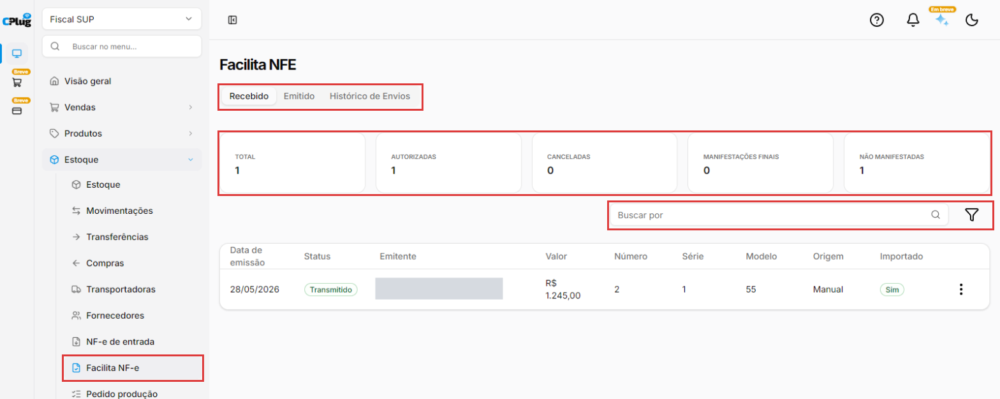
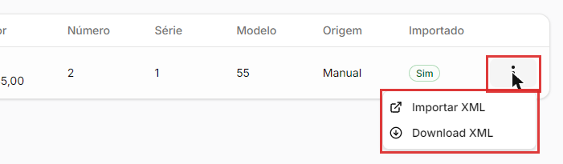
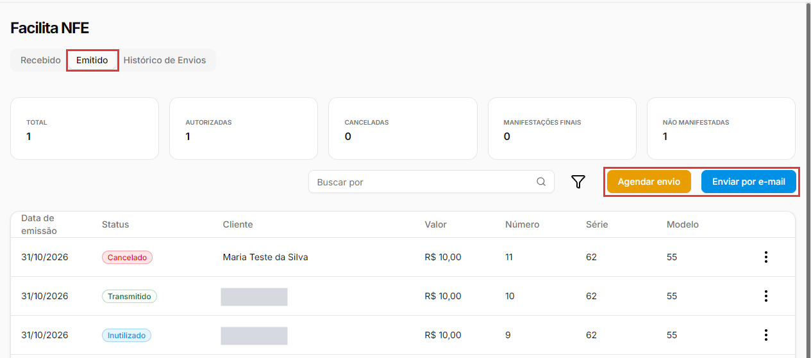
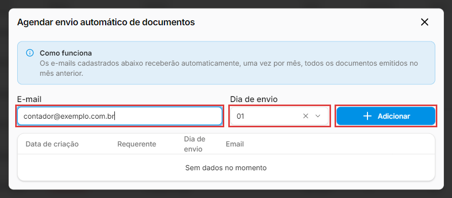

# Como usar o Facilita NF-e

:material-clock-outline: 8 minutos · :material-format-list-numbered: 6 passos · :material-calendar-check: Atualizado em 07/11/2026

O **Facilita NF-e** reúne as notas fiscais da empresa numa tela só: as que os fornecedores emitiram para você (**Recebido**) e as que a sua empresa emitiu (**Emitido**). Dali você importa uma nota de compra para o estoque, baixa os arquivos XML e programa o envio automático dos documentos do mês anterior para o seu contador.

## Entenda o conceito

**As três abas**

| Aba | O que mostra |
| --- | --- |
| **Recebido** | Notas emitidas por fornecedores para o CNPJ da sua empresa, com **Emitente**, **Valor**, **Número**, **Série**, **Modelo**, **Origem** e se já foi **Importado** para o sistema. |
| **Emitido** | Notas que a sua empresa emitiu: NF-e (modelo **55**) e NFC-e (modelo **65**), com o **Cliente** de cada uma. |
| **Histórico de Envios** | Os envios de documentos por e-mail já feitos, com **Solicitante**, **Período**, **E-mail**, **Status** e **Arquivos**. |

**Os cartões do alto** contam as notas recebidas: **Total**, **Autorizadas**, **Canceladas**, **Manifestações finais** e **Não manifestadas**. A **manifestação do destinatário** é a resposta que a empresa dá à Sefaz sobre uma nota recebida (por exemplo, confirmando que a compra aconteceu). Os dois últimos cartões mostram quantas notas já têm essa resposta final e quantas ainda não. Esta tela mostra as contagens, mas não faz a manifestação. Se tiver dúvida sobre manifestar uma nota, fale com o seu contador.

**Precisa do certificado digital.** As notas recebidas chegam da Sefaz pelo certificado digital da empresa. Sem o certificado configurado, a busca das notas recebidas não funciona (veja [Como configurar a emissão de notas fiscais](../configuracoes/emissao-de-notas.md)).

!!! info "Antes de começar"
    O Facilita NF-e aparece em dois lugares do menu: **Estoque → Facilita NF-e** e **Finanças → Facilita NF-e**. É a mesma tela. As notas recebidas só aparecem se o certificado digital da empresa estiver configurado (veja [Como configurar a emissão de notas fiscais](../configuracoes/emissao-de-notas.md)). Confira se você está na empresa certa, no seletor do alto do menu: cada empresa tem as suas notas.

Nos prints, o **quadrado vermelho** mostra onde você deve clicar ou digitar.

## Abra o Facilita NF-e

No menu do lado esquerdo, clique em **Estoque** (ou **Finanças**) e depois em **Facilita NF-e**. A tela abre na aba **Recebido**, com os cartões no alto e a lista das notas embaixo.

{ loading=lazy }

## Encontre uma nota recebida

No campo **Buscar por**, digite parte do nome do **emitente** (o fornecedor). Exemplo: o nome da distribuidora. A busca não procura pelo valor.

Para filtrar, clique no ícone do **funil**. No painel **Filtrar**, escolha:

- **Período:** **Últimos 30 dias**, **Últimas 2 semanas**, **Últimos 7 dias**, **Ontem**, **Hoje** ou **Personalizado**;
- **Status de Importação:** **Importado** ou **Não importado**. Use **Não importado** para achar as notas que ainda não foram importadas para o sistema;
- **Faixa de Preço:** valor **De** e **Até**.

Clique em **Aplicar filtros**.

## Importe ou baixe uma nota recebida

Antes de importar, olhe a coluna **Importado**: se está **Sim**, a nota já foi lançada; não importe de novo. Clique nos **três pontinhos** da nota:

- **Importar XML:** abre, numa aba nova do navegador, a tela **Importação de XML**, com as etapas **Fornecedor**, **Produtos** e **Pagamentos**. É a mesma importação da nota de compra: siga [Como importar a nota fiscal de compra (XML)](../estoque/importar-nota-de-compra.md).
- **Download XML:** baixa o arquivo XML da nota.

{ loading=lazy }

Na coluna **Importado**, **Sim** quer dizer que a nota já entrou no sistema. A coluna **Origem** mostra de onde a nota veio, por exemplo **Manual**.

## Consulte as notas emitidas

Clique na aba **Emitido**. A lista mostra as notas emitidas pela empresa, com **Data de emissão**, **Status** (**Transmitido**, **Cancelado**, **Inutilizado**, **Pendente**), **Cliente**, **Valor**, **Número**, **Série** e **Modelo**. O que cada status quer dizer está em [Como enviar os documentos fiscais para a contabilidade](contabilidade.md).

As opções dos **três pontinhos** dependem do status. Na nota cancelada aparecem **Download XML**, **Download PDF** e **Download XML • Cancelado**. O filtro desta aba tem **Período** e **Faixa de Preço**.

{ loading=lazy }

## Agende o envio automático para o contador

Na aba **Emitido**, clique em **Agendar envio**. Abre a janela **Agendar envio automático de documentos**. Como a própria janela explica, os e-mails cadastrados ali recebem automaticamente, **uma vez por mês, todos os documentos emitidos no mês anterior**.

1. Em **E-mail**, digite o e-mail do contador.
2. Em **Dia de envio**, escolha o dia do mês (de **01** a **31**).
3. Clique em **Adicionar**.

A tabela embaixo lista os e-mails agendados, com **Data de criação**, **Requerente**, **Dia de envio** e **Email**. Enquanto não houver nenhum, aparece **Sem dados no momento**.

{ loading=lazy }

## Envie agora e confira o histórico

Para mandar agora, por e-mail, um link para baixar os documentos, clique em **Enviar por e-mail**. Abre a janela **Enviar link de download por e-mail**, que só pede o **Email**: digite e clique em **Salvar**. Essa janela não deixa escolher o período. Se o contador precisar de um período específico, use **Finanças → Contabilidade** (veja [Como enviar os documentos fiscais para a contabilidade](contabilidade.md)).

Depois, abra a aba **Histórico de Envios** para conferir os envios feitos, com o **Período**, o **E-mail** e o **Status** de cada um.

!!! tip "Boas práticas"
    - **Agende o envio uma vez.** Combine o dia com o contador (por exemplo, dia **05**): todo mês ele recebe os documentos do mês anterior. De vez em quando, confirme com ele se está chegando.
    - **Confira o e-mail antes de adicionar ou enviar.** Um e-mail errado manda os documentos da empresa para outra pessoa.
    - **Olhe a aba Recebido toda semana**, com o filtro **Não importado**, para não esquecer de importar as notas de compra.
    - **Manifestação e dúvidas fiscais são com o contador.** Ele orienta o que fazer com cada nota recebida.

## Deu algum problema?

??? question "A aba Recebido está vazia"
    As notas recebidas chegam pela Sefaz usando o certificado digital da empresa. Confira com o suporte se o certificado está configurado. Confira também se você está na empresa certa e se o filtro de **Período** ou de **Status de Importação** não está escondendo as notas: clique em **Limpar** no painel **Filtrar**.

??? question "Busquei pelo valor da nota e não achei"
    A busca procura pelo nome do emitente. Para procurar por valor, use o filtro **Faixa de Preço**.

??? question "Cliquei em Importar XML e não aconteceu nada"
    A importação abre numa **aba nova** do navegador. Veja as abas no alto da janela. Se o navegador bloqueou a abertura, permita janelas (pop-ups) para o site do sistema.

??? question "Os cartões não mudam quando vou para a aba Emitido"
    É o esperado: os cartões contam as notas **recebidas**.

??? question "Agendei o envio e quero parar"
    Para tirar um e-mail do envio automático, fale com o suporte.

??? question "Onde eu manifesto a nota?"
    O Facilita NF-e mostra quantas notas estão manifestadas, mas a manifestação não é feita nesta tela. Fale com o seu contador sobre se e como manifestar cada nota.

**Relacionados:** [Como enviar os documentos fiscais para a contabilidade](contabilidade.md) · [Como importar a nota fiscal de compra (XML)](../estoque/importar-nota-de-compra.md) · [Como configurar a emissão de notas fiscais](../configuracoes/emissao-de-notas.md)

facilita nf-e facilita nfe notas recebidas notas emitidas nota de fornecedor importar xml download xml download pdf manifestação do destinatário manifestações finais não manifestadas agendar envio envio automático contador enviar por e-mail histórico de envios nfc-e nf-e modelo 55 modelo 65 importado não importado faixa de preço certificado digital
