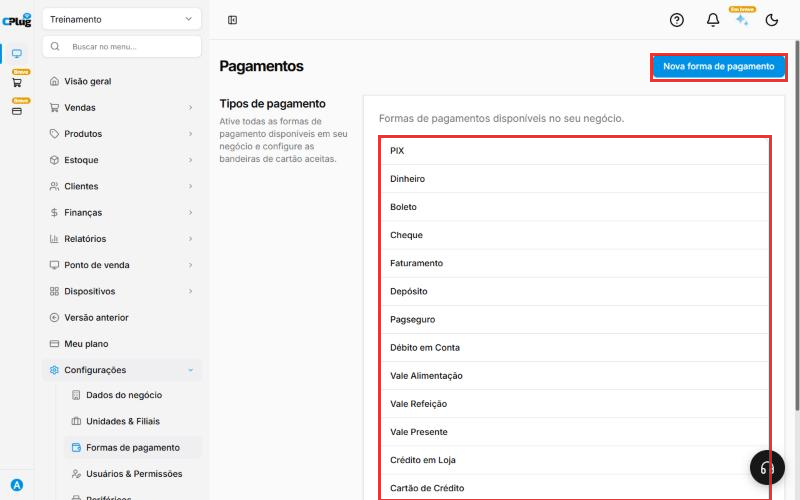
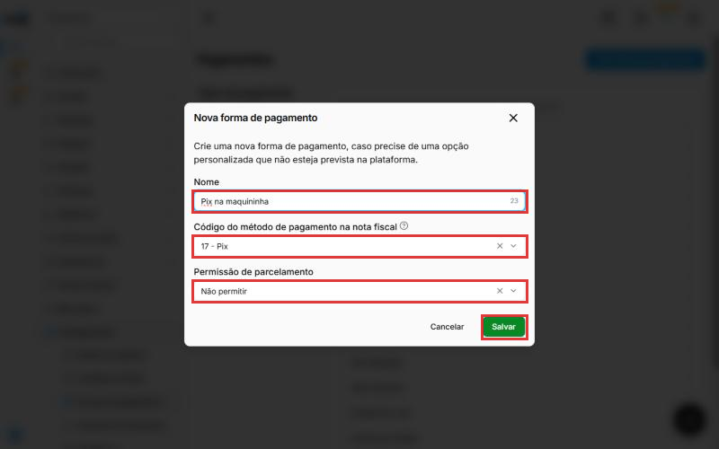
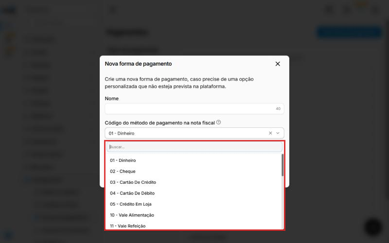
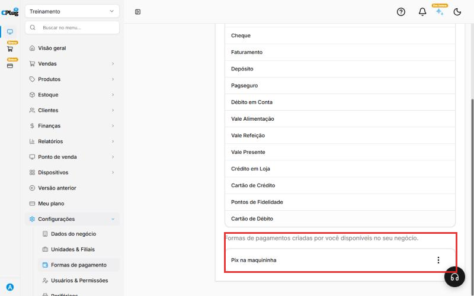

# Como cadastrar formas de pagamento

:material-clock-outline: 8 minutos · :material-format-list-numbered: 4 passos · :material-calendar-check: Atualizado em 01/11/2026

As **formas de pagamento** são as opções que o cliente usa para pagar: dinheiro, Pix, cartão, vale-refeição... O sistema **já vem com as mais comuns**. Só crie uma nova se precisar de uma opção que não está na lista.

## Entenda o conceito

Cada forma de pagamento tem **três informações**, e cada uma serve a um público diferente:

| Informação | Para quem | Exemplo |
| --- | --- | --- |
| **Nome** | Para o **caixa e os relatórios**: é o que aparece na tela de venda e no fechamento. | "Pix na maquininha" |
| **Código na nota fiscal** | Para a **Sefaz**: diz na nota como o cliente pagou. | 17 - Pix |
| **Permissão de parcelamento** | Para a **venda**: define se dá para dividir em parcelas. | Não permitir |

Ou seja: o **nome** pode ser do jeito da sua loja, mas o **código** precisa ser o real. Duas formas diferentes ("Pix balcão" e "Pix delivery") podem usar o mesmo código 17 e aparecer separadas nos relatórios.

**Formas padrão × formas criadas por você:** as padrão (PIX, Dinheiro, Cartão de Crédito...) não podem ser alteradas. Entre elas, **Boleto**, **Faturamento** e **Cartão de Crédito** já permitem parcelamento. As que você cria podem ser alteradas pelos três pontinhos.

!!! note "Forma de pagamento não é conta bancária"
    A forma diz **como** o cliente pagou; a [conta bancária](conta-bancaria.md) diz **onde** o dinheiro ficou. Um Pix e um cartão de débito podem cair na mesma conta do banco.

!!! warning "A forma de pagamento vai para a nota fiscal"
    Toda forma de pagamento tem um **código** que sai na nota fiscal (NFC-e e NF-e) e informa à Sefaz **como o cliente pagou**. Escolha sempre o código que corresponde ao pagamento de verdade. Exemplo: uma forma "Pix na maquininha" usa o código **17 - Pix**, e não **01 - Dinheiro**.

Nos prints, o **quadrado vermelho** mostra onde você deve clicar ou digitar.

## Veja as formas que já existem

No menu do lado esquerdo, clique em **Configurações** e depois em **Formas de pagamento**.

A lista mostra as formas que já vêm prontas: **PIX, Dinheiro, Boleto, Cheque, Faturamento, Depósito, Pagseguro, Débito em Conta, Vale Alimentação, Vale Refeição, Vale Presente, Crédito em Loja, Cartão de Crédito, Pontos de Fidelidade** e **Cartão de Débito**.

Se a forma que você precisa já está na lista, não precisa criar nada.

{ loading=lazy }

## Crie uma nova forma

Clique em **Nova forma de pagamento**, no canto de cima, à direita, e preencha:

- **Nome:** como a forma vai aparecer no caixa. Exemplo: "Pix na maquininha". Até 40 letras.
- **Código do método de pagamento na nota fiscal:** o tipo de pagamento que vai na nota. Veja a tabela abaixo.
- **Permissão de parcelamento:** **Permitir** se o cliente pode dividir o pagamento em parcelas (como no cartão de crédito). **Não permitir** para pagamentos à vista, como Pix e dinheiro.

{ loading=lazy }

## Escolha o código da nota fiscal

Clique no campo **Código do método de pagamento na nota fiscal** e escolha o código. Para achar mais rápido, digite o número.

{ loading=lazy }

Os códigos mais usados:

| Código | Use para |
| --- | --- |
| **01 - Dinheiro** | Dinheiro em espécie. |
| **03 - Cartão De Crédito** | Cartão de crédito, na maquininha ou no TEF. |
| **04 - Cartão De Débito** | Cartão de débito. |
| **05 - Crédito Em Loja** | Crédito que o cliente tem na sua loja. |
| **10 - Vale Alimentação** / **11 - Vale Refeição** | Vales e tíquetes de alimentação e refeição. |
| **12 - Vale Presente** | Vale-presente e gift card. |
| **15 - Boleto** | Boleto bancário. |
| **17 - Pix** | Pix com QR Code gerado na hora (maquininha ou sistema). |
| **20 - Pix Estático** | Pix por QR Code fixo ou chave Pix, sem valor gerado na hora. |
| **99 - Outros** | Só quando **nenhum** outro código serve. |

!!! tip "Na dúvida sobre o código, pergunte ao contador"
    O código errado pode fazer a nota ser recusada ou ficar com a informação de pagamento incorreta.

## Salve e confira

Clique em **Salvar**. Aparece a mensagem **Método de pagamento adicionado com sucesso**.

Role a tela até o fim: a nova forma aparece em **Formas de pagamentos criadas por você**. Os **três pontinhos** ao lado dela abrem as opções da forma.

{ loading=lazy }

!!! info "Bandeiras e taxas dos cartões"
    As bandeiras aceitas (Visa, Mastercard...) e as taxas cobradas pela maquininha são cadastradas em **Finanças → Contrato de cartões e outros**. Esse manual está a caminho.

!!! tip "Boas práticas"
    - **Use as formas padrão sempre que servirem.** Crie novas só para separar nos relatórios (ex.: "Pix delivery") ou para pagamentos que não existem na lista.
    - **Código fiscal real, sempre.** Nunca use "99 - Outros" por comodidade.
    - **Nomes curtos e claros**: é o que o operador do caixa lê na hora da venda.
    - **Parcelamento só onde existe parcela de verdade** (cartão de crédito, boleto, crediário).
    - **Não crie formas repetidas**: "Pix", "PIX" e "pix" viram três linhas no relatório.

## Deu algum problema?

??? question "Não consigo alterar uma forma padrão (PIX, Dinheiro...)"
    As formas que já vêm no sistema aparecem só para consulta nesta tela. As formas criadas por você podem ser alteradas pelos três pontinhos.

??? question "A nota saiu com a forma de pagamento errada"
    Confira o **código na nota fiscal** da forma usada na venda. Se estiver errado, altere a forma criada por você pelos três pontinhos, para as próximas vendas.

**Relacionados:** [Como cadastrar uma conta bancária](conta-bancaria.md) · [Como configurar a emissão de notas fiscais](../configuracoes/emissao-de-notas.md)

forma de pagamento meio de pagamento pix dinheiro cartão de crédito cartão de débito boleto vale refeição vale alimentação parcelamento parcelas código tpag nota fiscal nfc-e nf-e sefaz nova forma maquininha pix estático outros
