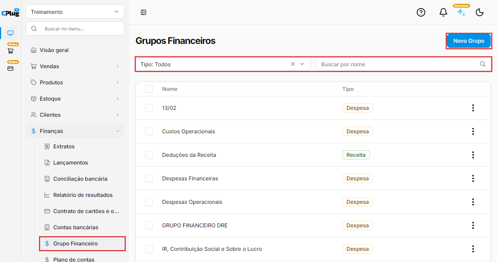
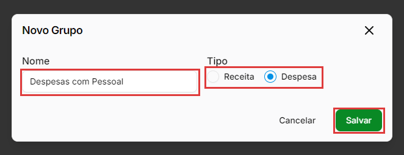
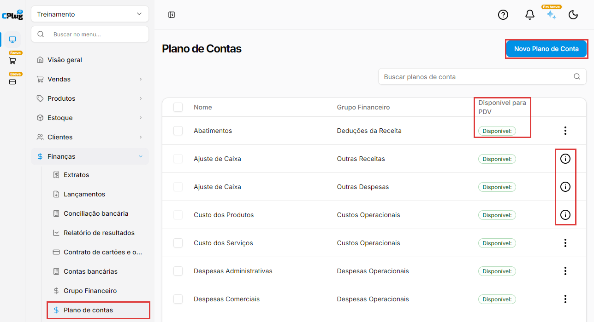
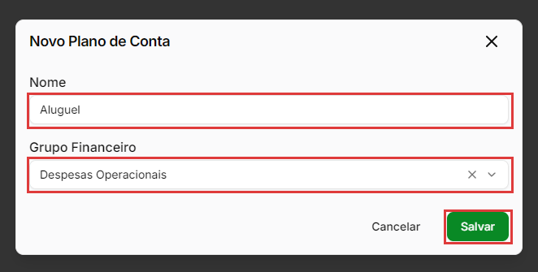
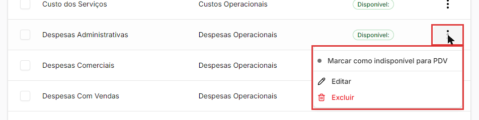

# Como organizar o plano de contas e os grupos financeiros

:material-clock-outline: 8 minutos · :material-format-list-numbered: 7 passos · :material-calendar-check: Atualizado em 11/11/2026

O **plano de contas** é a lista de **categorias** que você usa para classificar cada receita e cada despesa: aluguel, energia, venda de produtos, salários... Cada categoria fica dentro de um **grupo financeiro**. É essa organização que monta o [relatório de resultados (DRE)](relatorio-de-resultados.md): os grupos viram as linhas principais do relatório, e as categorias, as linhas de baixo.

## Entenda o conceito

**Três níveis, do geral para o detalhe**

| Nível | Exemplo | Onde fica |
| --- | --- | --- |
| **Grupo financeiro** | Despesas Operacionais | **Finanças → Grupo Financeiro** |
| **Categoria** (plano de contas) | Despesas Administrativas | **Finanças → Plano de contas** |
| **Lançamento** | Conta de luz de novembro | **Finanças → Lançamentos** |

**O tipo do grupo decide onde a categoria aparece.** Todo grupo é de **Receita** ou de **Despesa**. As categorias de grupos de receita aparecem para escolher numa **conta a receber**; as de grupos de despesa, numa **conta a pagar**. As deduções da receita (abatimentos, impostos sobre vendas, devoluções) ficam num grupo do tipo **Receita**, porque diminuem o que a empresa faturou; por isso aparecem na conta a receber.

**Grupos valem para todas as empresas; categorias, só para uma.** Se a sua conta tem mais de uma empresa (loja), os **grupos financeiros são os mesmos em todas**: criar, renomear ou excluir um grupo muda o grupo em todas elas. Já as **categorias** são de cada empresa: uma categoria criada numa loja não aparece na outra.

**Categorias padrão do sistema.** Algumas categorias já vêm prontas e não podem ser editadas nem excluídas. O sistema usa essas categorias sozinho: as vendas entram em **Faturamento com serviços / vendas de produtos**, as compras em **Custo dos Produtos** e os ajustes de saldo em **Ajuste de Caixa**. Os lançamentos de **Ajuste de Caixa** não entram no relatório de resultados.

!!! info "Antes de começar"
    Planeje antes de criar. Poucas categorias, com nomes claros, deixam o relatório fácil de ler. Antes de criar uma categoria nova, veja se já existe uma que serve. Exemplo: em vez de criar Luz, Água e Internet separadas, uma categoria **Contas de consumo** já mostra quanto a loja gasta com isso. Se tiver um contador, combine com ele os nomes: assim o relatório da loja conversa com a contabilidade.

Nos prints, o **quadrado vermelho** mostra onde você deve clicar ou digitar.

## Abra os grupos financeiros

No menu do lado esquerdo, clique em **Finanças** e depois em **Grupo Financeiro**. A lista mostra o **Nome** e o **Tipo** (**Receita** ou **Despesa**) de cada grupo.

Para achar um grupo, use o filtro **Tipo** (**Receita**, **Despesa** ou **Todos**) e o campo **Buscar por nome**. Os dois funcionam juntos: se nada combinar, aparece **Sem dados no momento**.

{ loading=lazy }

## Crie um grupo

Clique em **Novo Grupo**. Preencha:

- **Nome:** como o grupo vai aparecer no relatório. Exemplo: **Despesas com Pessoal**.
- **Tipo:** **Receita** ou **Despesa**.

Clique em **Salvar**. O grupo aparece em todas as empresas da sua conta e, no relatório de resultados, depois dos grupos que já existiam.

{ loading=lazy }

## Edite ou exclua um grupo

Clique nos **três pontinhos** do grupo:

- **Editar:** muda o **Nome** e o **Tipo**. A mudança vale para todas as empresas.
- **Excluir:** pede confirmação ("Tem certeza que deseja excluir o grupo...?"). Clique em **Excluir** para confirmar.

Um grupo com categorias que já têm lançamentos não pode ser excluído. Depois de excluir, confira se o grupo saiu mesmo da lista (veja "Excluí um grupo e ele continua na lista", no fim da página).

!!! warning "Cuidado com os grupos que vêm prontos"
    Os grupos que já vêm no sistema, como **Receitas operacionais** e **Despesas Operacionais**, também têm **Editar** e **Excluir**. Evite mexer neles: eles organizam o relatório de resultados de todas as empresas da sua conta.

## Abra o plano de contas

No menu, clique em **Finanças** e depois em **Plano de contas**. A lista mostra cada categoria com o **Nome**, o **Grupo Financeiro** e se está **Disponível para PDV**.

As categorias padrão do sistema têm um **i** no lugar dos três pontinhos. Pare o mouse em cima e aparece: "Este item não pode ser editado ou excluído pois é padrão do sistema".

Para achar uma categoria, use o campo **Buscar planos de conta**. Ele procura pelo **nome da categoria**, não pelo nome do grupo.

{ loading=lazy }

## Crie uma categoria

Clique em **Novo Plano de Conta**. Preencha:

- **Nome:** o nome da categoria. Exemplo: **Aluguel**.
- **Grupo Financeiro:** em qual grupo ela entra. Exemplo: **Despesas Operacionais**. O tipo do grupo decide se a categoria aparece nas contas a receber ou a pagar.

Clique em **Salvar**. A categoria já pode ser escolhida nos lançamentos desta empresa.

{ loading=lazy }

## Libere a categoria para o PDV

A coluna **Disponível para PDV** diz se a categoria pode ser usada no PDV (o caixa da loja). Nas categorias que vêm prontas, o selo pode ser **Disponível:** ou **Indisponível**, conforme a empresa (as de faturamento, por exemplo, podem vir indisponíveis); como são padrão do sistema, não mudam por aqui. Uma categoria nova vem como **Indisponível**. Para mudar, clique nos **três pontinhos** da categoria e em **Marcar como disponível para PDV**: o selo muda para **Disponível:** e aparece "Salvo com sucesso". Para voltar, use **Marcar como indisponível para PDV**.

Deixe disponíveis só as categorias que a sua equipe usa no caixa. Na dúvida sobre quais liberar, fale com o suporte.

No exemplo abaixo, a categoria já está disponível, por isso o menu mostra **Marcar como indisponível para PDV**.

{ loading=lazy }

## Edite, mude de grupo ou exclua uma categoria

Nos **três pontinhos** da categoria:

- **Editar:** muda o **Nome** e o **Grupo Financeiro**.
- **Excluir:** pede confirmação ("Esta ação não pode ser desfeita."). Uma categoria que já tem lançamentos **não pode ser excluída**: aparece "Não é possível excluir esta categoria pois ela possui transações vinculadas".

Mudar uma categoria de grupo **leva junto todos os lançamentos dela, inclusive os antigos**. Exemplo: se **Salários** sai de **Despesas com Pessoal** e vai para **Despesas Operacionais**, o relatório de resultados dos meses passados também passa a mostrar os salários em **Despesas Operacionais**. Isso é útil para corrigir uma organização errada, mas muda relatórios que você já viu.

!!! tip "Boas práticas"
    - **Menos é mais.** Um plano de contas enxuto, com nomes claros, é mais fácil de usar no dia a dia e de ler no relatório.
    - **Não crie categorias repetidas.** Antes de criar, use a busca para ver se já existe uma parecida.
    - **Pense em todas as lojas antes de mexer num grupo.** Grupos valem para todas as empresas da conta.
    - **Em vez de excluir, reorganize.** Uma categoria com lançamentos não pode ser excluída; mude o nome ou o grupo dela, se precisar (lembrando que mudar o grupo muda também os relatórios dos meses passados).
    - **Combine a estrutura com o seu contador.** Assim o relatório de resultados fica parecido com o que ele usa.

## Deu algum problema?

??? question "Não acho a categoria quando lanço uma conta"
    Confira o tipo do grupo dela em **Plano de contas** e **Grupo Financeiro**. Categoria de grupo de **Receita** só aparece em conta a receber; de grupo de **Despesa**, só em conta a pagar. Lembre também que as categorias são de cada empresa: confira se você está na empresa certa, no seletor do alto do menu.

??? question "Não consigo editar nem excluir uma categoria"
    Se no lugar dos três pontinhos aparece um **i**, é uma categoria padrão do sistema. Ela não pode ser editada nem excluída.

??? question "Não é possível excluir esta categoria pois ela possui transações vinculadas"
    A categoria já foi usada em lançamentos. Para excluí-la, primeiro troque a categoria desses lançamentos (ou exclua os que foram lançados por engano) em **Finanças → Lançamentos**. Se não quiser mexer neles, deixe a categoria como está ou mude só o nome dela.

??? question "Excluí um grupo e ele continua na lista"
    Pode aparecer "Grupo excluído com sucesso" mesmo quando o grupo não foi excluído, porque ele tem categorias com lançamentos. Atualize a página para conferir. Para excluir o grupo, primeiro mude as categorias dele para outro grupo. Se a sua conta tem mais de uma loja, confira também o **Plano de contas** das outras lojas: o grupo é o mesmo em todas.

??? question "Criei um grupo e ele apareceu na outra loja"
    É o esperado. Os grupos financeiros valem para todas as empresas da sua conta. As categorias, não.

??? question "Mudei uma categoria de grupo e o relatório dos meses passados mudou"
    É o esperado. O relatório usa o grupo atual da categoria, para todos os lançamentos dela, inclusive os antigos.

??? question "Fiz uma mudança e o relatório de resultados não mudou"
    O relatório de resultados guarda o cálculo de cada período por alguns minutos. Confira a hora em **Consultas realizadas em**, espere alguns minutos e abra o relatório de novo.

**Relacionados:** [Como ler o relatório de resultados (DRE)](relatorio-de-resultados.md) · [Como lançar uma conta a pagar ou a receber](contas-a-pagar-e-receber.md) · [Como consultar o extrato](extrato.md)

plano de contas plano de conta categorias categoria financeira grupo financeiro grupos financeiros novo grupo novo plano de conta receita despesa disponível para pdv indisponível padrão do sistema ajuste de caixa excluir categoria transações vinculadas dre relatório de resultados organizar despesas classificar lançamentos categorias padrão excluir grupo editar grupo deduções da receita abatimentos marcar como disponível para pdv
