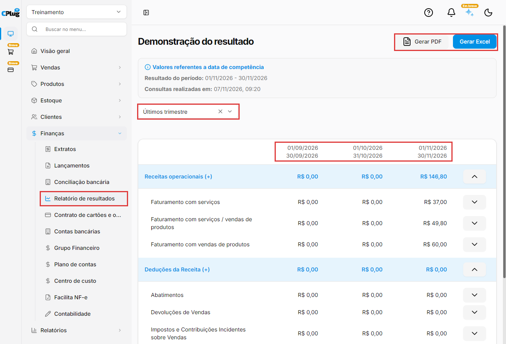
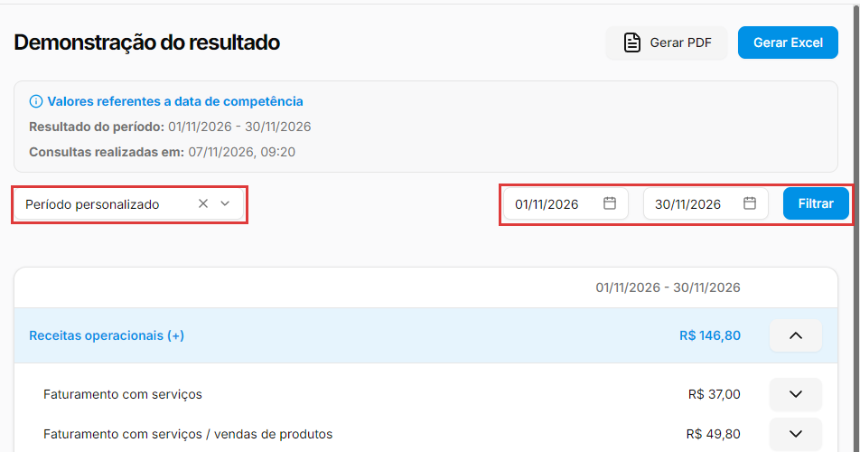
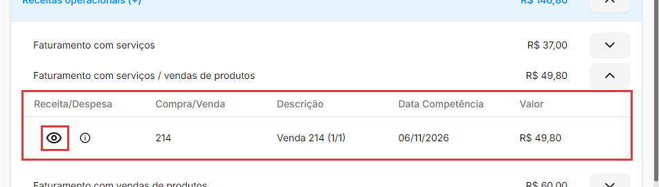
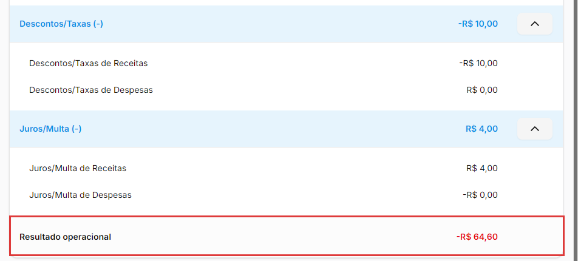

# Como ler o relatório de resultados (DRE)

:material-clock-outline: 8 minutos · :material-format-list-numbered: 6 passos · :material-calendar-check: Atualizado em 07/11/2026

O **relatório de resultados** (na tela, **Demonstração do resultado**) é o que os contadores chamam de **DRE**, sigla de Demonstração do Resultado do Exercício. Ele responde à pergunta mais importante do negócio: **a empresa teve lucro ou prejuízo neste período?** O relatório soma as receitas, tira os custos e as despesas e mostra o **Resultado operacional** no final.

## Entenda o conceito

**Competência, não caixa.** O relatório usa a **Data de Competência** dos lançamentos: o mês a que a receita ou a despesa pertence, não o dia em que o dinheiro entrou ou saiu. Por isso, uma venda de novembro que o cliente ainda não pagou **entra** no resultado de novembro. E registrar o pagamento de uma conta não muda o relatório: ela já estava lá, no mês da competência.

| Tela | Pergunta que responde |
| --- | --- |
| **Relatório de resultados** | "O mês deu lucro?" Considera tudo o que pertence ao período, pago ou não. |
| **Extratos** | "Quanto dinheiro entrou e saiu?" (veja [Como consultar o extrato](extrato.md)). |

Uma empresa pode ter lucro no mês e pouco dinheiro na conta (vendeu a prazo) ou o contrário (recebeu vendas do mês anterior). As duas visões se completam.

**Como o relatório é montado**

- **Grupos:** as linhas em destaque, como **Receitas operacionais (+)**, **Custos Operacionais (-)** e **Despesas Operacionais (-)**. Os grupos vêm de **Finanças → Grupo Financeiro** (veja [Como organizar o plano de contas e os grupos financeiros](plano-de-contas.md)). O **(+)** ou **(-)** no nome mostra o que o grupo costuma fazer; o que vale é o sinal do valor: valor com o sinal de menos diminui o resultado, valor sem sinal aumenta.
- **Categorias:** embaixo de cada grupo, como **Faturamento com vendas de produtos** ou **Despesas Administrativas**. São as categorias do **Plano de contas**, que você escolhe em cada lançamento (veja [Como lançar uma conta a pagar ou a receber](contas-a-pagar-e-receber.md)).
- **Descontos/Taxas** e **Juros/Multa:** linhas automáticas, que somam os campos **Taxas/Despesas** e **Multas/Juros** dos lançamentos, separadas em "de Receitas" e "de Despesas". Por isso **Juros/Multa (-)** aparece positivo quando a empresa recebeu juros de um cliente atrasado: esse dinheiro aumenta o resultado.
- **Resultado operacional:** a soma de tudo. Positivo é lucro; negativo (com o sinal de menos) é prejuízo.

**O que não entra:** transferências entre as contas da empresa (não são receita nem despesa) e os lançamentos da categoria **Ajuste de Caixa**. Um lançamento **agrupado** não é contado de novo: entram os lançamentos originais, cada um no mês da sua competência. E um lançamento **parcelado** entra parcela por parcela, cada uma no mês dela.

!!! info "Antes de começar"
    O relatório só fica bom se os lançamentos estiverem bem feitos: cada um com a **categoria** certa e a **Data de Competência** do mês a que pertence. Lançamento com categoria errada aparece no grupo errado.

Nos prints, o **quadrado vermelho** mostra onde você deve clicar.

## Abra o relatório

No menu do lado esquerdo, clique em **Finanças** e depois em **Relatório de resultados**. A tela abre em **Últimos trimestre**, com três colunas: os dois meses anteriores e o mês atual.

No quadro azul, no alto:

- **Valores referentes a data de competência:** o lembrete de que o relatório usa a competência.
- **Resultado do período:** o período que vai para o PDF e o Excel (passo 6). No **Últimos trimestre**, ele mostra só o mês atual.
- **Consultas realizadas em:** o dia e a hora em que os números foram calculados.

{ loading=lazy }

## Escolha o período

Clique no filtro de período, abaixo do quadro azul, e escolha:

- **Mês atual:** só o mês de hoje.
- **Período personalizado:** aparecem duas datas (dd/mm/aaaa), de início e de fim. Escolha as datas e clique em **Filtrar**. O relatório mostra **uma coluna só**, com a soma do período inteiro (por exemplo, o ano até agora).
- **Últimos trimestre:** os três últimos meses lado a lado, um por coluna. Bom para comparar.

{ loading=lazy }

## Leia os grupos e as categorias

Cada grupo mostra o total na sua linha e as categorias embaixo. Clique na **seta** à direita de um grupo para recolher ou abrir as categorias dele.

Os valores de custos e despesas aparecem com o sinal de menos (exemplo: **-R$ 192,90** em **Despesas Operacionais**). Em geral, uma categoria com **R$ 0,00** não teve lançamento no período. No **Últimos trimestre**, veja também o problema "No trimestre, uma linha mostra R$ 0,00", no fim desta página.

## Veja os lançamentos de uma categoria

Clique na **seta** à direita de uma categoria. Abre uma lista com os lançamentos que formam aquele valor, com as colunas **Receita/Despesa**, **Compra/Venda**, **Descrição**, **Data Competência** e **Valor**. Lançamentos que vieram de uma venda ou de uma compra mostram o número dela em **Compra/Venda** e aparecem com o nome dela na descrição, como **Venda 214 (1/1)** ou **Compra 19 (1/2)**. O **(1/2)** quer dizer parcela 1 de 2.

Na coluna **Receita/Despesa**:

- o **olho** abre o lançamento num painel ao lado, só para consulta: valor, taxas, conta, datas, pagamentos, cliente e categorias. Para alterar, use **Finanças → Lançamentos**;
- o **i**, ao parar o mouse em cima, mostra o **ID transação**, o código do lançamento no sistema. É útil quando o suporte pede o lançamento exato.

Se um lançamento foi dividido em mais de uma categoria, cada categoria mostra só a parte dela. Clique na seta de novo para fechar a lista.

{ loading=lazy }

As linhas **Descontos/Taxas** e **Juros/Multa** não abrem lista. Para ver de onde vêm, abra os lançamentos em **Finanças → Lançamentos**.

## Confira o resultado operacional

No fim do relatório fica o **Resultado operacional**: receitas menos custos e despesas, já com as linhas de taxas e de juros. No exemplo do print, o resultado é **-R$ 64,60**: o mês, até aqui, está no prejuízo. Se o mês ainda não acabou, o número muda conforme entram novos lançamentos.

No **Últimos trimestre**, cada mês tem o seu resultado, na coluna dele.

{ loading=lazy }

## Exporte em PDF ou Excel

Clique em **Gerar PDF** ou em **Gerar Excel**, no alto da tela. O sistema baixa o arquivo **dre.pdf** ou **dre.xlsx**, com o período que aparece em **Resultado do período**, no quadro azul.

Atenção: em **Últimos trimestre**, o arquivo vem só com o mês atual. Para exportar vários meses, use **Período personalizado** (passo 2), clique em **Filtrar** e depois gere o arquivo: ele traz a soma do período numa coluna só. Para ter cada mês separado, exporte um mês de cada vez.

!!! tip "Boas práticas"
    - **Categorize todo lançamento.** É a categoria que decide em qual linha do relatório o valor aparece.
    - **Capriche na Data de Competência.** Use o mês a que a receita ou a despesa pertence. Exemplo: a conta de luz de outubro, paga em novembro, tem competência em outubro.
    - **Lançamento com taxa ou juros: se puder, use uma categoria só.** Assim as linhas **Descontos/Taxas** e **Juros/Multa** mostram os valores certos (veja os problemas abaixo).
    - **Compare os meses** no **Últimos trimestre**: o que subiu, o que caiu e por quê.
    - **Feche o mês com calma:** confira os lançamentos e faça a [conciliação bancária](conciliacao-bancaria.md) antes de tirar conclusões do relatório.
    - **O relatório é gerencial.** Para o balanço oficial e os impostos, a referência é o seu contador.

## Deu algum problema?

??? question "Uma conta que ainda não paguei aparece no relatório"
    É o esperado. O relatório usa a **Data de Competência**: a conta pertence àquele mês, paga ou não. Para ver só o dinheiro que entrou e saiu, use o [extrato](extrato.md).

??? question "Paguei uma conta e o resultado não mudou"
    Também é o esperado. A despesa já estava no mês da competência. Pagar muda o saldo da conta bancária, não o resultado. A exceção: se você preencher **Taxas/Despesas** ou **Multas/Juros** no lançamento, esses valores aparecem nas linhas **Descontos/Taxas** e **Juros/Multa**.

??? question "Um lançamento não aparece no relatório"
    Confira em **Lançamentos** se a **Data de Competência** está dentro do período escolhido. Lembre que transferências e **Ajuste de Caixa** não entram. Se estiver tudo certo, confira se a categoria está num grupo que aparece no relatório: nem todo grupo cadastrado em **Grupo Financeiro** aparece. Nesse caso, fale com o suporte.

??? question "O resultado não bate com o saldo do banco"
    São coisas diferentes. O resultado considera tudo o que pertence ao período, pago ou não, e não inclui transferências nem ajustes. O saldo do banco é o dinheiro que está na conta.

??? question "Juros/Multa tem (-) no nome, mas o valor está positivo"
    São juros ou multas que a empresa **recebeu** de clientes atrasados. Eles aumentam o resultado, por isso aparecem sem o sinal de menos.

??? question "Descontos/Taxas ou Juros/Multa não batem com os lançamentos"
    Isso acontece quando o lançamento com taxa ou juros está dividido em **mais de uma categoria**. O relatório conta a taxa e os juros uma vez para cada categoria. E, nesse caso, as categorias já mostram o valor final (com a taxa descontada e os juros somados), e as linhas automáticas descontam e somam tudo de novo.

    Exemplo: um recebimento de R$ 100,00, com R$ 5,00 de taxa e R$ 2,00 de juros, dividido em duas categorias. As categorias somam R$ 97,00 (R$ 60,00 + R$ 37,00). **Descontos/Taxas** mostra **-R$ 10,00** e **Juros/Multa**, **R$ 4,00**. O resultado desse recebimento fica R$ 91,00 em vez de R$ 97,00: R$ 6,00 a menos.

    Se precisar do número exato, confira os valores em **Lançamentos** e fale com o suporte. Para os próximos lançamentos, prefira uma categoria só quando houver taxa ou juros.

??? question "No trimestre, uma linha mostra R$ 0,00, mas o grupo dela tem valor"
    Na visão de três colunas, as linhas **Descontos/Taxas de Receitas** e **Juros/Multa de Receitas** podem aparecer como **R$ 0,00** ou **-R$ 0,00**, embora o total do grupo esteja certo. Escolha **Período personalizado** com o mês que quer conferir: com uma coluna só, as linhas aparecem com os valores certos.

??? question "Exportei o trimestre e o arquivo veio com um mês só"
    O PDF e o Excel trazem o período do **Resultado do período**, que no trimestre é só o mês atual. Use **Período personalizado** com o período todo, clique em **Filtrar** e gere o arquivo de novo. Para ter cada mês separado, exporte um mês de cada vez.

??? question "Fiz uma mudança e o relatório não mudou"
    O relatório guarda o cálculo de cada período por alguns minutos. Confira a hora em **Consultas realizadas em**, espere alguns minutos e abra o relatório de novo.

??? question "Um grupo que cadastrei não aparece no relatório"
    Um grupo novo aparece depois dos grupos que já existiam, mas pode levar alguns minutos (veja o problema acima). Se mesmo assim ele não aparecer, fale com o suporte: alguns grupos antigos não aparecem no relatório. Para organizar grupos e categorias, veja [Como organizar o plano de contas e os grupos financeiros](plano-de-contas.md).

**Relacionados:** [Como organizar o plano de contas e os grupos financeiros](plano-de-contas.md) · [Como lançar uma conta a pagar ou a receber](contas-a-pagar-e-receber.md) · [Como consultar o extrato](extrato.md) · [Como fazer a conciliação bancária](conciliacao-bancaria.md) · [Como cadastrar as taxas do cartão](taxas-do-cartao.md)

relatório de resultados dre demonstração do resultado demonstração do resultado do exercício demonstrativo de resultado lucro prejuízo resultado operacional receitas custos despesas competência data de competência regime de competência grupo financeiro categoria plano de contas descontos taxas juros multa trimestre mês atual período personalizado gerar pdf gerar excel exportar planilha agrupado parcela parcelado ajuste de caixa
