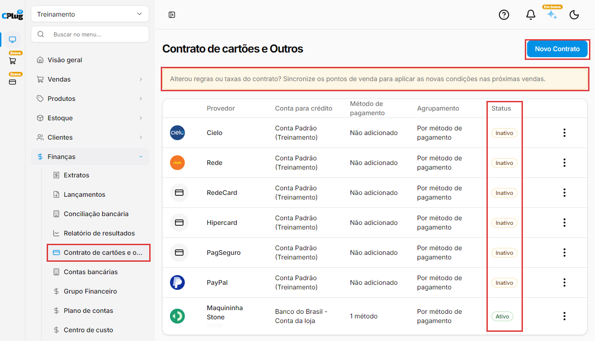
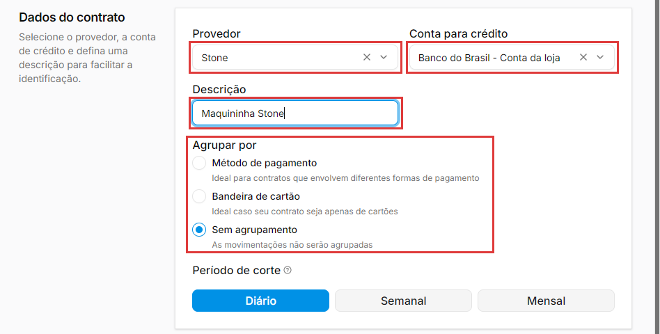
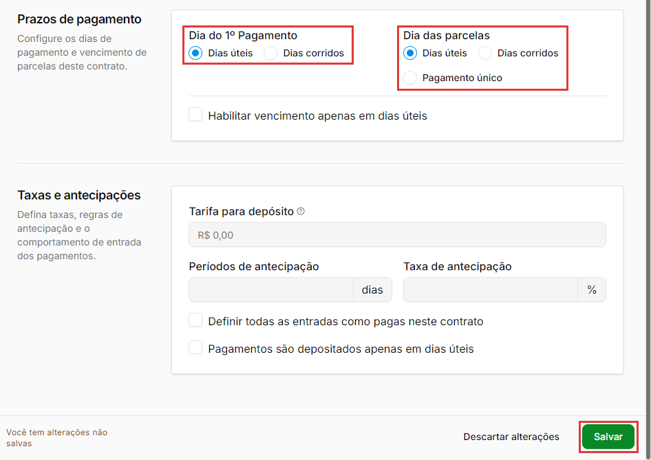
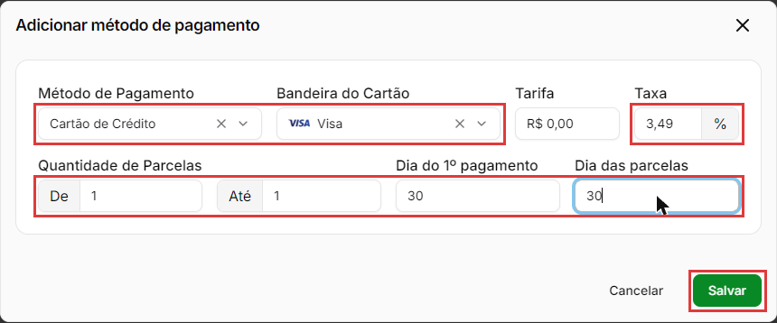
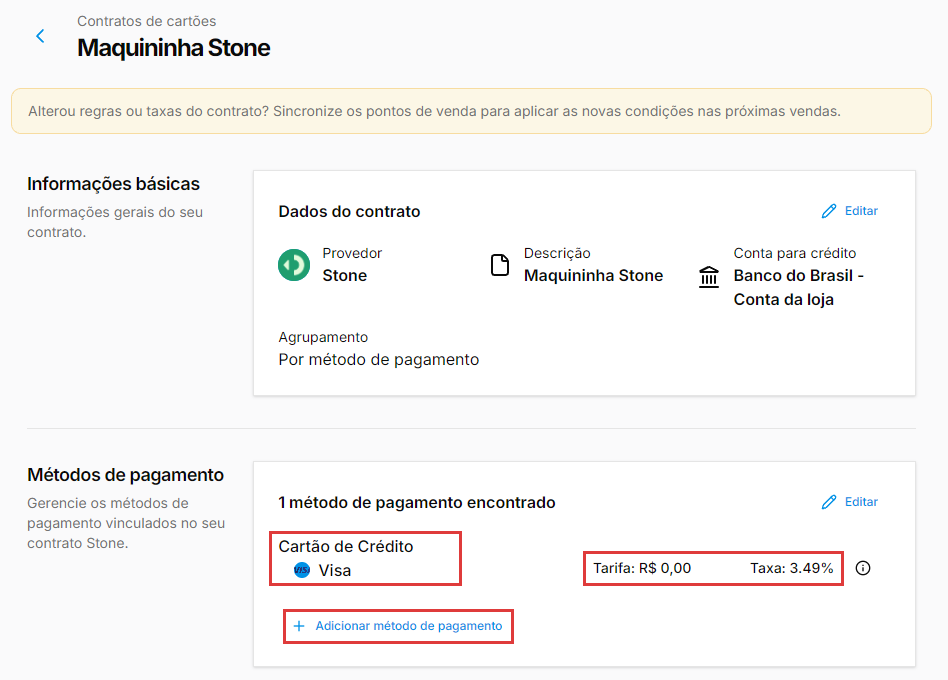
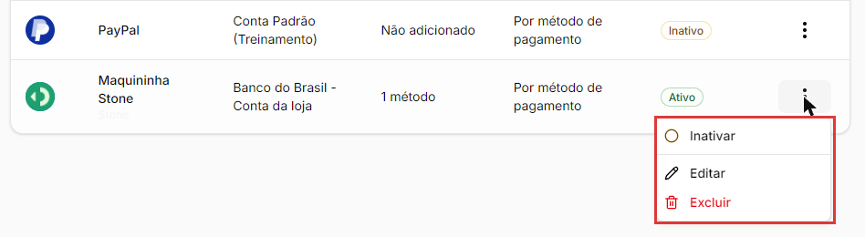

# Como cadastrar as taxas do cartão

:material-clock-outline: 8 minutos · :material-format-list-numbered: 5 passos · :material-calendar-check: Atualizado em 07/11/2026

Quando o cliente paga no cartão, o dinheiro não cai inteiro nem na hora: a operadora da maquininha desconta uma **taxa** e paga depois de alguns dias. O **contrato de cartões** é onde você registra essas condições: a taxa de cada bandeira, o prazo de recebimento e a conta onde a operadora deposita.

## Entenda o conceito

Cada maquininha (ou operadora) que a loja usa é um **contrato**. Dentro dele ficam as regras de cada forma de pagamento:

| Parte do contrato | O que é | Exemplo |
| --- | --- | --- |
| **Provedor** | A operadora da maquininha. | Stone |
| **Conta para crédito** | A conta bancária onde a operadora deposita o dinheiro. | Banco do Brasil - Conta da loja |
| **Método de pagamento** e **Bandeira** | Para qual forma de pagamento e bandeira vale a regra. | Cartão de Crédito, Visa |
| **Taxa** | A porcentagem que a operadora desconta. | 3,49% |
| **Tarifa** | Um valor fixo em reais cobrado por venda, se houver. | R$ 0,00 |
| **Dia do 1º pagamento** | Em quantos dias o dinheiro cai depois da venda. | 30 dias |
| **Quantidade de Parcelas** e **Dia das parcelas** | No crédito: para quais parcelas vale a regra e de quantos em quantos dias cada parcela cai. | De 1 até 1, a cada 30 dias |

**Onde as condições valem.** O aviso no alto da tela diz: "Alterou regras ou taxas do contrato? Sincronize os pontos de venda para aplicar as novas condições nas próximas vendas." Ou seja, o contrato é usado pelos **pontos de venda** (o caixa). Nas vendas geradas pelo **pedido de venda**, no ERP, a conta a receber é criada com o valor cheio e vence no dia da venda: a taxa e o prazo do contrato não são descontados.

**Dias úteis ou dias corridos?** Dias corridos contam todos os dias do calendário; dias úteis pulam sábado, domingo e feriado. Exemplo: numa venda na sexta-feira, 2 dias corridos dão domingo; 2 dias úteis dão terça-feira. Confira no contrato da operadora qual é o seu caso.

**Antecipação** é receber antes do prazo, pagando uma taxa extra à operadora.

!!! info "Antes de começar"
    - Cadastre a **conta bancária** onde a operadora deposita (veja [Como cadastrar uma conta bancária](conta-bancaria.md)).
    - Confira se as **formas de pagamento** que a maquininha aceita estão cadastradas (veja [Como cadastrar formas de pagamento](formas-de-pagamento.md)).
    - Tenha em mãos a **tabela de taxas e prazos** da operadora (no contrato ou no painel da maquininha). As taxas mudam de loja para loja e de bandeira para bandeira.

Nos prints, o **quadrado vermelho** mostra onde você deve clicar ou digitar.

## Abra os contratos de cartões

No menu do lado esquerdo, clique em **Finanças** e depois em **Contrato de cartões e o...** (o nome aparece cortado no menu). A tela que abre se chama **Contrato de cartões e Outros**. A lista mostra o **Provedor**, a **Conta para crédito**, o **Método de pagamento** (quantos foram cadastrados, ou **Não adicionado**), o **Agrupamento** e o **Status** (**Ativo** ou **Inativo**).

A lista pode já trazer contratos de operadoras conhecidas (Cielo, Rede...), **inativos** e com **Não adicionado**. Para cadastrar a sua maquininha, clique em **Novo Contrato**.

{ loading=lazy }

## Preencha os dados do contrato

Em **Dados do contrato**:

- **Provedor:** a operadora. A lista é grande (Stone, Cielo, Rede, Mercado Pago, Vero...): digite parte do nome para achar.
- **Conta para crédito:** a conta bancária onde a operadora deposita o dinheiro.
- **Descrição:** um nome para reconhecer o contrato. Exemplo: "Maquininha Stone". É ele que aparece na lista.
- **Agrupar por:** como as movimentações do contrato são juntadas. A tela explica cada opção: **Método de pagamento** ("Ideal para contratos que envolvem diferentes formas de pagamento"), **Bandeira de cartão** ("Ideal caso seu contrato seja apenas de cartões") e **Sem agrupamento** ("As movimentações não serão agrupadas"). Se não souber, deixe **Sem agrupamento**, que é o que vem marcado.
- **Período de corte** (**Diário**, **Semanal** ou **Mensal**): pode deixar como está. Essa opção ainda não está disponível (a dica da tela diz "Em breve nova funcionalidade").

{ loading=lazy }

## Confira os prazos e salve o contrato

Em **Prazos de pagamento**, você escolhe só **como os dias são contados**. O número de dias vai em cada forma de pagamento, no próximo passo.

- **Dia do 1º Pagamento:** **Dias úteis** ou **Dias corridos**.
- **Dia das parcelas:** **Dias úteis**, **Dias corridos** ou **Pagamento único**.
- **Habilitar vencimento apenas em dias úteis:** marque se o contrato da operadora diz que os pagamentos só vencem em dias úteis.

Em **Taxas e antecipações** ficam **Períodos de antecipação** (em dias), **Taxa de antecipação** (%), **Definir todas as entradas como pagas neste contrato** e **Pagamentos são depositados apenas em dias úteis**. A **Tarifa para depósito** aparece bloqueada ("Em breve nova funcionalidade"). Se não souber o que marcar, deixe essas opções como vieram e fale com o suporte.

{ loading=lazy }

Clique em **Salvar**, no canto de baixo, à direita. O contrato abre na tela dele: em cima, os **Dados do contrato**; embaixo, **Métodos de pagamento**, ainda com **Nenhum método de pagamento adicionado**. Na lista, ele já entra como **Ativo**.

## Cadastre a taxa de cada forma de pagamento

Em **Métodos de pagamento**, clique em **Adicionar novo** (depois do primeiro, o link se chama **Adicionar método de pagamento**). Na janela **Adicionar método de pagamento**:

- **Método de Pagamento:** a forma de pagamento. Exemplo: **Cartão de Crédito**.
- **Bandeira do Cartão:** Visa, MasterCard, Elo, American Express, Hipercard...
- **Tarifa:** o valor fixo em reais por venda, se a operadora cobrar.
- **Taxa:** a porcentagem. O campo já tem a vírgula: para 3,49%, digite **349**.
- **Dia do 1º pagamento:** em quantos dias o dinheiro cai.

No **Cartão de Crédito** aparecem também **Quantidade de Parcelas** (**De** e **Até**: para quais parcelas vale essa taxa) e **Dia das parcelas** (de quantos em quantos dias cada parcela cai).

Exemplo: Cartão de Crédito, Visa, Taxa **3,49%**, parcelas **De 1 Até 1**, Dia do 1º pagamento **30** e Dia das parcelas **30**.

{ loading=lazy }

Clique em **Salvar** na janela. A regra já fica gravada no contrato, sem outro Salvar, e aparece com o método, a bandeira, a **Tarifa** e a **Taxa** (a tela mostra a taxa com ponto: "3.49%"). Repita para cada forma de pagamento e bandeira que a maquininha aceita.

{ loading=lazy }

## Inative ou reative um contrato

Na lista de contratos, os **três pontinhos** de cada contrato têm:

- **Inativar** (ou **Reativar**, se ele estiver inativo): abre a janela **Inativar contrato de cartão**, que pede confirmação. Ao confirmar, aparece **Contrato de cartão inativado com sucesso** e o **Status** muda para **Inativo**. Use para deixar de usar uma maquininha sem perder o contrato.
- **Editar:** para mudar o contrato.
- **Excluir:** remove o contrato. Prefira **Inativar**, que guarda o contrato.

{ loading=lazy }

!!! warning "Sincronize os pontos de venda"
    Sempre que alterar regras ou taxas de um contrato, sincronize os pontos de venda, como pede o aviso no alto da tela: é assim que as novas condições passam a valer nas próximas vendas. Se não souber onde sincronizar, fale com o suporte.

!!! tip "Boas práticas"
    - **Um contrato para cada maquininha.** Se a loja tem Stone e Cielo, são dois contratos.
    - **Copie as taxas da tabela da operadora**, bandeira por bandeira, e use **De** e **Até** para separar as faixas de parcelas.
    - **Confira as taxas quando a operadora mudar as condições** (renovação, promoção, troca de plano).
    - **Inative a maquininha que saiu de uso**, em vez de excluir.

## Deu algum problema?

??? question "Gerei uma venda pelo pedido de venda e a conta a receber veio com o valor cheio"
    Nas vendas geradas pelo **pedido de venda**, no ERP, a conta a receber é criada com o valor cheio e vence no dia da venda: a taxa e o prazo do contrato não são descontados. O aviso da tela fala em aplicar as condições nas vendas dos **pontos de venda**. Se você precisa das taxas nas vendas feitas pelo ERP, fale com o suporte.

??? question "Apareceu: Os dados enviados são inválidos"
    Confira os números da janela. O **Dia das parcelas** não aceita mais de **365** dias. Se digitou duas vezes no mesmo campo, apague tudo e digite de novo.

??? question "Como digito a taxa 3,49%?"
    O campo de taxa já tem a vírgula: os dois últimos números são os centavos. Digite **349**.

??? question "O contrato está na lista, mas aparece Não adicionado"
    Falta cadastrar as formas de pagamento dele: abra o contrato e use **Adicionar novo**, em **Métodos de pagamento**.

??? question "Onde sincronizo os pontos de venda?"
    Fale com o suporte para fazer a sincronização depois de mudar um contrato.

**Relacionados:** [Como cadastrar uma conta bancária](conta-bancaria.md) · [Como cadastrar formas de pagamento](formas-de-pagamento.md) · [Como lançar uma conta a pagar ou a receber](contas-a-pagar-e-receber.md) · [Como cadastrar um ponto de venda](../ponto-de-venda/cadastrar-ponto-de-venda.md)

taxas do cartão taxa da maquininha contrato de cartões contrato de cartão maquininha operadora adquirente stone cielo rede mercado pago bandeira visa mastercard elo cartão de crédito cartão de débito parcelas prazo de recebimento dia do primeiro pagamento dias úteis dias corridos tarifa antecipação conta para crédito agrupamento sincronizar pontos de venda
