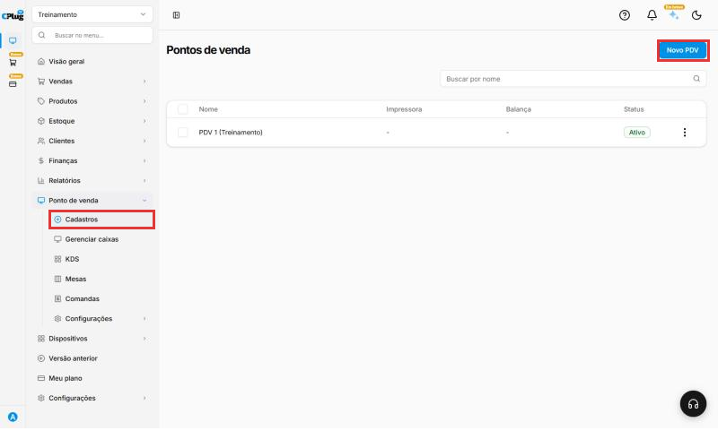
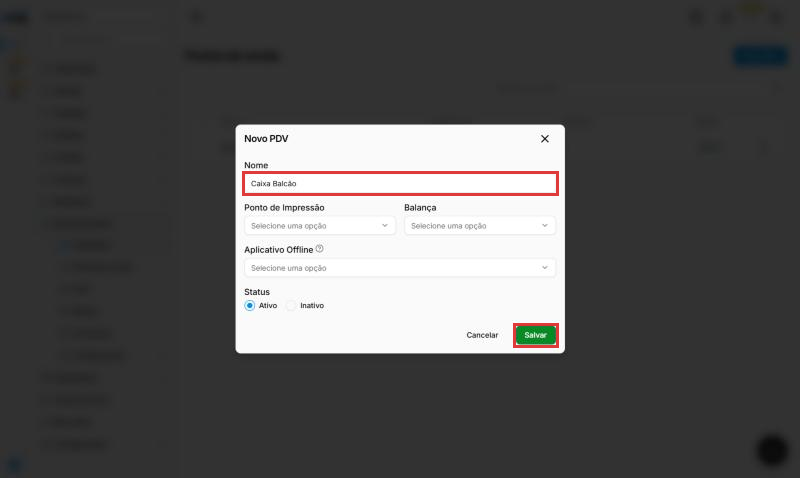
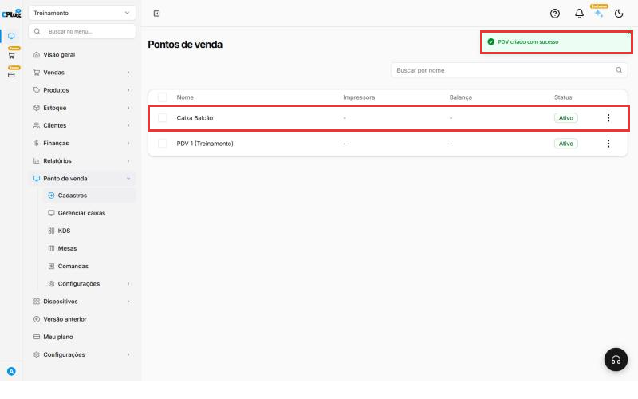
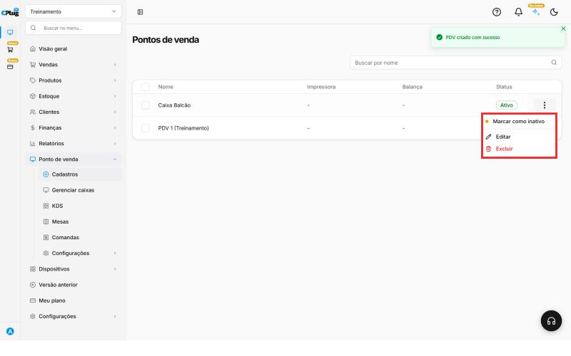

# Como cadastrar um ponto de venda

:material-clock-outline: 3 minutos · :material-format-list-numbered: 4 passos · :material-calendar-check: Atualizado em 30/10/2026

O **ponto de venda (PDV)** é cada caixa da loja, o lugar onde as vendas são registradas. Se a loja tem um caixa no balcão e outro no salão, cadastre um PDV para cada um. Exemplo: "Caixa Balcão" e "Caixa Salão".

Com um PDV para cada caixa, você sabe de onde saiu cada venda e confere o fechamento de cada um separado.

!!! info "Antes de começar"
    A loja já vem com um ponto de venda cadastrado. Confira a lista antes de criar outro: talvez você só precise trocar o nome dele.

    Se o caixa vai imprimir pedidos ou usar balança, cadastre antes esses aparelhos em **Dispositivos**. Eles aparecem como opção no cadastro do PDV.

Nos prints, o **quadrado vermelho** mostra onde você deve clicar ou digitar.

## Abra a tela de pontos de venda

No menu do lado esquerdo, clique em **Ponto de venda** e depois em **Cadastros**. A lista mostra cada PDV com a impressora, a balança e o status.

Clique em **Novo PDV**, no canto de cima, à direita.

{ loading=lazy }

## Preencha os dados do PDV

Abre a janela **Novo PDV**:

- **Nome:** um nome fácil de reconhecer no dia a dia. Exemplo: "Caixa Balcão".
- **Ponto de Impressão:** a impressora em que esse caixa imprime. Se a lista mostrar "Nenhum resultado encontrado", ainda não há impressora cadastrada. Pode deixar em branco.
- **Balança:** a balança ligada a esse caixa, se houver. Pode deixar em branco.
- **Aplicativo Offline:** a opção que aparece é **Servidor Padrão**. Na dúvida, deixe em branco e fale com o suporte.
- **Status:** deixe em **Ativo**.

{ loading=lazy }

## Salve o PDV

Clique em **Salvar**. Aparece a mensagem **PDV criado com sucesso**, e o novo caixa entra na lista com o status **Ativo**.

{ loading=lazy }

## Conheça as opções do PDV

Nos **três pontinhos** no fim da linha do PDV você tem:

- **Marcar como inativo:** muda o status do PDV para inativo, sem apagar o cadastro.
- **Editar:** muda o nome, a impressora, a balança ou o status.
- **Excluir:** apaga o PDV.

{ loading=lazy }

Pronto! O novo ponto de venda já aparece na lista de pontos de venda.

## Deu algum problema?

??? question "A lista de Ponto de Impressão está vazia"
    Nenhuma impressora foi cadastrada ainda. Salve o PDV sem impressora. Depois de cadastrar a impressora em **Dispositivos**, abra o PDV pelos três pontinhos, clique em **Editar** e escolha a impressora.

??? question "Não sei o que escolher em Aplicativo Offline"
    Deixe em branco e fale com o suporte antes de configurar.

??? question "Prefiro desativar o caixa em vez de excluir"
    Use **Marcar como inativo**. O PDV continua cadastrado na lista.

**Relacionados:** [Como escolher o tipo de nota emitida no PDV](../configuracoes/tipo-de-nota-no-pdv.md) · [Como cadastrar formas de pagamento](../financas/formas-de-pagamento.md)

ponto de venda pdv caixa novo pdv cadastrar caixa caixa balcão impressora ponto de impressão balança aplicativo offline sem internet ativo inativo editar excluir
