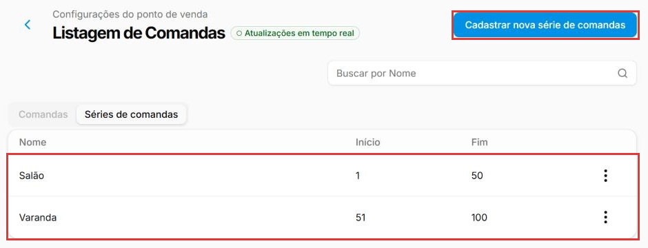
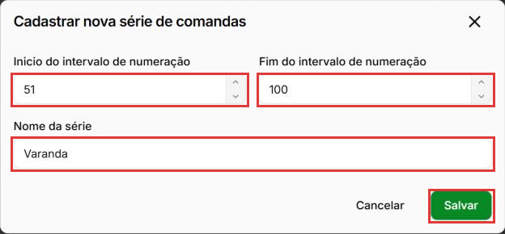

# Como usar comandas

:material-clock-outline: 5 minutos · :material-format-list-numbered: 3 passos · :material-calendar-check: Atualizado em 20/11/2026

Em bares e restaurantes, a **comanda** é o cartão numerado que acompanha o cliente enquanto ele consome: o que ele pede é anotado no número dele, e a conta é fechada no fim. Exemplo: um bar tem 100 comandas, de 1 a 100. As de 1 a 50 ficam no **Salão** e as de 51 a 100, na **Varanda**. Este manual prepara o sistema: você cadastra essas faixas de números, que o sistema chama de **séries de comandas**.

## Entenda o conceito

**Série de comandas é uma faixa de números com um nome.** Cada série diz de qual número a qual número vão as comandas daquele grupo:

| Série | Início | Fim | Para que serve |
| --- | --- | --- | --- |
| **Salão** | 1 | 50 | As comandas entregues no salão. |
| **Varanda** | 51 | 100 | As comandas entregues na varanda. |

Uma loja com um só conjunto de comandas pode ter uma série só (por exemplo, "Comandas", de 1 a 100). Dividir em séries ajuda a saber, pelo número, de qual área é a comanda.

**Cuidado com números repetidos.** O sistema aceita salvar duas séries com números que se cruzam (por exemplo, uma de 1 a 50 e outra de 40 a 60). Para evitar confusão entre as áreas, planeje as faixas antes e faça cada série começar no número seguinte ao fim da anterior (o Salão termina em 50, a Varanda começa em 51).

**Quando usar:** bares, restaurantes e lanchonetes em que o cliente consome e paga no fim. **Quando não usar:** venda só no balcão, paga na hora.

**Comandas no caixa.** Para atender com comandas no caixa, ligue a chave **Ponto de Venda oferece atendimento de mesa e comandas**, no atendimento **No estabelecimento**, em **Ponto de venda** → **Configurações** → **Modos de pedidos** (veja [Como configurar o terminal de vendas](configurar-terminal.md)).

!!! info "Antes de começar"
    Conte as comandas que a loja tem e anote a faixa de números de cada área. Para facilitar, cadastre as mesmas faixas impressas nos cartões.

Nos prints, o **quadrado vermelho** mostra onde você deve clicar ou digitar.

## Abra a tela de comandas

No menu do lado esquerdo, clique em **Ponto de venda** e depois em **Comandas**. Abre a **Listagem de Comandas**, na aba **Séries de comandas**, onde fica o cadastro, com o nome, o início e o fim de cada série. A busca **Buscar por Nome** ajuda quando há muitas séries.

Clique em **Cadastrar nova série de comandas**, no canto superior direito.

{ loading=lazy }

## Cadastre a série

Na janela **Cadastrar nova série de comandas**, os dois campos de número vêm com **0**: preencha com a faixa da sua loja (dá para usar as setas ao lado do campo).

- **Inicio do intervalo de numeração:** o primeiro número da série (no exemplo da Varanda, 51).
- **Fim do intervalo de numeração:** o último número da série (no exemplo, 100). Ele não pode ser menor que o início: com o fim menor, a janela não fecha e não aparece nenhum aviso.
- **Nome da série:** o nome que identifica o grupo (no exemplo, "Varanda"). É obrigatório: sem nome, aparece **O preenchimento é obrigatório**.

Clique em **Salvar**. Aparece **Série de comandas criada com sucesso**, e a série entra na lista.

{ loading=lazy }

## Edite ou exclua uma série

Na lista, clique nos **três pontinhos** (⋮) da série:

- **Editar:** abre a janela **Editar série de comandas**, com os números e o nome atuais. Altere e clique em **Salvar**.
- **Excluir:** pede confirmação ("Tem certeza que deseja excluir a série de comandas…?"). Clique em **Excluir** para confirmar. Aparece **Série de comandas excluída com sucesso**.

Se a série já estiver em uso no caixa, fale com o suporte antes de mudar ou excluir.

!!! tip "Boas práticas"
    - **Uma faixa por área:** separar as séries por área (salão, varanda, balcão) ajuda a equipe a saber de onde é cada comanda.
    - **Sem números repetidos:** confira as faixas antes de salvar; o sistema não avisa quando duas séries se cruzam.
    - **Cadastro igual aos cartões:** ao comprar comandas novas, cadastre também a nova faixa, para o cadastro continuar igual aos cartões.

## Deu algum problema?

??? question "Cliquei em Salvar e a janela não fechou"
    Confira o **Nome da série** (é obrigatório) e se o **Fim do intervalo de numeração** não é menor que o **Inicio**: nesse caso a janela não fecha e não aparece aviso. Corrija e clique em **Salvar** de novo.

??? question "Cadastrei duas séries com números iguais"
    O sistema aceita séries que se cruzam. Abra uma delas em **Editar** e ajuste a faixa para os números não se repetirem.

??? question "A aba Comandas está cinza"
    O cadastro é feito na aba **Séries de comandas**. Se precisar da aba **Comandas**, fale com o suporte.

??? question "Como abro e fecho uma comanda no caixa?"
    Este manual prepara o sistema. Para dúvidas sobre abrir, lançar e fechar comandas no caixa, fale com o suporte.

**Relacionados:** [Como configurar o terminal de vendas](configurar-terminal.md) · [Como cadastrar um ponto de venda](cadastrar-ponto-de-venda.md) · [Como configurar recibos e notas impressas](recibos-e-notas.md) · [Como cadastrar mesas e setores](../dispositivos/mesas.md)

comanda comandas série de comandas cadastrar nova série de comandas intervalo de numeração início fim nome da série cartão de consumo bar restaurante salão varanda mesas e comandas numeração repetida editar série excluir série
