# Como configurar o terminal de vendas

:material-clock-outline: 25 minutos · :material-format-list-numbered: 11 passos · :material-calendar-check: Atualizado em 01/11/2026

As **configurações do PDV** decidem como o caixa funciona no dia a dia. Por exemplo: se o operador pode mudar o preço do X-Burger na hora da venda, se a loja cobra 10% de taxa de serviço nas mesas, se a gaveta abre sozinha quando o cliente paga em dinheiro ou quanto custa a entrega em cada bairro.

As opções ficam em duas telas, as duas dentro de **Ponto de venda** → **Configurações**:

- **Geral**, com as abas **Geral**, **Segurança**, **Fechamento de caixa** e **Cliente**;
- **Modos de pedidos**, com o **Delivery** e o atendimento **No estabelecimento** (mesas e comandas).

Elas valem para todos os caixas da loja.

## Entenda o conceito

Estas telas são o **regulamento do caixa**. Cada opção responde a uma de quatro perguntas:

| Pergunta | Onde fica | Exemplos |
| --- | --- | --- |
| **O que o operador pode fazer sozinho?** | Geral e **Segurança** | Mudar preço, dar desconto, cancelar item. O que for sensível pede **senha de um responsável**. |
| **Como o dinheiro é conferido?** | **Fechamento de caixa** | Esconder os totais do operador, aprovação do fechamento, para onde vai o dinheiro no fim do dia. |
| **Como o cliente é tratado?** | **Cliente** | Crédito do cliente, desconto por categoria. |
| **Como o pedido chega?** | **Modos de pedidos** | Balcão, mesas e comandas, delivery com taxa de entrega. |

Uma regra prática para decidir: **quanto mais o dinheiro passa pela mão do operador, mais controle** (senha, aprovação do fechamento, alerta de sangria) a opção pede.

!!! info "Antes de começar"
    - Mude uma coisa de cada vez e confira se o caixa funciona como você espera.
    - Ao mudar qualquer opção, aparece no rodapé **Você tem alterações não salvas**, com os botões **Descartar alterações** e **Salvar**. Clique em **Salvar** antes de sair da tela. Ao salvar, aparece **Configurações do PDV atualizadas com sucesso**.
    - Os campos de **%** e de **R$** preenchem da direita para a esquerda: para 10,00, digite **1000**.

Nos prints, o **quadrado vermelho** mostra onde você deve clicar ou digitar.

## Abra as configurações e ajuste as regras de venda

No menu do lado esquerdo, clique em **Ponto de venda**, depois em **Configurações** e em **Geral**. A tela **Configurações do PDV** abre na aba **Geral**.

O bloco **Venda** reúne as regras do dia a dia:

- **Permitir edição do preço de venda dos produtos:** o operador pode mudar o preço de um item na hora da venda. Desmarcado, vale sempre o preço do cadastro.
- **Permitir edição de quantidade de produtos na venda:** o operador pode mudar a quantidade de um item já lançado. Já vem marcado.
- **Selecionar vendedor sempre que iniciar uma nova venda:** a cada venda nova, o PDV pede para escolher o vendedor. Use quando você quer saber quem fez cada venda.
- **Permitir abrir comanda ao iniciar venda balcão:** deixa o operador abrir uma comanda ao começar uma venda no balcão.
- **Exigir nome do cliente ao finalizar a venda:** a venda só fecha com o nome do cliente. Útil para chamar o pedido pelo nome.
- **Exigir número de autorização da operação com cartão nas vendas:** em pagamento com cartão, o operador digita o número de autorização que aparece no comprovante da maquininha.
- **Habilitar exibição de últimas vendas do cliente?:** mostra no PDV as compras anteriores do cliente escolhido.
- **Vincular cliente à venda atual ao adicionar o CPF na nota:** se o CPF digitado para a nota já for de um cliente cadastrado, o sistema liga a venda a esse cliente sozinho.
- **Permitir cancelamento de venda após tempo legal?:** deixa cancelar a venda no sistema mesmo depois do prazo da SEFAZ. **Atenção:** nesse caso a nota fiscal continua válida na SEFAZ. Use com cuidado. Só funciona no PDV a partir da versão 2.11.15.
- **Numeração de venda aleatória:** as vendas recebem números aleatórios em vez de 1, 2, 3...
- **Limitar exibição de vendas no histórico do PDV:** quantas vendas aparecem no histórico do caixa (até 200). Desmarcado, não há limite.

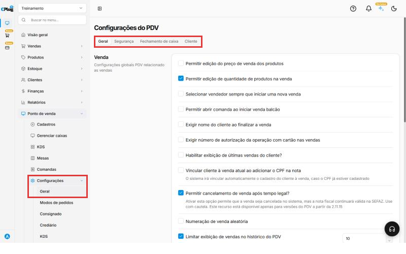{ loading=lazy }

## Configure taxa de serviço, balança, sangria e desconto

Role a aba **Geral** para baixo.

**Taxa de serviço** (os "10% do garçom"):

- Marque **Habilitar taxa de serviço** e digite o percentual. Para 10%, digite **1000**.
- **Utilizar taxa de serviço para vendas no balcão:** cobra a taxa também nas vendas de balcão, não só no atendimento de mesas e comandas.
- No botão **Produtos**, escolha quais produtos entram na taxa. A tela mostra quantos estão marcados, por exemplo "20 de 20 produtos selecionados".
- É a mesma taxa que aparece em **Modos de pedidos**: mudar em um lugar muda no outro.

**Habilitar código de barras gerado por balança:** para produtos pesados na balança que imprime etiqueta com código de barras. No botão **Produtos**, configure o código de cada produto.

**Registros de caixa** (depósitos e retiradas, também chamados de reforço e sangria):

- **Permitir depósitos e retiradas no caixa:** deixa o operador colocar ou tirar dinheiro do caixa durante o dia. Desligado, as opções abaixo somem.
- **Alertar sobre valor de retirada/sangria do caixa:** digite um valor em R$. Quando o dinheiro no caixa chegar nele, o PDV avisa que é hora da sangria.
- **Bloquear o Ponto de Venda ao alcançar o valor estipulado:** aparece quando o alerta está marcado. O PDV fica bloqueado até alguém fazer a sangria.
- **Imprimir comprovante ao realizar retiradas e depósitos no caixa.**

**Desconto:**

- **Habilitar descontos no Ponto de Venda:** liga ou desliga os descontos no caixa.
- **Desconto por categoria de cliente:** cada categoria de cliente pode ter um desconto. Escolha **Desconto aberto para alteração** (o operador pode mudar o desconto da categoria) ou **Desconto fixo** (o operador não muda).
- **Habilitar valor máximo de desconto aplicado:** aparecem os campos **Desconto máximo na venda** e **Desconto máximo no Produto**. Exemplo: até R$ 20,00 na venda e até R$ 5,00 em cada produto.
- **Tipo de desconto:** **Em %** ou **Em R$**.

Clique em **Salvar** no rodapé.

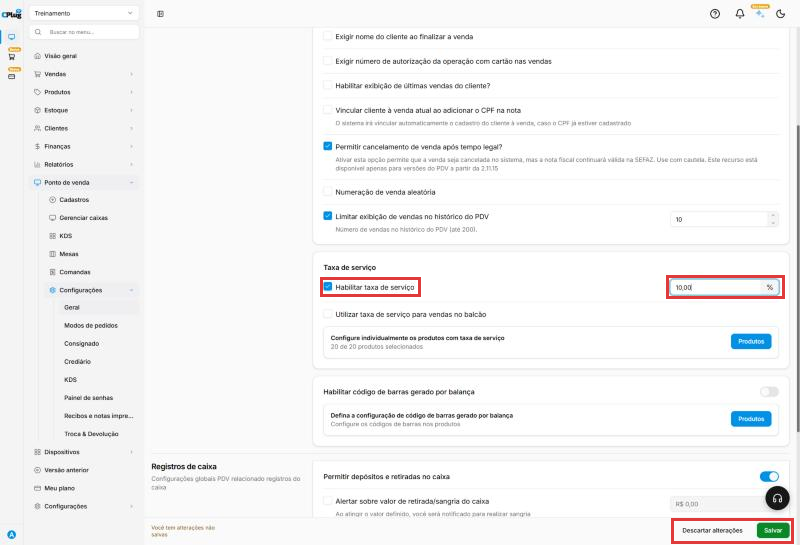{ loading=lazy }

## Proteja operações com senha (aba Segurança)

Clique na aba **Segurança**.

Ligue **Solicitar senha de segurança para determinadas operações** para pedir senha em algumas ações do caixa. Aparecem duas listas:

- **Solicitar senha de segurança para:** **Abandono de venda**, **Alterar taxa de serviço** e **Abrir gaveta**. A senha é cadastrada no campo **Senha de segurança**, em **Alterar senha**.
- **Solicitar senha de gerência para:** **Cancelamento de vendas e pedidos**, **Aplicar desconto na venda** e duas opções do crediário (venda acima do limite de crédito e venda com parcela em atraso). As opções do crediário ficam cinza enquanto o crediário não está ligado.

**Abandono de Vendas** (quando o operador desiste de uma venda já começada):

- **Gravar abandono de venda no relatório:** a venda abandonada fica registrada para consulta.
- **Exigir motivo no abandono de venda:** o operador precisa dizer por que desistiu.

**Abertura de Gaveta Automatica:** quando a gaveta do dinheiro abre sozinha.

- **Ao finalizar uma venda (qualquer método de pagamento)** ou **Ao finalizar uma venda com forma de pagamento igual a dinheiro**. Escolha uma das duas: marcar uma desmarca a outra.
- **Na Sangria/Reforço de caixa**, **Ao incluir/debitar Crédito de Clientes** e **Ao receber um faturamento de cliente** (quando o cliente paga uma conta que ficou em aberto).
- **Exibir botão para abertura manual:** mostra no PDV um botão para abrir a gaveta.

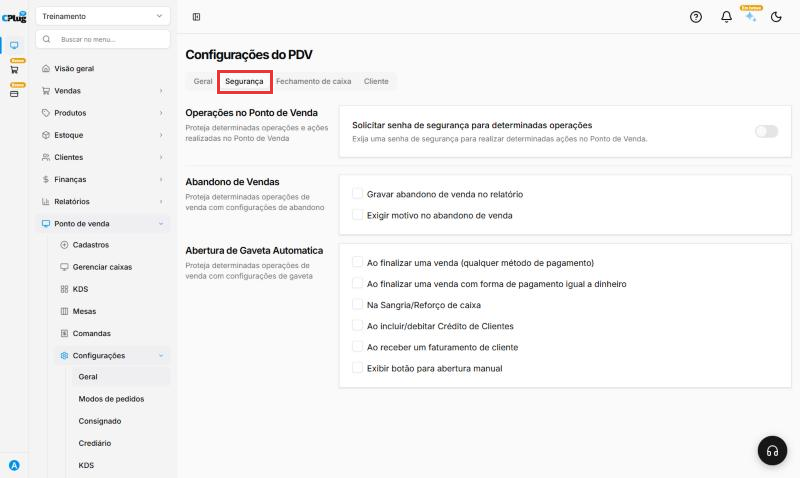{ loading=lazy }

## Defina o fechamento de caixa

Clique na aba **Fechamento de caixa**.

- **Exigir aprovação para fechar o caixa:** o fechamento só vale depois que um responsável revisa e confirma.
- **Modelo de fechamento:** como os valores aparecem na conferência.
    - **Formato Simples:** sempre Dinheiro, Cartão de crédito, Cartão de débito, Voucher e Outros.
    - **Dinâmico por método de pagamento:** só as formas de pagamento usadas naquele caixa. Já vem marcado.
    - **Dinâmico por bandeira de cartão:** como o anterior, mas separa os cartões por bandeira (Visa, Master...).
- **Transferir valores automaticamente no fechamento:** ao fechar o caixa, o dinheiro passa sozinho para outra conta. Escolha a **Conta bancária de destino** e o **Valor a permanecer no caixa**, que é o troco do dia seguinte. Exemplo: deixar R$ 100,00 e transferir o resto para "Banco do Brasil - Conta da loja".
- **Conferir os valores registrados antes de confirmar o fechamento.**
- **Informar o usuário que realizou o fechamento.**
- **Não mostrar informações de resultados operacionais:** o fechamento não mostra nem imprime o detalhamento do caixa. Use quando não quer que o operador veja os totais antes de contar o dinheiro.
- **Bloquear fechamento se houver pedidos em aberto:** escolha os tipos de pedido que impedem o fechamento: **Delivery & Retirada**, **Na mesa**, **Balcão** e **Consumo TAP**.

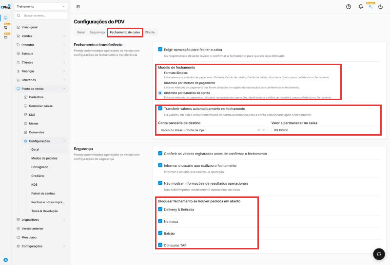{ loading=lazy }

## Libere o crédito de clientes

Clique na aba **Cliente** e ligue **Permitir Crédito de clientes no Ponto de Venda** se a loja guarda saldo para os clientes. Aparecem mais duas opções:

- **Permitir valores negativos de crédito:** o cliente pode ficar com saldo devedor, o famoso "fiado".
- **Imprimir recibo automaticamente o adicionar ou remover crédito de cliente.**

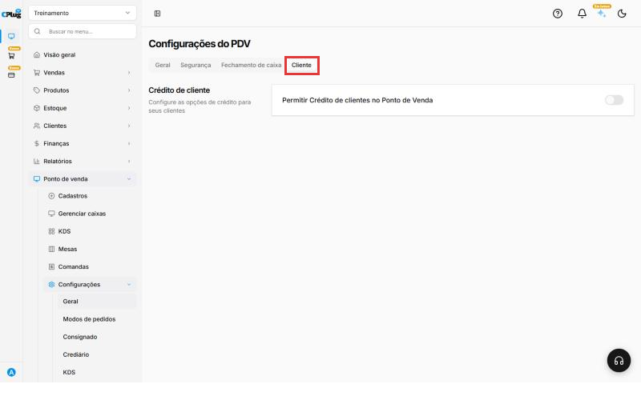{ loading=lazy }

## Ligue o delivery em Modos de pedidos

No menu, em **Ponto de venda** → **Configurações**, clique em **Modos de pedidos**. A primeira parte é o **Delivery**.

Ligue **Configurações de delivery no Ponto de Venda** se a loja faz entregas. Depois marque o que precisar:

- **Exigir seleção de entregador:** ao mudar o pedido para "Saiu para entrega", o operador precisa escolher quem vai entregar.
- **Preencher DDD automaticamente ao cadastrar cliente nos pedido delivery:** digite o DDD da sua cidade no campo ao lado (exemplo: 41), para o PDV preencher o DDD sozinho ao cadastrar um cliente no delivery. Desmarcado, o DDD fica em branco.
- **Finalizar venda após a entrega:** libera a opção de finalizar a venda só depois que o pedido foi entregue. Exemplo: o cliente paga para o entregador.
- **Habilitar observações para os clientes** e **Habilitar observações para Delivery antes de finalizar a venda:** campos para anotar detalhes, como "sem cebola" ou "portão azul".
- **Numeração de venda separada para delivery:** as vendas de delivery têm uma sequência de números própria.
- **Impressão do pedido de integração delivery:** em **Selecionar**, escolha a impressora dos pedidos que chegam por aplicativos de delivery integrados. Só funciona se a integração estiver configurada para **aceitar os pedidos automaticamente**.

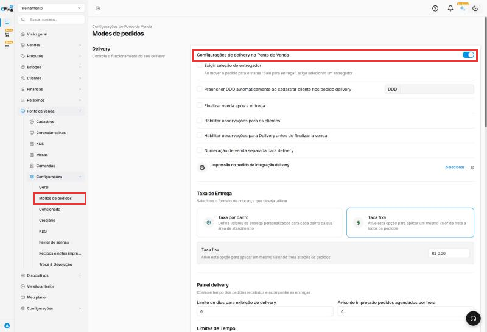{ loading=lazy }

## Escolha como cobrar a entrega

Em **Taxa de Entrega**, escolha uma das formas:

- **Taxa fixa:** o mesmo valor para todos os pedidos. Digite o valor no campo **R$**.
- **Taxa por bairro:** um valor para cada bairro. Clique em **Configurar bairros** para cadastrar os bairros e as taxas. Em **Defina uma taxa de entrega padrão**, escolha o que cobrar quando o bairro do cliente não está na lista: **Maior valor** (a maior taxa cadastrada) ou **Personalizado** (um valor que você digita, maior que zero).

!!! warning "Confira a taxa de entrega sempre que salvar esta tela"
    Nos testes, a tela **Modos de pedidos** abriu mostrando **Taxa fixa** mesmo com a taxa por bairro configurada. Ao salvar qualquer outra mudança nessa tela, a cobrança passou para **taxa fixa de R$ 0,00**. Se a sua loja usa taxa por bairro, confira essa parte antes de clicar em **Salvar**. Se ela mudar, fale com o suporte.

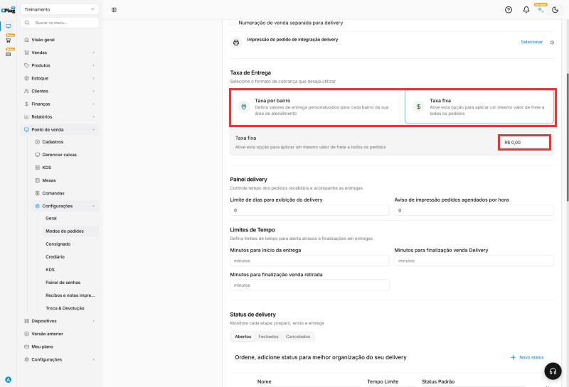{ loading=lazy }

## Ajuste o painel, os tempos e as etapas do delivery

- **Painel delivery:** **Limite de dias para exibição do delivery** (quantos dias de pedidos aparecem no painel) e **Aviso de impressão pedidos agendados por hora** (com quantas horas de antecedência o PDV avisa para imprimir um pedido agendado).
- **Limites de Tempo:** em quantos minutos a entrega deve **começar**, em quantos minutos a venda de **delivery** deve ser finalizada e em quantos minutos a venda de **retirada** deve ser finalizada. Servem para o PDV alertar os atrasos.

Em **Status de delivery** ficam as etapas do pedido, separadas em três abas:

- **Abertos:** **Novo**, **Em preparo** e **Pronto** são do sistema. Você pode mudar o nome e o tempo limite, mas não o **Status Padrão**. Também dá para criar etapas suas, como "Saiu para Entrega".
- **Fechados:** **Entregue**, que conclui o pedido.
- **Cancelados:** veja o próximo passo.

Para criar uma etapa, clique em **Novo status**. Aparece uma linha em branco para preencher **Nome**, **Tempo Limite** e **Status Padrão**. As setas do lado esquerdo mudam a ordem, e o **x** apaga a etapa (nas etapas do sistema ele fica cinza).

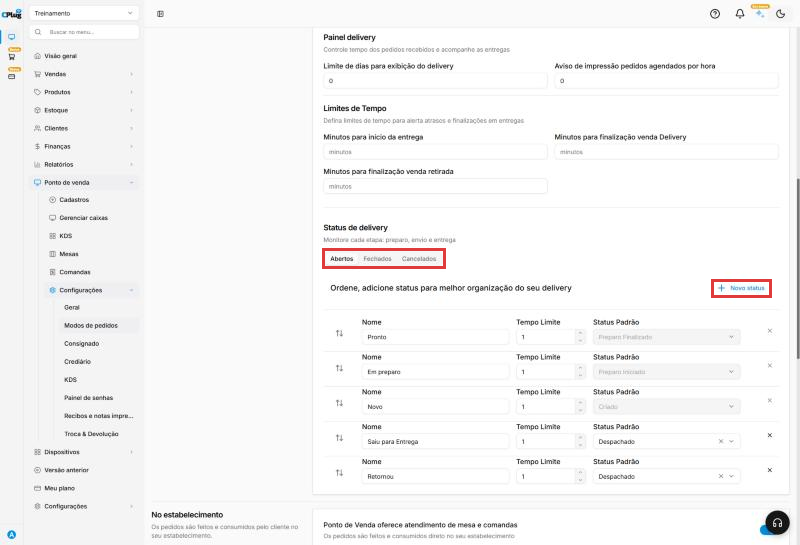{ loading=lazy }

## Cadastre os motivos de cancelamento

Na aba **Cancelados**, cada linha é um **motivo de cancelamento** do pedido. Exemplos: "Demora para Entregar", "Cancelado pelo cliente" e "Pedido Errado". Assim você sabe por que os pedidos foram cancelados.

Para criar um motivo, clique em **Novo status**, digite o nome e escolha **Cancelado** em **Status Padrão**.

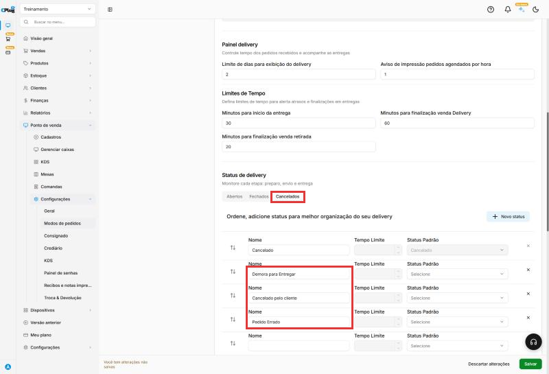{ loading=lazy }

## Configure o atendimento no estabelecimento

Mais abaixo fica **No estabelecimento**, para pedidos feitos e consumidos na loja.

Ligue **Ponto de Venda oferece atendimento de mesa e comandas** se a loja atende em mesas ou com comandas. Logo abaixo aparecem:

- **Mesas** e **Comandas:** as formas de atendimento.
- **Taxa de serviço:** mostra o percentual configurado. O link leva para a aba **Geral** (passo 2), onde a taxa é ligada e alterada.
- **Balança:** em **Selecionar**, escolha a balança usada no atendimento.

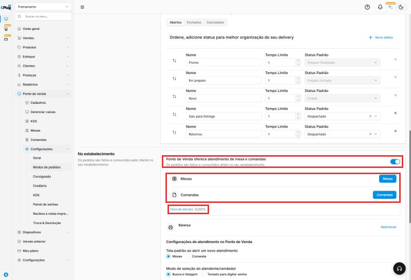{ loading=lazy }

## Ajuste as regras do atendimento

Em **Configurações de atendimento no Ponto de Venda**:

- **Tela padrão ao abrir um novo atendimento:** o PDV abre direto na tela de **Mesas** ou de **Comanda**. Escolha a que a loja mais usa.
- **Modo de seleção do atendente/vendedor:** **Busca e listagem** (o garçom é escolhido numa lista) ou **Teclado para digitar senha** (o garçom digita a senha dele).
- **Utilizar código de produto no atendimento?:** **Sim** para lançar itens digitando o código do produto.
- **Utilizar código de barras no atendimento?:** **Sim** para lançar itens pelo leitor de código de barras.
- **Pedir código ao garçom:** **Sim** para o PDV pedir o código do garçom no atendimento.
- **Obrigatório informar motivo de cancelamento de item na comanda:** **Sim** para exigir o motivo ao tirar um item.
- **Obrigatório selecionar cliente ao iniciar atendimento:** a mesa ou comanda só abre com um cliente escolhido.
- **Habilitar status de "Mesa aguardando liberação":** ativa esse status para as mesas.
- **Obrigatório informar motivo de cancelamento de comanda.**
- **Imprimir produtos com valor zerado:** itens de R$ 0,00 (como um adicional grátis) também saem na impressão. Já vem marcado.
- **Imprimir resumo ao fechar conta:** imprime o resumo da conta para o cliente conferir. Em **Ponto de impressão do resumo da conta**, clique em **Selecionar** e escolha a impressora.

Clique em **Salvar** no rodapé.

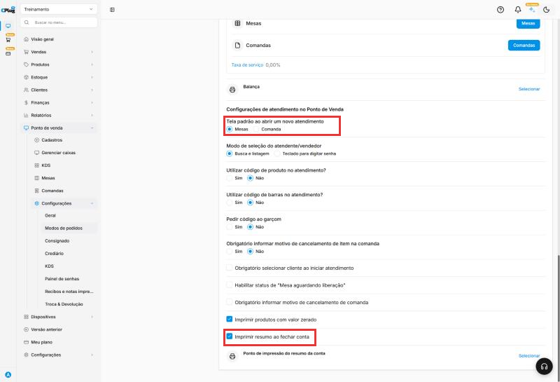{ loading=lazy }

Pronto! Antes de sair, confira o rodapé: se a mensagem **Você tem alterações não salvas** ainda estiver lá, clique em **Salvar**.

!!! tip "Boas práticas"
    - **Mude uma opção por vez** e teste no caixa antes de mudar a próxima.
    - **Proteja com senha** o que mexe em dinheiro: cancelamento, desconto, abertura de gaveta.
    - **Quando o operador não é o dono**, marque **Não mostrar informações de resultados operacionais**: ele conta o dinheiro sem ver antes o valor esperado.
    - **Confira a taxa de entrega** sempre que salvar a tela de Modos de pedidos.
    - **Anote o que foi mudado e quando**: se o caixa começar a se comportar diferente, fica fácil voltar.

## Deu algum problema?

??? question "Digitei 10 na taxa de serviço e apareceu 0,10"
    O campo preenche da direita para a esquerda. Apague e digite **1000** para ter **10,00**.

??? question "A taxa de entrega por bairro virou taxa fixa"
    Isso aconteceu nos nossos testes ao salvar outras mudanças na tela **Modos de pedidos**. Fale com o suporte para corrigir e, enquanto isso, confira a **Taxa de Entrega** antes de clicar em **Salvar**.

??? question "Apaguei um tempo limite e ele voltou"
    Nos testes, apagar o número de **Limites de Tempo** ou do **Painel delivery** não limpou o valor salvo. Se precisar tirar um limite, fale com o suporte.

??? question "As opções de crediário na aba Segurança estão cinza"
    Elas só funcionam com o crediário ligado. Primeiro ligue o crediário em **Ponto de venda** → **Configurações** → **Crediário**.

??? question "Mudei uma opção e quero voltar atrás"
    Se ainda não salvou, clique em **Descartar alterações** no rodapé. Se já salvou, mude a opção de volta e clique em **Salvar** de novo.

??? question "A lista de impressoras está vazia"
    Nenhuma impressora foi cadastrada ainda. Cadastre a impressora em **Dispositivos** e volte a esta tela.

**Relacionados:** [Como cadastrar um ponto de venda](cadastrar-ponto-de-venda.md) · [Como cadastrar uma conta bancária](../financas/conta-bancaria.md) · [Como cadastrar formas de pagamento](../financas/formas-de-pagamento.md) · [Como definir o tipo de nota emitida no PDV](../configuracoes/tipo-de-nota-no-pdv.md)

configurações do pdv terminal de vendas caixa editar preço quantidade vendedor nome do cliente autorização cartão cpf na nota cancelamento tempo legal numeração aleatória histórico taxa de serviço 10% garçom balança código de barras etiqueta sangria reforço retirada depósito alerta bloquear pdv desconto máximo categoria de cliente senha de segurança senha de gerência abandono de venda gaveta automática fechamento de caixa aprovação modelo de fechamento bandeira transferência automática troco fechamento às cegas crédito de cliente fiado saldo negativo delivery entregador ddd observações numeração separada integração ifood taxa de entrega taxa por bairro taxa fixa configurar bairros painel delivery agendado tempo limite status do pedido motivo de cancelamento mesas comandas atendimento tela padrão senha do garçom resumo da conta
