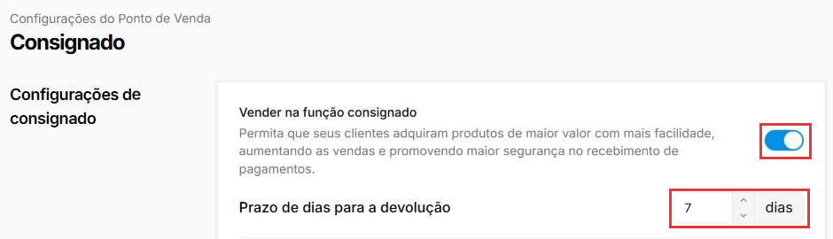
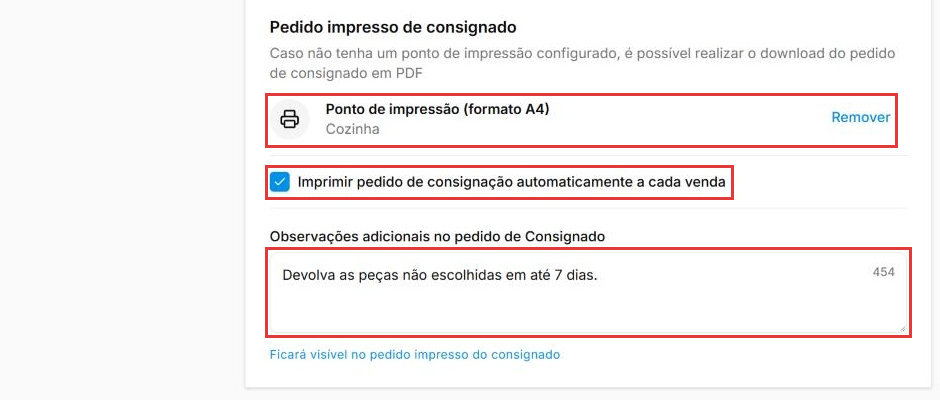

# Como vender em consignado

:material-clock-outline: 5 minutos · :material-format-list-numbered: 3 passos · :material-calendar-check: Atualizado em 20/11/2026

Na venda em **consignado**, o cliente leva os produtos antes de decidir: fica com o que quiser e devolve o resto dentro de um prazo combinado. Exemplo: uma cliente leva três vestidos para experimentar em casa, fica com um e devolve dois em até 7 dias. Este manual prepara o sistema: você liga o consignado no PDV, define esse prazo e como o pedido de consignado é impresso.

## Entenda o conceito

**Consignado não é venda fechada.** Na venda comum, o cliente paga e leva. No consignado, os produtos saem da loja **antes** da decisão final, e a loja confia que o cliente vai devolver o que não quiser. Por isso vale combinar o prazo na hora e deixar o combinado por escrito.

**Não confunda com o [crediário](crediario.md).** No crediário, o cliente fica com o produto e paga depois, em parcelas. No consignado, ele leva para decidir e devolve o que não ficar.

**Quando usar:** a própria tela descreve o consignado como uma forma de os clientes adquirirem "produtos de maior valor com mais facilidade". Por exemplo, roupas, joias e calçados que o cliente quer experimentar com calma. **Quando não usar:** venda do dia a dia, em que o cliente decide no balcão.

**As mudanças valem no caixa.** Esta tela só guarda a configuração. Se o caixa estiver aberto, faça a **sincronização** no PDV para aplicar as mudanças na hora.

!!! info "Antes de começar"
    - Para imprimir o pedido de consignado, cadastre antes a impressora em **Dispositivos** (veja os [manuais de periféricos](../suporte/perifericos/index.md)).
    - Ao mudar qualquer opção, aparece no rodapé **Você tem alterações não salvas**, com **Descartar alterações** e **Salvar**. Ao salvar, aparece **Configurações do PDV atualizadas com sucesso**.

Nos prints, o **quadrado vermelho** mostra onde você deve clicar ou digitar.

## Ligue o consignado e defina o prazo

No menu do lado esquerdo, clique em **Ponto de venda**, depois em **Configurações** e em **Consignado**.

Ligue a chave **Vender na função consignado**. As demais opções só aparecem com essa chave ligada.

Em **Prazo de dias para a devolução**, digite em quantos dias o cliente precisa devolver o que não ficar (no exemplo, **7** dias). O campo vem com **0**: preencha com o prazo da sua loja. Use as setas ao lado do campo para aumentar ou diminuir.

{ loading=lazy }

## Escolha como o pedido de consignado é impresso

Em **Pedido impresso de consignado**:

- **Ponto de impressão (formato A4):** clique em **Selecionar**. Abre a janela **Selecionar Periférico**: marque a impressora e clique em **Salvar**, na janela. O nome da impressora aparece no lugar, com o link **Remover** para tirá-la. No exemplo, a impressora cadastrada se chama **Cozinha**; na sua loja, aparece o nome que você deu ao periférico. Como avisa a tela, sem ponto de impressão é possível baixar o pedido de consignado em PDF.
- **Imprimir pedido de consignação automaticamente a cada venda:** marque para o pedido de consignação ser impresso automaticamente a cada venda, como diz o nome da opção.
- **Observações adicionais no pedido de Consignado:** o texto que fica visível no pedido impresso do consignado, como indica a tela (até 500 caracteres; o número no canto mostra quantos ainda cabem). Bom lugar para escrever o prazo. No exemplo: "Devolva as peças não escolhidas em até 7 dias."

{ loading=lazy }

## Salve

Clique em **Salvar**, no rodapé. Aparece **Configurações do PDV atualizadas com sucesso**. Se a mensagem **Você tem alterações não salvas** ainda estiver lá, as mudanças não foram gravadas.

!!! tip "Boas práticas"
    - **Prazo curto e claro:** um prazo de poucos dias, escrito nas **Observações adicionais**, evita que os produtos fiquem fora da loja por muito tempo.
    - **Entregue o pedido ao cliente:** entregue o pedido de consignado e combine o prazo na hora.
    - **Use uma impressora de papel A4:** o ponto de impressão do consignado é para o formato A4.

## Deu algum problema?

??? question "Não aparecem o prazo nem as opções de impressão"
    A chave **Vender na função consignado** está desligada. Ligue a chave e as opções aparecem logo abaixo.

??? question "Cliquei em Selecionar e a janela não abriu"
    Clique de novo em **Selecionar**.

??? question "A impressora não aparece na janela Selecionar Periférico"
    Confira se ela está cadastrada em **Dispositivos**. Se estiver e continuar sem aparecer, fale com o suporte.

??? question "Escolhi a impressora, mas ela não aparece na tela"
    Na janela **Selecionar Periférico**, marque a impressora e clique em **Salvar**, na janela. Depois clique em **Salvar** também no rodapé da tela.

??? question "Como faço a venda em consignado no caixa e registro a devolução?"
    Este manual prepara o sistema. Para dúvidas sobre a venda no caixa, a devolução e o efeito no estoque e no financeiro, fale com o suporte.

**Relacionados:** [Como vender no crediário](crediario.md) · [Como configurar o terminal de vendas](configurar-terminal.md) · [Como configurar recibos e notas impressas](recibos-e-notas.md) · [Como configurar troca e devolução](troca-e-devolucao.md)

consignado consignação venda em consignado venda condicional condicional malinha mala consignada levar para provar levar para experimentar prazo de devolução prazo de dias para a devolução pedido de consignado pedido impresso ponto de impressão a4 selecionar periférico imprimir pedido de consignação automaticamente observações do consignado pdf do consignado
