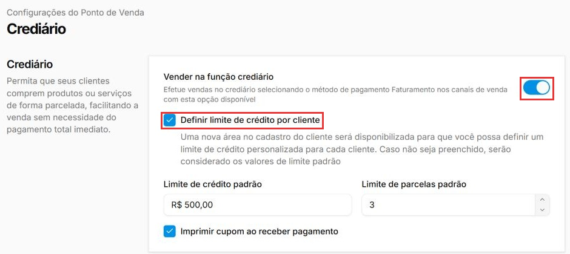
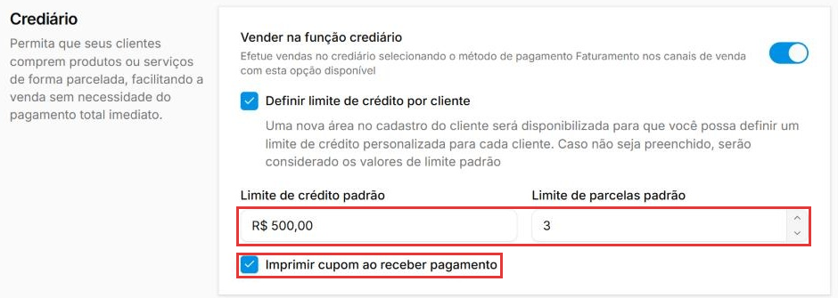
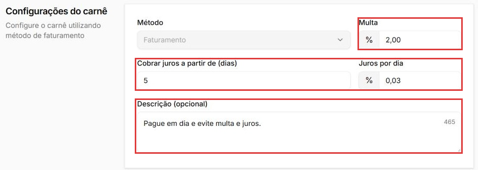
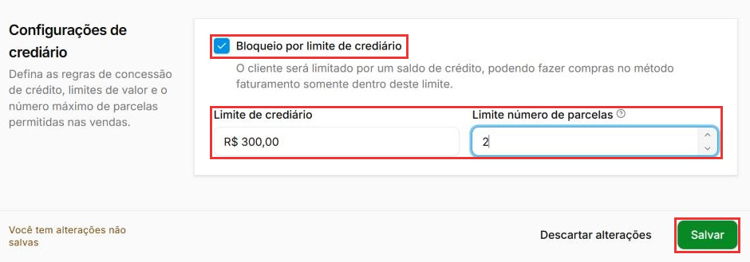

# Como vender no crediário

:material-clock-outline: 8 minutos · :material-format-list-numbered: 5 passos · :material-calendar-check: Atualizado em 19/11/2026

O **crediário** permite que o cliente compre agora e pague depois, em parcelas, sem cartão de crédito: a própria loja dá o crédito. Este manual prepara o sistema: você liga o crediário, define os limites de crédito e de parcelas e as regras do carnê, como a multa e os juros por atraso. No caixa, a venda no crediário é feita escolhendo o método de pagamento **Faturamento**, como indica a tela.

## Entenda o conceito

**No crediário, quem empresta é a loja.** No cartão de crédito, o banco paga a loja e cobra o cliente. No crediário, o dinheiro só entra quando o cliente paga cada parcela. Por isso o limite de crédito é tão importante: ele é o tamanho do risco que você aceita correr com cada cliente.

**No PDV, o crediário é a forma de pagamento Faturamento.** **Faturamento** é uma das formas de pagamento padrão do sistema e já permite parcelamento (veja [Como cadastrar formas de pagamento](../financas/formas-de-pagamento.md)).

**Não confunda com o Crédito de clientes.** O **Crédito de clientes** (aba **Cliente** das [configurações do terminal](configurar-terminal.md)) é um saldo guardado na conta do cliente. O crediário é a venda parcelada no **Faturamento**, com carnê.

**Limite padrão e limite por cliente.** A tela tem dois níveis:

| Nível | Onde fica | Para que serve |
| --- | --- | --- |
| **Padrão** | Nesta tela: **Limite de crédito padrão** e **Limite de parcelas padrão** | Vale para quem não tem um limite próprio no cadastro. No exemplo, R$ 500,00 em até 3 parcelas. |
| **Por cliente** | No cadastro do cliente, em **Configurações de crediário** | Um limite só daquele cliente. Com **Bloqueio por limite de crediário** marcado, o cliente compra no **Faturamento** somente dentro desse limite, como indica a tela. |

Como a tela explica, se o limite do cliente não for preenchido, valem os limites padrão. No exemplo, Bruno Lima é um cliente novo, ainda sem histórico, e a loja preferiu dar a ele um limite menor que o padrão: R$ 300,00 em até 2 parcelas.

**O carnê** é o conjunto de parcelas que o cliente leva para pagar. Nesta tela você define a multa e os juros por atraso que o carnê vai usar e uma mensagem para o carnê impresso.

**As mudanças valem no caixa.** Esta tela só guarda a configuração. Se o caixa estiver aberto, faça a **sincronização** no PDV para aplicar as mudanças na hora.

!!! info "Antes de começar"
    - Defina com a gerência o limite padrão e o máximo de parcelas, e confirme com o contador a multa e os juros por atraso.
    - Para imprimir cupons e carnês, o caixa precisa de uma impressora cadastrada em **Dispositivos** (veja os [manuais de periféricos](../suporte/perifericos/index.md)).
    - Ao mudar qualquer opção, aparece no rodapé **Você tem alterações não salvas**, com **Descartar alterações** e **Salvar**. Ao salvar, aparece **Configurações do PDV atualizadas com sucesso**.

Nos prints, o **quadrado vermelho** mostra onde você deve clicar ou digitar.

## Ligue o crediário

No menu do lado esquerdo, clique em **Ponto de venda**, depois em **Configurações** e em **Crediário**.

Ligue a chave **Vender na função crediário**. As demais opções desta tela só aparecem com essa chave ligada.

Marque **Definir limite de crédito por cliente**. Só com ela marcada você consegue preencher os limites padrão (passo 2), e só com ela o cadastro do cliente ganha a área para o limite próprio (passo 5).

!!! warning "Desmarcar apaga os limites padrão"
    Se você desmarcar **Definir limite de crédito por cliente** e salvar, os limites padrão são apagados e os campos ficam bloqueados. Ao marcar de novo, digite os valores outra vez.

{ loading=lazy }

## Defina os limites padrão

Com **Definir limite de crédito por cliente** marcada:

- **Limite de crédito padrão:** o limite de crédito de quem não tem um limite próprio no cadastro. O campo preenche da direita para a esquerda: para R$ 500,00, digite **50000**.
- **Limite de parcelas padrão:** o número máximo de parcelas (no exemplo, 3).

Logo abaixo, **Imprimir cupom ao receber pagamento**: marque para imprimir um cupom quando a loja receber um pagamento do crediário, como diz o nome da opção.

{ loading=lazy }

## Configure o carnê

No bloco **Configurações do carnê**, o **Método** já vem como **Faturamento** e não muda. Preencha:

- **Multa:** a porcentagem de multa por atraso (no exemplo, 2%). Para 2,00, digite **200**.
- **Cobrar juros a partir de (dias):** a partir de quantos dias de atraso os juros passam a ser cobrados, como diz o nome do campo (no exemplo, 5).
- **Juros por dia:** a porcentagem de juros **por dia** de atraso, não por mês (no exemplo, 0,03%). Para 0,03, digite **3**. Atenção: quem digita 1,00 aqui está cobrando 1% a cada dia de atraso.
- **Descrição (opcional):** o texto que vai aparecer no carnê impresso, como indica a tela (até 500 caracteres; o número no canto mostra quantos ainda cabem). No exemplo: "Pague em dia e evite multa e juros."

{ loading=lazy }

## Salve

Clique em **Salvar**, no rodapé. Aparece **Configurações do PDV atualizadas com sucesso**. Se a mensagem **Você tem alterações não salvas** ainda estiver lá, as mudanças não foram gravadas.

## Dê um limite próprio a um cliente

Abra o cliente em **Clientes** → **Todos os clientes**: clique nos **três pontinhos** (⋮) da linha dele e em **Editar**. A mesma área também aparece em **Novo cliente**, ao cadastrar. Desça até **Configurações de crediário**:

- **Bloqueio por limite de crediário:** marque para o cliente ser limitado por um saldo de crédito, podendo comprar no método **Faturamento** somente dentro deste limite, como explica a tela.
- **Limite de crediário:** o limite deste cliente (no exemplo, R$ 300,00).
- **Limite número de parcelas:** o máximo de parcelas para este cliente. O ícone ⓘ ao lado do nome lembra: de 1 a 62 parcelas (no exemplo, 2).

Clique em **Salvar**. O sistema volta para a lista de clientes.

{ loading=lazy }

!!! tip "Boas práticas"
    - **Ajuste o limite de cada cliente:** menor para quem está começando, maior para quem paga em dia.
    - **Comece com o padrão baixo:** é mais fácil aumentar o limite depois do que cobrar uma dívida grande.
    - **Multa e juros com o contador:** a lei pode limitar a multa e os juros cobrados do consumidor. Confirme os valores com o contador (ou com um advogado) antes de imprimir os carnês.
    - **Senha para vender acima do limite:** em **Ponto de venda** → **Configurações** → **Geral**, aba **Segurança**, é possível pedir senha de gerência para venda acima do limite de crédito e para venda com parcela em atraso (veja [Como configurar o terminal de vendas](configurar-terminal.md)).

## Deu algum problema?

??? question "Os campos de limite padrão estão cinza e zerados"
    A opção **Definir limite de crédito por cliente** está desmarcada. Marque a opção, digite de novo os valores e clique em **Salvar**.

??? question "O cadastro do cliente não tem a área Configurações de crediário"
    A área só aparece com **Vender na função crediário** ligada e **Definir limite de crédito por cliente** marcada, nesta tela. Confira as duas e clique em **Salvar**.

??? question "O Faturamento não aparece no caixa"
    Confira se **Vender na função crediário** está ligada e salva e se o caixa foi sincronizado. Se continuar sem aparecer, fale com o suporte.

??? question "Cliquei em Descartar alterações e a tela voltou para valores antigos"
    O **Descartar alterações** volta a tela para como ela estava quando foi aberta, mesmo que você tenha salvo depois. Para ver o que está gravado, atualize a página (tecla **F5**).

??? question "As opções de crediário da aba Segurança estão cinza"
    Elas ficam cinza enquanto o crediário está desligado. Ligue **Vender na função crediário** nesta tela, salve e volte à aba **Segurança**.

**Relacionados:** [Como configurar o terminal de vendas](configurar-terminal.md) · [Como cadastrar um cliente](../clientes/cadastrar-cliente.md) · [Como cadastrar formas de pagamento](../financas/formas-de-pagamento.md)

crediário vender parcelado sem cartão venda a prazo faturamento limite de crédito limite de crédito padrão limite de parcelas limite por cliente bloqueio por limite de crediário carnê multa juros por dia juros por atraso cobrar juros a partir de imprimir cupom ao receber pagamento conta do cliente
